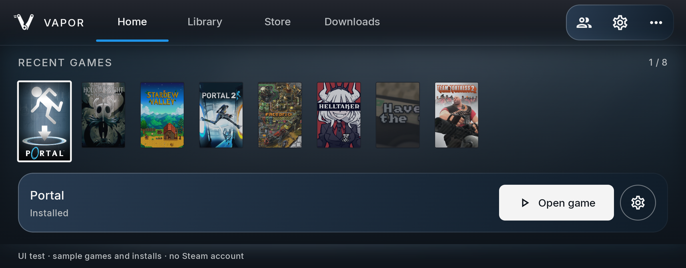
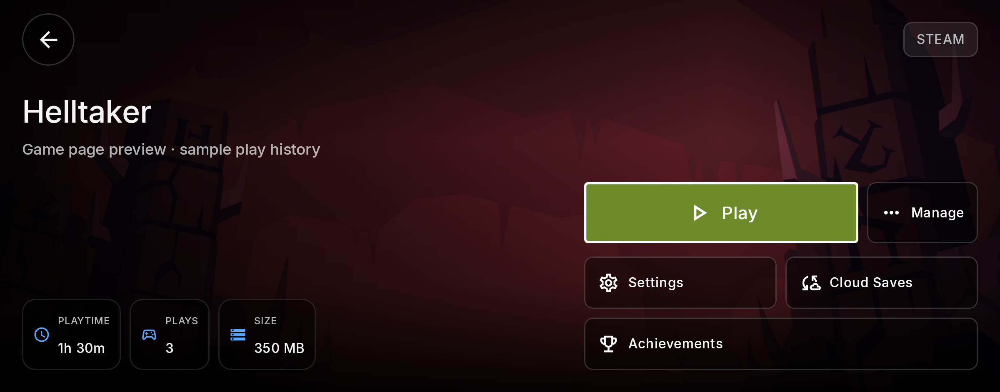
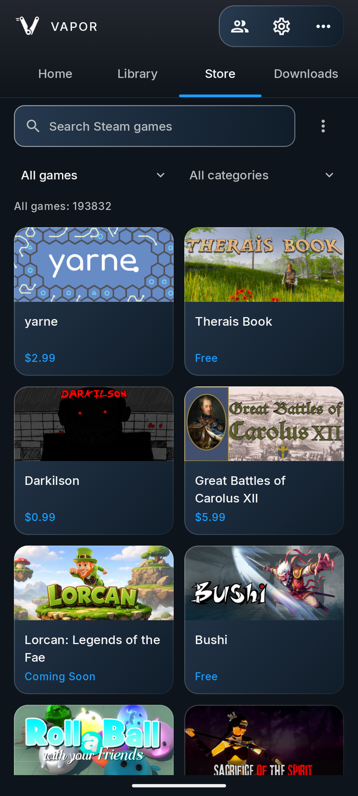
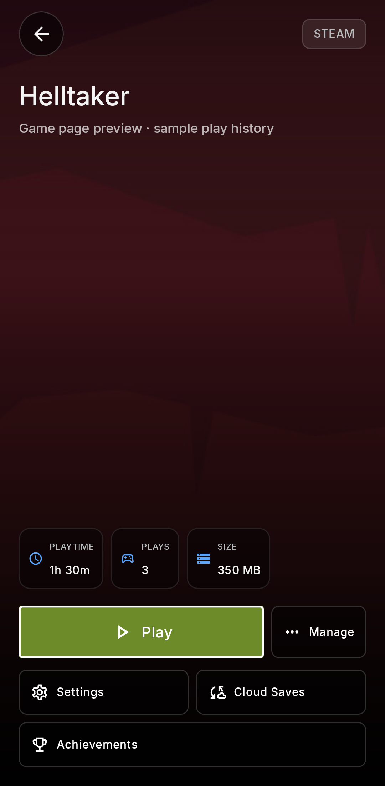
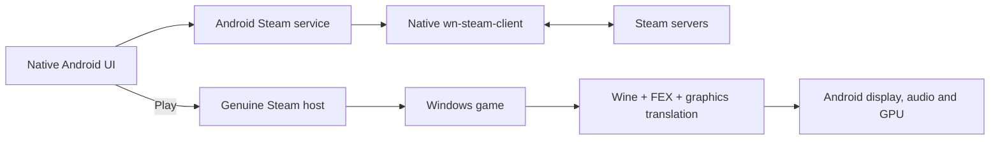

<div align="center">
  
  <h1>Vapor</h1>
  <p><strong>Your PC games. In your hands.</strong></p>
  <p>A native Android launcher for downloading and running compatible PC games locally.</p>
  <p>
    <a href="LICENSE"></a>
    
    
  </p>
  <p>
    <a href="#the-experience">The experience</a> &nbsp;·&nbsp;
    <a href="#compatibility-and-status">Compatibility</a> &nbsp;·&nbsp;
    <a href="docs/BUILDING.md">Build</a> &nbsp;·&nbsp;
    <a href="docs/ROADMAP.md">Roadmap</a>
  </p>
</div>



<p align="center"><sub>Native Android interface · Home preview with labeled sample games and installs</sub></p>

Connect Steam, choose a game, and play what your device can handle. Vapor pairs a Steam / Big Picture-inspired interface with local Windows-game execution through Wine, CPU translation, and graphics drivers. Snapdragon devices are the first qualification target.

> **In active development.** Local phone gameplay is demonstrated; compatibility and Steam feature qualification continue. No public alpha or official release APK is designated yet. See [current evidence](docs/QUALIFICATION.md) before treating a game or device as supported.

## The experience

- **Steam at the centre.** Home, Library, Store, and Downloads form the main navigation. Search the Steam catalog, browse categories, and manage owned games. Additional stores remain in **Settings → More stores**.
- **A native game library.** Cover shelves, controller focus, portrait and landscape layouts, and a game page that keeps Play, Settings, Cloud Saves, and supported Achievements close at hand. Maintenance tools live in Manage.
- **Community compatibility reports.** Steam game pages can read EmuReady reports in a native modal, with device, emulator and reported settings. Console ports are filtered out, title-only matches are labeled, known non-Windows entries hide the action, and external responses are never treated as compatibility verdicts. Reports are informational; applying settings automatically is not implemented. [Integration and evidence](docs/QUALIFICATION.md#emuready-community-reports--21-october-2026).
- **Direct downloads.** The connected Steam account supplies licenses, manifests, and game depots. Owned paid games, free/demo acquisition, and checkout are separate actions; public catalog information never grants ownership.
- **Your controls.** Touch gamepad, RTS and FPS layouts, keyboard/mouse bindings, and an in-game Vapor menu. New supported-store shortcuts start with a **60 FPS limit**; existing choices are preserved.
- **Official Steam pages when needed.** Checkout, Wishlist, Community, guides, and Workshop browsing open in a dedicated modal web panel. Web install links return to the native game page. Shared web sign-in is implemented; live authentication and payment flows still need qualification.



<p align="center"><sub>Native game-page preview · Sample Helltaker play history, not a live account result</sub></p>

<details>
<summary><strong>Portrait layouts and phone gameplay</strong></summary>

<br>

<table>
  <tr>
    <td align="center" width="50%"></td>
    <td align="center" width="50%"></td>
  </tr>
  <tr>
    <td align="center"><sub>Public Steam catalog in the signed-out app</sub></td>
    <td align="center"><sub>Portrait game page with sample data</sub></td>
  </tr>
</table>


*User-supplied Xiaomi 17 Pro gameplay, 15 October 2026. Sound was separately confirmed. HUD values are a screenshot observation, not a controlled performance comparison. [Phone evidence](docs/QUALIFICATION.md#helltaker-and-audio-follow-up--15-october-2026).*

</details>

## Latest development work

The latest UI pass makes Friends, Chat and per-game settings more consistent with
Vapor’s handheld interface: shared branding, reachable close actions, larger touch
targets, scrollable chat settings, and layouts that adapt to narrow screens and
larger text. Compact game settings use a horizontal section rail with controller
navigation; wide layouts retain their sidebar.

<table>
  <tr>
    <td align="center" width="33%"></td>
    <td align="center" width="33%"></td>
    <td align="center" width="33%"></td>
  </tr>
  <tr>
    <td align="center"><sub>Friends drawer</sub></td>
    <td align="center"><sub>Chat settings</sub></td>
    <td align="center"><sub>Steam catalog search</sub></td>
  </tr>
</table>

*Actual signed-out Android emulator captures, 20 October 2026. The UI build passes
8 selected Android instrumentation tests and 40 selected JVM/Compose tests.
[Layouts, controller-focus previews and screenshot gallery](docs/UI-UX.md#actual-emulator-review--20-october-2026). Physical-controller and live-account checks remain pending.*

Native Steam social diagnostics now also have controlled Windows DLL and process
execution checks inside Android Wine/FEX, in both 32-bit and 64-bit guests. These
exercise callback handling, cancellation, cleanup and timeouts without sending
messages or loading Valve libraries. **They are groundwork for genuine-host
social integration, not proof of live in-game chat.** The diagnostic source has
not replaced the runtime bundled in the tested UI APK.
[Native execution evidence and limits](docs/QUALIFICATION.md#production-parent-runner-execution--20-october-2026).

## Games running on the Xiaomi


<p align="center"><sub>Ghostrunner Demo · Still from the supplied Xiaomi gameplay video, 15 October 2026 · Not an FPS benchmark</sub></p>

Physical-phone results on the **Xiaomi 17 Pro / Snapdragon 8 Elite Gen 5** include:

| Game | Observed result |
| --- | --- |
| Europa Universalis III | Smooth gameplay and working sound reported. |
| Team Fortress 2 | Training runs with the Steam account connected and sound working. Online matches are not yet qualified. |
| You Have to Win the Game | Gameplay, CRT effects, touch controls and sound work. |
| Helltaker | Gameplay and sound work; the game recognizes controller input and shows controller prompts. |
| **Ghostrunner Demo** | **The demanding UE4 demo reaches controllable gameplay, wallrunning and checkpoint respawn, with sound working. Some hitching remains.** |

The latest Ghostrunner report confirms that the game runs well enough to play,
with some lag. Lower settings and resolution are the next tuning steps; sustained
**30–60 FPS is a test target, not a measured result**. These observations do not
establish full-campaign completion or the same performance on other chipsets.
[Gameplay and Cloud evidence](docs/QUALIFICATION.md#ghostrunner-demo-loading-and-gameplay-observation--15-october-2026).

DirectX 12 has a separate compatibility gate: the required Vulkan features and a
working VKD3D/driver combination must be present. An older chipset may lack those
features or usable performance; its age alone is not a universal DX12 cutoff.
Onimusha: Way of the Sword Demo's reported GPU-support error remains unresolved
on the phone. [Investigation](docs/QUALIFICATION.md#onimusha-way-of-the-sword-demo--18-october-2026).

## Compatibility and status

**The app running, a game launching, and a game playing well are different results.** Vapor does not promise the entire Steam catalog. GPU features, drivers, the runtime, game dependencies, available memory, and anti-cheat can all affect compatibility.

| Area | Current evidence | Still to qualify |
| --- | --- | --- |
| **Local gameplay** | Xiaomi 17 Pro / Snapdragon 8 Elite Gen 5 reports cover Europa Universalis III, Team Fortress 2 training, You Have to Win the Game, Helltaker, and Ghostrunner Demo. Sound is reported; Ghostrunner Demo has visible hitching. | Repeatable game/device settings, longer sessions, measured comparisons, and the full reference-device matrix. |
| **Steam session** | Account-connected TF2 training works through the genuine-client launch path. Original game Steam API libraries are retained. | Inventory / Game Coordinator traces, counted playtime, and online multiplayer. |
| **Steam Cloud** | One confirmed Ghostrunner Demo upload contains two files. Exit-sync guards and recovery have local regression coverage. | Remote restore/reopen and reliable repeated uploads; intermittent phone exit timeouts remain open. |
| **Friends, Chat, Achievements** | Native screens, request states, refresh, message acknowledgements, and session-ownership handling have local coverage; the latest UI has emulator checks. Controlled native receiver diagnostics run under Wine/FEX. | Live message delivery, in-game Android chat integration, and newly earned achievements reaching Steam. |
| **Store and controls** | Public Store recovery, native UI layouts, and injected controller navigation pass local checks. | Authenticated free/demo and paid flows, live web sign-in, physical controllers, and phone UX acceptance. |
| **Android platform** | ARM64 development APK; minimum Android 10. **39/39** APK native libraries and ZIP packaging pass 16 KB alignment. Native TLS/probe checks and startup pass on 4 KB / 16 KB emulators. | Modern target SDK 36 and complete Wine/FEX gameplay on 16 KB kernels. The current build targets SDK **28** and compiles against **35**. |

<details>
<summary><strong>Engineering checks and current development builds</strong></summary>

<br>

The 20 October UI pass passes **8 selected Android instrumentation tests** and
**40 selected JVM/Compose tests**. These cover Friends/Chat states, responsive
settings and injected controller navigation. Native contract suites pass **61
cases** (15 capability, 33 receiver and 13 mode-parser cases). Under emulator
Wine/FEX, each Windows architecture passes the 33 receiver scenarios, 9
controlled-DLL scenarios and 7 production parent-runner scenarios. The first
32-bit parent-fixture startup timed out before producing a result; an unchanged
retry passed. These are bounded fixture checks, not real Steam delivery or a
whole-project test total. [Latest qualification](docs/QUALIFICATION.md#production-parent-runner-execution--20-october-2026).

The earlier automatic-graphics development build passes **79 selected JVM tests**
and **39 emulator checks** (34 Compose and 5 native GPU-probe cases). Guided Steam
launches can try eligible installed graphics combinations after specific Vulkan
startup failures, with clean Steam/Cloud teardown, visible cancellation and at most
four attempts. Explicit game settings remain authoritative. Onimusha phone recovery,
real retry/Cloud handoffs and performance comparisons remain pending.
[Automatic graphics and component-review record](docs/evidence/2026-10-18-automatic-graphics.json).

The preceding Downloads/D3D12 build passes **27 selected Android UI tests** and
**48 JVM tests**, plus two landscape repetitions. Downloads show recovery and
completion actions; guided setup prepares the matched DirectX 12 component pair
used by the subsequent routing work.
[Downloads and preparation record](docs/evidence/2026-10-18-downloads-d3d12.json).

The preceding onboarding build passes **31 selected Android UI tests** and **25 JVM tests**, with three additional portrait rerenders of the same preview cases. Preparation, Steam sign-in and Steam Guard now share Vapor's native branding and layout. Live account completion and phone acceptance remain pending. [Onboarding record](docs/evidence/2026-10-18-onboarding.json).

The preceding game-page build records **26 selected Android UI tests**; the earlier Store/Home pass records **46 UI tests and 14 catalog JVM tests**. These are distinct scopes, not a whole-project total. Full Android lint remains unqualified. [Game-page record](docs/evidence/2026-10-17-ui.json) · [Full qualification history](docs/QUALIFICATION.md).

The separate 19 October component work rebuilt both FEX Windows DLLs and the Wine
X11 module. **15/15 FEX cache phases** pass. External-pointer tests reproduce lost
clipped clicks with the original Wine module and pass with the rebuilt module in
both guest architectures. These experiments leave the guided runtime defaults
unchanged; no new APK or phone performance result is claimed.
[Component record](docs/QUALIFICATION.md#runtime-components--19-october-2026).

</details>

## What makes Vapor different

Vapor focuses on a **Steam-first handheld experience in a native Android app**,
with source-visible Steam session handling and automatic selection among eligible
installed graphics components. It builds on WinNative and shared Wine, FEX and
Mesa work; it does not claim a new emulation engine or a proven speed lead.

| Project | Main approach | Vapor's distinction |
| --- | --- | --- |
| [GameNative](https://github.com/utkarshdalal/GameNative) | Native Android launcher with several stores, Cloud saves and automatically applied known game configurations. | Vapor emphasizes Steam / Big Picture-style navigation, its open inherited Steam host, bounded graphics startup retries and published test evidence. Native launching and automatic configs are shared ideas. |
| [DroidDeck](https://github.com/Droid-Deck/DroidDeck) | Valve's actual Steam Big Picture client in a Linux environment, using ARM64 Proton. | Vapor browses and downloads through Android services, then starts the game runtime and genuine Steam host on demand. DroidDeck provides the actual Valve frontend and more client behavior directly. |

The current work reaches below the interface: reproducible input fixes, translator
cache correctness, graphics capability checks and safer game/Cloud teardown.
Upstream fixes are credited, experimental builds stay separate, and live Steam
feature checks remain explicit. **There is no measured Vapor-versus-competitor
FPS, RAM or compatibility ranking yet.** [Detailed comparison](docs/COMPETITOR-COMPARISON.md).

## How Steam runs

Vapor uses a **native Android launcher with an on-demand headless Steam host**. Browsing does not require starting a Windows or Linux Steam desktop.



1. **Browse and download.** Compose talks to the Android Steam service and native `wn-steam-client` through JNI. Authentication, library metadata, manifests, and depot downloads work without a Wine/FEX game session.
2. **Play.** The service hands account ownership to the genuine host derived from WinNative’s `steamlite-handoff`. Valve client libraries provide the game’s Steam session and Steamworks IPC alongside Bionic Wine/FEX, without starting the desktop Steam browser UI in this path.
3. **Exit.** The host attempts Cloud synchronization, logs off, and returns ownership to the Android service. Reserved close-time work blocks removal. A timeout or offline exit is never reported as a successful upload.

During genuine-host gameplay, the Android Steam connection is intentionally
suspended. Friends status can be cached and the native chat interface does not
yet provide a qualified live in-game connection. Native receive diagnostics are
being tested separately before integration into that session lifecycle.

Depot chunk decoding is native Rust; the Android UI/service and JNI bridges also use managed memory. Comparative speed, RAM, and garbage-collection gains have **not** been benchmarked. FEX translates PC instructions, including applicable host code; the whole runtime is not native ARM code.

Returning to Library does not automatically stop a running game. Inherited manual/background pause controls are not yet a qualified SteamOS-style suspend feature. Vapor runs as an Android app; streaming and replacing Android with SteamOS are outside its scope.

## Build and contribute

The application package is `app.vapor.android`; the current build is the `standard` ARM64 flavor. Start with the [build instructions](docs/BUILDING.md) for the complete pinned toolchain, Git LFS assets, submodules, and Steam-host rebuild steps.

```sh
git lfs install
git clone --recurse-submodules https://github.com/giminycricket0-blip/vapor.git
cd vapor
git lfs pull
# Install the pinned prerequisites and rebuild the Steam hosts as documented.
./gradlew :app:assembleStandardDebug
```

Development APKs use a debug key. Runtime provenance, redistribution conditions, release signing, and device qualification remain separate public-APK gates.

Useful contributions include reproducible game/device reports, fixes in the existing runtime and service owners, controller/accessibility improvements, and focused regression tests. Include the app build, device, Android version, runtime/driver versions, steps, and expected versus actual behavior. Remove account tokens and personal data from diagnostics.

| Explore | Purpose |
| --- | --- |
| [Build instructions](docs/BUILDING.md) | Toolchains, native components, tests, and packaging |
| [Roadmap](docs/ROADMAP.md) | Current work, system map, and remaining milestones |
| [Qualification](docs/QUALIFICATION.md) | Game observations, test records, and explicit limits |
| [UI and controls](docs/UI-UX.md) | Navigation, layouts, and interaction decisions |
| [Runtime research](docs/RUNTIME-RESEARCH.md) | Translation, graphics, and upstream investigations |
| [Project comparisons](docs/COMPETITOR-COMPARISON.md) | Source-backed alternatives and comparison limits |
| [Provenance](docs/PROVENANCE.md) | Component identities, sources, licenses, and open distribution gates |

## Source and credits

Vapor builds on [WinNative](https://github.com/WinNative-Emu/WinNative) commit `8409085f706acbc0749881d9bf1e85f2f347dfd4`, retaining its source history and the existing account/download, Wine/FEX, display, and input integration. Upstream project and contributor attribution remain in [CREDITS.md](CREDITS.md) and [EMULATOR_CREDITS.md](EMULATOR_CREDITS.md).

Vapor and its inherited host source are licensed under [GPL-3.0](LICENSE). **Component licenses differ:** genuine Valve Steam client libraries are proprietary, and the complete bundled runtime is not entirely open source or GPL. See [provenance](docs/PROVENANCE.md) before redistributing a build.

Vapor is an independent project, unaffiliated with Valve. Steam, SteamOS, and game artwork belong to their respective owners. The current mechanical V is placeholder branding.
