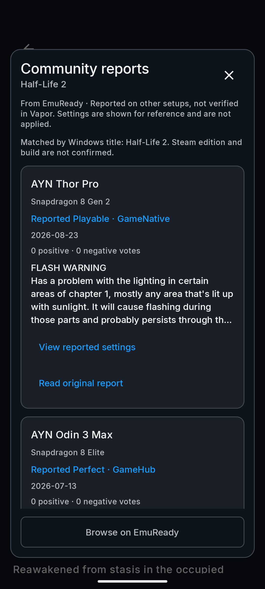
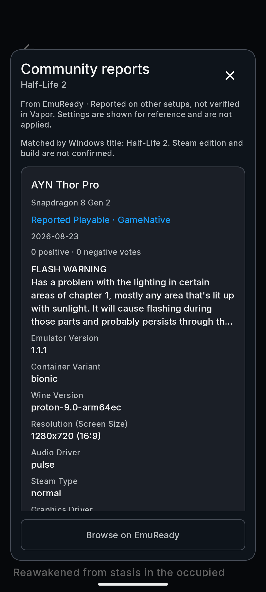
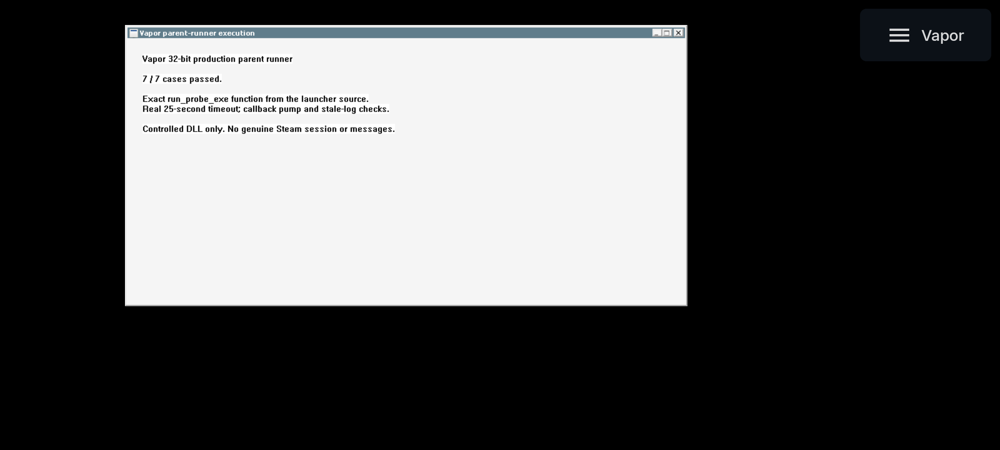
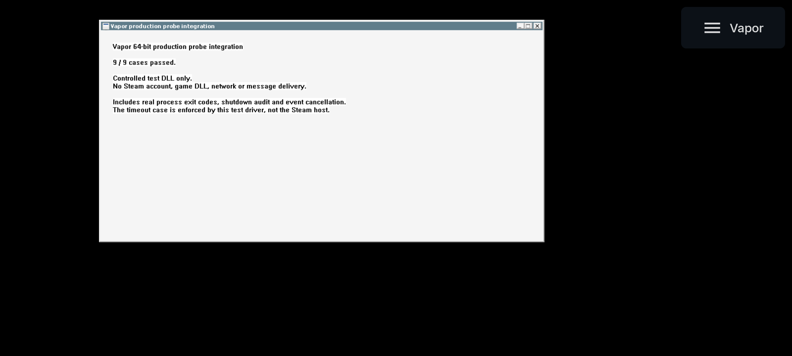
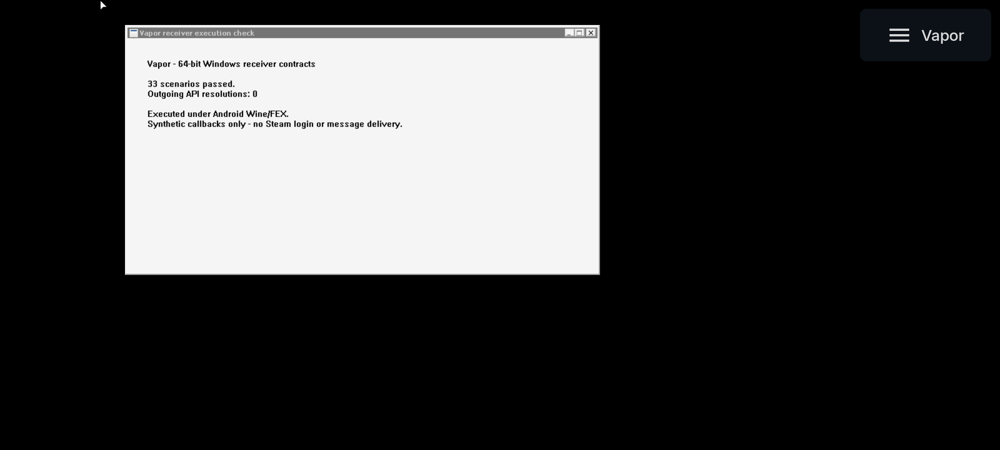
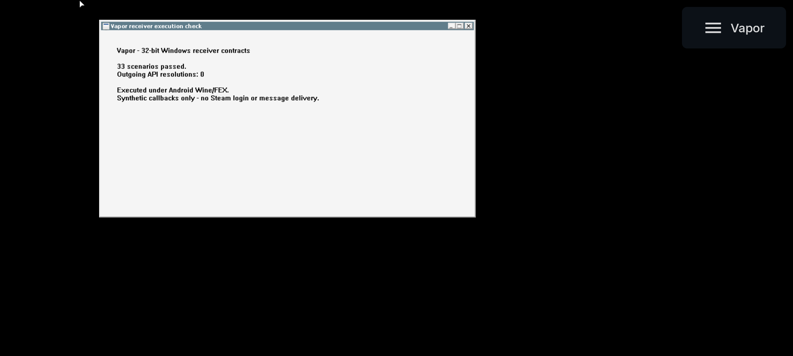

# Qualification protocol

Physical-phone gameplay is now owner-reported for Europa Universalis III and Team Fortress 2 on the owner-identified Xiaomi 17 Pro with Snapdragon 8 Elite Gen 5. These are two successful game reports on one device. The structured six-core-game qualification matrix below remains pending; EU3 and TF2 are additional titles. Reference devices remain the user-reported S24 Ultra and Xiaomi 17 Pro; Android version, RAM and the working runtime configuration still need to be recorded.

A subsequent [You Have to Win the Game screenshot](#you-have-to-win-the-game-screenshot--15-october-2026)
shows a rendered gameplay scene with Vapor's controls. Helltaker also has a supplied gameplay
screenshot. On 15 October the owner confirmed that **all tested games had sound**, covering the
reported EU3, TF2, You Have to Win the Game and Helltaker sessions. Audio is owner-confirmed;
persistence and repeat-launch checks remain separate.

## Graphics component source refactors — 21 October 2026

**Checkpoint: Turnip and Vulkan-wrapper source changes build for Android; the
wrapper's native loading and BC decode pass an offscreen emulator probe; no
physical-GPU or game-performance comparison.** These are changes to
Turnip and the Vulkan wrapper themselves. Guided runtime selections, APK assets,
game settings and the existing EmuReady feature remain unchanged.

### Turnip KGSL wait-any

Mesa `f28352d1179a4a85b4be286a883747bae2d3786b` contains the wait-any path. A
21 October sample of Mesa main (`c90ff433291a5c3ff5cea9913bbebeef9cd4e885`) has an
identical `tu_knl_kgsl.cc`; the sampled file SHA-256 is recorded in the receipt.
The original same-queue timestamp
route calls `u_vector_length` on a zero-initialized vector whose element size is
zero. UBSan reproduces division by zero. A failed initial allocation reproduces
invalid memory access under the sanitizer fixture. Kernel calls are mocked; no
claim about the cause of a reported game freeze follows from these results.

`tools/turnip/kgsl-wait-any.patch` replaces the temporary growable vector with
Mesa's own stack-array primitive and checks the fallback allocation. The candidate
passes **37 host-source checks** with clean ASan/UBSan output, plus the separate
failed-allocation subprocess. Original behavior checks complete, but its sanitizer
and allocation-failure controls fail as expected. Coverage includes borrowed/owned
FD cleanup, conversion failure, polling errors/timeouts, interrupted deadlines,
timestamp ordering/wrap, early returns and input counts 2/8/9/32/64.
Two additional mixed-input cases ensure that 64 inputs needing only two polled
descriptors still avoid heap allocation. The preceding 14-case timestamp-wait
regression also passes against the final candidate source; its old-source control
continues to fail eight cases. These are separate source fixtures, not app tests.

For input counts 2/8/9/32/64, observed scratch allocations are
**1→0, 2→0, 3→1, 4→1 and 5→1**; growth-copy bytes are
**0→0, 32→0, 96→0, 224→0 and 480→0**. These are function-level
work reductions, not game CPU, RAM or FPS measurements. The path's frequency in a
real game is not established.

Baseline and candidate full Android drivers build successfully from that pinned
Mesa base plus the same existing Android adaptations. The candidate adds only the
wait-any patch. All four `LOAD` segments in each are `0x4000` aligned; the exported
`HMI` HAL module symbol is unchanged. The experimental ZIP is
**2,839,098 bytes**, SHA-256
`e10e5743d628b6c4d43d203dc536bf45b9cc81f10327158d69c7ce5a5cd9b5ab`;
its 14,109,000-byte stripped `libvulkan_freedreno.so` payload is SHA-256
`d407b11f5c9c51802ebad895699a4ad54b9c8ded95d46243e77a20df1f47c4f4`.
Its metadata declares API 34 and records that payload checksum. Source/build
inputs, patches and notices are included. It is separate from StevenMXZ's V38
packages and not a full reproduction of their patch stacks.

### Vulkan-wrapper image creation

The source at `leegao/bionic-vulkan-wrapper`
`3abf48704a4d9303967a0811c0dc8ff8567d613b` allocates a temporary create-info and
list node even for ordinary images. It also shifts a BC-relative mask for non-BC
formats, which UBSan reports as an invalid shift. The source patch uses a stack
copy, confines mask evaluation to actual emulation and releases the underlying
image if wrapper bookkeeping fails. Source replay is exact without fuzz.

The follow-up traces the generated public entry point: it calls the image
function with the caller's data, before the lower dispatch trampoline. The
original BC format-list path mutates that caller data and crashes when it is
read-only. The candidate uses its own stack format list and copies only extension
nodes preceding it when needed. It preserves extension order, fields and the
original tail; scratch is released on success and failure. Empty format lists
remain empty. An unknown-size prefix requiring rewriting returns
`VK_ERROR_FORMAT_NOT_SUPPORTED`; unknown tails and untouched chains pass through.

The candidate passes **26 host-source cases plus a separate read-only-memory
subprocess** with clean ASan/UBSan. Ordinary-image temporary allocations change
**2→0**. The original fails three preservation cases, produces the invalid-shift
report and crashes on read-only input. Driver calls, format helpers, registry-size
lookup and bookkeeping are mocked; these are ownership and control-flow checks,
not GPU format/conformance or performance results.

### Vulkan-wrapper tracing and complete build

The existing generator tests `if (should_log)`, the always-true address of a
function, instead of the `should_print` boolean it computes. The patch uses that
boolean for input/output details. **Seven generated-call cases pass** using the
upstream logging macros under ASan/UBSan; the original fails five. The fixture
generates image creation, vertex-buffer binding and queue submission, with driver
execution and structure printers stubbed. Tracing off changes log-file lookups
**175→0** and printer calls **34→0** for the selected three-call batch. Explicit
tracing and returned Vulkan results are preserved. These counts are not per draw
or a game frame-time measurement.

The Android baseline and candidate both compile with the pinned custom
SPIRV-Tools fork and NDK r27d (27.3.13750724)/API 34. The first incremental
attempt showed the generator's local Python import was missing from Meson's
dependencies. The patch adds it; the final build regenerates the header and
replaces all 1,174 faulty conditions. Merely compiling the image object was not
counted as a complete pass.

Both final libraries have four `LOAD` segments aligned at `0x4000`. Their SONAME,
4,073 exported-symbol entries, 434 strong undefined-symbol entries and 20 direct
shared-library dependencies match each other. Those dependency names also match
the optional Leegao release. Symbol inventories and alignment do not establish
successful loading or dependency-version compatibility in Vapor's production
runtime. The local files retain build-tree RUNPATHs and are not packaged updates.

The optional packaged Leegao binary matches release `v0.0.5r5`, whose tag resolves
to `c8baafbd4f4835ca103acb55ec3ac13642b6b7e3`. Its four reviewed image/generator
files match the current source base. Vapor's default and GameNative wrapper
payloads differ and are not established as builds of this source. Effective-driver
image quality, concurrency and GPU/phone performance checks remain separate.

### Wrapper native loading and BC probe

`tools/tests/vulkan-wrapper-native.c` offscreen-loads the system loader or a built
wrapper, creates a device, uploads BC1/BC3 blocks and checks decoded pixels, and
passes the caller a read-only format list. On the Android 16/API 36 4 KB emulator,
47 captured runs include system, baseline and candidate rgba passes and
baseline/candidate BC1/BC3 passes with forced emulation; the baseline crashes 2/2
on read-only caller data (expected control) and the candidate passes. On the
Android 17/API 37 16 KB emulator 132 runs report `page_size=16384`: the
candidate passes rgba/bc1/bc3/readonly 36/36 plus 12/12 image-view runs, the
baseline passes 27/27 and crashes 9/9 on the read-only control, and both
wrappers plus all 16 auxiliary libraries load with `RTLD_NOW` and `0x4000`
alignment.

The 16 KB guest advertises `textureCompressionBC` but does not decode native BC
buffer-image copies; the system loader fails identically with no wrapper, so this
is an emulator limitation. The probe therefore uses the wrapper's emulation path
as the 4 KB matrix does, and the two AVDs differ in API level and GPU backend, so
no matched differential is claimed. Both devices are software Vulkan (llvmpipe)
inside the emulator: this does not qualify an Adreno/KGSL driver, a physical
phone, game rendering, image quality or performance.
[4 KB receipt](evidence/2026-10-21-vulkan-wrapper-native-4k.json),
[16 KB receipt](evidence/2026-10-21-vulkan-wrapper-native-16k.json).

### Wrapper staging lifetime

Source review found that staging storage tracked per BCn upload is freed only at
image destroy or device destroy: the `ready` fence is never assigned and the fence
branch is unreachable, while the intended reclamation is a TODO. The design is
safe for waited submissions but grows without bound on long-lived images (two
tracked objects plus staging bytes per upload; 32 probe uploads produced 64
entries, released once at `vkDestroyImage`). Those files are byte-identical to
the pinned source and the candidate's patches do not change them, so this is
inherited upstream behavior, not a candidate regression. One conditional risk is
recorded as open: staging memory allocated on the wrapper's emulated-memory path
(`VK_EXT_map_memory_placed` with `memoryMapPlaced`) is freed through the raw
trampoline, so a later device destroy can free the same memory again. The probe
does not enable those features; a dedicated fixture is required to settle it and
no defect is claimed. [Staging receipt](evidence/2026-10-21-vulkan-wrapper-staging.json).

A follow-up patch, `tools/vulkan-wrapper/staging-reclaim.patch`, implements the
reclamation: staging ownership moves to the recording command buffer,
one-time-submit resources take the submit fence and are freed from
`vkWaitForFences`/`vkDeviceWaitIdle`, re-submittable command buffers release on
free/begin/reset, and internal staging buffer/memory use the raw dispatch table so
the emulated-memory double-free class is removed. It applies and compiles cleanly,
and the built library keeps the candidate's SONAME, 20 `NEEDED` names, four
`0x4000`-aligned `LOAD` segments and the 4,073-export set. A/B probe runs on the
Android 16/API 36 emulator now show the intended release points: the unpatched
control keeps its single 64-resource release inside `vkDestroyImage`, while the
patched library releases two resources per command-buffer free in the staging
path, per fence inside `vkWaitForFences` for one-time-submit+fence, and inside
`vkDeviceWaitIdle` for the device-idle path; tracking and release totals are equal
and no crash occurs at image or device destroy. Resubmission, unfenced
one-time submissions, the `VK_EXT_map_memory_placed` path, semaphores, validation
layers, 16 KB pages, concurrency and long-running phone growth remain pending.
[Reclaim patch receipt](evidence/2026-10-21-wrapper-staging-reclaim.json).

Deeper runtime validation (23 runs on the 4 KB and 16 KB emulators) extends this:
unfenced one-time submissions release at command-buffer free; re-submittable
command buffers release inside `vkResetCommandBuffer`/`vkBeginCommandBuffer` (or
at free without a re-begin); `vkQueueSubmit2` with a fence still reclaims inside
`vkWaitForFences`; a semaphore-only submit does not reclaim early (documented
limitation, released at command-buffer free, no leak past destroy); stress runs
show peak tracked counts of 16 (32 images × 8 copies) and 2 (one image × 256
copies) against 512 for the unpatched control, with tracking equal to released in
every case; and the same A/B, one-time+fence and image-view cases pass on the
Android 17/API 37 16 KB emulator. Validation layers could not be attached because
the probe uses the wrapper directly as an ICD, and the placed-memory path,
concurrency and physical-phone duration remain pending. No defect was found in
the patch. [Extended runtime receipt](evidence/2026-10-21-wrapper-staging-reclaim-extended.json).

### Packaged wrapper payload identity

Static analysis (no execution, no repackaging) confirms the three packaged payload
sizes and hashes and separates their build lines. The Leegao payload (8,709,528 B,
`520ec0ba…`) is byte-identical to the v0.0.5r5 release asset and follows the
retained Termux recipe `leegao/vulkan_wrapper_termux-packages` at `c5c45d88`
(Docker, NDK r27c, API 26): 20 `NEEDED` entries, 3,583 exports, 4 KB `LOAD`
alignment, no `.comment`. A clean build of the verified tag source succeeds and
matches the SONAME, `NEEDED` names, wrapper/SPIRV-Tools export family and 4 KB
alignment, but not the bytes: NDK r27c, the release sysroot/Docker image, the
release SPIRV-Tools revision and the release strip step are not retained.
The default payload (19,146,576 B, `ff43589b…`) and GameNative payload
(2,705,856 B, `25e80104…`) are different builds — NDK r29/clang 21, 16 KB
alignment, an ICD-only 15-export set, with the default retaining `debug_info` and
a Termux build path. Their source lines are now identified from public sources:
the **GameNative payload is byte-identical to the `libvulkan_wrapper.so` member of
the public `wrapper-gamenative-20260719` release artifact**, whose workflow builds
the public **GameNative/mesa** fork (branch `wrapper-25`, NDK r29; commit
`5212f63a`/merge `8e64d5f4` two days before the artifact contains every
previously-unidentified compile unit and the `WRAPPER_DIAG` code present in the
payload), and the **default payload is a Termux debug build of the public
`Pipetto-crypto/mesa` fork line** (branch `wrapper-25`, at or after commit
`ac54448c`: its fork-unique cache strings and the `WRAPPER_SURFACE_FORMAT` literal
match, while GameNative-only literals and `WRAPPER_DIAG` are absent). They are two
different public forks, not the reviewed v0.0.5r5 source; the exact GameNative
build ref and the default build's commit are not embedded in the payloads. Static
identity evidence does not establish execution, image quality or performance.
[Reproduction receipt](evidence/2026-10-21-wrapper-release-repro.json),
[source-identity receipt](evidence/2026-10-22-wrapper-variant-source-identity.json).

### Wrapper reference-image BC/depth probe

An offscreen reference probe (`tools/tests/vulkan-wrapper-reference.py` plus its
own fixture; `--print-runbook` for the phone procedure) uploads deterministic
BC1/BC3 blocks and compares readbacks with an independent pure-Python S3TC
decoder, with the system loader as a native-driver cross-check. On the Android
16/API 36 4 KB emulator (llvmpipe software Vulkan) all 43 runs pass: the
wrapper's compute-shader decode via staging and via image view is **exact** for
BC1 and BC3 (4096/4096 pixels, 0 LSB delta) for candidate and baseline, the host
CPU fallback (bcdec) stays within 1 LSB, and llvmpipe's native decode via
`vkCmdBlitImage` stays within 2 LSB (expected inter-decoder convention spread).
Candidate and baseline readbacks are byte-identical, so the format-list fix does
not change decoded pixels. Depth transfers for D16_UNORM, D24_UNORM_S8_UINT and
D32_SFLOAT create/bind/upload/readback bit-exactly on system loader, baseline and
candidate; unsupported combinations are recorded.
[Probe receipt](evidence/2026-10-21-vulkan-wrapper-reference.json),
[tool](../tools/tests/vulkan-wrapper-reference.py).

Extended coverage adds a 16 KB-page run (43/43 matrix passes, page_size=16384,
wrapper compute decode exact and depth bit-exact), odd non-multiple-of-4 extents
(5x7, 13x17, 1x1, 63x65: compute paths decode every in-bounds pixel exactly),
partial-region copies with sentinel checks, three mip levels × two array layers,
BC1/BC3 sRGB variants plus an RGBA8_SRGB control, and independent BC4/BC5 (RGTC)
decoders whose wrapper compute and host paths are exact. The wrapper's
depth-format-reduction knob is reachable through `DEPTH_STENCIL_ATTACHMENT` images:
unset stays bit-exact, `safe` reduces D32→D16 (D24S8 unchanged), `aggressive`
reduces D32/D24S8→D16 (transfers no longer bit-exact), and `disabled` rejects
image creation with `VK_ERROR_FORMAT_NOT_SUPPORTED`. Two suspected defects are
recorded for the wrapper owners, both in software emulation: BC_SRGB data decodes
to different pixels depending on whether the compute shader (linearised) or the
host-CPU fallback (encoded) runs, and the host-CPU path corrupts partial edge
blocks for out-of-spec non-block-aligned copy extents. Neither is an app defect and
neither is claimed as a conformance failure.
[Extended receipt](evidence/2026-10-21-vulkan-wrapper-reference-extended.json).
The same extended families also pass on the Android 17/API 37 16 KB emulator
(43/43 default matrix plus 66 extended passes and 28 recorded robustness cases,
`page_size=16384`), and both suspected defects reproduce there.
[16 KB extended receipt](evidence/2026-10-21-vulkan-wrapper-reference-16k-extended.json).

A later opt-in BC7 family (256 deterministic valid blocks across modes 0-7;
`--cases bc7`) decodes **exactly** against the bcdec reference through the wrapper
compute shader and through the llvmpipe native decoder — 16384/16384 pixels for
BC7_UNORM and BC7_SRGB through the wrapper, 4096/4096 for the native blit, 0 LSB
delta, on both 4 KB and 16 KB emulators. The host-CPU path is exact by
construction because it uses the same bcdec decoder (a self-consistency check);
the compute-shader and llvmpipe decoders are the independent comparisons. The
BC7_SRGB results extend the known sRGB storage split: compute stores linearised
values while host-CPU stores sRGB-encoded values, so their readbacks differ
(4,185/16,384 bytes, max channel delta 73) even though each matches its own
reference exactly. BC2/BC6H/BC7 format support is recorded.
[BC7 receipt](evidence/2026-10-22-vulkan-wrapper-bc7-reference.json).

These are software-Vulkan, synthetic-data results: no Adreno/KGSL driver, physical
GPU, validation layers or game asset is covered. The receipt carries a one-command
phone runbook (`--serial <PHONE> --label phone-adreno`) with controls and
adjudication; no phone result is claimed.

### Wrapper sampling and rendering pipeline

An offscreen sampling/render probe (`tools/tests/vulkan-wrapper-render.c` fixture,
committed GLSL shaders, and the `tools/tests/vulkan-wrapper-render.py` checker)
uploads BC1/BC3 UNORM/sRGB textures through the wrapper, samples them through a
real graphics pipeline (fullscreen triangle, nearest clamp-edge sampler, RGBA8
render target) and compares the rendered image with an independently derived
expected image (nearest upscale of the decoded texture; sRGB encoded/linear
conventions). On the 4 KB emulator all 32 checked readbacks pass and 16 are
byte-exact: wrapper compute/compute-view UNORM BC1/BC3 renders byte-exactly; the
sRGB compute paths render the linearised convention within 1 LSB; the pre-patch
host-CPU sRGB path renders the encoded convention and diverges from the
linearised expectation by up to 73 LSB (the known storage split); the native
llvmpipe control stays within 3 LSB (inter-decoder rounding); RGBA8 controls are
byte-exact everywhere. This closes the "transfer-only" gap for the wrapper on
software Vulkan. [Render-pipeline receipt](evidence/2026-10-22-vulkan-wrapper-render-pipeline.json).

The fixture was salvaged from an interrupted workstream: the checker
independently re-derives and verifies the expected images offline and
`--print-runbook` prints the device commands, but a single-command device
orchestrator is still a follow-up. Nearest sampling, one fullscreen triangle and
llvmpipe only; no phone or game assets.

### Wrapper SRGB storage fix

The compute-vs-host sRGB split is root-caused and fixed experimentally:
BC*_SRGB sources are emulated as `R8G8B8A8_UNORM` (and image views are patched to
UNORM), so sampling performs no hardware sRGB decode and the stored texels must be
linear, which is what the compute shaders already do. `tools/vulkan-wrapper/srgb-storage.patch`
(3 hunks in the host bcdec path, IEC 61966-2-1 transfer function with double
precision ties-to-even rounding, alpha untouched) makes the host-CPU fallback
store linear values as well. The patch applies cleanly to the pinned source
(forward/reverse, `--fuzz=0`), the patched library keeps the recorded ELF identity
class (same SONAME, 20 NEEDED names, 4073 exports, 0x4000 load alignment), and a
4 KB emulator A/B shows the host-vs-compute disagreement falling from up to 74 LSB
to 1 LSB while compute, compute-view, native and RGBA8 readbacks stay byte-identical.
The reference tool's host-cpu sRGB expectation still encodes the pre-patch
convention, so patched runs report two stale-convention failures until that
expectation is updated; that is a tool follow-up, not a patch failure.
[SRGB patch receipt](evidence/2026-10-22-vulkan-wrapper-srgb-storage.json).

### Placed-memory loader path and capability skip

The wrapper's placed-memory path (`VK_EXT_map_memory_placed` with
`memoryMapPlaced`/`memoryMapRangePlaced`, which the staging review's conditional
double-free risk depends on) needs a RADV/ANV/NVK/Turnip-class driver for real
placement semantics, but its loader plumbing, capability reporting and skip logic
are testable without a GPU.

- **Android emulator presence:** the new `tools/tests/vulkan-map-memory-presence.c`
  fixture loads the system loader on both emulator AVDs. The extension is absent
  from the 49 device extensions on the API 36 4 KB llvmpipe path and the 101
  extensions on the API 37 16 KB gfxstream path, and both feature bits read zero
  while positive feature controls (robustBufferAccess, samplerAnisotropy,
  textureCompressionBC) prove the query returned real data. The correct outcome is
  `RESULT=SKIP`: the Android path does not silently claim placed-memory coverage.
  [Presence receipt](evidence/2026-10-21-vulkan-map-memory-presence.json).
- **No-GPU CI lane:** `tools/tests/vulkan-loader-path.c` is a loader-mediated
  harness (it never dlopens an ICD) driven by `tools/tests/vulkan-loader-path.py`
  in the independent `vulkan-loader-ci` workflow. Lane A on lavapipe must SKIP
  (extension absent) with clean validation; Lane B on a pinned, patched
  Vulkan-Tools mock ICD must report `MEMORY_MAP_PLACED=1` and complete placed and
  range-placed `vkMapMemory2` calls with zero VUIDs. CI run **39686064374**
  passes: Lane A `RESULT=SKIP` with 0 validation errors (lavapipe manifest
  resolved from `libvulkan_lvp.so`), Lane B `RESULT=PASS`,
  `MEMORY_MAP_PLACED=1`/`MEMORY_MAP_RANGE_PLACED=1`, both placed maps
  `VK_SUCCESS`, 0 VUIDs, driver self-test 7/7. The first attempt failed only on
  lavapipe ICD discovery, which is fixed in the same lane.
  [Loader-path receipt](evidence/2026-10-21-vulkan-loader-path.json).
  A Vulkan Profiles capability file for the intended mock + profiles-layer route
  is delivered and schema-validated; the CI lane uses the documented mock-ICD
  capability patch instead because the profiles layer needs a large
  Vulkan-Utility-Libraries bootstrap.
- **Limits:** this is loader/capability/validation plumbing over a mock and over
  lavapipe, not real placement semantics. Alignment, reserve/unmap lifecycle and
  behaviour on RADV/ANV/NVK/Turnip still need a real driver (or a phone), and
  lavapipe's `DEVICE_LOCAL == HOST_VISIBLE` means heap-selection assumptions need
  a discrete-GPU check.

### Remaining boundaries

Neither candidate is installed or bundled. No phone, authenticated game session,
Cloud synchronization or game run was performed. Native loading, synthetic BC
decode and depth transfers pass the offscreen emulator probes on software Vulkan,
and the source checks cover reference-image BC decode. Matched Adreno/KGSL
loading, physical-driver reference-image/depth correctness, actual game frame
times/power, physical 16 KB-device execution and release/distribution review
remain separate gates; the phone runbook is ready but not executed. Selected
DXVK queue/compiler and VKD3D queue/cache paths were read at pinned revisions;
they were not changed or exhaustively audited. Wine/FEX retain their earlier
component records and open gates.

Fresh public EmuReady Ghostrunner/Onimusha lookups returned HTTP 403 here; no new
report contents or settings were used as evidence for either patch. The earlier
live app observations below remain a separate result. Reports should guide
reproduction workloads, not establish a source bottleneck or a Vapor badge.

[Component receipt](evidence/2026-10-21-graphics-source.json),
[Turnip source notes](../tools/turnip/README.md),
[wrapper source notes](../tools/vulkan-wrapper/README.md),
[build instructions](BUILDING.md#vulkan-wrapper-source-build--21-october-2026).

## EmuReady community reports — 21 October 2026

Steam catalog details and installed Steam game pages now expose a native Community
reports modal. It reads public EmuReady data on demand, retains a page-local
snapshot, cancels work on close, and reads a report's settings only when requested.
It does not apply settings, download components, submit reports or use Steam auth.

**44 focused JVM/Compose tests pass:** 20 API/identity tests, 10 reports UI tests
and the existing 14 Store catalog tests. Coverage includes rejecting console ports
and conflicting Steam IDs, separate demo titles, ambiguous Windows matches,
missing data versus service errors, cancellation, explicit settings loads,
single-tap retry, and narrow/large-text and short-landscape layouts.

An earlier feature APK passes **17 Android instrumentation tests**: 5 Community
reports checks plus 12 game-page checks, including the new action in short
landscape (268.812 seconds). Parsing was subsequently moved off the UI thread;
the final APK passes all 44 focused JVM tests and repeats the **same five reports
Android checks** successfully (59.684 seconds). This is a subset repetition, not
22 distinct Android tests. The original pre-result ADB interruption is not counted
as a pass. Both application and test APKs build; the final installed application
hash matches the local APK. [Build/test receipt](evidence/2026-10-21-emuready.json).

**Follow-up corrections (21 October):** an independent review of this committed
slice found two medium and six low issues: batch AppID identity could reject
Windows entries whose titles differ in punctuation or accent, the catalog action
appeared for known non-Windows apps, missing and ambiguous entries shared one
message, and several error/wording details were inconsistent. All were fixed and
re-verified. EmuReadyTest passes **24/24** and CommunityReportsUiTest **17/17**
(41 focused JVM tests); the rebuilt APK and test APK were run on the Android
16/API 36 emulator with injected data: **17 report/game-page checks** (5 reports
+ 12 game-page, 155.682 s) and **14 catalog-install checks** including both new
platform-gating cases (77.114 s), with no results carried over. The APK is a
Kotlin/resource rebuild because a full native build needs a Rust/cargo toolchain
not installed here, so it reuses the prior native libraries. The Gradle
dependency fetch now sends explicit HTTP headers to GitHub.
[Follow-up receipt](evidence/2026-10-21-emuready-followup.json).

**Live-service re-check (21 October):** all four mobile procedures answer with the
reader's exact URL format (HTTP 200, JSON), and the envelope, identity and
platform guards match the committed parser on 39 sampled listings plus two
settings lookups. The Windows platform guard is load-bearing on live data: the
batch endpoint returns console entries for Windows AppIDs (Portal → Switch,
Red Dead Redemption 2 → PS4, Stardew Valley and Hades → Switch). Batch AppID
coverage has gaps — GTA V and The Witcher 3 have Windows entries and many
listings but are not returned by the batch lookup — so the title fallback is
load-bearing for well-populated games, not only unindexed ones. The earlier 403s
came from the desktop web path's origin gate, not from headers. No parser change
was required; residual risks (a non-approved page-1 row blanking the page,
unobserved `metadata.steamAppId` and array field shapes) are documented.
[Live re-check receipt](evidence/2026-10-21-emuready-live-recheck.json).

**Full native rebuild (21 October):** the Rust/cargo toolchain was located on the
build host (1.99.0 with the `aarch64-linux-android` target). After clearing the
cached Rust and CMake outputs, a full debug APK build succeeded with **no
excluded tasks**, including the native CMake stages: 23 arm64 libraries were
rebuilt and `libwnsteam.so` recompiled from cargo. The fresh APK is 684,926,636 B
(SHA-256 `889bc3bc…`) and the test APK 3,759,428 B (SHA-256 `2bb4c4bd…`). The
focused JVM suites re-passed (EmuReadyTest 24/24, CommunityReportsUiTest 17/17),
and both Android suites re-ran on the rebuilt APK: 17/17 report/game-page and
14/14 catalog-install checks pass, with no carried-over results. This replaces
the earlier "native libraries reused" caveat. A same-machine rebuild was not
byte-for-byte identical end to end, but root-cause analysis (22 October) shows
the differences are build inputs/metadata rather than general build
nondeterminism: the three dex entries differ only because the two builds carried
different git `BUILD_ID` values (application source identical; only `BuildConfig`
and two classes inlining it change), `libcrypto.so` differs only by OpenSSL's
embedded build timestamp (`.comment`, symbols and headers are identical; the
differing instructions are address fix-ups of a moved `.rodata` string), and the
4.87 MB size delta is incremental-packaging hole/padding reuse. Mitigations are
now demonstrated: at a fixed commit with a pinned `BUILD_ID`, a fixed
`SOURCE_DATE_EPOCH`, cleared `app/build` and `app/.cxx`, and the pinned
toolchain, two clean builds produced **byte-identical APKs** (676,228,770 B,
SHA-256 `f8cc0b2f…`), with identical ZIP layout/padding, a fixed OpenSSL build
date and no dex `BUILD_ID` drift. Signing the demonstrated APK is also
byte-deterministic in repeated runs (three identical debug-signed APKs, an
identical 4 KB v2 signing block, zipalign included), and an independent
`APK reproducibility` workflow builds the same pinned APK on two separate
`ubuntu-24.04` runners, signs both with a committed throwaway CI-only key through
the app's `KEYSTORE_FILE` hook (guarded by `:app:signingReport`), and fails unless
the two hashes match. Its first two runs both proved the builds produce
byte-identical ZIP content (1638/1638 entries, zero differing CRCs, zero padding)
and failed only on the per-runner debug signing block; copying the key to
`~/.android` was not picked up by AGP on the runners, so signing now goes through
the explicit hook. The latest run's result is recorded in the lane receipt. Release signing and cross-toolchain reproducibility remain out
of scope.
[Native rebuild receipt](evidence/2026-10-21-emuready-native-rebuild.json),
[rebuild reproducibility receipt](evidence/2026-10-21-apk-rebuild-reproducibility.json),
[root-cause receipt](evidence/2026-10-22-apk-reproducibility-rootcause.json),
[mitigation receipt](evidence/2026-10-22-apk-reproducibility-mitigation.json),
[cross-runner lane receipt](evidence/2026-10-22-apk-cross-runner-reproducibility.json).

### Live public data in the normal app

The final APK was opened normally with Steam signed out. The journey
**Store → Half-Life 2 → Community reports → View reported settings** succeeded.
The Windows title match is explicitly labeled with Steam edition/build unconfirmed.
The app displayed a report for AYN Thor Pro / Snapdragon 8 Gen 2 / GameNative and
retrieved its reported emulator version, Bionic container, Wine version, resolution
and audio values. Those are the contributor's settings, not a Vapor recommendation
or a Half-Life 2 gameplay test.

The public API batch lookup also returned a Nintendo Switch entry for Steam's
Portal AppID. A separate title search returned both Windows and Switch entries;
the reader filters platform before selecting an unambiguous Windows match. Batch
lookups for TF2 and Ghostrunner Demo returned no entry during the observation;
that alone does not establish absence from every EmuReady search or incompatibility.

<table>
<tr>
<td width="50%"></td>
<td width="50%"></td>
</tr>
<tr><td>Live community reports</td><td>Live reported settings</td></tr>
</table>

The separate [Android UI fixture capture](images/emuready-reports-emulator-sample.png)
uses labeled sample content. All captures are from the Android 16 / API 36 ARM64
emulator with 4 KB pages; they are not physical Xiaomi or gameplay measurements.

### Live emulator journey — 21 October

The rebuilt APK was installed on an Android 16/API 36 ARM64 emulator and opened
normally with Steam signed out. The journey **Store → Half-Life 2 → Community
reports → View reported settings** succeeded with live data: the modal rendered
the AYN Thor Pro / Snapdragon 8 Gen 2 / Reported Playable · GameNative report
(2026-08-23, 0 positive / 0 negative votes, FLASH WARNING notes), and View
reported settings loaded the live report's values (Emulator Version 1.1.1,
Container Variant bionic, Wine Version proton-9.0-arm64ec, Resolution 1280x720
16:9) read-only. On-screen values were cross-checked against fresh live payloads
and match. Both source actions handed off to Chrome with the reader-generated
URLs. Team Fortress 2 reached the honest "No matching Windows entry found" state.
The live mobile path also accepts the app's default OkHttp user agent, and live
malformed/missing/unknown/oversized inputs map to the reader's connection-failure
wording rather than the unexpected-response state; a valid envelope with an
unknown game id returns an empty page.

[Live journey receipt](evidence/2026-10-21-emuready-live-app-journey.json).
Screenshots: [reports](images/emuready-live-app-2026-10-21-reports.png),
[settings](images/emuready-live-app-2026-10-21-settings.png),
[no entry](images/emuready-live-app-2026-10-21-no-entry.png),
[catalog action](images/emuready-live-app-2026-10-21-catalog-action.png).

The Windows-less gating branch was not observable live (no Steam catalog app with
`platforms.windows=false` could be located) and remains covered by the committed
JVM/device tests. The emulator ran under host memory pressure (one SystemUI ANR
and one app-process restart, no app crash) and in landscape; no physical phone,
TalkBack or physical gamepad pass was performed.

Remaining: physical-phone acceptance, physical gamepad and TalkBack, same-device/
runtime matching and selective settings preview/application. Live API reads do
not qualify long-term service availability, catalog coverage, game performance,
Steam Cloud, achievements or chat. External source navigation is callback-tested,
and the later live emulator journey opens both source links in Chrome. No account,
purchase, runtime launch, settings mutation, APK publication or Git push was
performed in this slice.

## Production parent-runner execution — 20 October 2026

A test-only entry point includes the actual launcher source and directly exercises
`run_probe_exe`, without starting its genuine Steam entry point or replacing the
APK runtime. The x86_64 run passes **7/7 cases**: normal log import, missing/invalid
executable, blocked log path, oversized command, continuously busy callback pump,
and actual parent timeout. The hot callback case acquired/released 7,104 callbacks
and returned normally. The hung-child case acquired/released 15,616 callbacks,
returned in 25.211 seconds, and logged forced termination with cleanup unconfirmed.
No matching fixture child remained. Those timings check timeout correctness only.

The first i686 attempt produced no test result before the external observation
limit; Wine startup processes were observed and the test program had not appeared
in the process listing. It is not counted as a pass or a demonstrated parent-runner
defect. A single unchanged-input retry then passed **7/7 cases**. Its busy callback
case acquired/released 7,552 callbacks; the real timeout returned in 25.711 seconds
with 15,104 acquisitions/releases. The first startup timeout remains recorded
separately; this retry does not establish repeatable startup reliability.
[Initial 32-bit startup capture](images/emulator-probe-parent-i686-startup.png).

Both attempts retained unchanged container bytes and recorded FEX DLL/SO hashes.
No account, game files, APK or runtime payload was modified. The fixture session
was stopped after execution. [Execution receipt](evidence/2026-10-20-probe-parent-execution.json).




This fixture does not test real Valve callback data, marker-driven authenticated
startup or real messages. Callback pumping uses a synthetic always-ready source;
child execution uses the isolated DLL fixture. CI cross-compiles both architectures
and the YAML parses locally; no remote CI run is claimed. Build warnings are the
two existing unused declarations included from launcher source (`installPath` and
`marker_has_path`). No production source changed for this parent-runner test.

## Production probe controlled-DLL execution — 20 October 2026

**9/9 integration cases pass in each architecture**, x86_64 and i686, under the
existing ARM64 Android 16 Wine/FEX emulator. The actual production `iface_probe.cpp`
loads an isolated test DLL through `LoadLibraryA`/`GetProcAddress`; a Windows test
driver checks child exit codes, diagnostic text and fixture shutdown traces.
These are nine scenarios exercised twice, not eighteen different features.

| Case | Expected exit | Result on x64 / x86 |
| --- | --- | --- |
| Read-only capabilities | 0 | Pass / Pass; no listening or message reads |
| Receive one synthetic entry | 0 | Pass / Pass; acquired callback released, one read |
| Quiet observation window | 9 | Pass / Pass; not represented as delivered chat |
| Malformed callback payload | 10 | Pass / Pass; callback released without reading |
| Listener enable rejected | 8 | Pass / Pass; disable attempted, shutdown called |
| Listener disable reports failure | 8 | Pass / Pass; failure retained rather than success |
| Named-event cancellation | 11 | Pass / Pass; listener off before shutdown |
| Selected DLL missing | 2 | Pass / Pass; no fallback to the nearby fixture DLL |
| Callback frame deliberately hangs | 124 from test driver | Pass / Pass; killed child exit confirmed, no shutdown completion claimed |

The audits require no outstanding callback on normal exit and no sending-function
call. The fixture's private message text must not appear in diagnostic logs. The
fixture exports the legacy `SteamAPI_Init` path; the internal-init path and Valve
session remain separate gates.

### Cancellation defect and correction

The original x64 console-control test failed: `GenerateConsoleCtrlEvent` returned
success but the probe exited 9 after its quiet window, rather than cancellation
11. Additional targeted/broadcast attempts, including production-matching process
creation flags, did not establish console delivery. The underlying cause was not
isolated. [Original failed summary](images/emulator-probe-console-baseline.png).

The receive diagnostic now offers a per-process named Windows event, polled by its
existing dispatch wait. The targeted event test passes, followed by all nine
cases on both architectures. The cancellation trace records `listen_off` before
`shutdown enabled=0`, and exit 11. Console handling remains best-effort and is not
claimed fixed or qualified. [Targeted cancellation capture](images/emulator-probe-dll-cancel-x86_64.png).
Event creation/collision/wait failures have explicit
failure paths; those error injections were not executed in this matrix.

### Actual emulator screenshots




The [execution receipt](evidence/2026-10-20-probe-dll-execution.json) retains all
case logs/audits, current source and binary hashes, screenshot hashes and the
original console failure. The baseline binary itself was not retained. Runtime:
`Proton-11.0-2-arm64ec-steam-unixlib-3` / `2607-84e127a63-unix-0`, Steam launching
disabled in the test container. Container bytes and the four recorded FEX DLL/SO
hashes match before/after. No game DLL, APK or runtime payload was replaced.
The fixture session was stopped after testing; no integration/probe/wineserver
remained. Vapor was then reopened to its ordinary Home screen.

This step uses no Steam account or genuine Steam library. The timeout belongs to
the controlled test driver, **not the genuine host's parent wait loop**. The
subsequent parent-runner execution above tests that loop with controlled fixtures;
real Valve callbacks, authenticated startup, actual message delivery, Android chat
integration and physical phone behavior remain unqualified. The native 33-case ASan/UBSan regression passes;
CI compilation steps are added in source and YAML parses, but no remote CI run,
commit or publication occurred.

## Receiver contracts on Android Wine/FEX — 20 October 2026

**33/33 receiver scenarios passed in each Windows architecture**: x86_64 and i686,
executed via Vapor's installed `XServerDisplayActivity` on `Vapor_UI_API36` (ARM64
Android 16, 4 KB pages). Each executable wrote its final `result=PASS` and rendered
a Win32 summary captured through ADB. The same suite still passes host-native
ASan/UBSan after the test-only MinGW name-collision fix.

Runtime: `Proton-11.0-2-arm64ec-steam-unixlib-3` and
`2607-84e127a63-unix-0` FEX, existing `PERFORMANCE_TSO` container. No Steam login,
genuine Steam API DLL, real friend/message or graphics workload was used. Both
PE guests use the injected resolver and callback fixture, including cancellation,
callback release, rejected reads, unavailable sessions and disabled outgoing APIs.
This is 33 scenarios exercised in two environments, not 66 distinct scenarios.





The result files, PE and screenshot hashes are recorded in the
[execution receipt](evidence/2026-10-20-receiver-wine-execution.json).
The container's bytes and four recorded FEX DLL/SO hashes match before/after; no
runtime, driver or configuration payload was replaced. Only the test executables
and result files were placed in the emulator's Downloads test directory. The fixture session
was stopped afterward, and no receiver or wineserver process remained in the
post-run process listing. Vapor was then reopened to its ordinary Home screen. No new APK was built for these fixtures.

The screenshot proves the fixture summary rendered; result files and assertions
carry the contract verdict. The production `GetProcAddress` binding, real Valve
callbacks, parent-runner forced timeout, Windows console cancellation and Android
chat bridge remain pending. Prior local/build-only receipts remain historical.

## Current UI on Android emulator — 20 October 2026

The existing `Vapor_UI_API36` was booted after the earlier empty-device check.
The current UI and instrumentation APKs build and install successfully. The
installed app's SHA-256 matches the built APK. No app data was wiped. Environment:
ARM64 Android 16/API 36, 4 KB pages; app target SDK remains 28.

**8/8 `SteamChatUiTest` instrumentation cases passed** in 46.128 seconds with fixture
message handlers. This verifies native Android UI interactions rather than only
JVM rendering; it does not verify Steam authentication or delivery. Manual
signed-out navigation verified Home, Friends, Chat Settings and Store. A `Portal`
search showed 130 results including Portal and Portal 2 and retained its query when
the keyboard closed. No purchase, license acquisition or game launch was attempted.

[Five actual emulator screenshots](UI-UX.md#actual-emulator-review--20-october-2026)
and the [receipt](evidence/2026-10-20-emulator-social.json) distinguish this run from
the preceding Robolectric captures. Current social host/probe source remains
separate from the bundled APK runtime assets; native genuine-session execution,
live chat, Cloud and physical-phone performance are still unqualified. No account
login or real message was performed. The emulator remains running.

## Screenshot documentation and execution availability — 20 October 2026

The [UI screenshot review](UI-UX.md#screenshot-review--20-october-2026) collects
eight local production-Compose renders covering Friends, conversation, short
landscape Chat Settings, compact/wide/large-text game settings and two controller
focus states. Each is labelled as sample/signed-out Robolectric evidence, not a
phone screenshot or live Steam result. The source/build social receipts remain
linked separately from visual layout evidence.

Execution availability check: `adb devices -l` returned an empty device list;
`command -v wine` and `command -v wine64` returned no executable. The genuine-host
receive test could not be run in this environment. No emulator was booted, account
operation performed, or APK rebuilt/installed. This is a pending device gate,
not a failed Steam delivery test. The documentation receipt records the fresh
local UI test result and screenshot hashes.

## Genuine-host social diagnostic integration — 20 October 2026

The existing marker-file diagnostic runner now selects `social` or `social-listen`
without enabling a second Steam login. Invalid content is rejected, explicit
diagnostic mode never falls through to gameplay, stale per-probe logs are removed,
and the host continues pumping its own callback pipe while waiting. A 25-second
wait expiry requests termination and reports unconfirmed cleanup.

- **61 local contract scenarios pass** with ASan/UBSan: 13 marker-mode, 33 receive,
  15 capability. The 13 new scenarios verify accepted modes, whitespace, invalid
  names and appended argument rejection; they do not simulate Windows processes.
- **x86 and x86_64 hosts compile**, with three existing unused-code warnings in
  each build. No warnings originate in the changed runner. Builds are staged
  outside APK assets; no bundled host or APK was replaced.
- Process creation, callback-pipe progress during a child run, timeout termination,
  file operations, console cancellation and live incoming messages remain
  **unexecuted on Windows/Wine/FEX**. These are compilation/source checks, not a
  qualified device integration or Android chat feature.

[Integration receipt](evidence/2026-10-20-steam-social-host.json).

## Friends receiver cleanup follow-up — 20 October 2026

The local receiver suite now passes **33 scenarios** under ASan/UBSan (the prior
27-case result below remains its earlier snapshot). Added coverage includes
unavailable interface/pipe, negative callback size, non-terminated one-byte data,
cancellation cleanup, and listener-disable failure after cancellation. Rejected
reads now produce `receive_callbacks_rejected`, distinct from a quiet window;
interruption produces `receive_cancelled` unless cleanup fails. The console probe
routes Ctrl+C/Ctrl+Break through this path and requires `SteamAPI_Shutdown` before
social initialization. Console event delivery itself has not been exercised on
Windows/Wine; the injected cancellation path is what the local suite verifies.

The earlier 15 capability tests pass again, and both Windows architectures build
with warnings treated as errors. No APK, live account, Android bridge or packaged
runtime was changed. [Follow-up receipt](evidence/2026-10-20-steam-social-receive-cleanup.json).

## Passive Friends receive diagnostic — 20 October 2026

**Local component result:** 27 fake-export/callback scenarios pass under ASan and
UBSan. Tests cover missing exports, wrong user, short/null payloads, invalid message
identity, failed/oversized/empty reads, non-chat entries, a quiet observation,
listener failures, older accessor fallback, and a saturated callback queue.
Every acquired callback is released, cleanup disables listening, and outgoing API
resolution is forbidden by the fixture. The previous 15 capability scenarios also
pass. Both x86 and x86_64 Windows probes compile with warnings treated as errors.

The explicit `--social-listen` mode reads and counts messages only in response to
manual Friends callbacks. It records neither message text nor friend IDs. It is
not automatically launched by Vapor. Source tests are added to existing CI; no
remote workflow, APK build, packaged-asset replacement, Wine/FEX execution, live
message delivery or Android conversation integration was performed for this step.
A quiet diagnostic cannot qualify delivery. [Receipt](evidence/2026-10-20-steam-social-receive.json).

## Native Steam social probe — 20 October 2026

The existing interface probe now has a read-only `--social` mode for the selected
game's original Steam API DLL. This is source/build preparation for the genuine
host's social path, not delivered in-game Friends/Chat support.

- **15 native contract scenarios passed**, using injected DLL exports under
  AddressSanitizer and UndefinedBehaviorSanitizer. They cover v018/v017 accessors,
  preference for the current accessor, unavailable interfaces, missing read/chat/
  callback exports, disconnected queries and an empty Friends list. Tests assert
  no listener, callback-pump, message-read or send function is invoked.
- **Both Windows architectures compile:** PE32 x86 and PE32+ x86_64, using the
  retained LLVM-MinGW toolchain and `-Wall -Wextra -Werror`. These binaries were
  built into the task's `steam-social-proof` directory, outside APK assets.
- The diagnostic reports `exports_present_delivery_unverified`, rather than
  claiming successful chat from API symbol availability. Its social mode does
  not use the legacy authentication-ticket/certificate/hardware probe paths.
- The existing CI workflow now includes the account-free contract test in source.
  No workflow was pushed or run remotely for this step.

No genuine Valve API DLL was loaded in these local tests. No Windows/Wine/FEX
execution, live account, incoming callback, message delivery, Android bridge or
Cloud behavior is qualified. No device was connected to ADB. No APK, packaged
probe or game file was replaced. Earlier UI and runtime evidence remains separate.
[Source/build receipt](evidence/2026-10-20-steam-social-probe.json).

## Runtime components — 19 October 2026

This continuation builds and checks **components**, using the existing prepared
account-free API 36 ARM64 AVD with 4 KB pages. No APK was rebuilt, installed or
requalified. The existing 18 October app source checks remain a separate record.
No Steam account or physical phone was used. The
[portable receipt](evidence/2026-10-19-runtime-components.json) records inputs,
payloads, phase results, log hashes and restoration checks.

### FEX cache candidate

Both Windows DLLs were rebuilt from FEX `14c92681f4d62cf84d901460e0358de09c8847a7`
with the existing app-config/frontend-partition changes and the unmodified
upstream [blob-lifetime fix b49837f0](https://github.com/FEX-Emu/FEX/commit/b49837f0c3961194b35da2187e5f742982a0c716).
Its author found the stale pointer through introspection, principally at `-O0`;
this work does not claim a new Vapor reproduction of that race or an `-O3` gain.
The retained bylaws LLVM-MinGW 20250920 toolchain built both DLLs. The Bionic
Unix libraries were reused unchanged and remain 4 KB aligned.

The separate local WCP is `FEXCore-2610-14c92681f-vapor-cache2-unix-0.wcp`,
**1,560,960 bytes**, SHA-256
`93fcd0458fb3c93df5196bd8c1c542823c3fb30bbaa5461ac231ffb4ae77077d`.
Its MIT notice, three patches, submodules, toolchain and payload records are
included. Package caching remains **off by default**; no guided input changed.

All **15/15 candidate test phases** pass integer/memory/thread checks:

| Check | Recorded result |
| --- | --- |
| x64 cold → warm → after x86 | 87 → 1 → 1 unique compiled guest entrypoints. |
| x86 cold → warm → after x64 | 692 → 11 → 8 unique compiled guest entrypoints. |
| Changed code with unchanged filename, length, PE timestamp and image size | Correct updated arithmetic result, correct warm repeat and correct original result after restoring the binary. |
| Cache disabled, both widths | Correct execution; no files in the designated off-cache lane. |
| Small main-cache limit, cold/warm | Correct execution; the main file remains within 16,384 bytes. Indexes and other frontend/configuration caches are separate. |
| Stale-machine pruning, both frontends | Each frontend removes only its own test stale bucket; the other frontend survives until its own run. |

These are sequential, instrumented console workloads. IR counts show reuse, not
an exact hit rate, launch benchmark, FPS or game compatibility. All applied DLL/SO
hashes match the candidate during its runs. Both x64/x86 probes also pass after
restoring the 2607 baseline and its actual applied payloads. The original container,
registry and external probe bytes were restored again after those checks; only
new test-owned cache/component paths were removed. Manual WCP import, concurrent
mixed-child behavior, Steam/Cloud exit, game speed and 16 KB execution remain open.
[FEX build and repeat protocol](../tools/fex/README.md).

### Wine X11 source build and pointer regression

The identified Proton 11.0-2 base is
`71040f04bd3a451fd2c5d2552f0b64a23dd7c69b`. All **45** Android patches named by
its ARM64EC recipe pass reverse-application checks. Three unmodified X11 patches
from [GameNative/proton-wine 00095e1a](https://github.com/GameNative/proton-wine/commit/00095e1a945e357c22a0987d70392b9b352c1749)
were applied to the full source. The fourth `_NET_WM_HWND` patch was omitted
because the base already sets that property.

Native Wine build tools and the Android `winex11.so` target build successfully
with NDK r27d and LLVM-MinGW 20250920. The target also builds native `ntdll.so`
and `win32u.so` dependencies. All three AArch64 ELF outputs have **16 KB LOAD
alignment**. This partial build is not a complete Wine WCP, exact reproduction
of `steam-unixlib-3`, or qualification of 16 KB runtime execution.

The build needed modern Bison, generated protocol/Vulkan sources, explicit cross
`llvm-readelf`/pkg-config paths and an include-root correction for macOS's
`xlocale.h` / `Xlocale.h` collision. No application dependency or global tool
installation was added. [Inputs and instructions](../tools/wine/README.md).

The new small Windows fixture receives **external Android taps through Vapor's
production X11 host**. It does not synthesize Windows button messages. Only
`winex11.so` changes between comparisons; Wine dependencies, FEX and container
settings stay fixed. Five complete clicks are sent at each phase marker.

| Pointer phase | Original module, x64 / x86 | Rebuilt module, x64 / x86 |
| --- | --- | --- |
| Unclipped control | 5/5 clicks in both widths | 5/5 in both widths |
| Clip once | **0/5** in both widths | **5/5** in both widths |
| Repeat the same clip rectangle | **0/5** in both widths | **5/5** in both widths |
| Release clipping | 5/5 in both widths | 5/5 in both widths |

The candidate passes **8/8 input phases** across x64/x86, correcting a reproduced
Vapor input failure with upstream code. The three-patch set was tested together;
individual patch contributions and the other-process Vulkan policy were not
isolated. A first console-subsystem fixture allowed its console to take focus;
that invalid attempt was excluded and replaced with a GUI-subsystem fixture.

The original X11 module, registry and container bytes/modes were restored and
hashed. All four FEX baseline payloads remained unchanged. The test-owned external
directory was removed and the headless AVD stopped. No new Wine component was
activated in guided preparation. Full package/source/Steam ABI validation,
fullscreen/Vulkan games, phone input and measured performance remain required
before promoting this candidate.

## Automatic graphics routing — 18 October 2026

The initial D3D12 selector is replaced by one bounded routing owner. It uses the
existing component installer, per-game shortcut extras, driver catalog, process log
stream and display/exit owners. Guided Proton Steam launches can choose the selected
installed driver or System and eligible legacy DXVK, modern DXVK, paired DXVK/VKD3D,
or older-game WineD3D. Explicit per-game graphics/Wine settings remain authoritative.
No new runtime downloads, experimental-driver activation, prefix reset or save
modification is part of a retry. The WineD3D option still uses Zink/Vulkan here.

The native C/JNI probe now obtains Vulkan feature bits, descriptor limits and actual
driver/device identity. These are minimum underlying-driver checks; they are not
full wrapper/translator conformance or a supported-game claim. The API 36 emulator
reports Vulkan 1.3 but fails this modern-path minimum, illustrating why a version
label alone is insufficient.

Only a small, source-checked set of DXVK/VKD3D Vulkan initialization errors can schedule another
eligible attempt, with at most four attempts per launch. Loading time, generic
crashes, Steam authentication, Cloud errors and normal Quit do not change graphics.
Ordinary DirectX feature-level probes and generic DXGI adapter failures are excluded;
a game can make one unsuccessful probe and then select a working feature level.
The attempt is visible and cancellable by touch or controller B. Backgrounding,
changed components, unclean teardown or uncertain Cloud status stop retries. The
90-second graphics observation window begins with a process/frame observation;
waiting for Steam or Cloud does not consume it.

Preparation and teardown now share the owning session worker. The retry/return
callback is posted after the existing close-time Cloud reservation is released;
it also requires no remaining session processes and no pending save/Steam failure.
Changing the launch target uses this same exit path instead of recreating while a
forced-cleanup thread is still running. Physical teardown and Steam ownership
acceptance remain part of the phone gate below.

A learned choice needs an explicit Steam game-process observation, at least 120
frame observations spanning 20 seconds, and a clean exit. It is stored in the
existing shortcut and checked against hardware, game/build, relevant settings and
actual executable/component-file hashes. A failed remembered choice is cleared.
Steam-created files or a changed installation directory timestamp do not invalidate
an otherwise unchanged game. This learning is startup evidence, never a Verified
badge or proof of gameplay quality.

Local JVM verification is **79/79 passing**: 21 preparation, 16 routing, 13 driver,
12 host-observation, 6 close-reservation and 11 exit/Cloud cases. The exact final
APK passes **39/39 emulator cases**: 34 Compose and 5 real JNI probe checks on an
account-free API 36 ARM64 / 4 KB device. Two controller fixtures were corrected
to wait for native window focus and completed event delivery after a repeated
batch exposed timing failures; both cases also pass two additional repetitions
(four repeated executions, not four new cases). A normal signed-out Home →
Downloads → Home journey passes using observed controls, with no fatal
AndroidRuntime error in that interval. The installed APK hash matches the artifact.

The native snapshot reports Vulkan 1.3, feature mask `751`, `legacyFloor=true`,
`modernFloor=false` and `direct3d12Floor=false` on this emulator. These are real
probe results; the attempt/Turnip text in the loading-screen capture is explicitly
labeled synthetic UI data and does not represent a game or Turnip session.

Artifact: `Vapor-0.1.0-auto-graphics-dev.apk`, **680787824 bytes**, SHA-256
`f9cb798c6cb13ce3d4d3baf9c27ebe0256db067e0881e35539fcca793022d639`.
Debug signature, 16 KB ZIP alignment and **39/39** native ELF alignments pass.
Of 222 bundled asset/native entries compared with the preceding Downloads APK,
221 are identical; only the rebuilt `lib/arm64-v8a/libwinlator.so` differs.
Wine/FEX/translator/driver payloads are unchanged. Minimum SDK 29, target SDK 28,
compile SDK 35 and ARM64 remain the development baseline. No public binary release
or alpha designation is made. Source hashes, test reports and the bounded Wine/FEX
source review are in [the portable receipt](evidence/2026-10-18-automatic-graphics.json).

Remaining acceptance: the actual Onimusha demo GPU rejection and recovery, repeated
real host/Cloud handoffs through retries, phone-driver failure behavior, physical
controller UX, and matched performance/launch-time measurements. Some game error
dialogs emit no recognized translator diagnostic. Native driver crashes can end the
Android process. Unsupported feature levels cannot be created by another preset.
The experimental Turnip and FEX candidates remain separate from this APK's routing
implementation. The historical Downloads/D3D12 record below describes the prior build.

## Downloads and initial D3D12 preparation — 18 October 2026

The existing download queue now separates stage, file, transfer progress and full
failure text. Unknown totals and unfinished finalization remain visibly in progress.
Trusted completed Steam installs offer **Open game**, using the existing native game
page and its Play/session/save checks. Retry, resume and confirmed cancellation stay
with the existing download service; listeners and speed sampling follow the screen lifecycle.

Guided preparation now includes a pinned modern DXVK/DXGI and VKD3D pair alongside
the older-game baseline. For a fresh Steam session with unchanged guided graphics, a complete static
D3D12 import scan can select that pair before Steam/Cloud preparation. Explicit
per-game Wine/graphics settings and saved container graphics remain authoritative.
Missing pair files stop that detected launch with a Prepare Vapor repair instruction.
This is initial selection, **not an automatic failure/retry loop**. Static imports
can miss dynamically loaded APIs and child executables; driver features and actual
D3D12 gameplay are not established by these checks. See [provenance](PROVENANCE.md#guided-preparation-downloads).

| Check | Result | Boundary |
| --- | --- | --- |
| Focused JVM batch | **48/48 pass** | 20 preparation/selection tests, 15 read-only engine/path tests and 13 PE/import tests. Includes preservation of explicit Wine/graphics choices and failure before partially selecting a missing component pair. |
| Native UI batch | **27/27 pass** | 11 Downloads cases plus 6 preparation and 10 Home regressions on an account-free API 36 ARM64 / 4 KB emulator. Includes failure recovery, unknown totals, finalization, narrow/large-text layouts and injected D-pad/A/Y behavior. |
| Landscape repetition | **2/2 pass** | The same queue render and controller case repeated after changing the viewport; these are not two additional unique tests. |
| Rendered review | **Reviewed** | Labeled portrait/landscape production-card previews and normal-app empty Downloads. The wide queue scrolls; no real transfer or owned game is represented by the previews. |
| Normal app | **Pass** | Home → Downloads through observed native controls, no account or live download. Installed APK hash matches the supplied artifact; no fatal AndroidRuntime error in this smoke interval. |
| Packaging | **Pass** | Debug signature, 16 KB ZIP alignment, 39/39 native ELF alignments and 222/222 compared runtime entries identical to the onboarding APK. The new WCPs are Prepare downloads, not newly bundled runtime binaries. |

Artifact: `Vapor-0.1.0-downloads-d3d12-dev.apk`, **676054306 bytes**, SHA-256
`88225734660e5daefde3cb7f56dfc294422af65706cb83ed58ac4a35c9133f59`.
ARM64, minimum SDK 29, target SDK 28, compile SDK 35. This is a local development
APK, with no public binary release or alpha designation. The default source branch
is now `Vapor`; donor history and notices remain.

Onimusha phone recovery, live installs, Steam round trips and physical controller
acceptance remain pending. The core reference-game/device matrix is unchanged.
Reproduce the focused tests with `:app:testStandardDebugUnitTest` filtered to
`VaporPreparationTest`, `GameEngineHintsTest` and `PEHelperTest`; Android test
classes and exact source/artifact hashes are in [the portable evidence](evidence/2026-10-18-downloads-d3d12.json).

## Setup and Steam sign-in — 18 October 2026

The preparation, account-connection, sign-in and Steam Guard screens now share
Vapor's native logo, theme, measured header and scrollable content. Narrow
windows use QR/account tabs; wide windows show both methods. Busy, failure,
retry, password-visibility and code-rejection states stay with the existing
authentication/service owners. Abandoned and superseded Steam Guard code
requests are cancelled rather than left waiting for a later submission.

| Check | Result | Boundary |
| --- | --- | --- |
| Native UI batch | **31/31 pass** | 15 onboarding cases, 6 existing preparation cases and 10 existing Home cases on the account-free API 36 / 4 KB ARM64 emulator. Includes dialog A/B handling, rejected/busy/retry states and injected 280 dp / 1.6 font-scale layouts. |
| Portrait renders | **3/3 pass** | Repeat renders of welcome, sign-in and Steam Guard; these are not three additional unique interaction cases. All six portrait/landscape captures were visually inspected. Authentication state and QR content are synthetic. |
| JVM batch | **25/25 pass** | Four actual ViewModel/Steam Guard challenge tests plus the existing 21 image-budget, cache-transfer and Library checks. No account or native authentication is started by these tests. |
| Normal Application | **Smoke pass** | Signed-out Home → account setup → Steam sign-in → injected gamepad B back → Set up later → Home, then Android Home and foreground return. Installed APK hash matches the artifact. No credentials/Guard codes entered or AndroidRuntime errors observed. A required a later screen snapshot; exact-once confirmation is covered by the component test, not this smoke check. |
| Package | **Pass** | Debug signature, 16 KB ZIP alignment and 39/39 native ELF-library alignment. All 222 runtime/native entries are byte-identical to the idle/artwork APK. |

The first UI batch exposed a dialog-focus failure, and screen review exposed
dark-on-dark card text. Both were corrected before the final passing batch.
A combined build/test attempt under concurrent emulator load timed out in three
artwork-transfer cases; the unchanged 25-case JVM batch passed when run serially
without the emulator. These are scoped local checks, not a whole-project total.
Full Android lint was not rerun. Live Steam sign-in/Guard completion, physical
controllers, phone appearance and account-side round trips remain pending.

Local artifact: `Vapor-0.1.0-onboarding-dev.apk`, **685645396 bytes**, SHA-256
`249a659157aab946a31af202ef689880eee8a8705d99428b975e4300253cb048`.
It retains `app.vapor.android`, the existing debug signer, minimum SDK 29 and
target SDK 28. No modern-target gameplay, full 16 KB runtime, measured RAM or
new game-compatibility result is inferred. See the
[UI design](UI-UX.md#setup-and-steam-sign-in--18-october-2026) and
[portable evidence](evidence/2026-10-18-onboarding.json).

## Onimusha: Way of the Sword Demo — 18 October 2026

The owner reports that the demo opens on the Xiaomi 17 Pro / Snapdragon 8 Elite
Gen 5, then reports **no GPU support**. Gameplay has not been established. The
exact dialog text, installed demo build, APK identity, selected Wine/driver/VKD3D
versions and diagnostic log have not been supplied. This is a failure on the
reported configuration, not a finding that the game cannot run on every device.

[Steam's catalog response](https://store.steampowered.com/api/appdetails?appids=3974650&l=english)
identifies demo `3974650` and parent game `2638890`; the installed phone build
has not been captured. The demo response lists only the 64-bit CPU/OS requirement,
so the fuller parent-game requirements below are an investigation lead rather
than independently confirmed demo feature requirements.

The [full game's Steam requirements](https://store.steampowered.com/app/2638890/Onimusha_Way_of_the_Sword/?l=english)
list DirectX 12. The first investigation is therefore the D3D12 adapter and
feature checks exposed through the selected Wine/VKD3D/driver combination; the
message alone does not identify a missing feature or establish insufficient
hardware performance. No game-specific overrides have been applied.

The owner subsequently found **VKD3D Version: None**, **Feature Level: 12_1**,
an ARM64EC DXVK selection, X11 and FIFO. The precise DXVK version and underlying
driver version remain unconfirmed. The feature-level setting is not a replacement
for a D3D12 implementation. The preceding onboarding build pinned Proton, FEX
and legacy DXVK but no VKD3D package. The Downloads/D3D12 continuation above
adds a matched modern pair and bounded initial selection. This addresses a
guided-setup gap; a corrected configuration has not yet been tested on the phone.

The manual factory, `ContainerCreation.buildDefaultDxWrapperConfig`, selects
an installed VKD3D profile and falls back to `None` when none is available.
`XServerDisplayActivity.applyVkd3dWrapper` restores Wine's builtin D3D12 when
`None` is selected. Neither source path establishes which setting was active
on the phone. Record the effective pair and driver evidence in the next phone check; GPU-name or feature-level overrides do not implement missing
graphics features.

**19 October comparison with Ghostrunner Demo.** The supplied Ghostrunner host
log records `d3d11.dll` and `dxgi.dll` loading, with no `d3d12.dll` module line.
This supports a D3D11-path explanation for that run; it is not evidence that
Ghostrunner qualified the D3D12 path needed by Onimusha. The missing VKD3D selection
is the first concrete setup gap found, not a confirmed complete diagnosis of the
GPU dialog. A lower resolution can reduce rendering cost but cannot supply a
missing API implementation or hardware feature. Device age alone does not decide
DX12 support; the effective driver/translator features and game requirements do.

## Artwork and idle-work checks — 18 October 2026

The first idle-work pass extends the existing Coil loader and Library artwork owner.
The decoded-image cache is capped at 48 MiB (16 MiB on Android low-RAM devices),
with smaller heaps limited further to one eighth of their heap class. The loader
remains lazy and retains its disk cache and Android memory-pressure callbacks.
The stopped launcher also trims cached artwork when a game Activity keeps the
application visible. This does not discard the Library snapshot or stop a game.

Library prefetch now follows the screen's STARTED lifecycle. Four workers replace
one coroutine per artwork entry. Cancellation closes active HTTP calls, waits for
file cleanup, and preserves completed files. Temporary files are unique and only
complete responses are renamed into the existing cache. Invalid URLs and HTTP
failures remain isolated to the affected artwork.

| Check | Result | Boundary |
| --- | --- | --- |
| Image budget | **3/3 pass** | Actual Coil cache limits with simulated 64, 256, 512 and 1024 MiB Android heap classes and low-RAM flags. |
| Artwork transfers | **6/6 pass** | Loopback HTTP, real cache files, duplicate/repeat reuse, a 40-image bounded batch, cancellation during headers/body, retry, truncated data and per-image failures. |
| Existing Library rules | **12/12 pass** | Existing installed/owned views, history, filtering and removal semantics. |
| Packaged native TLS | **5/5 pass** | Existing JNI curl/OpenSSL tests on the account-free API 36 / 4 KB ARM64 emulator, after verifying the installed APK hash. Trusted transfer, certificate/hostname rejection, truncation and HTTP failure. |
| Normal Application | **Smoke pass** | Signed-out Home → public Store with rendered artwork → Home, then Android Home and return. No AndroidRuntime errors observed. This is not a Library containing owned games or a latency benchmark. |
| Package | **Pass** | Signature, 16 KB ZIP alignment and **39/39** native ELF-library alignment. No modern-target or 16 KB runtime claim. |

All **21 JVM checks pass** in one final Gradle run. Robolectric uses a bare
Application at API 35; the checks do not launch Steam or a Windows game. They do
not establish real-device lifecycle behavior, measured PSS, faster navigation or
gameplay savings. Foreground 150–250 MB PSS, background 100–150 MB with no active
work, and a one-second cached warm return on the Xiaomi remain proposed budgets.
No phone is connected; live account checks remain deferred. See the
[idle-work design](UI-UX.md#artwork-and-idle-work--18-october-2026) and
[portable verification record](evidence/2026-10-18-idle-artwork.json).

Local development artifact: `Vapor-0.1.0-idle-artwork-dev.apk`, **676045702 bytes**,
SHA-256 `d1b1c93a5df53aa37de46a548971eeb3bc9062151b22cc5b93961f8cbfde4bb1`.
It uses the existing package identity and debug signing certificate. All **222**
bundled runtime/native entries are compared with the preceding game-page APK:
**221 are byte-identical**. The clean build regenerates `libcrypto.so` from the
same pinned OpenSSL 1.1.1q source, with a changed build timestamp; it passes the
five packaged native TLS tests above. Windows hosts, drivers and runtime archives
remain unchanged. No public binary release is designated by these checks.

## Repository snapshot and artifact retention — 17 October 2026

The first Vapor source snapshot retains the upstream history, component licenses,
runtime inputs, implementation and regression tests. The README now presents the
current native interface, with sample-data previews distinguished from the supplied
phone screenshot. A [portable UI record](evidence/2026-10-17-ui.json) contains the
latest game-page test results, application/test source hashes, package identity,
222 runtime/native hashes, screenshot identities and pending acceptance gates.

Before source delivery, all **67 selected JVM checks pass** across catalog,
close-sync, handoff, install recovery, host-status, launch-error and exit-Cloud
suites; see the [suite receipt](evidence/2026-10-17-pre-push.json). The portable
Cloud-conflict answer check passes, the extracted Wayland fence fixture passes
55 cases, and the Mesa KGSL wait fixture retains its expected failing baseline
and passing 14-case correction. These are local regression fixtures, not GPU,
gameplay, live-account or whole-project qualification. APK signature, ZIP alignment
and 39/39 native ELF alignment are rechecked without rebuilding or changing app code.

Workspace cleanup retains `Vapor-0.1.0-game-page-dev.apk` with the identity below,
current captures and compact receipts. Earlier APK copies and disposable build
trees are retired. Loose historical previews, logs and source snapshots are
consolidated in the local `Vapor-local-history-20261017.tar.xz`; the local cleanup
receipt records retired APK hashes. Historical artifact names in this document
identify past observations and do not promise a downloadable GitHub asset.
Active emulator disks and private save/account backups are preserved outside Git.
No public APK release, new gameplay pass or live Steam round trip is inferred.

## Native game page — 17 October 2026

The existing installed-game page now keeps Play prominent and places labeled Settings,
Cloud Saves and supported Achievements below it. **Manage** consolidates update checks,
file verification, Workshop, Home screen shortcut, desktop launch, optional save transfer
and cheats, storage moves, store selection and removal. The source badge is a label.
Existing callbacks, visibility rules, store ownership, launch preparation and the
close-time save reservation remain their current owners.

The action row uses its actual remaining width instead of fixed half-width children.
Larger text reflows the buttons and the header. The scrollable body measures the space
below that header. Wide layouts put the title/history beside the action group; portrait
retains the stacked layout. The page paints a dark background while artwork is loading
or unavailable. Material's anchored, scrollable dropdown replaces the custom popup.

| Check | Result | Boundary |
| --- | --- | --- |
| Game page | **11/11 pass** | Touch callbacks, maintenance visibility/disabled states, optional actions, large text, header separation, short-wide bounds and injected controller input. |
| Existing store selection | **7/7 pass** | Owned-store selection and empty/current-store behavior remain available through Manage. |
| Existing branch selection | **6/6 pass** | Placement, visibility, current choice and branch callbacks. |
| Close-time reservation | **2/2 pass** | Pending work blocks removal; a reservation beginning during confirmation closes that confirmation. Local state is controlled by the test. |
| Render review | **Portrait and landscape reviewed** | Native production component with labeled sample Helltaker history and public game artwork. The preview is not a live account or gameplay result. |
| Package | **Pass** | Signature, 16 KB ZIP alignment and **39/39** APK ELF-library alignment. All **222** bundled runtime/native entries match the preceding UI-continuation APK. |

The delivery APK passes all **26 checks in one clean batch** on the dedicated Android 16
API 36 / 4 KB UI emulator. A separate portrait preview also passes. The wide host uses a
2400×1080 display override; the component capture is 2400×943. The portrait component
capture is 1080×2201. Physical display size and the original rotation preferences are
restored afterward, and the dedicated headless emulator is closed after capture.

Visual review of the preceding 25-pass candidate caught a short-wide clipping defect
that visibility-only checks had missed. The added regression fails before the fix:
Achievements has 46 visible pixels out of its measured 48 in the constrained fixture.
It passes after the parallel-column change. Early checks also exposed entry-focus,
label wrapping and screenshot-root issues. A rapid menu-reopen check is synchronized
with native window focus returning after Popup dismissal; Compose idleness alone was
insufficient. Intermediate failed/aborted runs are retained in the local evidence.

Two instrumentation starts encounter an emulator process-start ANR before any test
begins. These are not counted as passing checks. The completed runs use the same AVD
data with cached background apps cleared; no account, game or save data is cleared.
The final fixture and clipping regressions run against the delivery app code.

Local development delivery: `Vapor-0.1.0-game-page-dev.apk`, **689610456 bytes**,
SHA-256 `ca52ba8383d6648b3ecb05cf752335c0056c450e54ed066daaf29f4226d3441d`. The workspace's `Vapor-game-page-checks.json` records the
source/test identities and verification scope; `Vapor-game-page-apk-checks.json` records
package checks and runtime hashes. Full `:app:lintStandardDebug` is **unqualified**:
it was cancelled with exit 130 after roughly 15 minutes of Kotlin FIR analysis across
inherited modules/app code, before a report was produced. No lint pass or finding-free
claim is made, and no unrelated lint cleanup was attempted.
The mechanical V remains the placeholder. Target SDK remains 28; native-library
alignment does not establish modern-target game execution. Physical controllers, phone
appearance, real Cloud restoration/repeated uploads, achievement writeback and live chat
remain deferred as requested. This pass does not change the Wine/FEX runtime or prove a
complete signed-in Library-to-game round trip.

## Store recovery and shelf geometry — 17 October 2026

The three-pivot logo is retained as placeholder artwork. The UI follow-up corrects
the cover shelf and Store recovery through their existing owners; it adds no
account system, runtime choice, response cache or background retry service.

The original cover card reserves part of its 2:3 frame for a caption, cropping
portrait artwork. The new geometry check fails on that implementation. The shelf
now uses the whole card for artwork and retains the selected title in its action
panel. Grid/List captions keep their default behavior. Short wide windows reserve
additional space for the action panel's lower padding. Large-text Store selectors
retain an 8 dp gap and their 48 dp minimum touch targets.

Store reconnects previously lose their retry signal while details or checkout are
open. The browser now retains it until active again, and reads the already-seeded
network state without a synchronous ConnectivityManager Binder call on Main. A
test context that rejects the platform query confirms it runs off Main and that
an unknown result still permits a transport attempt. Definite offline results
stop the request. Separate messages distinguish retained results from
a new offline query; an online service failure keeps its own error and Retry.

A normal-app trace reproduces the remaining new-query reconnect failure: the
retry is dispatched, then the HTTP request reaches its 20-second deadline with
`InterruptedIOException`. Discarding the existing client's idle connections on IO
before recovery removes that failure in the controlled sequence. Logs record one
idle connection before eviction and successful responses afterward. A loaded page
does not fetch again merely because connectivity returned. The underlying
[OkHttp 5.3.2 pool operation](https://raw.githubusercontent.com/square/okhttp/parent-5.3.2/okhttp/src/commonJvmAndroid/kotlin/okhttp3/ConnectionPool.kt)
removes idle connections; it does not cancel active calls. Application logging
records booleans, counts and exception types, without search text or credentials.

| Check | Result | Boundary |
| --- | --- | --- |
| Original Store regressions | **3/3 fail** | Modal reconnect, offline presentation and stacked-filter spacing. |
| Original shelf geometry | **1/1 fails** | The caption crops the portrait artwork. |
| Current Store UI | **25/25 pass** | Offline requests, recovery, retained results, cancellation, modal ownership, filters, paging and injected controller input. |
| Current Home/shared UI | **10/10 Home and 11/11 shared checks pass** | Full portrait frames, short-window action padding, selection/open behavior, accessible large-text controls and injected controller actions. |
| Catalog JVM | **14/14 pass**, no failures/errors/skips | Existing public-query and response contracts. |
| Normal public Store | **Controlled two-disconnect sequence passes** | Factorio refresh retains its cards and recovers; a different offline Hollow Knight search removes old cards and recovers without manual Retry. The final delivery-APK run then returns 193832 All games records in this changing snapshot. No Steam account. |
| Package | **Pass** | Standard debug build, APK signature and 16 KB ZIP alignment. All 222 asset/native-library entries match the preceding mechanical-V APK. |

An intermediate 46-case wide UI batch passes 45 cases; the reconnect test checks
results before the new IO cleanup completes. Its test-only correction waits for
the actual retry dispatch. After the final fallback-contract review, the delivery
APK passes all 46 cases in one clean wide batch (25 Store, 10 Home and 11 shared
UI). The earlier failed batch is retained rather than counted as green.
The wide host uses a 2400×1080 display override; the captured Home root is
2400×943. A rotation request alone had left an earlier test capture in portrait,
so it is not counted as landscape visual evidence. Both display sizes are
reviewed with labeled sample library data; public-store recovery uses the normal
Application. The complete live protocol is repeated on the exact delivery APK
after the final fallback-contract change and passes both reconnect cases.

An early 2 GB emulator boot also hits System UI/ConnectivityService timeouts. The
same AVD is restarted with a 3 GB command-line memory override, preserving its data.
That environment issue is separate from the later traced HTTP deadline. Radio,
display and logging settings are restored after verification. No account or game
data is cleared.

Local delivery: `Vapor-0.1.0-ui-continuation-dev.apk`, 689626948 bytes,
SHA-256 `d9640e0c254a85692d5924688d8d03d7405c9989f4870af8bbd6e0109e4f8928`.
The workspace's `Vapor-ui-continuation-checks.json` records current per-class
results and source identities; the adjacent APK checks record packaging equality.
This remains a local development build. Physical-phone appearance, physical
controllers, Steam login/license operations, live messages, achievements and
Cloud round trips are deferred as requested. No new game/runtime qualification,
modern-target execution or 16 KB-kernel result is claimed.

## Native cover shelf and Store recovery — 17 October 2026

Home and the existing Library carousel now share one native Compose cover shelf,
following the supplied console-launcher reference. Portrait covers enlarge on
selection, the title/install state update below, and settings stay beside the
primary action. A first touch selects another cover; a second touch or **Open
game** opens its existing native game page. Uninstalled games enter their existing
install manager. Play, update/verification checks and save/Cloud actions remain
with that page. Existing Grid/List preferences are preserved; an unset Library
layout now defaults to the carousel. No game data, account, runtime or additional
navigation destination is introduced.

The native-shelf APK used a mechanical pressure-release V with
five circular joints, broad connecting channels and six flat-ended steam jets.
It uses a white silhouette with a navy-to-blue launcher background. The Android
drawable owns the geometry and paint attributes used by the SVG exports. The
standalone SVG is tightly cropped; the launcher retains its safe inset. This
superseded the nested-V artwork in the dated 15 October record. The later three-pivot
placeholder is recorded in UI-UX.md and the subsequent UI continuation evidence.

Translucent navy panels and subtle light edges are shared by the header utility
group, selected-game actions, Store cards, search and Quick Access. Home/Library
blur only their static background artwork on Android 12+; text and controls stay
sharp. Older Android retains the tinted image. No game-surface blur, new theme
package, dependency, animation loop or preference is introduced.

Normal-app taps also reproduce a navigation obstruction: the inset, invisible
right drawer swipe target sits over the Store options button. A pointer regression
records zero of two adjacent button taps before the fix. Both swipe targets now
occupy only the outer 8 dp gutters. The focused regression passes both button taps
and both retained drawer swipes; the normal Store options centre is reachable.

The owner subsequently confirmed that Store search worked again after a likely
connection problem, but reported four repeated `Try “…”` prompts. Public Steam
responses reproduce suggestions alongside matching games. The original Android
screen displays five such prompts above matches; the corrected screen hides
spelling prompts when games match and offers only one different suggestion when
none match. The top-seller subset returned 84 records at the check, while an All
games request returned 193802. These are changing public-catalog snapshots, not a
fixed catalog size, compatibility count or ownership result. Counts now identify
the selected subset; a search keeps its existing 50-result limit and filters.

Refresh retains only the current query's rendered results in Compose memory,
labels them after a failed refresh, and provides Retry. Changed section, category,
offset or search cannot inherit that page. An unchanged successful IME submit
does not repeat the request; the existing network monitor retries a failed
active page when connectivity returns, including restarting a request still waiting
on the old network. The latter timing case fails before the additional correction
and passes afterward. Steam sends
`Cache-Control: max-age=0, no-cache, no-store`, which remains respected. No
persisted HTTP-response cache, TTL policy, account cache, retry worker, network
client or extra Steam connection is added. This is not an offline copy of the
Steam catalog, and no comparative download-speed or RAM improvement is claimed.

Account-free normal-app checks find Factorio and its demo with zero spelling
prompts, retain them with the explicit warning after a radio-off refresh, and
refresh automatically after connection return. A different offline search removes
the old cards and shows the connection error. Its second radio-return sequence
still requires one manual Retry in the emulator, after which Hollow Knight results
load correctly. Automatic recovery across every network transition is therefore
not qualified. Selecting All games displays 193807 in this later snapshot; the
initial API snapshot above was 193802. Both establish that 84 is a subset count.

| Check | Result | Scope |
| --- | --- | --- |
| Original Store UI | **6/21 cases fail** | New regressions reproduce repeated prompts with/without matches, redundant submit, discarded refresh content, ambiguous count and missing reconnect retry. Fifteen existing cases pass. |
| Corrected native UI | **42/42 pass** | Home/shelf 9, Store browsing 22, shell/layout 11. Covers controlled request failure/retry, stale-response cancellation, pagination, filter restoration, large text, controller actions, and selected-game settings/install routing. |
| Touch gestures | **3/3 focused checks pass**, also included in the 42-case run | Actual Compose pointer injection verifies first-tap selection and second-tap opening; uninstalled routing uses its existing callback. |
| Landscape and reduced motion | **9/9 earlier shelf cases pass again** | Before the later glass styling, the emulator is rotated to landscape with Android's animator duration scale at zero. The latest glass styling still needs that landscape recheck. Production-component captures use labeled sample data. Original settings are restored. |
| Focused JVM | **26/26 pass** | Catalog parsing/request contracts 14; Library data/view rules 12. |
| Runtime preservation | **222/222 entries unchanged** | Every bundled runtime asset and APK native-library hash matches the preceding Cloud-exit APK. No Wine/FEX, graphics-driver or Steam-host change. |
| APK packaging | **39/39 libraries at least 16 KB; ZIP alignment and v2 signature pass** | APK packaging only; the test emulator uses a 4 KB kernel. |

Development APK: `Vapor-0.1.0-native-shelf-dev.apk`, **689,618,520 bytes**,
SHA-256 `7bb608253c6bff1daf07bf0207d553e8913b6d52d14501c1323fadf1e1a62da5`.
The installed emulator APK matches that hash. This APK includes the unapproved
five-joint logo study; the owner rejected that direction and paused further logo
implementation for concept discussion. It is not the final branding candidate. Package `app.vapor.android`,
`0.1.0-dev` / 1, ARM64, minimum SDK 29 and target SDK 28 remain unchanged.
The build is debug signed and the checkout is dirty at upstream
`8409085f706acbc0749881d9bf1e85f2f347dfd4`; this is a local development artifact.

The account-free `Vapor_UI_API36` emulator runs Android 16/API 36. Populated shelf
captures use production Compose components with explicitly labeled sample games
and install states, not an authenticated library. Normal application browsing
and real network transitions remain distinct from controlled-response UI tests.
Physical Xiaomi review, a real controller, account checkout/license flows,
achievements/chat and the pending Cloud restore/repeated-exit cases are not
qualified by this UI pass. No repository staging, commit, push or release occurs.

## Overlapping Steam host exit requests — 16 October 2026

A local shutdown race is reproduced and corrected in the existing genuine-host
source. The phone's intermittent Cloud timeout remains an open acceptance check;
this experiment transfers no Steam saves and uses no account or Valve client DLL.

After normal game exit, the host's main thread begins cleanup. Android can see
the game-exit log and submit its shutdown sentinel while that cleanup is still
running. The duplicate `teardown` call previously returned immediately, but the
sentinel watcher then called `ExitProcess(0)`, terminating the owner before it
could finish. A successful process exit code did not mean cleanup succeeded.
The private helper now reports whether it owned and completed cleanup. Only that
sentinel owner can terminate the process; a duplicate retires its watcher and
leaves the existing owner in charge. Public entry points, Cloud policy, timeouts,
save paths, Android reservations and reconnect behavior are unchanged.

| Check | Result | Scope |
| --- | --- | --- |
| Original Windows shutdown source, x64 | **2/8 cases fail** | Both game-first cases exit with code 0, one start and zero completion markers while the owner is held. Six controls pass. |
| Original Windows shutdown source, x86 | **2/8 cases fail** | Repeats the same early process termination. |
| Corrected Windows shutdown source, x64 | **8/8 pass** | Two cycles each of natural exit, game-first sentinel, sentinel-first and concurrent duplicate calls. |
| Corrected Windows shutdown source, x86 | **8/8 pass** | Same source, scenarios and assertions on the 32-bit guest path. |
| Existing JVM suites | **53/53 pass** | CloseSync 6, Handoff 10, InstallRecovery 6, ExitCloud 11, GameSessionFailure 8, status tailer 12. |
| Existing Android UI | **4/4 pass** | Pending sync disables uninstall and closes its confirmation; error dialogs retain their existing recovery actions. |
| APK packaging | **39/39 native libraries at least 16 KB; ZIP alignment and v2 signature pass** | Packaging only; the emulator uses 4 KB pages. |

The [Windows regression fixture](../app/src/main/cpp/wn-steam-launcher/tests/shutdown_overlap_test.cpp)
links the production `clean_shutdown.cpp`, starts fresh child processes and uses
the actual sentinel watcher. A test log sink holds the owner before logoff for
750 ms, spanning multiple watcher polls. Corrected game-first traces explicitly
record watcher deferral **before** owner release, followed by exactly one
completion. The sixteen positive cases are process-ordering checks, not games,
Cloud transfers or evidence of private Steam interface correctness.

Runs use the account-free `Vapor_UI_API36` AVD, Android 16/API 36 ARM64, 4 KB,
UID 10213, stock FEX `2607-84e127a63-unix-0` and Wine
`11.0-2-arm64ec-steam-unixlib-3`. Test executables use LLVM-MinGW 20250920/Clang
21.1.0. The packaged x64/x86 Steam hosts are rebuilt with the existing LLVM-MinGW
20261006 toolchain and build script. Interface probes rebuilt from unchanged
source differ only in COFF/debug timestamps; the preceding probe bytes are
retained. All 77 binary-input records and Steam-host source digests are verified.

Development APK: `Vapor-0.1.0-cloud-exit-reliability-dev.apk`, **692,095,812 bytes**,
SHA-256 `894a58c6f16afffbf12d7dbdb48268fcc9eda23ba22b26ceeceed9efa963aa04`.
All 1,638 entries are compared with the preceding audio APK: **only the two Steam
host assets change**. Android code, UI, native libraries, drivers and runtime
archives retain their previous bytes. The Windows test fixture is absent.

The original container bytes and both registry snapshots are restored, all 12
applied FEX/DXVK source-target pairs match, the stock Vulkan wrapper matches its
packaged source, and the baseline x64 FEX CPU probe passes again. The test
sentinel and Windows fixture directory are absent. The installed APK hash is
checked and the account-free emulator is stopped. No game save is changed and
no repository staging, commit, push or release occurs.

**Still required:** repeated normal Quit and Vapor Exit on the Xiaomi; Wi-Fi loss
during exit; clean Steam session ownership on the next launch; matching remote
file timestamps/content; download/restore and reopening real progress. The earlier
confirmed two-file Ghostrunner Demo upload remains a separate result. This fix
cannot by itself establish reliable Cloud transfers or resolve every shutdown
stall.

### Xiaomi repeat-exit and save-restoration check — 16 October 2026

**First game: You Have to Win the Game (`286100`), then Ghostrunner Demo
(`1249200`).** The first title is where the second-launch failure was reported
and advertises both achievements and Steam Cloud in its
[current Steam listing](https://store.steampowered.com/app/286100/You_Have_to_Win_the_Game/).
Use Ghostrunner Demo afterward for the demonstrated 64-bit gameplay and known
two-file upload. Helltaker remains an achievement/input/local-progression test:
its [Steam feature list](https://store.steampowered.com/app/1289310/Helltaker/)
does not advertise Steam Cloud. It is not a Cloud-restore acceptance title.

All five phone case groups below are **pending** on the Cloud-exit APK. On
16 October ADB reports no connected device; the available local evidence remains
the process-ordering, JVM, UI and packaging results above. The APK hash and five
relevant source/binary digests were rechecked against the build receipt. No
phone installation, account login, message delivery or save mutation was run.

The reproduced race is a plausible contributor to intermittent exits, not a
proven explanation of the Xiaomi failure. The earlier 16.622-second Ghostrunner
teardown, including its 3.818-second upload, **completed successfully** and shows
no timeout. Those durations describe that run; they are neither a fixed wait nor
an expected duration for every exit. A second UI action also does not guarantee
the native race occurs, because Android already ignores duplicate exit requests.

Before testing, record the installed APK/build, Android version, RAM/page size if
available, selected Wine/FEX/DXVK/driver, resolution, FPS limit and input profile.
Keep the working container and game settings fixed. Preserve a readable backup
of the existing saves outside their synchronized folders before the upgrade or
restore experiment; keep the preceding APK. Do not uninstall, clear app storage,
create a replacement container or run fresh Prepare Vapor for this comparison.
Fresh setup already selects FEX 2610, while an existing container retains its
choice. The patched cache component, DXVK 3.1.1, Turnip candidate and full Wayland
path remain outside this phone comparison; the current APK already includes the
earlier input/audio and optional-compositor corrections.

| Order / case | Procedure | Pass and evidence |
| --- | --- | --- |
| 1 — 1E, upgrade | With no game or save worker active and a preserved save backup, install the hash-checked APK over the existing app. Compare the same container, settings, installed games and local progress afterward. | Upgrade preserves that state. Do not reset an existing FPS choice to test defaults. A newly created Steam shortcut's 60 FPS default is a separate check, not a reason to replace the working shortcut. |
| 2 — 1A, normal Quit and reopen | In You Have to Win the Game, use normal mode and make recognizable progress. Quit through the game's own menu, wait for actual cleanup to finish, then tap Play without restarting Vapor. Complete three consecutive cycles. Repeat with Ghostrunner Demo where its save behavior permits. | Each fresh launch starts without an account/session conflict; progress persists locally where supported. Capture game exit, host cleanup/logoff and Android handoff/reconnect evidence. Returning from Library to an already-running process does not count as a new launch. |
| 3 — 1B, Vapor Exit and overlapping input | Repeat through Vapor's Exit action. While the closing UI is still visible, try an ordinary second Exit/Back action if the UI permits it. Do not force-stop the app or swipe it away during this case. | One cleanup completes; no premature host exit or native crash. The uninstall guard stays active while the close worker reads files. A `sentinel deferred to existing cleanup owner` log supports overlap, but its absence is not a failure if the timing never creates an overlapping native request. |
| 4 — 1C, remote restore | First establish a known persistent local save, a completed upload and matching remote files for the correct AppID/account. Preserve that save outside all synced folders. Prefer a separate clean test environment or another compatible Windows client for download/reopen; keep the source game closed. | Newly downloaded remote files restore the same recognizable progress. An unchanged local Continue entry, a changed timestamp alone, settings-only files or a zero-transfer result do not establish restoration. If a separate environment is unavailable, leave restore pending instead of deleting the only local save. |
| 5 — 1D, lost connection | Make progress, disconnect Wi-Fi **and mobile data**, then quit. Record the exact close result. Reconnect and use the normal recovery/next-launch flow; keep other clients for this game closed. | Local progress survives, offline/failure is not called a successful upload, and the close worker eventually stops or reports a bounded failure. After reconnect, require an actual confirmed upload and remote comparison. Record an unavailable recovery action or stale error as a failure/gap; do not assume an automatic retry exists. |

**Reservation semantics:** `SteamCloseSync` protects active work; it is not a
persisted queue of unsynced saves. The Android uploader and native-host cleanup
release reservations after the worker stops, including failure. Consequently,
an enabled Uninstall action or a cleared reservation is not evidence that Cloud
is synchronized, and the current implementation does not promise to block
uninstall indefinitely while offline. The test must never uninstall the game to
check this state. Confirm remote synchronization independently. See the existing
[reservation owner](../app/src/main/feature/stores/steam/service/SteamCloseSync.kt)
and [exit worker](../app/src/main/feature/stores/steam/service/SteamService.kt).

Before calling Ghostrunner Demo a progress-restore pass, identify what its two
uploaded files contain and whether this demo persists the tested checkpoint
across launches. The previous upload confirms files, not their meaning. Keep
the demo's AppID `1249200` separate from the full game's `1139900`; do not assume
their save storage is shared. Valve documents demo/full-game Cloud sharing as an
explicit app configuration in its [Cloud documentation](https://partner.steamgames.com/doc/features/cloud).

After repeat exits pass, run the existing account features with these evidence
boundaries:

| Feature | Required result |
| --- | --- |
| Achievement | Earn one normally in Helltaker or You Have to Win the Game. Confirm it on the same account through an independent Steam page/client, then refresh Vapor after Android regains the session. Distinguish account writeback, Vapor refresh and any popup. |
| Shared web sign-in | Open a page that actually needs the account, such as the signed-in Wishlist/account view. Confirm the correct account without another password/QR login. A public Community page is insufficient. Test an install link returning to the correct native details page; stop before any purchase. |
| Friends / Chat | With a friend who has agreed to the test, verify send and receive while browsing, no competing Android reconnect during host ownership, and resumed delivery after exit. Preserve drafts on unconfirmed sends. No messages are authorized or sent by this documentation update. |
| Acquisition | Request a legitimate license for a not-yet-owned free title/demo, handle any required agreement, pause/resume the download and reach an installed/launchable state. Separately download a game already owned. Do not purchase a game for this check or treat catalog metadata as ownership. |

Optional Mac capture commands use an explicit phone serial. Replace
`YOUR_XIAOMI_SERIAL` only after identifying the Xiaomi in `devices -l`; do not
accidentally target an emulator. These are instructions, not completed phone
actions. No destructive save command is provided.

```sh
VAPOR_ADB="$HOME/Library/Android/sdk/platform-tools/adb"
VAPOR_APK="/Users/cheng/Documents/Codex/2026-10-13/82379689/outputs/Vapor-0.1.0-cloud-exit-reliability-dev.apk"
"$VAPOR_ADB" devices -l
shasum -a 256 "$VAPOR_APK"
# Expected: 894a58c6f16afffbf12d7dbdb48268fcc9eda23ba22b26ceeceed9efa963aa04
"$VAPOR_ADB" -s YOUR_XIAOMI_SERIAL install -r "$VAPOR_APK"

# Preserve the existing log buffer; do not clear away a preceding failure.
VAPOR_CAPTURE="$HOME/Downloads/Vapor-phone-$(date +%Y%m%d-%H%M%S).log"
"$VAPOR_ADB" -s YOUR_XIAOMI_SERIAL logcat -v threadtime > "$VAPOR_CAPTURE"
# Stop capture with Ctrl-C after the chosen test.
```

Full logcat/host logs can contain account/session data. Keep raw captures local
and review them before sharing; text filtering by `Steam` or `Vapor` does not
redact credentials. Record the safe fixed-state exit summary separately from
private raw logs. Keep the new failure evidence before restarting Vapor.

For each case record `pass / fail / pending / not applicable`, game/AppID, APK
hash, unchanged component/settings identity, exit method, launch cycle, exact UI
message and elapsed phase, local progress outcome, remote filenames/timestamps,
restore environment/outcome and private log location. This is a focused recovery
screen, not the full six-game/two-device qualification matrix or a performance
comparison. Packaging alignment remains separate from target SDK 36 and complete
16 KB Wine/FEX runtime qualification.

## Audio interface and exit corrections — 16 October 2026

Runtime-plan step 7 now has source corrections and an account-free audio baseline.
**No lower acoustic latency, improved sound quality or physical-device route
recovery is claimed.** The existing PulseAudio default, buffer presets, Wine/FEX
selection and four bundled DirectAudio v1.3.2 archives remain fixed.

**Three reproduced faults are corrected.**

1. Classic and system-thread Wine 11 audio interfaces both expose 37 calls but
   differ in slot meanings. The previous selector accepted the wrong interface.
   It now compares table count and the undefined `PsCreateSystemThread` import in
   the host and candidate unixlib. Unsupported or unreadable interfaces return
   failure to the existing default-audio fallback. The selected Wine 11.0-2
   `winealsa.so` and `winepulse.so` both have the classic 296-byte table without
   that import. This distinguishes the known interfaces; future private-ABI
   changes still need matched-build qualification.
2. Equal file sizes previously skipped replacement of an outdated prefix driver.
   Both guest PE halves now require equal contents to skip copying. Repeated
   installs preserve unchanged files' timestamps, and a same-size stale file is
   repaired. An incompatible host switch removes the old prefix drivers.
3. The existing native audio/input test crashed during process finalization with
   the original preloaded `libfakeinput.so`. The trace repeatedly reaches
   `writev` → a destroyed controller mutex → libc fatal logging. NDK/Clang now
   keeps the four existing state holders alive through finalization while
   preserving their static initialization. Normal per-controller `close()`
   cleanup remains. This is not evidence that the owner's Cloud timeout had the
   same cause. The optional GCC-built Linux preload ignores Clang's attribute;
   its exit behavior remains a separate qualification gate.

| Check | Result | Scope |
| --- | --- | --- |
| Original install behavior | **3/7 JVM cases fail** | Real upstream equal-count fixture, incompatible switch after install, same-size stale prefix copy. Four inherited cases pass. |
| Corrected ABI/install suite | **11/11 JVM cases pass** | Adds signature distinction, bounded malformed-ELF rejection, unchanged-file preservation and legacy-interface staging. Robolectric/API 35; file operations use temporary fixtures. |
| Native preloaded audio/exit negative control | **SIGSEGV / exit 139** | Same shared-C++ test executable, original input library; no account or game. |
| Corrected preloaded audio/exit | **Two runs pass** | Logging off/on; each opens five output streams and receives at least three AAudio callbacks per stream, then exits normally. Uses the actual bridge and corrected input library. |
| Existing native input suite | **17/17 pass** | Controller state/read/poll/ioctl, bounds, concurrent readers, generation, rumble backpressure and blocking passthrough. |
| Windows output, x64 + PulseAudio | **53/53 checks pass** | Driver registry and loaded `winepulse.drv` confirm the backend. |
| Windows output, x64 + DirectAudio | **53/53 checks pass** | Driver registry and loaded `winedirectaudio.drv` confirm the backend. |
| Windows output, x86 + PulseAudio | **53/53 checks pass** | Same source/format/lifecycle workload on the 32-bit guest path. |
| Windows output, x86 + DirectAudio | **53/53 checks pass** | Same workload on the 32-bit guest path. |
| Windows invalid-device negative control | **Expected failure** | `waveOutOpen` returns `MMSYSERR_BADDEVICEID` (2); the probe reports failure rather than a successful playback check. |
| In-game Compose menu | **7/7 Android UI tests pass** | Existing touch isolation, controls, return/dismissal and frame-limit fixtures. |
| APK packaging | **39/39 native libraries at least 16 KB; ZIP alignment passes** | Does not qualify the downloaded runtime or a 16 KB kernel. |

The [Windows probe](../tools/tests/audio-smoke.c) performs two cycles of
44.1 kHz PCM16 stereo and 48 kHz float32 stereo per run: open, prepare, write,
sample progress, pause with a stable position, restart with new progress, reset
to zero, buffer return, unprepare and close. Four architecture/backend runs
produce **212 successful checks across 16 streams**, not 212 tested games.
Position/callback progress does not measure acoustic output, sample fidelity,
end-to-end latency or underruns. The emulator's host audio is disabled; no
microphone is opened.

**Inputs.** The equal-count fixture is the unmodified upstream
`directaudio-v1.4.0` system-thread/sdk28 archive, source commit
`8cc1227bf1b929521e6b2df2509d8b309c4c4f25`, SHA-256
`30382cadbabc7e5d926db08166140f16e7e74eddbd2eb6d2baab0a8fae56099b`.
It is test-only and absent from the APK. Both sdk28 and sdk35 system-thread
archives are inspected; their published release digests match. Runtime audio
archives and `libwaudio.so` remain unchanged. Native compilation uses NDK
27.3.13750724/Clang 18.0.4; both Windows probes use LLVM-MinGW 20250920/Clang 21.1.

The Windows runs use stock FEX `2607-84e127a63-unix-0`, Wine
`11.0-2-arm64ec-steam-unixlib-3`, the same preset and graphics settings, on the
account-free `Vapor_UI_API36` AVD: Android 16/API 36, ARM64, 4 KB pages, app UID
10213. Only the audio selection changes between the positive runs. Diagnostic
logging stays enabled and capture stays off. The stock native exit failure and
an unsuccessful preload-initialization experiment are retained as diagnostic
evidence; the shipped fix preserves the original static initialization.

Development APK: `Vapor-0.1.0-audio-reliability-dev.apk`, **692,095,812 bytes**,
SHA-256 `070f9b67bb8413d8af009bf2ce425fbb22d0a6d56603a85f0441e9df8bb7ec50`.
All **1,638 APK entries** are compared against the preceding Wayland build:
two DEX files, `libfakeinput.so` and the DirectAudio provenance note change.
The other asset/native payloads retain their previous bytes. No new runtime
driver is introduced, and no repository commit, push or public release occurs.

After the tests, the original container bytes, eight audio file existence/content
snapshots (including the selected registry file), 12 applied FEX/DXVK file pairs
and stock wrapper are restored. The FEX 2607 x64 CPU probe passes again. The
input preload staged by the updated app matches its new APK library. Temporary
native probes are removed and the account-free emulator is stopped.

**Remaining gates:** audible quality on physical hardware; headphone, Bluetooth
and USB route changes; suspend/background/resume with a real game; cutscene and
codec discovery/decoding; microphone/voice; Steam-host/Cloud exit; measured
latency, underruns, CPU and power; optional Linux/GCC and complete 16 KB runtime
qualification. Media modules/dependencies were inspected without reproducing a
video failure, so no global Media Foundation/GStreamer/XAudio override is added.

Receipt: `Vapor-audio-checks.json`; source manifest:
`Vapor-audio-source-manifest.json`; evidence: `Vapor-audio-evidence.tar.xz` and
`../audio-qualification/`. See [reproduction](BUILDING.md#audio-interface-and-playback-checks)
and [source/provenance](PROVENANCE.md#audio-interface-and-native-exit-corrections--16-october-2026).

## Wayland fence correction — 16 October 2026

Runtime-plan step 6 now has a focused source correction, Android build and local
regression evidence. **Wayland game rendering and phone performance remain
unqualified.** X11 stays the ordinary display path, and no experimental runtime,
driver or synchronization backend is enabled by this change.

**Source and behavior.** A fresh check of WinNative's public default branch
resolves to the existing foundation commit
`8409085f706acbc0749881d9bf1e85f2f347dfd4`; its four relevant compositor files
match Vapor's pre-change bytes. The correction extends those owners:

- Acquire polling no longer presents an unfinished frame after timeout, failure,
  or error/hangup/invalid-descriptor events. An outstanding fallback release also
  prevents direct re-presentation of that buffer's token.
- A pending display-release fence continues to defer `wl_buffer.release` after
  the SurfaceControl callback. A spurious notification is not completion.
  Watch-allocation failure or an actual fence error reports a Wayland client
  failure instead of returning the unprotected buffer. Error reporting checks
  that the client resource still exists.
- The copy path borrows its release fence. Vulkan receives a close-on-exec
  duplicate; failure retains the original with its pool slot, and success closes
  it. All four ordinary/effects/HDR/overlay copy callers follow the same contract.

| Local check | Result | Boundary |
| --- | --- | --- |
| Original source, host and Android | **28 failures among 48 checks** on each | Negative control reproduces ignored acquire waits, false readiness, premature release and discarded fence ownership. These are source/API scenarios, not 28 game failures. |
| Corrected source, host and Android | **55/55 pass** on each | The same 48 cases plus seven checks for retained/consumed copy-fence ownership and retries. Four cases use real OS pipes/poll; the remaining API boundaries are controlled test doubles. |
| Android native library and APK | **Build pass** | NDK `27.3.13750724`, Clang 18.0.4; existing Vulkan platform-macro redefinition warnings remain. |
| In-game Compose menu | **7/7 Android UI tests pass** | Touch isolation, return/dismissal, controls and frame-limit access, including narrow/large-text layouts. This is not a Wine Wayland overlay-rendering test. |
| Retained X11 graphics probe | **Pass: 240 presents, 18 readbacks, two resizes** | x64, FEX 2610, DXVK 1.10.3 and Lavapipe software rendering. Each readback checks five pixels. It does not exercise the corrected Wayland path. |
| APK native/asset comparison | **222 entries checked; only `libwnwayland.so` changed** | Guided Wine/FEX/DXVK/driver payloads and all other compared asset/native entries match the preceding development APK. |
| APK ELF / ZIP packaging | **39/39 libraries at least 16 KB; `zipalign -P 16` passes** | Packaging only. The executed Android fixture has 4 KB pages. |

The [regression tool](../tools/tests/wayland-fences.py) compiles the actual source
functions without rewriting their logic. Its mocked poll/ioctl, Vulkan import,
Wayland event registration and SurfaceControl boundaries deliberately inject
timeouts and failures; it does not simulate a successful game, actual GPU fences
or SurfaceFlinger rendering. The original source remains in the evidence archive.
Both native runs execute under Vapor UID 10213 on the account-free
`Vapor_UI_API36` AVD (Android 16/API 36, ARM64, 4 KB). No live account, real game
save, physical phone or Cloud operation is involved.

**Remaining step-6 gate.** Both `lib/wine/aarch64-unix/winewayland.so` and
`lib/libvulkan_freedreno_wayland.so` are absent from the selected guided Wine
`11.0-2-arm64ec-steam-unixlib-3`. A coherent Wine/Wayland/Turnip package must be
qualified before actual presentation, same-buffer retirement/re-presentation,
effects/overlay transitions, input, resize, surface recreation and background
return can pass. The retained 100 ms CPU fallback and compositor GPU-completion
waits still need targeted measurement. No FPS, latency, RAM or battery improvement
is claimed. This is not complete protection against every driver/session failure.

Development APK: `Vapor-0.1.0-wayland-fences-dev.apk`, **692,095,812 bytes**,
SHA-256 `416657e38e3648b0e3c5def75e9bb10f4ba3bc6f2875378d14e4a14fd79a78da`.
It updates the isolated emulator; no public release or repository push occurs.
The original container bytes, 12 applied FEX/DXVK file pairs and stock wrapper
are restored after the graphics test; the original FEX 2607 x64 CPU probe passes
again. Temporary native probes are removed and the emulator is stopped.

Receipt: `Vapor-wayland-fence-checks.json`; source manifest:
`Vapor-wayland-fence-source-manifest.json`; raw/build evidence:
`Vapor-wayland-fence-evidence.tar.xz` and `../wayland-qualification/`. See
[reproduction](BUILDING.md#wayland-fence-regression-experiment) and
[design and limits](WAYLAND-DISPLAY.md#vapor-fence-correction-and-qualification).

## Android ntsync recovery gate — 16 October 2026

Step 5 of the runtime plan has progressed through library source/build checks,
native Android execution and Windows baseline checks. **It is not qualified for
activation:** the inspected library cannot recover its shared-region lock after
the owner process exits on the tested stock Bionic environment. No ntsync runtime
is installed in Vapor and no application default changes.

**Sources.** `GameNative/ntsync-android` and its joshuatam upstream both report
`7ce6435e5979b1cb5341aa4b299f31e8937fe121` at this check. The original library
and a local guarded variant build with Rust/Cargo 1.99.0, NDK
`27.3.13750724`/Clang 18.0.4 and API 28 for Android AArch64. Cargo uses its locked
`libc 0.2.189` dependency. The four checked library/test ELF files have all LOAD
segments aligned to at least 16 KB; this does not qualify the complete runtime
on a 16 KB kernel. The source patch replays without fuzz to the compiled source.

All native tests run under the **Vapor app UID** on the account-free
`Vapor_UI_API36` AVD: Android 16/API 36, ARM64, **4 KB** kernel pages. No live
account, real game save or phone is used. Optional spinning stays off.

| Check | Observed result | Scope |
| --- | --- | --- |
| Original library functional suite | **15 pass; 13 benchmark/worker tests ignored** | Ordinary events, semaphores, mutexes, waits and existing cleanup checks. This suite alone missed the shared-lock death case. |
| Original library, independent process execution | **Pass** | C-ABI parent/child have different `TMPDIR`s, map the same device/inode/path through `NTSYNC_SHM`, and complete a semaphore handoff. The child uses `exec`, not an inherited Rust region. |
| Android libc capability probe | Both `pthread_mutexattr_setrobust` and `pthread_mutex_consistent` are **missing**; `/dev/ntsync` cannot be opened (`ENOENT`) | Actual API-36 app-UID observation. Merely opening a device on another system would not prove kernel ioctl support. |
| Original shared-region lock after child exit | **Fails:** `ETIMEDOUT` (110), expected `EOWNERDEAD` (130) | The child acquires the actual library lock and exits while holding it; the parent uses a bounded 250 ms lock attempt. |
| Initialization regression | **Fails before; passes with local guard** | Original initialization falsely returns success without the required APIs. Guarded initialization returns `ENOSYS` before publishing a region. |
| Recovery-or-refusal regression | **Pass through refusal** with the guard | Initialization reports unavailable. Actual successful recovery remains unexercised and unimplemented on this environment. |
| C-ABI unsupported-initialization control | **Fails before; passes with guard** | Repeated initialization and valid object creation return `-ENOSYS` (-38), output handle remains untouched and no region file is created. |
| Current Windows runtime, x86 and x64 | **Both 11-check runs pass** | Existing three CPU/memory/thread checks plus eight synchronization/process checks. This runtime does not use the new library. |

The donor's successful no-op substitutes for missing robust mutex APIs are the
concrete recovery failure. [Bionic's own status](https://android.googlesource.com/platform/bionic/+/main/docs/status.md)
lists robust mutexes as unsupported. The
[local patch](../tools/ntsync/patches/0001-require-recoverable-region-mutex.patch)
checks both symbols and refuses initialization before opening/mapping the region;
the fallback functions return an error instead of success. This is a correction
to backend availability reporting, **not a new robust-mutex implementation or a
working ntsync promotion**. It is not installed in the application. Do not assign
Vapor's prior Cloud symptoms to a library Vapor has not enabled.

**Windows baseline.** The existing [FEX execution probe](../tools/tests/fex-smoke.c)
adds an optional `--sync` mode for auto/manual events, wait-any, atomic wait-all,
recursive mutexes, normal and forced child-process abandonment, and suspend/resume.
Both guest architectures pass all eight extra cases and the three original cases
on Wine/Proton `11.0-2-arm64ec-steam-unixlib-3`, stock FEX
`2610-14c92681f-unix-0`, `PERFORMANCE_TSO` and the existing launch configuration.
The app normally configures `WINEESYNC=1`; these logs do **not** contain an explicit
backend activation line, so record this as the current Wine/FEX baseline rather
than a traced esync-vs-ntsync comparison. Emulator `SurfaceSyncGroup` timing
warnings are retained in the log; they are not esync diagnostics.

**Wine integration audit.** The public Wine source is
`GameNative/proton-wine d13b1d7efcadeda19341252a4406471a4bc513ca`. Its vendored
public header exactly matches this library's header. Its real server patch applies
without fuzz in an isolated source fixture. It links the matching static library
into both ntdll and wineserver, advertises the userspace sentinel only after
initialization, and has matching client-handle, thread and process cleanup patches.
After a kernel-device failure and rejected userspace initialization, the inspected
source chooses fsync if enabled, otherwise server-side synchronization. Automatic
esync fallback is not established. This is source tracing; a matched Wine build,
guest dispatch, actual backend selection, Steam-host exit and Cloud handoff have
not been executed.

The original container bytes, 12 FEX/DXVK applied file pairs, stock wrapper and
FEX 2607 baseline are restored. The original x64 CPU probe passes again. Temporary
native test files are removed and the account-free emulator is stopped. The
installed APK remains SHA-256
`63e26a9a1f4e72757c0f899bfe09ca1d72f4ed7aaf05fbcef4e4ba029f9eae87`;
no new APK or installable Wine component is produced.

Receipt: `Vapor-ntsync-checks.json`; raw data: `../ntsync-qualification/`.
See [source and constraints](../tools/ntsync/README.md) and
[reproduction](BUILDING.md#android-ntsync-library-experiment). The next ntsync gate
is a recoverable Android primitive or another proven implementation, followed by a
matched Wine build and repeated guest/session tests. Speed, battery, live account,
Cloud and physical-phone comparisons remain open.

## Turnip queue audit and driver candidate — 16 October 2026

Runtime-plan step 4 now has a source-built Android driver candidate and repeatable
correctness checks. **No Turnip phone rendering, speed or battery improvement has
been established.** Vapor's driver selection, power policy and inherited
`TU_DEBUG=noconform,sysmem` defaults are unchanged.

**Upstream fix adopted for the experiment.** Mesa
[MR 44838](https://gitlab.freedesktop.org/mesa/mesa/-/merge_requests/44838) merged
on 8 October. It fixes KGSL synchronization, including a zero/expired-timeout poll
that incorrectly issued a blocking timestamp-wait ioctl. Use the actual driver
fix before replacing DXVK queue semantics. The source candidate is the full merged
series at `a51a418991f883413f10f66cd52398d590a8257b`, Mesa `26.3.0-devel`.

- **Source regression:** [the test](../tools/tests/turnip-kgsl-wait.py) extracts
  Mesa's unmodified timestamp-comparison, timeout, error and wait functions and
  compiles them against a mocked clock/ioctl boundary. The source immediately
  before fix commit `e984ef294eaf5729d8434694f27de32a8922205c` fails **8/14**
  cases; the fix and the full candidate each pass **14/14**. Cases cover pending
  and retired polls, timestamp wrap, expired/interrupted deadlines, finite and
  infinite waits, faults, detached contexts and read errors. The mock records a
  forbidden zero-timeout blocking ioctl without performing a real kernel wait.
  This proves the tested source behavior, not GPU execution or a measured stall
  reduction on the Xiaomi.
- **Separate graphics control:** the existing [Windows probe](../tools/tests/dxvk-smoke.c)
  now supports `--stress`. Two independent x64 runs each pass **240 presents,
  18 readbacks with five checked pixels each, and two buffer resizes**. Each frame
  uploads a changing color. A deliberately broken test-only binary, updating the
  color only on frame 0, passes the first frame and fails at frame 16 as intended.
  The ordinary one-frame mode also passes. These runs use the same account-free
  API-36 ARM64/4 KB AVD, **Lavapipe/stock wrapper, DXVK 1.10.3 and FEX 2610**.
  They do not execute the new Turnip driver or modern DXVK's queue implementation,
  and they are not frame-time or power benchmarks.
- **32-bit limit retained:** the x86 stress launch completes cache-path access,
  then times out during device creation within 60 polling iterations. It never
  reaches its frame loop. This matches the earlier legacy Lavapipe initialization
  problem; it is not a stress-test pass or evidence of a new-driver regression.
- **Binary fallback rejected at source review:** the donor patch applies cleanly
  to DXVK 3.1.1, but passes the same `VkFence` to every graphics submission in a
  command list that can split into multiple submissions, without a wait/reset
  between uses. This conflicts with the pending/unsignaled fence requirements in
  [Vulkan's submission contract](https://docs.vulkan.org/refpages/latest/refpages/source/vkQueueSubmit2.html).
  Allocation-failure handling, pool cleanup and transfer dependencies also need
  work. This is a source finding, not a reproduced device crash. No fallback patch
  or `DXVK_DISABLE_TIMELINE_SEMAPHORES` toggle is shipped by this checkpoint.

**Built component:** `Vapor-Turnip-a51a4189-balanced-experimental.zip`,
**2,842,739 bytes**, SHA-256
`ddb5134a58c6fd175097741173dd5a1665cf30c8d13b3d70219a80588bcff822`.
The stripped AArch64 driver is **14,531,896 bytes** and its four ELF LOAD segments
are aligned to **0x4000**. API floor is **34**. It retains the pinned donor's
A810/A829 GMEM disables, A825 profile, A7xx workarounds and Android gralloc/UBWC
integration, with the balanced bandwidth adjustment and **no maximum-clock patch**.
Thirteen changed/new source files replay exactly from the consolidated patch.
The obsolete A825 applicator anchor/parameter was re-anchored; an obsolete draw-count
tuning rule was not recreated. Build warnings and retries are preserved.

Manual import, Android app-namespace dependency loading, actual GPU enumeration,
visual correctness and sustained phone runs are **pending**. The driver ZIP is
separate from the APK and is not an automatic download or new default. Its ELF
alignment does not qualify the complete Wine/FEX/game path on a 16 KB kernel.
The emulator cannot exercise Qualcomm's KGSL hardware. Modern DXVK still needs
its separate eligible-driver check.

The final installed APK remains the previous development build, SHA-256
`63e26a9a1f4e72757c0f899bfe09ca1d72f4ed7aaf05fbcef4e4ba029f9eae87`.
No new APK was necessary for these tool/component changes. The original container
bytes, **12 FEX/DXVK source-to-applied file pairs**, stock wrapper and SwiftShader
backend were restored; the x64 CPU probe passes again and the crash buffer is empty.
The account-free emulator was then stopped. No Steam account, Cloud, game save or
physical-phone operation was performed.

Receipt: `Vapor-turnip-queue-checks.json`; raw evidence:
`../turnip-queue-qualification/`. See [source/provenance](../tools/turnip/README.md)
and [build instructions](BUILDING.md#android-turnip-candidate). The donor's root
license differs from its README label; the actual GPL-3.0 notice and separate
Mesa/dependency notices are retained, with public distribution review still open.

## DXVK 3.1.1 candidate and cache path — 16 October 2026

Step 3 of the [runtime plan](ROADMAP.md#runtime-improvement-implementation-plan--16-october-2026)
produces a release-pinned graphics component, fixes the modern cache-path setting,
and protects guided preparation from automatically selecting an imported experiment.
**The new DXVK has not passed rendering on an eligible driver.** The existing guided
DXVK/FEX pins and the owner's phone configuration remain the baseline.

- **Source build:** unmodified DXVK `v3.1.1`, commit
  `b1a1c99ab52b687cf950d62c88bc2fa316b41663`, with pinned recursive submodules.
  ARM64EC and i686 builds completed using bylaws LLVM-MinGW 20250920/Clang 21.1.0,
  glslang 16.6.0, Meson 1.9.1 and Ninja 1.10.2 on macOS. Cross files and the ten-file
  packaging pattern reuse the existing upstream component workflow. No async,
  binary-semaphore, feature-spoofing or lowered-requirement patch was applied.
  Compiler override/unused-argument warnings are retained in the build logs.
- **Component:** `DXVK-3.1.1-arm64ec-vapor-0`, packaged as
  `Dxvk-3.1.1-arm64ec-vapor.wcp`, **6,959,396 bytes**, SHA-256
  `12fddac9e250fe88a58f67b948d24ac88d997b7b2f4da9d757e3b562a3960afb`.
  Ten archive DLLs/mappings, COFF architecture headers and payload hashes were
  checked. The archive includes dependency notices, build inputs and the full
  release Vulkan requirements profile. It was seeded into a separate installed
  component fixture through ADB and applied by the normal launcher; its manual
  import UI was not tested. Applied D3D9/10Core/11/DXGI hashes were captured per run.
- **Cache setting:** the existing `DXVKConfigUtils` now supplies
  `DXVK_SHADER_CACHE_PATH=Z:\home\xuser\.cache`. This is a Windows path into the
  existing imagefs cache, suitable for the release's Win32 file APIs. The legacy
  state-cache setting is retained. The new interface uses `.dxvk.bin`/`.dxvk.lut`
  rather than the old state-cache format. Without this setting DXVK can use its
  own default under `LOCALAPPDATA`; missing the setting did not prove caching was
  disabled. Nine Windows launches wrote/read test markers through the new path,
  including the partial 32-bit run described below. Marker bytes were checked on
  the Android side. Actual modern shader-cache creation/reuse remains untested
  because the new graphics device does not initialize in these environments.
- **Guided selection:** a newer installed component could previously win the generic
  container factory's selection. `VaporPreparation` now requires the pinned DXVK's
  nonempty files for both guest architectures and applies that version to a newly
  created guided container, using the existing configuration owner. Existing
  containers return before defaults are applied. Tests preserve their custom DXVK
  and FEX selections, settings bytes and synthetic save bytes.
- **JVM checks:** **25 pass**: 11 preparation, 13 driver-catalog and one cache-path
  regression. The cache-path case and two new preparation cases failed before
  their fixes, then passed. This is a local regression suite, not a phone or game test.

**Actual Windows check.** The original [D3D11 probe](../tools/tests/dxvk-smoke.c)
is built as x86 and x64. It creates a window/device/swapchain, compiles original
HLSL with Wine's `d3dcompiler_47.dll`, draws a triangle, reads back a pixel and presents.
The isolated, account-free `Vapor_UI_API36` AVD uses Android 16/API 36, ARM64 and
4 KB pages. Wine/Proton `11.0-2-arm64ec-steam-unixlib-3`, stock FEX
`2610-14c92681f-unix-0`, `PERFORMANCE_TSO`, 1280×720 and the saved graphics settings
remain fixed. Software emulator backends are recorded separately:

| Backend / Android wrapper | DXVK / guest | Observed graphics result |
| --- | --- | --- |
| SwiftShader / stock | 1.10.3 / x64 and x86 | Device creation fails: requested D3D feature level unsupported. |
| SwiftShader / stock | 3.1.1 / x64 and x86 | Both rebuilt paths load, then reject the driver for missing `dualSrcBlend`. |
| Lavapipe / stock | 1.10.3 / x64 | **Pass:** D3D feature level 11.0, shader draw, RGBA `(64,128,191,255)` readback and successful Present. This is CPU software rendering. |
| Lavapipe / stock | 3.1.1 / x64 and x86 | Both rebuilt paths load, then reject the driver for missing `robustBufferAccess2` (`VK_EXT_robustness2`). |
| Lavapipe / bundled Leegao | 3.1.1 / x64 | Same missing `robustBufferAccess2`; changing only the bundled wrapper does not resolve it. |
| Lavapipe / stock | 1.10.3 / x86 | **Timeout:** cache-path check completes, but no complete device/draw result within 90 polling iterations. The partial result and logs are retained; the fixture was stopped. |

These are **nine launches: one rendering pass, seven graphics initialization failures
and one timeout**, with cache-path access recorded separately. The new DXVK fails
its required features before executing the probe's shaders. Vulkan version alone
cannot certify the complete wrapper/driver/translator chain. The Android preflight
still checks driver availability, not this entire DXVK requirements profile. No
feature bits were forced on. The 32-bit reference timeout remains unresolved and
does not establish a problem specific to the new component.

Four initial SwiftShader runs used the intermediate cache-only APK, SHA-256
`7f8d347ee36ef539fb8c63564aa5689060af72673f72bb6ba66ac1c326f97237`.
The five Lavapipe runs used the final APK including the preparation fix:
`Vapor-0.1.0-dxvk-cache-dev.apk`, **692,095,812 bytes**, SHA-256
`63e26a9a1f4e72757c0f899bfe09ca1d72f4ed7aaf05fbcef4e4ba029f9eae87`.
Its **222 APK asset/native entries** match the preceding FEX APK byte-for-byte;
the external DXVK WCP is not newly bundled. APK ELF alignment remains **39/39**,
and `zipalign -c -P 16 -v 4` passes. Target/compile SDK remain **28/35**. No new
16 KB runtime, real game, phone, Steam account, Cloud, audio or performance test
was performed. An initialization rejection is not a rendering or speed pass.

The app was force-stopped between launches. The original SwiftShader backend,
container configuration, applied FEX 2607/DXVK 1.10.3 files and stock wrapper were
restored, followed by the account-free x64 CPU probe and normal Home check.
The test emulator was then stopped. Local receipt: `Vapor-dxvk-checks.json`;
raw build/launch inputs and results: `../dxvk-qualification/`.
Eligible Snapdragon rendering, modern shader-cache reuse/storage, frame times,
game compatibility, Steam behavior and the 32-bit timeout remain separate open gates.

## FEX disk-cache experiment — 16 October 2026

Step 2 of the [runtime plan](ROADMAP.md#runtime-improvement-implementation-plan--16-october-2026)
demonstrates persistent compiled-code reuse in both Windows guest architectures and
fixes a reproduced cross-architecture eviction in an experimental FEX component.
Ordinary containers still use the upstream default of **cache off**. The guided
2610 pin, APK, Wine, graphics, Steam handoff and save code were not changed.

**Fixture and method.** The account-free `Vapor_UI_API36` ARM64 AVD runs Android
16/API 36 with 4 KB pages and software graphics. The same x86/x64 console probes
use the production display-host → Wine → FEX path, Proton
`11.0-2-arm64ec-steam-unixlib-3`, DXVK `1.10.3-arm64ec-async-0`, system wrapper,
1280×720 and `PERFORMANCE_TSO`. FEX `AppOverrides` enable caching only for each
test EXE, leave the extra RAM cache at zero, and select a dedicated test directory.
IR dumps record unique compiled guest entrypoints. Cache lookup returns before
`CompileCode` on a hit; these counts are evidence of reuse, **not** an exact hit
rate, total compilation count, launch benchmark or FPS result. IR tracing and ADB
polling were active. The upstream Bionic Unix package stubs SHM support, so its
SHM statistics cannot provide a real cache-hit counter here.

| Runtime / probe | Cold unique entrypoints | Immediate warm run | After the other architecture |
| --- | ---: | ---: | ---: |
| Stock 2610 / x64 | 84 | 1 | 84 |
| Stock 2610 / x86 | 687 | 10 | Not run in this sequence |
| Patched 2610 / x64 | 84 | 16 | 2 |
| Patched 2610 / x86 | 694 | 6 | 6 |

**Reproduced cause and patch.** Stock WOW64 masks AVX, while ARM64EC does not.
The real cache metadata feature masks differ by exactly `0x1000`. Their machine
buckets differ, and `PruneStaleEntries` deletes the other bucket. Alternating x64
and x86 therefore discards useful cache data. A nine-line patch in FEX's existing
`DiskCache::Init` adds `arm64ec/` or `wow64/` before pruning. Both patched Windows
DLLs were built from FEX `14c92681f4d62cf84d901460e0358de09c8847a7`, preserving the
upstream optional-app-config patch. The compiler is bylaws LLVM-MinGW 20250920,
Clang 21.1.0, with the upstream Windows recipe and CMake 3.22.1/Ninja on macOS.
The original two Unix libraries were reused unchanged; they remain 4 KB aligned.
[Patch, build instructions and known layout limits](../tools/fex/README.md).

**Native checks.** All **12 patched-build console launches** report integer,
memory and event/thread/atomic checks passing with zero failures. These are repeated
runs of the small workload, not 12 game-compatibility tests. The six cold/warm and
alternating runs above preserve both real cache directories automatically from one
shared base. Test stale directories are removed only by their own frontend.
Applied hashes establish that the rebuilt DLLs and expected Unix libraries ran.
The following additional checks also pass:

- Updating only the probe's seed and expected machine-code constant, while retaining
  filename, length, PE timestamp and SizeOfImage, returns the new correct arithmetic
  value `0205546eb3c8a509`. A second run passes; restoring the original binary returns
  `1973681da6a03468`. These three runs each dump one unique compiled entrypoint.
  The same update/restore check also passed on stock 2610 before the patch.
- With a 16,384-byte test main-file limit, the patched cache stops at **16,300 bytes**
  plus a **2,860-byte index**, unchanged on the next run; both probes pass. The stock
  build has the same observed sizes. The main-file limit excludes indexes and other
  frontend/configuration caches; it is not a global disk budget.
- Cache-off execution passes, dumps 84 entrypoints and creates no files under its
  designated cache directory. Default-off configuration remains intact.

**Component and isolation.** The local package is
`FEXCore-2610-14c92681f-vapor-cache-unix.wcp`, **1,559,576 bytes**, SHA-256
`99c0e6d0da02b0f95991e4474c6158a8dbe470748e8561fc185ef1a2d02e1620`.
It uses the existing four-file WCP profile. Its contents were seeded into a separate
installed-component fixture through ADB, then applied by the normal launcher;
the manual import UI was not tested for this archive. Both upstream packages remain
available. No public download URL or guided default was changed. All **1,898 app
files** in the preceding APK's source manifest remain byte-identical. The installed
APK remains `Vapor-0.1.0-fex2610-dev.apk`; no new APK was needed for this experiment.

The fixture app was force-stopped between runs. Console completion does not prove
Steam-host/session shutdown, Cloud sync or save safety. No Steam account, physical
phone, real game, DirectX rendering or audio test was used. Concurrent mixed-child
behavior, old/new runtime switching against a shared cache root, 16 KB runtime
execution, crash recovery, storage over many games, and matched phone loading/frame
times remain open. The original container configuration and applied 2607 runtime
were restored and a final baseline x64 console check passed. Local receipts and
logs: `Vapor-fex-cache-checks.json` and `../fex-cache-qualification/`.

## FEX 2610 development candidate — 16 October 2026

This is step 1 of the [runtime improvement plan](ROADMAP.md#runtime-improvement-implementation-plan--16-october-2026).
Fresh guided preparation now pins `FEXCore-2610-14c92681f-unix-0`; existing containers
retain their chosen version. Wine/Proton, DXVK, driver defaults, FEX presets, Steam
handoff and save behavior are unchanged by this step. Persistent FEX caching remains
at its upstream default of off; no cache environment variable was added.

- **Package:** the [upstream release](https://github.com/nicholasx417/WinNative-Components/releases/tag/fex-unix-2610-14c92681f)
  identifies FEX release commit `14c92681f4d62cf84d901460e0358de09c8847a7`.
  The downloaded archive matches both the 1,555,528-byte size and release SHA-256
  `bc5c601b995acf19a958237d8aff5cb24de7aa8b96241a35b3c0ad9e03ca2178`.
  Its profile maps both ARM64EC/WOW64 DLLs and both Bionic Unix libraries.
  The installed and applied four-file payload hashes match the inspected archive.
  Both Unix libraries still have **4 KB** ELF LOAD alignment; this is a 4 KB runtime
  candidate, independent of the APK's 16 KB library check. The upstream build recipe
  was inspected, but an independent source rebuild was not performed.
- **Selection fix:** the existing generic container factory selects the newest
  installed component. Guided preparation now explicitly applies its verified FEX
  pin to a newly created container, so an unrelated higher-version package cannot
  silently win. Existing containers return before any default is reapplied.
- **JVM checks:** **22 pass**: nine `VaporPreparationTest` and 13
  `GraphicsDriverCatalogTest`. The two new preparation cases failed before the
  selection fix, then passed. They cover a newer unrelated component and an empty
  file in each DLL/Unix-library pair. Retry coverage confirms the existing 2607
  choice, settings file and synthetic save bytes are preserved. These are fixtures,
  not real-game save tests.
- **Normal preparation:** on the isolated account-free `Vapor_UI_API36` ARM64 AVD,
  Settings → App preferences → Setup Wizard → Prepare Vapor downloaded/installed
  2610 and reached “Vapor is prepared.” The existing container stayed on 2607;
  both components remained installed. This exercised the normal installer and its
  archive verification. Candidate selection for execution was then changed directly
  in the stopped test container's existing configuration through ADB; the component
  picker UI was not qualified in this check.
- **Actual Windows execution:** the same [small console probe](../tools/tests/fex-smoke.c)
  passed as **x86 and x64 on 2607, then x86 and x64 on 2610** using the production
  `XServerDisplayActivity` → Wine → FEX path. Each result reports integer arithmetic,
  overlapping memory moves and Windows event/thread/atomic checks passing with
  zero failures. A fifth x64 run after restoring 2607 also passed. Old result files
  were removed before each relevant run. Launcher logs and applied component hashes
  establish the selected pair. The test APK remained the same across comparisons;
  Proton `11.0-2-arm64ec-steam-unixlib-3`, DXVK `1.10.3-arm64ec-async-0`, system wrapper,
  1280×720 and `PERFORMANCE_TSO` were held fixed. The probe does not render DirectX.
- **Isolation and exit limits:** the AVD used Android 16/API 36, ARM64, 4 KB pages
  and emulator software graphics. The fixture app was force-stopped between runs;
  there were no Steam accounts or real game saves. The console processes completed,
  but this does not prove session/Steam shutdown. Baseline and candidate logs include
  X-server client-disconnect warnings during console teardown; those warnings were
  not resolved in this component experiment. The original 2607 selection was restored
  and normal signed-out Home reopened after testing.
- **Artifact:** `Vapor-0.1.0-fex2610-dev.apk`, **692,095,168 bytes**, SHA-256
  `0cfaa7b45b2396c6fd7215844c84d5e2f5883f1ccc5622f33648a103d2d8ba08`.
  Built, delivered and installed APK hashes match. All **222 APK asset/native entries**
  match the preceding launch-diagnostics APK; 190 checked-in asset/native files also
  match the pre-change snapshot. ELF alignment is **39/39**, and
  `zipalign -c -P 16 -v 4` passes. Target/compile SDK remain **28/35**. Local receipt:
  `Vapor-fex2610-checks.json`; detailed local inputs/results: `../fex-2610-qualification/`.

Step 1's local package/build/console checks pass. Phone game qualification remains
open: compare Helltaker, TF2 training and the Ghostrunner Demo on the same Xiaomi
configuration before recommending 2610 for a working installation. No faster launch,
FPS gain, reduced battery use, Steamworks/Cloud success, 16 KB runtime compatibility
or public-release readiness follows from these checks. No phone/account test, commit,
push or public release was performed.

## PE import hints and launch summaries — 16 October 2026

This checkpoint implements the diagnostic portion of the
[ten-part blueprint](ROADMAP.md#ten-part-blueprint-existing-owners-and-delivery-boundaries--16-october-2026).
It extends existing owners; it does not change automatic graphics/input selection,
shader-cache policy, suspend behavior or save handling.

- **PE inspection:** the existing `PEHelper` reads ordinary and delayed import
  tables in PE32/PE32+ files, including legacy PE32 delay-import virtual addresses.
  The reader bounds headers/sections, descriptor counts and names; invalid,
  truncated, ambiguous or unsupported input returns Unknown without partial hints.
  `GameEngineHints` now records positive D3D8/9/10/11/12, OpenGL, Vulkan and XInput
  import evidence alongside its existing architecture and engine-layout hints.
  The Steam hook still runs only with diagnostics enabled and after the existing
  resolver selects the entry executable. No Rust download hook or second scanner
  was added. Dynamic libraries and later child executables remain outside this scan.
- **Launch observations:** driver preflight has explicit start/return events.
  Existing first-content, failure and destruction records include the furthest
  observed driver, runtime, Steam and display milestones with monotonic timings.
  Unobserved lanes remain `not_observed`. Runtime setup returning is not proof of
  FEX execution, and first guest content is not proof of a playable game. The
  application-log capture now includes `GameLaunchTiming:I`, which its general
  warning threshold previously excluded. These records contain fixed labels and
  timings, without adding account data or raw command lines.
- **JVM checks:** **48 selected tests pass**: 13 `PEHelperTest`, 15
  `GameEngineHintsTest`, eight `GameLaunchTimingTest`, and 12
  `WnLauncherStatusTailerTest`. Coverage includes both import tables, malformed
  offsets, overlapping sections, non-file-backed data, bounded counts/names,
  read-only behavior, safe hint formatting, failure summaries, reattachment and
  duplicate/late callbacks. CI now selects these suites; GitHub CI was not run here.
- **Android checks:** **seven tests pass** on the isolated Android 16/API 36 ARM64
  emulator with 4 KB pages (0.135 s). They exercise filesystem boundaries, read
  both bundled Steam host binaries without running them, and confirm the real
  hint and launch-summary messages survive the production application-log export.
  A separate local read of the existing EU3 demo executable reports `x86`, a
  complete import scan and `D3D9`; this is static inspection, not a new gameplay run.
  After instrumentation, the normal app cold-started in 1,461 ms and its signed-out
  Home screen was visually inspected. The new crash log was empty.
- **Artifact:** `Vapor-0.1.0-launch-diagnostics-dev.apk`, **687,231,696 bytes**,
  SHA-256 `437f32b552309cea77a4048af947d9a2ee56217fa29d9e4b7d15183ce1124872`.
  Built, delivered and installed hashes match. All **222 asset/native entries**
  match the preceding alignment APK. ELF alignment remains **39/39** and APK
  `zipalign -c -P 16 -v 4` passes. Target/compile SDK remain **28/35**. This APK was
  not run on the 16 KB AVD; the previous native-library checkpoint remains separate.
  Local receipt: `Vapor-launch-diagnostics-checks.json`.

No physical phone, live Steam account, Cloud, achievement or messaging test was
performed. This work does not establish new game/device compatibility or faster
loading. Complete driver/wrapper/translator feature qualification, cache changes,
modern-target execution, download survival and the later suspend/save experiments
remain open. No commit, push or public release was made.

## Native library alignment and TLS — 16 October 2026

The three known APK ELF alignment failures are resolved. This checkpoint covers
APK packaging and the app's native network/probe paths, not target SDK 36 or a
complete Wine/FEX game run on a 16 KB device.

- **Implementation:** OpenSSL 1.1.1q and curl 7.85.0 now build from checksum-pinned
  upstream source in the existing CMake path. The two old Prefab dependencies were
  removed. NDK 27.3 links the three libraries with 16 KB maximum/common page sizes.
  Their SONAMEs, dynamic dependencies and sets of exported symbols match the previous
  APK. Original OpenSSL/SSLeay and curl notices are packaged. This is not a version upgrade.
- **Alignment:** the same checker that failed the preceding APK at **36/39** now
  passes **39/39** ARM64 native libraries. `zipalign -c -P 16 -v 4` passes. The three
  rebuilt libraries also have 16 KB-aligned GNU_RELRO end addresses. Other runtime
  archives and native layout/page-size assumptions remain separate checks.
- **Real native checks:** **nine tests pass on each of two isolated ARM64 emulators**:
  Android 16/API 36 with 4 KB pages (0.404 s), and Android 17/API 37 with 16 KB pages
  (0.482 s). These are the same nine cases run twice, not 18 different tests.
  Five new `NativeContentIOTest` cases exercise actual curl/OpenSSL JNI against a
  loopback TLS server: successful HEAD/download, certificate rejection, hostname
  rejection, truncated content and HTTP failure. Failure checks preserve the existing
  file and remove the native partial file. Four existing driver-probe JNI tests also
  pass using emulator SwiftShader. No external server or account was used.
- **Normal application:** after instrumentation, the production activity cold-started
  on both emulators. Android 16 opened `UnifiedActivity` in the account-free test
  installation; the fresh Android 17 AVD rendered Prepare Vapor's permission/setup page. The 16 KB kernel reported
  `PAGE_SIZE=16384`, and the package dump reported `pageSizeCompat=0`; no page-size
  compatibility override was applied. There was no Vapor crash in either crash log.
  Preparation downloads and Wine/FEX were not started in this check.
- **Artifact:** `Vapor-0.1.0-native-alignment-dev.apk`, **687,231,696 bytes**, SHA-256
  `32164c4aff469311f081243ad130018522b30d326141b96df5aedf6cbf964d3a`.
  Package `app.vapor.android`, version `0.1.0-dev` / code 1, minimum/target/compile
  SDK **29/28/35**. The built, delivered and both installed APK hashes match.
  Among the preceding 220 asset/native entries, 216 are unchanged; only `libcrypto.so`,
  `libssl.so`, `libcurl.so` and linked `libwinlator.so` differ. Two license texts bring
  the new total to 222. TLS fixtures are absent from the app APK. The local receipt
  is `Vapor-native-alignment-checks.json`.
- **Durability:** CI now checks APK ELF and ZIP alignment after building. That workflow
  has not been run on GitHub in this local task. No JVM/Rust behavior changed, so their
  previously recorded suites were not rerun here. No commit, push or release was made.

The [upstream reuse audit](COMPETITOR-COMPARISON.md#upstream-reuse-audit--16-october-2026)
also confirms that the bundled Leegao wrapper matches v0.0.5r5 exactly; it was not
replaced. Physical GPU/game qualification, target-36 execution, downloadable runtime
alignment, interrupted downloads and live Steam/Cloud checks remain open.

## Driver validation development check — 16 October 2026

This check covers imported-driver selection and native probe accuracy, not a new qualified
GPU family or a complete Wine/wrapper/DirectX compatibility matrix.

- **Behavior:** the existing catalog now filters imported drivers through device, payload and
  initialization checks. Setup no longer substitutes an arbitrary imported driver when a
  remembered choice is missing. New defaults keep wrapper type and driver identity separate.
  Container/shortcut settings retain an unavailable saved selection when editing other fields.
  The X11/Bionic launch path checks the actual selection before starting Cloud/prefix work and
  returns a specific error through the existing game-settings recovery dialog. Active-session
  reuse and the separate Wayland/Linux selection paths retain their own handling.
- **Native fixes:** a failed custom-driver probe no longer reports the system driver's renderer
  or vendor. The shared renderer loader retains its existing fallback behavior; the strict
  check is the probe used by selection/pre-launch validation. JNI looks up `getFilesDir` on
  `Context`, so it accepts a plain Android context as well as an Activity/Application wrapper.
- **Before/after evidence:** the previous library/logo APK (`2cda26b4…`) failed all three
  custom-driver fallback regressions, reporting `SwiftShader Device (LLVM 10.0.0)` for missing
  or broken drivers. A separate raw-context run reproduced the JNI `ContextWrapper` abort.
  The updated APK passes all four native-probe tests, including that context case.
- **Automation:** 28 selected JVM tests pass: 13 `GraphicsDriverCatalogTest`, seven
  `VaporPreparationTest`, eight `GameSessionFailureTest`. Eight Android checks pass in 9.234 s:
  four `GraphicsDriverProbeDeviceTest`, two `GameSessionFailureDialogTest` and two
  `GameSettingsNavigationTest`. JVM GPU identities are fixtures. Android checks use real JNI
  on the isolated `Vapor_UI_API36` AVD, Android 16 ARM64, 4 KB pages, software SwiftShader Vulkan.
- **Normal app:** after instrumentation, the production activity cold-started and displayed
  the signed-out Home screen. This is separate from the bare-Application test runner. No live
  account, game, Cloud, achievement or messaging action was performed.
- **Artifact:** `Vapor-0.1.0-driver-validation-dev.apk`, 687,231,539 bytes, SHA-256
  `9b5c9097e3cce34b335bcd1b2b7bd6ecc9a5e15056d4082ebfc0785aac688bba`.
  Built, delivered and installed hashes match. Debug signing matches the preceding build.
  Of 220 asset/native-library entries, only `lib/arm64-v8a/libwinlator.so` changed; the remaining
  219 match the library/logo APK. The local receipt is `Vapor-driver-validation-checks.json`.
- **Android gates:** APK `zipalign -c -P 16 -v 4` passes. The separate ELF LOAD scan still fails:
  36/39 libraries pass; `libcrypto.so`, `libssl.so`, `libcurl.so` remain 4 KB aligned. Their
  source packages were traced, not rebuilt. Target SDK remains 28. RELRO layout, downloaded
  runtime libraries and actual 16 KB execution are separate from this LOAD-segment count.

Physical Adreno driver initialization remains to be checked on the Xiaomi. Mali/Xclipse
identities in JVM tests are policy fixtures, not device results. Matching the selected
DXVK/vkd3d/Wine build's features and formats, and qualifying BCn emulation, remain open.

## Steam feature evidence — 15 October 2026

The current evidence supports individual Steam functions, not full Steam-client parity.

| Feature | Current evidence and remaining check |
| --- | --- |
| Account connection and local game launch | Owner-connected TF2 training and the supplied Ghostrunner Demo host log establish working sessions for those runs. This is not catalog-wide Steamworks or DRM qualification. |
| Library and depot downloads | Native owners are implemented; earlier emulator EU3 Demo download evidence is recorded below. The newer free-license flow and repeated interruption/recovery checks remain separate. |
| Steam Cloud upload | Ghostrunner Demo log records two transfers, synchronized state and clean logoff; the owner independently found two Cloud files. Intermittent timeout reports remain open. |
| Cloud restore and reopened progress | No supplied trace yet proves downloading those files into a fresh or separately backed-up environment and reopening the correct progress. Do not delete the working saves to test this. |
| Achievement list and account progress | `SteamAchievementsScreen` reads schema and account unlock state from one `getUserStatsFull` response on the current Android session. Missing progress remains unknown, failures are distinct from an empty list, and Refresh reads again. Automated coverage is recorded below; the display does not establish a newly earned unlock. |
| New achievement written to Steam | Not yet confirmed. The supplied Ghostrunner host log has no achievement/stat-store markers. Absence of logging is not proof of failure; a normal earned unlock and independent account-side result are needed. |
| Vapor achievement popup | No active `wn-achievement-events` producer/observer was found. A missing popup is distinct from a failed Steam-side unlock. |
| Friends and direct chat outside a game | Native screens, transport and recovery tests exist. The recorded UI tests use simulated messages; live send/receive is not yet qualified. |
| Live chat during a game | The Android message poller disconnects at genuine-host handoff. Its cached friends/chat UI cannot be claimed as live in-game delivery; an active-host route remains work. |
| Steam presence, counted hours, TF2 inventory/GC, invitations and online play | Each needs its own account-side result. TF2 training and a successful Cloud upload do not qualify these functions. |
| DLC, beta branches, Workshop and official web panels | Existing source paths are recorded in the roadmap. Successful entitlement/install/use or authenticated web journeys remain feature-specific tests. |

Next achievement check uses an already working title: Helltaker or You Have to Win the Game.
Record a currently locked achievement on Steam, earn it normally in Vapor, exit cleanly, then
refresh the same account's independent Steam achievement page and Vapor's achievement page.
Record the unlock name/time, account-side result and Vapor display separately from popup delivery.
Do not use a diagnostic setter or synthetic achievement upload as the acceptance test.

## Library layout and vector logo — 15 October 2026

Library's All games / Installed tabs now share a toolbar with Search and Library options.
Labels determine tab width; narrow or large-text windows stack the actions and keep the selected
tab reachable. Expanded search has a 48 dp minimum height and a clear action. Grid counts/cards
use 16 dp outer gutters, 12 dp horizontal gaps and 16 dp vertical gaps. The existing hub still owns
search, selected view, focus and downloads/launches.

The standard APK launcher, header, welcome and Quick Access share one Android vector drawable.
The final explicit selection keeps the outer two straight bands joined and removes the bottom
quarter of the innermost V, with flat ends and short flat connected bases. The portable SVG has
identical paths. Old standard-density launcher bitmaps and the unrelated generic V tile were
removed; specialized build-variant resources are unchanged.

A normal-app landscape review exposed a clipped Connect Steam action in the empty Library.
Wide, short windows now place the explanation beside the buttons. Narrow/large-text windows
retain vertical scrolling, and the existing callbacks and controller focus are preserved.

### Local checks

Standard debug and instrumentation builds pass. **45 selected Android UI tests pass in 168.342 s**:
10 polish, 7 Library, 6 Home, 7 Steam shell and 15 Store browser checks. Four new tests cover the
combined portrait toolbar and 48 dp actions, Library at 200% text, wide navigation, and all welcome
actions visible without scrolling in an 880×220 dp viewport for signed-out and signed-in states.
Existing checks cover search clearing, selected state, controller A/B handling, account/store
navigation and Store search/filter/recovery behavior. No JVM or native-runtime suite was rerun
for this visual change; earlier counts remain historical results.

The normal signed-out app was inspected at 1080×2400 and 2400×1080, density 420 dpi, on the
isolated `Vapor_UI_API36`. Library view selection, clear/close search, Library options and simulated
gamepad shortcuts were exercised. In landscape, both Connect Steam and Add a PC game are fully
visible beside the introduction. The header, welcome, Quick Access and Android app icon use the
same vector. The populated Library capture uses labeled sample rows in production components;
it does not represent installed games or account ownership.

Physical-controller, TalkBack and Xiaomi acceptance remain separate checks. This pass did not
sign in, send messages, install/play games, perform purchases or test Cloud/achievement transfers.
It makes no new game compatibility, performance or battery claim.

### Development artifact

Artifact: `Vapor-0.1.0-library-logo-dev.apk`, **687,230,035 bytes**, SHA-256:
`2cda26b470470e96fdc3deacc9ec0c5bc004a7e52a4a8948aee4dfef32908853`.
Package `app.vapor.android`, version 0.1.0-dev/code 1, ARM64, min/target/compile SDK **29/28/35**.
Built, delivered and installed APK hashes match, as do the built and installed test APKs.
APK v2 signing verifies with the existing local debug certificate. All **220 bundled asset/native
library entries** are byte-identical to `Vapor-0.1.0-compact-store-dev.apk`.

Receipt: `Vapor-library-logo-checks.json`. Screens: `Vapor-library-logo-portrait.png`,
`Vapor-library-logo-landscape.png`, `Vapor-library-logo-search.png`, `Vapor-logo-quick-access.png`,
`Vapor-logo-android-icon.png` and the labeled `Vapor-library-sample.png`.
Artwork: `Vapor-logo.svg` and `Vapor-logo-preview.png`. Changes remain local and uncommitted;
no push or public release was made.

## Compact Store layout — 15 October 2026

The latest feedback identified oversized search/filter controls and too much UI before the games.
The existing native browser now uses a compact search field, two text selectors and one Store
options menu. Repeated Store/discovery/results headings and both chip rows are removed. Portrait
keeps search mounted while selectors scroll with results; wide windows place search, game type,
category and options on one toolbar. Very large text stacks the selectors instead of squeezing them.
Wishlist, Community and Refresh remain in Steam Store options; active filters keep a visible Reset.

### Local checks

Standard debug and instrumentation builds pass. **35 selected Android UI tests pass on this APK**:
15 production-browser tests and 20 existing shell, polish and Steam-web-panel tests. The five new
checks cover compact bounds and 48 dp targets, short landscape card/price visibility, 200% text in
a 320×360 dp fixture, real window gamepad selection/dismissal, and retained Store menu callbacks.
Existing browser checks continue to cover debounce/reset, loading, retry, cancellation, pagination,
lazy cards, detail return and saved-state restoration. This is a scoped UI run; earlier JVM/native
counts elsewhere in this document are separate historical checks, not newly rerun totals.

The first run exposed a 40 dp Store-options layout box, now explicitly 48 dp (as is search clear).
It also used the emulator's actual portrait width for the intended wide fixture; the fixture now
sets a deterministic available width. Android System UI became unresponsive during that initial
run, interfering with activity/focus checks. After dismissing that emulator failure, controller
selection passed unchanged. The final clean runs passed **15/15** in 55.932 s and **20/20** in
70.966 s. No extra controller adapter or window hook was added.

The ordinary signed-out app was inspected at 1080×2400 and 2400×1080, density 420 dpi, with
public Steam catalog data. Game type and Action category selection, query entry, IME submission,
native details and controller B return were exercised. Returning from Portal details retained the
query and exact title bounds. No account, purchase, install, game or Cloud operation was performed.

For the same portrait `portal` / All games / Action request, the first card moves from y=1116 px to
y=748 px with the Store content start unchanged at y=296 px. The controls and spacing before
results fall from **312.38 dp to 172.19 dp**: **140.19 dp recovered**, or **44.88% less control
height**. This is layout space, not a speed or memory benchmark. The actual search and options
hit areas are 48 dp tall; the options target is 48 dp wide, and controls have 8 dp gaps. In the
landscape capture all four first-row cards include their names and prices without scrolling.

Source-palette calculations give secondary text on the search surface 7.91:1 contrast and the
search border against its inner surface 3.09:1. Named controls, selected menu states, focus feedback
and scalable text remain in place. These checks do not certify full accessibility: physical
TalkBack, a physical controller and owner review on Xiaomi remain separate checks.

### Development artifact

Artifact: `Vapor-0.1.0-compact-store-dev.apk`, **687,232,649 bytes**. SHA-256:
`871bd29281497a91ba33abb41fe41245dcad47a92e3760502d6f3473f0991e23`.
Package remains `app.vapor.android`, version 0.1.0-dev/code 1, ARM64, min/target/compile SDK
29/28/35. Local debug APK v2 signing verifies with the existing certificate. All **220 bundled
asset/native-library entries** are byte-identical to `Vapor-0.1.0-store-navigation-dev.apk`.
The inspected emulator is the isolated account-free `Vapor_UI_API36`.

Receipt: `Vapor-compact-store-checks.json`. Actual-app captures: `Vapor-compact-store-browse.png`,
`Vapor-compact-store-search.png`, `Vapor-compact-store-filters.png` and
`Vapor-compact-store-landscape.png`. The source changes remain local; no commit, push or public
release was made. This pass changes Store presentation and its UI tests, not Steam feature,
compatibility or physical-game qualification.

## Store browsing and recovery — 15 October 2026

The native Store now exposes Reset beside filtered/search results, a Refresh action, labeled loading
and searching, and a centered retry/empty state. Retry keeps the same filters and page. Previous/Next
show the page number and retain the actual visited offsets, rather than assuming Steam always
returns 24 entries. Filter/search changes return to page one. Cancelled late responses cannot replace
newer results or clear a newer request's loading state.

The existing public browse state now lives in `SteamCatalogBrowser` in the same source file; the
activity retains authentication, license acquisition, details and web panels. A loader argument lets
tests exercise the production browser with controlled responses; normal browsing still uses
`SteamCatalog.browse`. No catalog service, database, cache or dependency was added. Compose's
lazy grid creates cards as needed, keeps stable game keys and adapts its column count to text size.
Opening/closing details preserves the result position. The previous filter spacing remains intact.

Builds of the standard debug APK and instrumentation APK passed. **62 selected Android UI tests
passed on the final installed APK**, zero failures: the prior 52-test selection plus **10 new public
browser tests**. The new cases cover pending loading/disabled refresh, filtered search/reset,
cancelled late responses, retrying the same request, short-page offset history, empty results and
spelling suggestions, lazy cards/detail return, controller/modal routing, a 320 dp window with
150% text, and saved-state restoration. **14 catalog JVM tests** also passed; the catalog protocol
and parser source are unchanged. Rust/native-host suites were not rerun.

The first focused run passed 8/10. Both failures incorrectly compared all text-field semantics to
an empty string, which included the visible placeholder. The editable text was already empty.
Assertions now inspect `EditableText`; all ten passed in the final 62-test run. The laziness check
confirms a far-off card is not composed until scrolled into view; it is not a RAM, battery or speed
benchmark.

Normal signed-out app review used the isolated API 36 UI emulator. Public browsing, Free to play
plus Action, Reset to All games, and a Portal search with the Action filter were exercised in the
native Store. Opening Portal Knights details and closing with a simulated controller B press
preserved both the query and the exact card bounds. Portrait and landscape screenshots show the
actual public catalog, not a mock library. Native bounds retain **8 dp** vertical filter gaps,
approximately **10 dp** horizontal gaps and **48 dp** chip height. No purchase or install was made.
In the normal Activity window, simulated controller Y focused search. The first B press hid the
IME (`mInputShown` changed from true to false); the next cleared the query while staying in Store.
The crash-buffer check after the run was empty. These checks do not substitute for a physical pad.

Artifact: `Vapor-0.1.0-store-navigation-dev.apk`, **687,232,177 bytes**. SHA-256:
`0c27b2d91998643d931df3defff300f133e10d9ba18afec9d1e5bfca760994cf`.
The installed APK matches this hash. APK v2 verification passes with the existing debug certificate;
package `app.vapor.android`, version `0.1.0-dev` / code 1, ARM64 and SDK **29 / 28 / 35** remain
unchanged. All **220 bundled asset/native-library entries** match `Vapor-0.1.0-ui-polish-dev.apk`.
Receipt: `Vapor-store-navigation-checks.json`; screenshots: `Vapor-store-navigation-browse.png`,
`Vapor-store-navigation-search.png` and `Vapor-store-navigation-landscape.png`.

This is local UI/catalog qualification. Physical Xiaomi/gamepad review, TalkBack, authenticated
checkout, Cloud restoration/repeat uploads, achievement uploads and live chat delivery remain
separate checks. No Steam account, game or save was used. No commit, push or release was made.

## Native UI polish — 15 October 2026

The native shell now shares Vapor's existing V mark across the header, welcome state and Quick
Access. It keeps utilities reachable on narrow screens, uses one navigation row in wide landscape,
and brings the selected tab into view with larger text. Library search has explicit clear/close
actions and Back closes search first. Home actions stack when needed, the welcome screen scrolls
in short windows, the Store spotlight grows with text, and the Downloads empty state offers
Browse store. Downloads uses the parent hub's navigation-bar inset once. Short selection/search
transitions reuse Compose and the existing theme; no runtime or account owner is replaced.

The reported touching Store filters are fixed: **8 dp** separates search from the first filter row
and the first row from categories; **10 dp** separates chips horizontally. Chips have rounded
corners, an explicit selected color and a 48 dp minimum touch height. Portrait retains scrollable
categories; wide landscape uses the existing category dropdown. Actual native bounds at
1080 × 2400 / 420 dpi measured 8 dp vertical gaps and 9.9 dp horizontal gaps after pixel rounding.

`assembleStandardDebug` and `assembleStandardDebugAndroidTest` passed. The final installed APK
matches the packaged artifact, and **52 selected Android UI tests pass**, with zero failures:

| Suite | Tests |
| --- | ---: |
| UI polish: 280/320 dp windows, 150%/200% text, search, welcome, spotlight, Quick Access | 6 |
| Home | 6 |
| Library views | 7 |
| Steam shell and account actions | 7 |
| In-game menu | 7 |
| Official Steam web panel | 7 |
| Native catalog/install controls | 12 |

The new Quick Access test sends keys through the real Android window. Its initial test setup
requested semantic focus while still in touch mode and failed its first A activation. The corrected
setup enters controller navigation with D-pad before checking focus and A/B dispatch; the focused
six tests and both subsequent 52-test runs passed. This is simulated controller input, not a
physical gamepad result. JVM, Rust and native-host suites were not rerun for this UI-only change.

The normal signed-out app was also inspected in portrait and landscape: Home, Library search
and Clear search, controller B closing search without leaving Library, the native public Store,
Downloads and Quick Access. On the final build, the entire landscape Browse store button fits
above the navigation bar and opens Steam Store. Android's disabled-animation setting was checked
and restored. The final crash-buffer check was empty. One System UI non-response dialog appeared
during the emulator's initial cold boot on the preceding APK; Wait dismissed it before the updated
app checks. No Vapor crash was recorded in this pass.

Artifact: `Vapor-0.1.0-ui-polish-dev.apk`, **682,368,685 bytes**. SHA-256:
`f41b70832fa9efb6edf65ab2acc17ec62ef15d59b336b0330696c8612308ecda`.
It remains debug-signed ARM64, package `app.vapor.android`, version `0.1.0-dev` / code 1,
minimum / target / compile SDK **29 / 28 / 35**. APK v2 signature verification passed with the
existing local debug certificate. All **220 bundled asset/native-library entries** are byte-identical
to `Vapor-0.1.0-steam-web-fps-dev.apk`. Receipt: `Vapor-ui-polish-checks.json`.

Native screenshots: `Vapor-ui-polish-store.png`, `Vapor-ui-polish-store-landscape.png` and
`Vapor-ui-polish-downloads-landscape.png`. These show the actual app, with public Store data and
no account connection. The separate `Vapor-ui-polish-home-fixture.png` uses sample games in
production Home components and is not the user's library or a gameplay result.

This pass used only the isolated `Vapor_UI_API36` emulator. Physical Xiaomi review, TalkBack,
full physical-controller navigation, live Steam web authentication, Cloud restore/repeat uploads,
new achievement uploads and real chat delivery remain separate qualification checks. No game,
account or save was used, and no release, commit or publication was made.

## Steam web session and FPS defaults — 15 October 2026

This pass is local only at the owner's request. It uses the isolated account-free UI emulator and
synthetic service responses. It does not use the signed-in emulator, send messages, purchase or
license a game, alter phone saves, or earn achievements.

The official web modal reuses the currently authenticated Android Steam connection. It checks the
account, native session and game-host ownership before and after token generation and cookie writes.
It waits through offline/game ownership instead of creating a second CM connection. Closing the
modal cancels its work; explicit Retry or Refresh Steam sign-in can prepare a fresh page. A loaded
checkout is not reloaded automatically when the CM connection reconnects. Refresh returns to the
original requested URL, rather than replaying a checkout operation. The default Steam-client web
access flow remains on the authenticated CM path, consistent with the upstream
[Steam-session token documentation](https://github.com/DoctorMcKay/node-steam-session).

Cookie writes await Android's completion callback. Refresh replaces authentication cookies without
wiping language/age-gate/cart preferences. Ordinary Steam logout now invokes the previously unused
cleanup path, scoped to official Steam hosts; unrelated-store cookies remain. If WebView is disabled
or unavailable, native logout still clears its account state. The short-lived access cookie is
Secure and HttpOnly; no refresh token or credential-bearing JavaScript interface is exposed.

New Steam shortcuts created during install or first launch, new Epic/GOG launch shortcuts, and new
library-generated store shortcuts explicitly save `fpsLimit=60`. Existing shortcuts are not migrated:
older absent values can represent an intentional Off selection. Newly saved Off is explicit `0`.
**Vapor → Performance** exposes the limiter before frame generation and retains the existing slider
and callbacks. Its current X11 path delays Present idle notifications; Wayland delays buffer release.
These paths pace guest buffer reuse, rather than only discarding extra displayed frames. No second
DXVK limiter, GPU preset, runtime binary or game configuration file is added.

The window-input regression exposed an A-button problem in the shared dialog modifier: it
re-entered Compose from the key-preview handler. Dialogs now translate A to the platform confirm
key at the Window callback, preserving press/release metadata before Compose receives it. The
local test sends D-pad and A/B/X/Y through Android instrumentation: A activates Refresh exactly
once, B closes, and X/Y do not accidentally activate the focused button. The existing non-dialog
input path remains unchanged. This does not qualify every screen or a physical controller.

Development artifact: `outputs/Vapor-0.1.0-steam-web-fps-dev.apk`, **685,853,485 bytes**, SHA-256
`fd3e449cbf75072ab9e6d44176d735a9e621b0a2848bbe6ddd0667874fccd701`.
Built, delivered and isolated-emulator installed hashes match. All **220 runtime assets/native
libraries** match the preceding achievements APK. Package remains `app.vapor.android`, version
`0.1.0-dev` / code 1, min/target/compile SDK **29/28/35**, same local debug certificate. Runtime
source/binaries, save locations and genuine Steam host behavior were not changed in this pass.

**91 selected JVM tests pass:** WebSession 12, ShortcutFrameLimit 3, SteamHandoff 10,
SteamCloseSync 6, SteamExitCloud 11, SteamInstallRecovery 6, SteamCloudConflictDialog 3,
SteamCatalog 14, SteamConversation 8, SteamChatService 6 and SteamAchievements 12. These cover
failed/offline/current-attempt status, reservation ordering, token/session changes, cancellation,
logout, cookie errors, preserved FPS settings, catalog metadata and chat/achievement recovery using
local fixtures. They do not perform real save restoration or live store license acquisition.

The final 14-test web/menu UI selection passes in 67.687 seconds. An earlier run caught the
controller bug and an ambiguous test selector for two distinct Off controls; neither failing
attempt is counted as a pass. The reviewed Performance screenshot is a labeled test surface with
no game running. A further **39 Android UI checks pass** in 123.676 seconds: SteamShell 7,
SteamCatalogInstall 12, SteamCloseSync 2, SteamChat 8, SteamAchievements 8 and GameSettingsNavigation 2.
The combined final selection is **53 passed**, zero failures/skips. These use fixtures; successful
license-action callbacks do not establish a real Steam entitlement.

The normal signed-out app cold-starts to Home in 1,270 ms on the isolated emulator. Injected gamepad
keys exercise X to Library and Installed, B to Home, R1 through Library/Store/Downloads, and Start/B
to open/close Quick Access. The Store displays public catalog data, without account authentication.
The final crash buffer is empty. This is not populated-library or whole-app physical-controller
qualification. Build/install/signature checks and scoped whitespace/document-link checks pass.
Results, changed-source hashes, logs and capture paths are recorded in
`outputs/Vapor-steam-web-fps-checks.json`. Native Rust tests were not rerun because their source
and packaged binaries are unchanged. No staging, commit, push, publication or release was made.

The same-game capped/uncapped phone comparison remains pending. The You Have to Win the Game and
Helltaker HUD captures are different workloads and do not establish a causal power/temperature
reduction, universal 60 FPS, or a guaranteed 43°C / 1.8 W result.

| Remaining live gate | Required evidence |
| --- | --- |
| Cloud restoration | Preserve and export the current saves first. Restore into a separate test environment and reopen the expected progress; record remote and restored filenames/hashes without account tokens. |
| Repeated Cloud exits | Five complete play/save/exit/reopen cycles, including one with no new save. Record each current attempt's sync result and host close result separately. Then test a controlled network interruption and explicit recovery without deleting the working saves. |
| Achievement round trip | Earn a previously locked achievement normally, then confirm the independent Steam account page and Vapor's refreshed progress. |
| Friends and Chat | With an agreed recipient, verify send, receipt, reply and reconnect. Local draft tests do not prove delivery. In-game live chat still needs an active-host route. |
| Store licenses and web sign-in | Check an owned paid game, a newly acquired free/demo license, and the authenticated web panel. Public catalog entries and a successful cookie callback are not ownership or server-login proof. |
| Physical controls and performance | D-pad/A/B/X/Y, focus visibility, reconnect and return across each real screen on the intended handhelds; repeat the same game/scene with the selected FPS limit after warm-up. |

## Achievement status and refresh — 15 October 2026

The achievement page no longer turns a failed Steam request into an empty list or missing unlock
times into locked achievements. Definitions and progress come from one native response on the
already connected Android session. Reads check game ownership and account/session identity before
and after the request; they cannot create a second Steam connection during handoff or the existing
exit/reconnect delay. The global achievement cache was removed. Runtime schema generation still
uses its existing owner; the UI no longer depends on that path's side effects.

The page offers Refresh and the existing sign-in action, distinguishes offline/game ownership,
and rechecks when its observed connection state returns to ready. Unknown progress gets an explicit
label rather than a misleading locked count. The layout keeps Refresh and Close reachable on small
screens. New text uses the existing default English resources; translations remain follow-up work.

Development artifact: `outputs/Vapor-0.1.0-achievements-dev.apk`, **682,366,897 bytes**, SHA-256
`12d705a9b70285f9eaed9571b5075bda669b7d1659c34fe2c6dcf18f7227b009`.
Built, delivered and isolated-emulator installed APKs match. Package remains `app.vapor.android`,
version `0.1.0-dev` / code 1, min/target/compile SDK **29/28/35**, with the same local debug
certificate. Branch remains `codex/vapor-foundation` on upstream base
`8409085f706acbc0749881d9bf1e85f2f347dfd4`; pre-existing uncommitted changes are preserved.

- **26 focused JVM checks pass:** SteamAchievementsTest 12, SteamHandoffTest 10 and
  SteamWebSessionTest 4. They cover explicit locked/unlocked times, missing and malformed progress,
  failed refreshes, cancellation, changed account/ownership during a request, and existing web
  cookie/origin/install-link boundaries. No real Steam account is used.
- **15 Android UI checks pass** on isolated `Vapor_UI_API36`, `emulator-5556`:
  SteamAchievementsUiTest 8 and SteamShellUiTest 7, with zero failures/skips. They cover failure,
  refresh, incomplete progress, sign-in, game/offline state, close during loading, and 280×320 dp
  at 150% text size. The final suite took 27.347 seconds. Production content rendered with synthetic
  achievement fixtures was visually reviewed; these images are not evidence of real unlocks.
- Standard debug app/test APK builds, signature verification and installation pass. All **220
  assets/native-library entries** match `Vapor-0.1.0-cloud-exit-dev.apk` byte-for-byte. No native
  Steam host, Wine/FEX, graphics, save routing or protocol implementation changed. Runtime/native
  suites were not rerun for this Kotlin/Compose change.
- After instrumentation, the normal signed-out application cold-started to Home and its captured
  crash buffer was empty. This startup check does not test a real account or game. Scoped local
  review, `git diff --check` and 59 local documentation links pass.

Receipt: `outputs/Vapor-achievements-checks.json`; build/test logs and the scoped patch are under
`work/steam-achievements-*`. A normal earned unlock, independent account-side confirmation, actual
post-game refresh, live web Store sign-in and payment remain separate phone checks. The existing
web panel already requested an access cookie for the account signed into Vapor when opened. A
subsequent audit found that its cookie-cleanup helper was not wired into ordinary logout; the
[web session and FPS update](#steam-web-session-and-fps-defaults--15-october-2026) corrects that gap. No second account system was added. It still depends on the
Android connection and is not a qualified in-game web authentication route. No commit, push or
public release was made.

## Exit Cloud status and diagnostics — 15 October 2026

The earlier Ghostrunner Demo after-exit error maps to the existing host-shutdown guard, which
normally waits up to 90 seconds; the failed run was not timed or supplied as a log.
A later supplied log records a successful two-file upload and clean shutdown; both outcomes are
preserved in the phone-evidence section below.
Source review found a separate progress regression: independent one-time message flags could
show Cloud completion, then show the earlier Uploading message on the following poll. The exit
screen now reads the host log once per poll and keeps the host's Cloud result separate from its
closing phase. A failed or skipped upload is not described as synchronized; clean logoff does not
convert a failed upload into success. The deadline uses monotonic elapsed time. If the host reported
sync complete before a shutdown timeout, the error now preserves that distinction.

Each supported-host shutdown attempt writes `steam-exit-latest.log` through the existing session
log directory, included in **Settings → Debug → Download logs / Share logs**. The ZIP entry is
`gamescope/steam-exit-latest.log` under the inherited archive grouping. It contains the numeric
AppID, phase, Cloud outcome, log-read status, observed process exit and elapsed milliseconds.
It copies no native host lines, account names, tokens, save contents or absolute private paths.
It records the latest host shutdown attempt, not any later Android fallback upload; export it
before another game exits. A failed write or unsupported-host handshake can leave no new summary.

Development artifact: `outputs/Vapor-0.1.0-cloud-exit-dev.apk`, **682,365,221 bytes**, SHA-256
`2a95bb37cf0811c1ca5e681d6fb9b9b05917f3f3d7e01b62a38564e8dba4c08d`. Built and delivered APKs match. Package remains `app.vapor.android`,
version `0.1.0-dev` / code 1, min/target/compile SDK **29/28/35**, signed with the same local debug
certificate. Working branch remains `codex/vapor-foundation` on upstream base
`8409085f706acbc0749881d9bf1e85f2f347dfd4`, with existing uncommitted changes preserved.

- **27 focused JVM tests pass:** SteamExitCloudTest 11, SteamCloseSyncTest 6 and SteamHandoffTest 10,
  with zero failures/errors/skips. The seven new checks cover repeat polling after sync completion,
  setup-phase reporting, unsuccessful sync followed by logoff, later exit attempts, offline skips,
  missing logs and account-free diagnostic content.
- Standard debug APK build and signature verification pass. All **220 assets/native-library
  entries** match the prior `Vapor-0.1.0-steam-chat-dev.apk` byte-for-byte, with matching names.
  No native host, Wine/FEX, graphics, save routing or Steam transport implementation was changed.
- Scoped diff review, `git diff --check` and local documentation-link checks pass. No Android UI
  suite or runtime/native suite was rerun for this log-parser/message change. No APK installation or
  live account operation was performed by this local check. The subsequently supplied phone log
  is separate evidence of a successful upload on the phone; it is not a test of this new APK.

Receipt: `outputs/Vapor-cloud-exit-checks.json`; build/test logs and the scoped patch are under
`work/steam-exit-*`. The corrected Ghostrunner observation and Cloud-path trace below belong to
this update. **This fixes misleading status reporting and adds evidence; it does not establish that
the intermittent phone shutdown delay or Cloud reliability problem is fixed.** The next phone check is one
save/exit/reopen cycle on the unchanged game configuration, followed by the diagnostic export and
remote file/restore comparison. No commit, push or public release was made.

## Friends and chat recovery — 15 October 2026

The existing native Friends drawer, chat dialog and floating chat now distinguish signed-out,
disabled, offline and genuine-game-host ownership from a connected Android Steam session. Cached
friend status is labeled and cannot expose stale Join/Play actions. The drawer offers the existing
Steam sign-in screen when signed out. Text sends keep the draft until an acknowledgement arrives;
an unconfirmed send shows a warning and needs an explicit retry. No automatic resend occurs when
the connection returns. Drafts are retained in the open conversation, not persisted across app
restart or conversation dismissal. Acknowledgements, incoming echoes and history merge using
Steam's timestamp, ordinal and sender direction, without creating duplicate optimistic bubbles.

Chat text, history and image requests reuse only the current logged-on native session. They do
not bring up another CM connection during game ownership or the existing exit/reconnect delay.
The normal dialog and floating chat share their conversation/composer path. No Rust/JNI protocol,
genuine-host, game-runtime, automatic-pause or frame-limit change is included.

Development artifact: `outputs/Vapor-0.1.0-steam-chat-dev.apk`, **682,364,533 bytes**, SHA-256
`7216d0fe5ca0bcac750b23531e2c80d5d1350168f3156e3882d1e59c46da155d`.
The built, delivered and installed APK hashes match. Branch remains `codex/vapor-foundation`,
based on `8409085f706acbc0749881d9bf1e85f2f347dfd4`; inherited dirty changes are preserved.
Package is `app.vapor.android`, version `0.1.0-dev` / code 1, min/target/compile SDK **29/28/35**,
with the same local debug certificate. No commit, push or public release was made.

Checks for this change:

- Standard debug app/test APK builds pass. **24 focused JVM checks pass:**
  SteamConversationTest 8, SteamChatServiceTest 6 and SteamHandoffTest 10. Coverage includes
  acknowledgement identity, failed/cancelled sends, concurrent send protection, incoming messages
  during history merging, and blocked native requests while the genuine host owns the session.
- **15 Android UI checks pass** with zero failures/skips on isolated `Vapor_UI_API36`,
  `emulator-5556` (91.987 seconds): SteamChatUiTest 8 and SteamShellUiTest 7. They cover signed-out
  recovery, cached in-game status, offline controls, explicit retry, no automatic send on reconnect,
  keyboard Send and a narrow layout at 150% text size, plus existing shell/account navigation.
  These use artificial accounts/messages and send no real Steam messages.
- A normal signed-out app walkthrough opened Friends in portrait and landscape, followed its
  Sign In action to the existing Steam login screen, and returned with Android Back. The drawer
  screenshots were reviewed. One emulator System UI ANR was dismissed before this walkthrough;
  the captured crash buffer is empty. This is not a phone or UI performance benchmark.
- All **220 bundled assets/native-library entries** match `Vapor-0.1.0-steam-focus-dev.apk`
  byte-for-byte, including matching entry names. Runtime Rust/C++ suites were not rerun for this
  Kotlin/Compose/service change. Signature validation, `git diff --check` and local doc links pass.

Receipt: `outputs/Vapor-steam-chat-checks.json`. Captures: `Vapor-friends-chat-portrait.png` and
`Vapor-friends-chat-final.png`. Build, JVM and UI logs are under `work/steam-chat-*`; the receipt
records the changed-file hashes relative to the pre-edit snapshots, not every inherited change.

Live send/receive, image delivery, unread/read behavior, account restrictions and real reconnect
remain unqualified. The existing native history API still collapses some request failures to an
empty result; the UI says no recent messages are available rather than proving an empty server
history. There is no new live in-game social transport: the Android connection still yields to the
genuine game host. This build did not qualify Xiaomi repeat launch, Cloud restore or suspend/resume.
The later Ghostrunner correction below supersedes the earlier Blade Runner identification; the
Factorio/Ghostrunner HUD values supplied as text remain separately labeled transcriptions.

## More stores navigation and suspend research — 15 October 2026

The main Home, Library, Store and Downloads navigation stays Steam-focused. Epic Games, GOG and
itch.io now have a dedicated **Settings → More stores** destination using the existing account,
browse, download and storage owners. Optional-store pages show that breadcrumb and return there
with their back arrow, Android Back or controller B. Their uninstalled catalogs no longer merge
into the main owned-game catalog; installed non-Steam games and active downloads remain available.
The welcome note now points directly to Settings → More stores.

Local branch: `codex/vapor-foundation`, based on
`8409085f706acbc0749881d9bf1e85f2f347dfd4`, with pre-existing uncommitted changes preserved. No
commit, push or release was made. Development artifact:
`outputs/Vapor-0.1.0-steam-focus-dev.apk`, **687,227,569 bytes**, SHA-256
`c45baa4d49fff9539d74fea30b48ee48152239d84daf6b5dcb10f581f6fe3b1c`.
Built, delivered and installed APK hashes match. Package remains `app.vapor.android`, version
`0.1.0-dev` / code 1, with min/target/compile SDK **29/28/35** and the same local debug certificate
SHA-256 `7e122c925e37a47696abc9b111ec747872061cb1d686eb7be9880cfafa4a93f1`.
This is a development update, not a public alpha or modern-target qualification.

Checks for this change:

- Standard debug app/test APK builds pass. A final rebuild initially failed because duplicate
  generated ` 2.class` files declared the same classes. Generated app build outputs were moved
  to `/Users/cheng/Library/Caches/Vapor/steam-focus-app-build-20261015` with an ignored
  `app/build` symlink; duplicate generated files were quarantined outside the source tree. The
  subsequent build passed in 33 seconds. This changes the local generated-output location, not
  Gradle source configuration or runtime components.
- **34 focused JVM tests pass:** LibraryViewTest 12, SteamClientLibraryTest 4 and LibraryStoreLinkTest
  18. They cover installed/owned catalog behavior and launch-link identity. No JVM production code
  changed after that pass; the final app rebuild corrected one welcome-screen resource string.
- **20 Android UI tests pass in the final APK run** on isolated `Vapor_UI_API36`, `emulator-5556`:
  SteamShellUiTest 7, HomeUiTest 6 and LibraryViewUiTest 7, with zero failures/skips (222.640 seconds).
  The earlier run had 19/20 passing because a test still expected the superseded “Connect your
  stores” text. It now requires Connect Steam and excludes other store brands; the focused 7/7
  rerun and final complete 20/20 run pass. These are fixture UI checks, not live account operations.
- A normal signed-out app walkthrough exercised Home → Settings → More stores → GOG/Epic and
  return using controller B and Android Back. Main navigation, the Steam-only account page and
  More stores were reviewed in landscape and portrait. The UI remained usable after dismissing
  emulator System UI/Digital Wellbeing ANR dialogs; the emulator also logged Bluetooth service
  crashes. These system failures are recorded separately and the run is not a UI performance
  benchmark. No Vapor crash appears in the captured crash buffer.
- All **220 bundled assets/native-library entries** match
  `Vapor-0.1.0-session-recovery-dev.apk` byte-for-byte; runtime entry names also match. No Wine/FEX,
  graphics-driver, Steam-host or audio source was changed by this navigation work.
  Rust/C++ game-runtime suites were not rerun for this UI/resource change.
- `git diff --check`, APK signature validation and local documentation links pass. The compiled
  APK resource contains the corrected Settings → More stores welcome note.

Receipts and captures are under the workspace `outputs` and `work` directories, including
`Vapor-steam-focus-checks.json`, `Vapor-more-stores-portrait.png`,
`Vapor-more-stores-landscape.png`, `Vapor-more-stores-final.png`, `steam-focus-ui-final.log` and
`steam-focus-jvm-results.json`. The final capture was reviewed after the complete 20-test run
against the delivered APK. The isolated emulator was shut down after restoring its rotation settings.
Earlier navigation screenshots precede only the final welcome-copy correction; they do not
establish phone operation or runtime behavior.

The [Steam feature plan](ROADMAP.md#steam-features-and-integration-plan--15-october-2026) distinguishes
existing native Friends/direct-chat code from unqualified live/in-game behavior and authenticated
web-session constraints. The [quick-pause design](ROADMAP.md#quick-pause-and-resume-design--15-october-2026)
traces existing process, audio, surface, session-switch and Cloud owners and sketches the proposed
helper contract. **No automatic freeze, new native suspend helper, default frame cap or suspend
banner was implemented.** No physical-phone pause/resume, clean exit, second-launch recovery,
remote Steam Cloud round trip, power comparison or real chat message was tested here. Those
remain separate acceptance checks; the two supplied phone HUD screenshots do not close them.

## Ghostrunner Demo loading and gameplay observation — 15 October 2026

**19 October phone follow-up:** the owner confirms that Ghostrunner Demo runs
well enough to play on the Xiaomi, with gameplay and sound working and some lag.
Lower settings/resolution are proposed tuning steps. Sustained 30–60 FPS remains
a target to measure, not a newly verified frame-rate range. The original video,
log and CSV qualifications below remain unchanged; no new capture, matched
settings or sustained performance measurement was supplied with this follow-up.

**Identification correction:** the owner identified `45985.jpg` and a described 2:02 gameplay
video as **Ghostrunner Demo (AppID 1249200)**, watermark `DEMO 0.25004.315`, Unreal Engine 4,
on the Xiaomi 17 Pro with Snapdragon 8 Elite Gen 5. The full game's AppID is **1139900**.
The earlier attribution to Blade Runner: Enhanced Edition (1678420), its KEX diagnosis and the
unfilled KEX launch-argument test form were incorrect for this evidence and are superseded.
No KEX-specific launch rule was installed. Historical build receipts are unchanged.

The owner reports the following on an updated Vapor APK, without custom launch arguments:

| Segment | Reported observation |
| --- | --- |
| Initial loading | Reaches the opening scene after approximately 18 seconds. The earlier zero-FPS Loading frame did not establish a permanent hang. |
| 00:18–00:40 | Dharma Tower in-engine cutscene, cybernetic hand, Whisper subtitles and katana takedown render. |
| 00:41–01:13 | Controllable first-person gameplay, movement instructions, the Free Whisper objective and wallrunning; stationary interval reported at 00:55–01:05. |
| 01:13–01:20 | Critical Failure death screen and checkpoint respawn. |
| 01:20–02:01 | Further wallrunning and metro-station traversal; stationary interval reported at 01:44–02:01. |
| Gameplay quality | Sound and gameplay work; visible hitching during camera movement/traversal. No sustained FPS or frame-time trace supplied for this run. |
| After exiting | The Cloud/loading screen persists until “Steam took too long to close”; local saves are retained, but Cloud completion is not confirmed. The owner explicitly located this failure after exit. |

The table initially came from the owner's account. The owner subsequently supplied the actual
122.196-second video, a separate performance CSV and a Wine/Steam host log. Representative decoded
video frames now confirm the transition from Loading into the opening scene, first-person movement
scenes, Critical Failure and subsequent gameplay. The first scene appears around 18–20 seconds.
The file contains one 848×390 H.264 video stream and **no audio stream**; game sound remains
owner-confirmed. The original `45985.jpg` still was not supplied separately. The video filename
predates the CSV/log session; do not assign its scenes to CSV timestamps or treat its encoding frame
rate as game FPS. Detailed intervals in the table follow the owner's annotations; the decoded-frame
review supports the scene sequence, not a frame-by-frame timing or responsiveness measurement.

The APK hash, effective Wine/FEX/driver/DXVK versions, Android version, game resolution and full
settings remain unpinned. The host log records a 32-bit host build stamp of 15 October 2026 01:58:55;
that stamp identifies a host build, not the APK. `LaunchApp` has empty user arguments, while Steam
adds the demo's `-UsePathForDemo` argument. Checkpoint respawn within a session does not prove
save/reopen persistence or a remote Cloud restore. No full-game campaign qualification is implied,
and the six-game/two-device matrix remains pending.

### Supplied phone log: successful upload and clean shutdown

Inputs supplied from the owner's Downloads folder:

- `WhatsApp Video 2026-10-15 at 14.18.01.mp4` — 17,528,880 bytes.
- `perf_Ghostrunner_Demo_20261015-143000-584_v1.csv` — 33,789 bytes, 347 samples.
- `wine_steamclient_loader_x64_2026-10-15_14-30-00.txt` — 878,741 bytes, 12,891 lines.

Hashes and numerical analysis are recorded in `outputs/Vapor-Ghostrunner-evidence-20261015.json`.
Raw account-bearing host log lines are not copied into the repository. Decoded contact sheets
are in `work/ghostrunner-evidence-20261015/`; these are inspection aids, not new capture evidence.

The supplied log uses AppID **1249200** and reports Cloud enabled for the account and demo. At
launch, it finds local files ahead of Cloud and keeps them for an exit upload. Its exit sequence is:

| Host elapsed time | Observed event |
| --- | --- |
| 342.540 s | Sentinel-triggered teardown starts. |
| 342.578 s | Sends WM_CLOSE to two Ghostrunner processes. |
| 354.520 s | Reports the game ignored the nominal 10-second close wait and forcibly ends two processes. The logged elapsed interval is about 12 seconds. |
| 354.927 s | Starts exit Cloud sync. |
| 355.442 s | Client sync callback reports success with zero transfers; this is not treated as the final upload outcome. |
| 358.737 s | Server sync callback reports `eResult=1`, two transfers for 1249200. |
| 358.745 s | Final state is `2 (synchronized)`; exit sync COMPLETE, two files transferred. |
| 359.162 s | Clean logoff complete after releasing the Steam user and pipe. |

Cloud took **3.818 seconds** from its start marker to completion; the whole recorded teardown took
**16.622 seconds**. Duplicate Wine debug lines are the same events, not additional uploads. The
owner also checked Steam Cloud and confirmed two saves/files. Together these establish a successful
upload in this run. They do not identify the files' contents or prove a downloaded save restores
correct progress. **No 90-second shutdown timeout occurs in this log.** The owner still reports
intermittent failures; keep those open instead of treating this successful run as a fix for them.
The main recorded wait here is game shutdown before upload. A forced close cannot be assumed to
flush progress still held in the game process.

### Performance CSV: useful evidence with measurement limits

The CSV spans **346.526 seconds (5 min 46.5 s)**, from 13:30:01.585Z to 13:35:47.110Z, sampled
approximately once per second. Its end aligns with the start of the host teardown in the local-time
log; it does not record Cloud-transfer performance. Battery percentage goes from 33 to 30. Available
system memory reaches 858 MiB. Android reports LIGHT from about 209 seconds, MODERATE in two
intervals and SEVERE from about 332 seconds to the end (16 samples). This is a reported thermal
status, not a measured throttling percentage or proof that heat caused a particular hitch.

Do not publish a gameplay FPS or power-efficiency claim from this export yet:

- `fps_avg` reaches 1,707.95 during the early part of the session. The 180-second-to-end window has
  a median sample value of 36.945, but there is no synchronized gameplay/menus annotation.
  `FrameRating` notifies the recorder before its primary/fallback suppression, so the observer
  path also needs qualification. Raw callback cadence is not established as unique displayed frames.
- Per-window frame-time percentiles cannot be combined into a valid whole-session 1% low. The
  recorder also drops inter-event intervals over one second, so it cannot quantify all long stalls.
- `cpu_self_pct` uses `Debug.threadCpuTimeNanos()` in the writer thread; its initial/final samples
  can even cross thread boundaries. It is not total game or device CPU usage. `pss_kb` measures the
  Android process rather than the entire Wine/FEX process tree.
- GPU utilization is unavailable (`NA`) in all 347 rows. `soc_temp_c` is 95–96.5°C from the maximum
  of loosely selected thermal zones; sensor identity is not recorded, so it is not a validated CPU
  die or external phone temperature. Do not silently correct or replace those values.
- Battery-current magnitudes and voltage are instantaneous system readings. Charging state and
  a controlled workload are missing; they do not support a battery-life or runtime-comparison claim.

The original `.meta.json` sidecar, which records device/runtime settings, was not supplied. The
recorder issues are documented for correction; this Cloud-status APK does not change performance
measurement. Use the video for visual gameplay evidence and the host log for this upload outcome.


### Community full-game report: a test lead

The owner supplied a first-person account of a different Ghostrunner installation: a glibc/Box64
setup reportedly ran around 40 FPS with FSR Performance but froze near the end; a Bionic/FEX
setup reportedly improved performance and avoided that freeze, while failing to play videos and
crashing in levels 9–12. That player completed the story by using FEX for levels 1–8, glibc for
9–12, then FEX again. The report recommends a GOG copy and describes occasional scenes above
100 FPS at low settings. These are that player's observations, not controlled Vapor benchmarks.

The supplied Winlator release link ends at `https://github.com/jhinzuo/winlator/r` and does not
identify a release or commit. The linked videos were not retrievable during this check. Runtime,
Wine, translator, graphics-driver, game-build and hardware versions are insufficient to reproduce
or attribute those failures. [FEX](https://github.com/FEX-Emu/FEX) is a CPU translator; glibc is a
C library used by a runtime environment. Switching those container presets can change several
components together. No level-dependent runtime switch, general UE4 fix, GOG performance claim,
mandatory-cooler requirement or flagship-only FPS guarantee is adopted by Vapor from this report.

Use this as a later full-game regression checklist: test video playback, the same level 9–12
checkpoints and the reported late-game segment with a recorded build and preserved local saves.
The working Steam demo remains on its current configuration while the exit/Cloud issue is traced.

### Cloud save paths checked in source

Valve's [Store metadata for the demo](https://store.steampowered.com/api/appdetails?appids=1249200)
identifies it as Ghostrunner Demo, links full-game AppID 1139900 and lists Steam Cloud. The
[full-game metadata](https://store.steampowered.com/api/appdetails?appids=1139900) also lists Cloud.
Snapshots are saved locally under `work/ghostrunner-1249200-store-metadata.json` and
`work/ghostrunner-1139900-store-metadata.json`. Store categories do not provide the actual file rules.

The checked source paths are:

| Responsibility | Existing implementation |
| --- | --- |
| Correct Wine prefix | `SteamCloudSyncHelper.resolveShortcutContainer()` uses the shortcut's explicit container override before its original container. Activation points `files/imagefs/home/xuser` at `xuser-<containerId>`. A failed activation aborts upload. |
| Windows local save roots | `PathType` maps WinAppDataLocal to `<prefix>/drive_c/users/xuser/AppData/Local/`, WinSavedGames to `.../Saved Games/`, and WinMyDocuments to `.../Documents/`. `<prefix>` is the selected container's `.wine` directory. The game's Steam UFS rule supplies the subdirectory and filename pattern. |
| Steam RemoteStorage files | The mapped root is `<prefix>/drive_c/Program Files (x86)/Steam/userdata/<32-bit accountID>/<appID>/remote/`. Its physical target can be shared through the existing Steam-directory links. It is not a universal location for every game's original save files. |
| Upload names and downloads | `KeyValueUtils` retains the original Cloud root/path when applying a Windows root override. `SteamAutoCloud` scans those configured patterns and RemoteStorage files, maps Cloud names back through the same routing, and writes `remotecache.vdf` beside `remote/`. |
| Normal genuine-host session | The host uses `C:\Program Files (x86)\Steam` and Valve's AutoCloud APIs. It handles launch/exit Cloud in this mode; Android's upload helper is a conditional fallback, not the normal simultaneous uploader. |

The supplied host log and owner Cloud-file check establish a working upload for this demo.
Its actual PICS/UFS rules, effective shared-Cloud AppID, save filenames and on-phone directory
contents remain unavailable; no confirmed wrong-folder change is justified by this evidence. The Android UFS model currently retains quota, file count and patterns but no explicit
shared-Cloud AppID field; the fallback uses the shortcut AppID. That needs a metadata-backed test
if this demo shares storage. Do not silently redirect 1249200 to 1139900: Valve documents a separate
[Shared cloud APP ID setting](https://partner.steamgames.com/doc/features/cloud#initial_setup),
and the Store's fullgame link does not establish that setting. The ordinary genuine-host path uses
Valve's client metadata and is separate from this Android fallback limitation.

To finish the remaining restore check, retain the local save and record the actual demo file/rule.
The owner has already confirmed files on Steam; preserve that evidence from the
[demo's Steam Cloud files](https://store.steampowered.com/account/remotestorageapp/?appid=1249200)
after exit. Use the full-game Cloud page only if actual shared-storage metadata indicates it.
A remote timestamp is an upload clue; a recognizable save restored and reopened is the completion
check. The observed shutdown timeout alone does not establish a path mismatch or successful upload.

## Owner-reported Xiaomi gameplay — 14 October 2026

Evidence source: the owner's report from testing Vapor on their Xiaomi with Snapdragon 8 Elite Gen 5, subsequently identified by the owner as Xiaomi 17 Pro. These are physical-phone results, separate from the agent's emulator checks and automated tests.

| Game | Reported activity | Owner's result |
| --- | --- | --- |
| Europa Universalis III | Local gameplay on the Xiaomi | Runs “flawlessly.” The report does not identify the demo or full edition. |
| Team Fortress 2 | Local 64-bit training mode with a Steam account connected | Runs without observed frame drops, with live account data connected. |

Accept these as successful owner gameplay reports. Preserve the working installation and runtime settings as the starting point for further phone testing. The report does not pin the APK/source revision, Android version, game builds, runtime/driver settings, input method or session duration. Do not attach it to the latest delivered APK hash or the earlier EU3 demo manifest without confirmation.

The subsequent README clarification identifies the TF2 session as 64-bit training with live account
data. It supplies no inventory/Game Coordinator protocol trace or measured frame-time log.

“Without frame drops” records the owner's experience; no numerical FPS or frame-time measurement was supplied. TF2 training with a connected account does not establish online multiplayer, VAC, achievements or cloud-save behavior. Save/reopen and the other detailed checks below were not reported individually. The next step is to capture the working configuration and verify those specific behaviors.

## Steam session and close-time Cloud trace — 14 October 2026

This is a source trace and automated reservation/UI check, not a live Steam Cloud transfer.
The native Android client is `wn-steam-client`; JavaSteam is not a dependency in this checkout.
Normal browsing/download requests do not start Wine/FEX. A separately running game can still
keep its runtime alive while the user returns to the library.

The genuine-client launch path loads Valve's Steam libraries through the GPL host inherited from
WinNative's `steamlite-handoff`, without launching the desktop browser UI. It preserves the game's
original Steam API DLLs. It does not keep the same Android CM connection alive through gameplay:
`SteamServiceConnection.bionicHandoffAcquireImpl` stops the message poller and disconnects the
Android session. The host owns the game session until handoff release.

| Step | Current owner and source | What the guard covers |
| --- | --- | --- |
| Exit is requested | `XServerDisplayActivity.exit()` calls `reserveSteamCloseSync()` synchronously before callbacks/threads are queued. Forced activity cleanup uses the same reservation and one cleanup owner. | Uninstall sees pending work before the upload worker starts. |
| Genuine-host exit | `syncSteamCloudOnExit()` defers to the host when agent Cloud is active. `sanitizeSteamStateForNextSession()` writes `wn-launcher.shutdown`; `signalPlanWLauncherCleanShutdown()` waits for the clean-logoff marker, process exit or a 90-second ceiling. | The reservation stays active while native code may read game save files. A logoff marker alone does not establish that Cloud succeeded. |
| Host upload and logoff | `wn-steam-launcher/clean_shutdown.cpp` closes/waits for the game, attempts `RunAutoCloudOnAppExit` with a 60-second budget when eligible, then logs off and releases its Steam handles. It skips upload for offline/disabled Cloud and unresolved launch conflicts. | The existing host remains responsible for the transfer; no second Android uploader races it in the normal path. |
| Android session resumes | `bionicHandoffReleaseImpl()` allows reconnection after the existing Plan-W reap delay. If the host log specifically reports local saves still ahead, `uploadSavesIfAgentExitSyncLeftThemLocal()` waits up to 20 seconds for reconnect and calls the existing blocking upload helper. | The activity reservation includes this fallback. A timeout or failure leaves local files in place; it is not a Cloud success. |
| Cleanup ends | Ordinary or forced activity cleanup completes its reservation in `finally`, after its teardown/fallback work. The separate Android `syncCloudOnExit()` path reserves before dispatch and releases in `finally` plus a coroutine-completion backstop. | All overlapping reservations for that AppID must finish before `awaitIdle()` returns. Completion tracks stopped work, including failure. |
| User deletes the installation | Both `SteamService.uninstallApp()` and `deleteApp()` await the tracker before touching files, markers or database records. Library screens subscribe to `activeAppIds`; they disable Uninstall and dismiss an open confirmation while pending. | Protects scheduled close-time work; it is not a universal read/write lock or a guarantee against every live-game deletion or process-death scenario. |

This implementation already adapts [GameNative PR #1962](https://github.com/utkarshdalal/GameNative/pull/1962)
and retains its attribution in `CREDITS.md`. No second mutex, queue or sync database was added in
the Steam-focused navigation change. The current tests exercise reserved-work ordering, cancellation,
overlapping uploads, actual deletion entry-point waiting and UI gating using local files and simulated
uploads. A genuine-host exit → successful remote upload → other-device save restore is still untested
in this pass. Failed-upload recovery and the visibility of that failure to the user need a real-game check.

Native chunk decoding exists in Rust (`depot_chunk.rs`). The Android service, buffers and UI still
include managed code; neither absence of GC pauses nor a performance advantage over JavaSteam has
been benchmarked. The GPL application/host does not make Valve's proprietary libraries GPL. TF2
training with an account connected establishes that observed gameplay only; inventory, Game Coordinator,
achievements and Cloud results must be recorded individually.

Follow-up check, **15 October 2026**: the current checkout passes **15 focused JVM tests**
(`SteamCloseSyncTest` 6, `SteamInstallRecoveryTest` 6, `SteamCloudConflictDialogTest` 3; zero
failures/errors/skips) and the portable C++ host conflict-answer check. These exercise reservation
ordering, preservation during pending deletion and explicit conflict choices with simulated data.
They do not transfer saves to Valve. The JVM log is retained locally as
`work/cloud-check-2026-10-15-jvm.log`. The optional filtered Rust check could not start because
`cargo` is unavailable on the current shell PATH; the historical native-suite result is unchanged,
not a new pass. No APK or application code was changed for this check.

At that earlier source recheck, the following visibility limitation was still open (addressed in the later Store/session build below): the native-host shutdown
observer shows start/success markers, but does not present a dedicated failure result for the host's
`sync FAILED` / `did NOT reach synchronized` log lines. The fallback logs reconnection/upload
failures and returns with local files retained. Returning to Library or completing the uninstall
reservation is therefore not evidence of a successful upload. This behavior was traced in
`XServerDisplayActivity.signalPlanWLauncherCleanShutdown` / `uploadSavesIfAgentExitSyncLeftThemLocal`
and `clean_shutdown.cpp`; it was not reproduced with a phone transfer in this check.

ADB reports no connected device. The owner elected to inspect Cloud files on the phone. Live upload,
download/restore and failed-upload recovery remain pending that evidence. The browser control attempt
timed out, so no signed-in remote file listing was inspected from this workspace.

## Store and session recovery — 15 October 2026

Triggered by the owner's You Have to Win the Game second-launch Cloud hang and request for
Store/UI polish. The phone was not connected and no native host log was supplied; the exact
phone failure is not reproduced or certified fixed by this pass.

Changes on the existing paths:

- The host status observer remains alive after a successful launch, polls less often during play,
  and delivers the native game-exit observation once. Late login/Cloud lines do not revive the
  launch UI. The activity uses its existing cleanup/reservation path, including ordinary in-game
  Quit. A known Plan-W host termination avoids the generic extra Wine-process watcher.
- The host logs Cloud entry before private Steam calls. Android enforces a 135-second launch
  Cloud deadline, with time spent answering a save conflict excluded and a fresh budget after
  the answer. A failure enters the existing session-error path. The host's ordinary launch/exit
  budgets remain 120/60 seconds; Android cleanup still has a separate 90-second ceiling.
- A native Cloud error aborts before the game launches. Exit upload requires a confirmed game
  start and no unresolved conflict, so abandoning a failed pre-launch check cannot upload an
  old local save. Failure cleanup owns the account handoff release.
- Exit sync completion with zero transferred files is valid. Unfinished/failed uploads are shown
  through the existing return-to-library error dialog unless the existing app-side fallback
  succeeds. Disabled/offline/skipped sync is not relabeled as upload failure. A host shutdown
  timeout is reported separately. No timeout, logoff or reservation completion proves remote
  upload success.
- Native Store adds released top-seller discovery, genre and sale filters, debounced search and
  optional spelling suggestions. Landscape uses a compact search row and genre dropdown;
  portrait uses genre chips. Steam web features open in inset modals and retain native Store
  state on close. Account, acquisition and download ownership is unchanged.

The rebuilt x86/x86-64 hosts and both interface probes are packaged in
`Vapor-0.1.0-store-session-dev.apk` (687,218,185 bytes), SHA-256
`6e6983626b278665649bfd08caffea8f5578e38190524a46433e1a8cee9439a6`.
The APK is debug-signed, package `app.vapor.android`, version `0.1.0-dev` / code 1,
minimum SDK 29, target SDK 28, compile SDK 35. All 220 asset/native-library entry names match
the preceding engine-hints APK; only the four rebuilt host/probe executables differ. All 77
checked-in runtime inventory entries match their recorded sizes/hashes; the host source and
binary hashes in `runtime-inputs.json` were refreshed.

The final source passes **57 focused JVM tests**, zero failures/errors/skips: tailer 12, exit-Cloud
result interpretation 4, catalog 14, web session 4, close-sync ordering 6, install recovery 6,
Cloud conflict UI 3 and session-error delivery 8. The portable C++ conflict-answer/pre-game-upload
safety check passes. These are synthetic behavior checks, not transfers to Valve. The Rust suite
was not rerun; historical results remain attributed to their original build.

The delivered APK passes **24 Android UI tests** on the isolated, signed-out `Vapor_UI_API36`
emulator: native catalog/install/account flows, Steam shell/account actions and the production
menu over a synthetic game-surface View. The added modal test checks close/search preservation.
These UI fixtures do not start a real game or transfer a save. Normal-app checks exercised the
live public Store, combined sale/genre filters, Helltaker search and native details, modal closing
by touch and simulated controller B, and portrait/landscape layouts. Authenticated web content
was not inspected. An initial emulator System UI ANR was dismissed with Wait; it was not a Vapor
crash, and the subsequent normal-app check is recorded separately in the local receipt.

Local artifact details and the Android/UI results are in `outputs/Vapor-store-session-checks.json`
outside the repository. No source commit, push, publication or release is part of this pass.
Phone repeat-launch recovery, actual Steam Cloud upload/download/restore, authenticated web
navigation and owner acceptance of the new presentation remain pending.

## Session handoff and loading layout — 15 October 2026

Continuation without a physical phone or signed-in test account. Source inspection found that
the previous exit's reconnect and playing-status retry coroutines were unowned: handoff acquire
did not cancel them, and the retry budget ran alongside the entire reconnect delay. A return to
Home could also start a connection before that delay ended. These are source-confirmed lifecycle
gaps, not a log-confirmed explanation of the Xiaomi's reported Cloud hang.

The existing Steam service now retains one cancellable release job for its delayed reconnect and
status cleanup. Handoff acquire, idle background suspension and service shutdown cancel that job.
Native status-clearing sends are serialized with acquire and reject a suspended/stopping service.
The retry budget begins after the existing ten-second delay, duplicate release calls share the job,
and a caller's shorter wait does not cancel shared cleanup. Returning Home leaves the pending
release in control. Background-idle detection includes existing close-sync reservations so it does
not disconnect while that save work is still pending. No extra connection, sync database or queue
was added. Native host teardown and Cloud timeouts are unchanged from the preceding build.

The existing loading dialog puts game information and current phase side by side in landscape,
retains portrait layout, and scrolls for short windows/large text. Progress comes from the same
state and callbacks. The four new Android layout tests pass with explicit fixture state; their
screenshots do not depict a running game or a successful Steam Cloud transfer.

`Vapor-0.1.0-session-recovery-dev.apk` is 692,082,801 bytes, SHA-256
`810e3fb36881e072b912f53db65631832a36087f7de4a68a46d31e1396a59ff5`.
The package, debug signer, version and SDK levels remain `app.vapor.android`, `0.1.0-dev` / code 1,
minimum 29, target 28 and compile 35. **All 220 asset/native-library entries are byte-identical to
the preceding Store/session APK**, and all 77 checked-in runtime inventory entries match.

**70 focused JVM tests pass**, with zero failures/errors/skips: handoff 10, close-sync ordering 6,
install recovery 6, Cloud conflict 3, host status tailer 12, exit-Cloud interpretation 4, session-error
delivery 8, loading state 3, native catalog 14 and Steam web session 4. The handoff tests use a mock
native transport and test-only preferences; they send no Steam packets. One regression test covers
the real ten-second deferred-job ordering. Native C++/Rust source and binaries were not changed
or rebuilt in this follow-up; their earlier test results retain their original dates/builds.

The installed build passes **32 selected Android UI tests**: loading layout 4, close-sync uninstall
protection 2, session-error dialog 2, catalog/install flows 12, shell/account actions 7 and game-menu
touch isolation/controls 5. These run on the isolated signed-out `Vapor_UI_API36` emulator with
fixture account/upload/game state. The landscape and portrait loading captures were inspected.
The ordinary signed-out app also cold-started, loaded the live public Hot games catalog, opened
and closed the Wishlist modal, and returned to Home. Its installed APK hash matches the delivered
file. No Vapor crash/ANR appears in that run's collected event/error logs. This did not authenticate
Steam, launch a game or transfer a Cloud file.

The local receipt is `outputs/Vapor-session-recovery-checks.json`, outside the repository. Phone
repeat-launch recovery, real Steam Cloud upload/download/restore, authenticated web panels and
owner acceptance remain open. No commit, push, publication or release is part of this pass.

## Next free-game tests on Xiaomi — selected 15 October 2026

Use the Xiaomi 17 Pro / Snapdragon 8 Elite Gen 5. Keep the working EU3 and TF2 installation and
settings as the comparison baseline. **You Have to Win the Game has reached a rendered gameplay
scene in the owner's screenshot and sound is owner-confirmed. Helltaker also renders gameplay
with confirmed sound.** You Have to Win the Game has a reported second-launch Cloud hang; local
save/reopen and remote Cloud checks remain pending. Sonic and Gravitas have no reported Vapor
result yet. These four titles are an inexpensive first
screen for failures and do not replace the six-core-game, two-device qualification matrix below.

Install the first three in this order through Vapor's signed-in Steam catalog. The linked publisher
store pages list the base games as free as of this review. The space figures are published Windows
requirements, not measured Steam download sizes or total Vapor storage; runtime, temporary files
and updates need additional space. Do not buy optional DLC or soundtracks for these tests.

| Order | Steam title / AppID | Listed space | Why selected | First gameplay check |
| --- | --- | --- | --- | --- |
| 1 | [You Have to Win the Game](https://store.steampowered.com/app/286100/You_Have_to_Win_the_Game/) — `286100` | 20 MB | Older platformer; the Windows listing explicitly specifies a 32-bit executable and DirectX 9.0c, plus Steam achievements and Cloud. First candidate for the 32-bit path and Cloud investigation. | Play normal mode for 10 minutes, exercise movement/jump and a checkpoint, exit normally, then check that progress resumes. Avoid the one-life mode for this test. |
| 2 | [Helltaker](https://store.steampowered.com/app/1289310/Helltaker/) — `1289310` | 350 MB | Small puzzle game with Steam achievements; useful for input, music, level transitions and a legitimate unlock. | Complete the opening puzzles, test restart/menu/overlay input and check retained progression after reopening. Compare any earned unlock with Steam's account-side achievement page. |
| 3 | [The Murder of Sonic the Hedgehog](https://store.steampowered.com/app/2324650/The_Murder_of_Sonic_the_Hedgehog/) — `2324650` | 500 MB | A visual novel / point-and-click workload to investigate the earlier concern about lightweight story games. The Windows listing requires 64-bit. | Test text, pointer input, music and menus; create a save when available, exit and load it. Exercise the action section if reached and record it separately. |
| 4, after the small tests | [Gravitas](https://store.steampowered.com/app/1067310/Gravitas/) — `1067310` | 8 GB | A 64-bit first-person 3D puzzle workload with achievements and Cloud listed. Adds camera movement, effects and a larger installation. | Start at 1280×720, low settings and a 30 FPS target where supported; complete the opening puzzle area with working camera/input and audio. |

The first three list **870 MB combined**, before overhead. Install Gravitas later so a large download
does not delay the simpler checks. For the lighter games, aim for 60 FPS where supported; this is a
test target, not a prediction. Use suitable D-pad/keyboard mappings for the platformer and puzzle
game, mouse/touchpad for Sonic, and the existing FPS profile for Gravitas. Record physical-controller
and touch-overlay results separately. A button mapping working does not establish native gamepad
support. Record the actual Windows executable architecture, renderer and engine hint from the
installed build; do not force a renderer or infer its engine from the genre. Unknown is an allowed hint.

### You Have to Win the Game screenshot — 15 October 2026

The owner supplied `45972.jpg` after the first-game recommendation. The image shows the game's
“KISS Principle” room, a player character, the Vapor menu button and virtual gamepad controls.
This establishes that the gameplay scene and Android controls are rendered together. A still image
does not establish that controls respond or that sound, saving, achievements or Cloud work.

| Observation | What the image establishes |
| --- | --- |
| Game scene | The selected game's recognizable “KISS Principle” room is rendered. The AppID, game build and executable architecture are not displayed. |
| Vapor interface | The Vapor menu button, sticks, D-pad and gamepad buttons are visible over the game. Input mapping and overlay touch isolation still need an interactive check. |
| Frame-rate HUD | At capture, DXVK reports 555 FPS, AVG 374 FPS, 1% 138 FPS and 0.1% 80 FPS. The sample duration, resolution, limiter and frame-generation state are unknown. These displayed values are not a sustained benchmark or the screen's refresh rate. |
| Other HUD readings | GPU 85% / 61°C, CPU 24% / 73°C, RAM 8.1 GiB / 74%, battery 18% / 32°C / 12.2 W. Sensor attribution and measurement method are unverified; RAM must not be attributed to Vapor alone. |
| Device and build | Conversation context identifies the test phone as Xiaomi 17 Pro / Snapdragon 8 Elite Gen 5. The image itself does not identify the device, Android version, APK or runtime/driver versions. Do not assign it to the latest APK receipt. |

Preserved unchanged in the local `outputs` directory as
`Vapor-you-have-to-win-the-game-2026-10-15.jpg` (61,408 bytes), SHA-256
`5770ba87667e566970c1a84faee0e8f4ce43257dff18518c621861c0f7766c4c`.
This is user-supplied image evidence, not an agent-operated device test.

Sound was subsequently confirmed by the owner. Next check movement/jump, a checkpoint, normal
exit and progress after reopening. Use the existing 60 FPS test target for the separate performance run and record
whether the game actually respects the limit. Keep this title at **rendering observed; gameplay
checks pending** until those results are reported. Steam achievement writeback and Cloud restore
remain separate checks. No compatibility badge or automatic setting is added from the screenshot.

### Helltaker and audio follow-up — 15 October 2026

The owner supplied `45973.jpg`, preserved unchanged as
`outputs/Vapor-helltaker-2026-10-15.jpg` outside the repository. The image shows Helltaker's opening
puzzle scene with the Vapor touch controls. The HUD displays 60 FPS / 15.6 ms at capture; its AVG
161 FPS, 1% 47 FPS and 0.1% 11 FPS have no recorded sampling duration. These are screenshot
readings, not a sustained performance result. The same Xiaomi 17 Pro / Snapdragon 8 Elite Gen 5
is identified by the surrounding conversation; no APK or component versions are visible.

The owner's subsequent statement, “All games had sound,” confirms audible game output for the
reported tests, including You Have to Win the Game and Helltaker. No achievement round trip,
Helltaker save/reopen, or remote Steam Cloud transfer is established by that statement or image.

The owner also reported that **You Have to Win the Game became stuck at Cloud on a second
launch and required restarting Vapor**. They had played briefly, did not believe a save had been
created, and saw no error message. The first exit method, exact timing and phone logs were not
supplied. Do not infer a missing-save cause or claim a reproduced root cause from this report.
Repeat-launch recovery is now a blocking check for that game's short screening pass.

### HUD snapshot interpretation and frame-cap proposal — 15 October 2026

Both original images were visually rechecked. The numbers below are transcribed from the HUD,
not raw telemetry captured by Vapor's test suite. Sensor meanings, collection windows and the
phone's exact APK/runtime/settings are not established by the images.

| Displayed reading | You Have to Win the Game | Helltaker |
| --- | --- | --- |
| DXVK FPS / adjacent time | 555 FPS / 1.1 ms | 60 FPS / 15.6 ms |
| AVG / 1% / 0.1% | 374 / 138 / 80 FPS | 161 / 47 / 11 FPS |
| Frame-time graph min–max | 0.8–4.8 ms | 9.2–23.4 ms |
| GPU load / temperature | 85% / 61°C | 22% / 43°C |
| CPU load / temperature | 24% / 73°C | 9% / 44°C |
| VRAM | 0.1 GiB | 0.1 GiB |
| System RAM | 8.1 GiB / 74% | 8.5 GiB / 78% |
| Battery level / temperature / power estimate | 18% / 32°C / 12.2 W | 14% / 32°C / 1.8 W |

The platformer's CRT-shaped scene and both Android control overlays are visible. Helltaker shows
keyboard/controller-style prompts (L or LB, R or RB). A still image does not prove an XInput API
path, responsive controls, zero rendering defects throughout play, executable architecture or a
particular frame-cap setting. The displayed FPS/adjacent-time figures also need not be reciprocal:
HUD metrics may sample different intervals or measure different stages. Keep the readings as
shown rather than deriving more precise frame pacing from them.

These two different workloads cannot establish that a cap caused the 12.2 W versus 1.8 W
contrast. No sevenfold battery saving, guaranteed 1.5–2 W result or sustained thermal result is
claimed. Use the same scene/game/settings in a repeated capped-versus-current comparison; record
warm-up, duration, power source, brightness, refresh rate, resolution, cooling and frame generation.
Check that the existing limiter reduces the game's rendering work rather than just presentation.
See the [Steam feature roadmap](ROADMAP.md#performance-hud-follow-up).

The agent has not opened the Vapor menu or exited these two sessions on the Xiaomi. The existing
emulator menu tests use an Android View fixture, not these running games. The owner's audio
confirmation stands; normal Quit, Vapor Exit, clean host shutdown, remote Cloud sync and subsequent
launch remain separate pending phone checks. These images are not assigned to a newer dev APK.

### Factorio and Ghostrunner Demo HUD transcription — 15 October 2026

The owner supplied a text transcription referring to `45984.jpg` (Factorio) and `45985.jpg`
(Ghostrunner Demo, corrected by the owner). A targeted search of the available local/remote attachment
directories and workspace outputs did not locate either image. **These are supplied readings,
not independently inspected screenshots or verified benchmarks.** They do not pin the phone,
Android version, APK hash, store source, game build, runtime or driver configuration.

| Supplied reading | Factorio (`45984.jpg`) | Ghostrunner Demo (`45985.jpg`) |
| --- | --- | --- |
| DXVK FPS / adjacent time | 60 FPS / 8.5 ms | 0 FPS / -ms |
| AVG / 1% / 0.1% | 59 / 39 / 9 FPS | 161 / 82 / 82 FPS |
| Frame-time graph min–max | 4.4–34.0 ms | 0.2–12.2 ms |
| GPU load / temperature / clock | 41% / 55°C / -MHz | 2% / 56°C / -MHz |
| CPU load / temperature / clock | 13% / 58°C / 1987 MHz | 41% / 62°C / 1309 MHz |
| VRAM | 0.1 GiB | 0.1 GiB |
| System RAM | 9.2 GiB / 85% | 8.9 GiB / 82% |
| Battery level / temperature / power estimate | 5% / 40°C / 3.5 W | 1% / 37°C / 2.6 W |
| Described scene and overlay | Daytime terrain/player, cursor, Coal deposit tooltip (Amount: 48), Vapor button and keyboard/RTS touch bindings | Black frame with Loading at lower right, Vapor button and virtual gamepad |

If inspected, a still Factorio image could establish simultaneous rendering of the scene, tooltip
and touch layout; it would not demonstrate that cursor movement caused the tooltip, that all
bindings work, or that 60 FPS is sustained. The earlier confirmation of sound in four other games
does not automatically cover this new Factorio report. Install/ownership, genuine-host operation,
sound, save/reopen and clean exit remain separate checks.

The Ghostrunner transcription is consistent with the described loading moment. It does not
identify a blocked thread, codec failure, shader state, surface loss or FEX memory-ordering fault.
The subsequent [gameplay observation](#ghostrunner-demo-loading-and-gameplay-observation--15-october-2026)
reports that loading clears and gameplay/sound work without custom arguments. The later supplied log confirms one successful upload and clean shutdown; intermittent after-exit
Cloud/session timeouts remain unresolved. An application log may show runtime/preset selection but does
not necessarily capture every Wine/DXVK diagnostic or explain a stall.

The next phone checks remain:

1. Record the APK actually installed, Android version, total RAM, page size if available, and
   working per-game settings once. Do not retrospectively assign a newer APK hash to older runs.
2. Retest You Have to Win the Game (`286100`) through three launches, including normal Quit and
   Vapor Exit, without changing its working runtime profile. Record launch times and any Cloud
   phase/error. The 135-second deadline is the Android-side launch guard; its presence is not
   phone confirmation that the reported second-launch stall is fixed.
3. Create recognizable progress, exit cleanly, and compare the expected files on the
   [Steam Cloud file page](https://store.steampowered.com/account/remotestorageapp/?appid=286100).
   A timestamp change is evidence of a remote update, not proof of correct progress, the identity
   of the uploading client, or a restore. Check the relevant file/content and a safe restore/reopen
   separately, preserving the current local save before any restore experiment.

### One short test per game first

1. Record Vapor's APK/build, Android version, existing Wine/FEX/graphics component versions and
   per-game settings before changes. Keep EU3/TF2 settings intact. If comparing builds, first record
   their working configuration and retain a supported save backup.
2. Search the exact title in Vapor, connect Steam if needed, and install the free base game.
   The install must finish and appear in Library through Vapor's ordinary path. A web redirect,
   license failure or missing EULA flow is an acquisition failure to record separately from a
   game-launch failure. The player handles any required terms; no synthetic ownership or bypass.
3. On the first launch, enable the existing Debug → Application logging → Logcat → Application
   logging path and retain the `GameEngineHints` line if produced. Measure Play → interactive
   menu and Play → controllable gameplay separately. Note initial setup/shader work.
4. Play the table's segment for about 10 minutes. Check sound, controls, menus and the Vapor
   overlay. Close the overlay by tapping outside and confirm that the tap does not trigger a game
   action. Then exit normally and reopen the local save/progress. Record a missing save feature as
   not applicable, not success.
5. Make three complete launch/exit attempts, waiting for session cleanup between them. Record
   first-launch and repeat-launch times separately. Returning to an already-running game is not a
   fresh launch. Turn diagnostic logging off before a separate performance run.
6. For a failure, stop at the first repeatable symptom and retain its exact message or short clip
   plus a user-initiated diagnostic export. Keep account credentials and tokens out of shared
   reports. Change one setting only after identifying a plausible cause; retain before/after results.

This is a short screening pass, not the formal qualification standard of five successful launches
and two 30-minute sessions. For performance runs, record measured frame times/FPS if available,
resolution, graphics settings, frame-generation state, session duration and cooling. A subjective
smooth result stays labeled as an observation. Do not compare a first launch with setup work to
another app's warm resume or call rendered/interpolated frames the game's real FPS.

### Steam features are separate outcomes

- **Achievements:** use You Have to Win the Game or Helltaker. Earn an achievement normally and
  check the same account's Steam achievement page independently. Record account writeback and a
  Vapor popup separately; a popup is not required to prove account writeback.
- **Cloud:** start with You Have to Win the Game once local save/reopen works. Inspect the game's
  actual configured Cloud files and identify whether they contain progress or only settings.
  For the owner's phone check, open the official
  [Steam Cloud file page for AppID 286100](https://store.steampowered.com/account/remotestorageapp/?appid=286100)
  in the same account and note the current filenames/timestamps. If the direct page does not open,
  use the [Steam Cloud account list](https://store.steampowered.com/account/remotestorage/) and select
  the game. Make new progress in Vapor, exit normally through the game's Quit action and Vapor's
  cleanup, keep Vapor online, then refresh the file list. Keep other installations of this game
  closed for the comparison. A newly updated remote file supports upload for that file; an old
  existing file does not prove this session uploaded, and a settings file does not prove progress
  was saved. Record filenames and timestamps without account credentials or private file contents.
  Compare a local change with the remote upload and then restore it on a second device or a
  separately prepared test installation, without deleting the only local copy. If that second
  environment is unavailable, mark download/restore pending. Reopening on the same installation
  proves local persistence only. Gravitas is a second advertised-Cloud candidate, not a promised
  progress-sync test.
- **Source / genuine session baseline:** retain TF2 training with Steam connected and EU3 as
  their existing successful reports. A successful free-game launch does not, by itself, prove DRM,
  Game Coordinator, inventory or anti-cheat behavior. Online multiplayer is a later separate check.

Sonic and Helltaker do not list Steam Cloud on the reviewed store pages; their local save/progress
tests must not be reported as Steam Cloud results. No new compatibility badge or automatic game
setting follows from this selection.

For the first reply, use this compact report for **You Have to Win the Game**:

```text
Vapor build:
Install: completed / failed + message
First Play to menu: __ seconds; repeat launches: __ / __ seconds
Gameplay: works / problem + where it happens
Controls and sound:
Exit and reopen progress: yes / no / not applicable
Achievement visible on Steam: yes / no / not tested
Cloud upload / second-device restore: confirmed / failed / not tested
```

The game list and tests were selected from current publisher store information and the gaps in
Vapor's existing evidence. The subsequent screenshot observation above is separate from that
selection. This documentation update requires no APK rebuild.

## Planned core game matrix

| Candidate | S24 Ultra | Xiaomi | Purpose |
| --- | --- | --- | --- |
| Celeste | Pending | Pending | Light workload, controls, audio, saves |
| Hollow Knight | Pending | Pending | Frame pacing, controls, saves |
| Portal 2 | Pending | Pending | Genuine Steam and older 3D |
| Tomb Raider (2013) | Pending | Pending | Older 3D |
| Hades | Pending | Pending | Effects and longer sessions |
| Skyrim Special Edition | Pending | Pending | Memory, thermal and saves |
| Control | Exploratory, pending | Exploratory, pending | Heavy graphics / DX12 where available |
| The Witcher 3 | Exploratory, pending | Exploratory, pending | Heavy graphics / DX12 where available |

## Required record for each result

Record date, actual game build/architecture, device/model/Android/RAM/GPU/Vulkan/page size, Vapor source/diff and APK hash, Wine/FEX/DXVK/vkd3d/driver versions, resolution/preset/FPS limit/cooling, measured frame times and session length. Record launch, touch/controller, sound, save, reopen and known defects separately. Do not put account names, IDs, passwords, tokens or personal saves in public reports.

A core game passes only after five consecutive launches, two 30-minute sessions of a repeatable gameplay segment, working input/audio/menus/saving/reopening, and the assigned 30 or 60 FPS target after warm-up, with frame-time results reported. No crash or severe defect may block the tested segment. Include explicit 32-bit and 64-bit checks if current game builds do not cover both.

Compare the pinned upstream build on the same phone, scene, resolution, driver/settings and cooling. Do not infer a speed improvement from a different driver or short loading scene.

## Read-only engine hints — 15 October 2026

Artifact: `Vapor-0.1.0-engine-hints-dev.apk`, **692,059,437 bytes**, SHA-256
`a7d4cd2708cc623246f73ae0b0594b83548c06103a8d2ac167da4fb337174193`.
Package `app.vapor.android`, version 0.1.0-dev / 1, ARM64, minimum/target/compile SDK 29/28/35.
APK v2 verification passes with the same local debug certificate as the Steam-focused build.
All **220 assets/native-library entries** have identical names and uncompressed SHA-256 hashes
to that build. Bundled Wine/FEX, Steam and graphics components are unchanged.

The Steam launch resolver now invokes a bounded, read-only inspector when existing diagnostic
logging is enabled. It records the selected executable's PE CPU identity and supported Unity,
Unreal or Source layout hints. Ambiguous, unsupported or unreadable inputs remain Unknown.
The inspection applies no settings and does not choose a different executable. Architecture
describes the launch entry, which can differ from a later child game process.

| Check | Result and boundary |
| --- | --- |
| Build | The app and Android test APKs build successfully. Final JVM selection: **33 passed**, zero failures/errors/skips — GameEngineHintsTest 14, PEHelperTest 4, GameDisplaySettingsTest 10, GameLaunchTimingTest 5. |
| Executable inspector regression | Before the PE fix, two of four new tests failed: ARM/ARMNT were labeled x86, and a malformed offset threw an exception. The corrected reader handles unknown/truncated headers and preserves the existing bitness API. This is header inspection, not validation of an entire executable. |
| Android filesystem and logging | **Six passed** in GameEngineHintsDeviceTest on account-free Vapor_UI_API36, Android 16/API 36 ARM64, 4 KB pages, software graphics. Tests cover case-sensitive collisions, Windows separators, symlink containment, CPU metadata and the real logging wrapper. They use synthetic files, not game installations. |
| Exported diagnostics | Review found the INFO hint was excluded from the existing WARN-level application capture. A single tag filter now includes it. The export regression initially failed, then exposed buffered logcat output; the fixture now flushes a bounded batch and checks only the current log file through the existing export function. It passes and restores logging preferences. Immediate flushing is not a new production guarantee. |
| Normal application | The final APK cold-started Home, opened Accounts & storage with Other stores collapsed, and returned Home on the isolated emulator. Final screenshots cover Home and Settings. No Vapor crash/ANR appears in the checked event log. Built, delivered and installed APK hashes match. |
| Scope | No automatic TSO/graphics/DLL settings, downloaded redistributables, compatibility rating, JSON database or remote rule refresh. The existing EU3 fix and user settings remain separate owners. |

`Vapor-engine-hints-fixture.log` in outputs is explicitly synthetic. Its elapsed time is a fixture
observation, not a phone or game-loading benchmark. The new detector has not been observed in a
real signed-in Steam game launch on either reference phone. No new gameplay, Cloud, achievement,
inventory/Game Coordinator or performance qualification is claimed. The earlier emulator guest
failure and modern-target/16 KB work remain open.

The public README now describes Vapor as an app and game launcher, uses the supplied Xiaomi
gameplay wording and separates each build's automated counts. Earlier results below remain dated
records; the 184 Rust checks and earlier UI suites were not rerun for this Java/Kotlin change.
Source identity, artifact hashes and the normal-application smoke result are recorded in
`Vapor-engine-hints-source-inputs.json` and `Vapor-engine-hints-checks.json` in outputs.

## Steam-focused navigation — 14 October 2026

Artifact: `Vapor-0.1.0-steam-first-dev.apk`, **687,209,057 bytes**, SHA-256
`3e59bc325b03b6dff60ac8f9418c555950930d50344796e057817d797768ddb2`.
Package `app.vapor.android`, version 0.1.0-dev / 1, ARM64, minimum/target/compile SDK 29/28/35.
The built, delivered and installed APK hashes match. APK v2 verification passes with the same
local debug certificate as the previous game-menu build. Source/build identity is recorded in
`Vapor-steam-first-source-inputs.json` and `Vapor-steam-first-checks.json` in outputs.

Steam is the only first-run account offer, with Set up later retained. The four main tabs are
Home, Library, Store and Downloads. Epic Games, GOG and itch.io are expandable account/Browse
actions in Settings → Accounts & storage → Other stores. Their existing accounts, download
services and installed library games remain supported. No new account store or visibility flag
was added; the earlier visibility switches/header store picker are removed. Existing setup
completion is retained on upgrade. All **220 asset/native-library entries** are byte-identical
to the game-menu APK, so this build does not change the bundled Wine/FEX/Steam/graphics inputs.

| Check | Result and boundary |
| --- | --- |
| Build | App and Android test APKs build successfully. The initial compile caught one removed string resource still used by the web connection action; it was corrected before both successful builds. The final build includes the corrected Steam-focused empty-library text. |
| Android UI | **26 passed**, no failures: SteamCatalogInstallUiTest 11, SteamShellUiTest 7, HomeUiTest 6, SteamCloseSyncUiTest 2. The final installed APK was tested after the wording correction. These are bare-Application fixtures, not real account operations. |
| JVM | **15 passed**, no failures/errors/skips: SteamCloseSyncTest 6, SteamInstallRecoveryTest 6, SteamCloudConflictDialogTest 3. They use local data and simulated uploads. |
| Normal application | The final APK completed 22 recorded observations on the isolated, account-free Vapor_UI_API36 emulator. Home opens; Connect Steam opens the welcome screen, then the native login Activity only on an explicit tap. Back/Set up later returns Home. Other stores is initially collapsed; each of Epic, GOG and itch.io opens through its Browse action. |
| Controller/navigation | Injected L1 from an optional store opens Downloads; R1 cycles Home → Library → Store → Downloads → Home. The native Steam catalog renders in landscape. This checks Android key routing, not a connected physical controller. |
| Rendered review | Final normal-app captures show Home, Steam welcome, collapsed Settings, expanded optional stores and the landscape native Steam catalog. They are account-free UI captures, not gameplay. No Vapor crash/ANR event was recorded in the checked normal-app event log. |
| Architecture/Cloud | The source trace above identifies Android disconnect, genuine-host exit upload, fallback and the existing uninstall guard. No new synchronization primitive was added. A real upload/restore and genuine-host exit/uninstall race remain device tests. |

The emulator uses Android 16/API 36, ARM64, 4 KB pages and software graphics. Its original rotation
settings were restored and it was shut down after the checks. The account-bearing emulator and
physical phones were not modified. The preceding game-menu emulator runtime failure remains
unresolved; this pass makes no new game-execution, frame-rate, Cloud, achievement or inventory claim.
Owner-reported Xiaomi EU3/TF2 gameplay remains separate from this exact APK.

At this build, the engine/profile work was design only. The later 15 October build adds read-only
engine hints; the automatic profile loader remains unimplemented.
No speculative per-game flags or Verified badges were applied. Existing APKs and receipts remain
frozen. No staging, commit, push, publication or release was performed.

## Native game menu — 14 October 2026

Artifact: `Vapor-0.1.0-game-menu-dev.apk`, **687,206,409 bytes**, SHA-256
`682b4c2c1c1e62c7bcb87305a127767ac87400bdfb5af4dbb823ef665c8bbf9f`.
Package `app.vapor.android`, version 0.1.0-dev / 1, ARM64, minimum/target/compile SDK 29/28/35.
The debug signing certificate matches the preceding stores APK. Build and source details are
recorded in `Vapor-game-menu-checks.json` and `Vapor-game-menu-source-inputs.json` in outputs.

The existing session display host now exposes a visible Vapor menu button and Return to game.
An outside dismissal touch is consumed through the closing animation. Menu opening resets held
touch input through the existing owners; closing clears the pane and its popup callback. The
sheet width fits narrow displays. Existing profile storage, Steam services and runtime inputs
are retained. All **220 asset/native-library entries** match the stores APK by SHA-256 comparison.

**11 Android UI tests pass**: five new `GameMenuUiTest` cases and six existing `HomeUiTest`
cases. Menu checks use the actual Compose display host over an Android View fixture. They verify
opening/return without game taps, consumed outside dismissal followed by normal game-surface
input, profile/visibility callback routing and selection retention, hidden-popup cleanup and
reopening, and Return reachability at 280×320 dp with 150% font size. The Controls capture is
explicitly labeled “UI TEST SURFACE / No game running.” It is not a gameplay screenshot.

Normal-app verification on the separate account-free `Vapor_UI_API36` emulator opens Home,
Settings and the prepared container page. Running that container entered preparation but the
guest command `wine explorer /desktop=shell,1280x720 winhandler.exe "wfm.exe"` exited with status 1,
returning to Settings before its desktop appeared. The log includes first-prefix update timeout,
a `dinput8.tzst` extraction failure and software-GPU import warnings; no single root cause is
established by this pass. No new running-game, audio, save/reopen or phone result is claimed for
this APK. The owner's successful Xiaomi EU3/TF2 results above remain a separate evidence source.

The final app/test build passes after regenerating three ignored intermediate directories that
contained duplicate generated class files. No application source was removed by that repair.
The previous APKs/receipts remain frozen. Public alpha and modern-Android gates remain open.

## Accounts, direct installs, Steam web panel and native controls — 14 October 2026

Artifact: `Vapor-0.1.0-stores-dev.apk`, **692,053,917 bytes**, SHA-256
`e4d52a8e9d5a936ca8c415218a1f4874bd161ac21d83530627789158e37e8db1`.
Package `app.vapor.android`, version 0.1.0-dev / 1, ARM64, minimum SDK 29, target SDK 28.
The local debug signing certificate matches the previous development APK. The complete uncommitted
Vapor tree is recorded by `Vapor-stores-source-inputs.json`; `Vapor-stores-checks.json` records logs,
screenshots and the exact artifact. Earlier delivered APKs and their receipts remain separate.

This supersedes the older website-only demo acquisition behavior. Startup offers explicit store
selection and optional connections. Steam free/demo actions now call the native free-license protocol,
wait for authoritative license/PICS library data and enter the existing install manager. The paid EU3
parent (25800) exposes the separate demo (22150). Owned paid games use the existing native manager;
unowned paid games retain checkout. Refresh also processes new licenses before reading the library.
Game-title search requests no keyboard autocorrection. Gboard still changed injected hardware-key
“Universalis” to “Universalist” in the emulator despite that flag; the catalog check uses the title prefix
“Europa”. Physical-phone keyboard behavior is not qualified by this run.

The official Steam web panel implements checkout, Wishlist, Community, guides and Workshop browsing.
It offers native connection when signed out, uses a short-lived web access cookie when connected,
restricts embedded navigation to exact HTTPS Steam hosts and routes Steam install links back to native
metadata. The refresh token is never passed to a page or JavaScript bridge. Logout clears Steam cookies
without clearing other stores. A later audit found ordinary logout did not call this helper; see
[the subsequent correction](#steam-web-session-and-fps-defaults--15-october-2026). No purchase or authenticated web session is qualified by this delivery.

Native Android controls remain the existing runtime input path: dual joysticks, buttons, D-pad,
keyboard/mouse bindings, touchpad, editable profiles, overlay opacity and controller auto-hide. The
renderer and editor now show a Vapor V for the existing Guide icon ID. No saved layout or binding is
migrated. Opening the editor proves availability of the layout, not working physical game input.
Product strings, new export/recording paths and support links use Vapor while source credits,
component-supplier references and required runtime identities remain intact.

Selected automation: **15 JVM tests** (11 catalog, 4 web-origin/link/cookie rules), **17 Android UI
tests** (10 catalog/account/JNI/web-connection cases, 7 existing Library cases), and **184 native Rust
tests**, all passing with no failures. Four native checks specifically cover free-license fields,
packed/unpacked responses, malformed/denied results and job routing. UI tests use the bare-Application
runner and simulated account callbacks; they neither acquire a real license nor play a game.

Normal UI checks use `Vapor_UI_API36`, an account-free Android 16/API 36 ARM64 emulator with 4 KB
pages and software graphics. First-run store choice and skipping account setup, the controls editor,
public catalog EU3 parent-to-demo routing and native Steam login routing are checked separately from
instrumentation. The final receipt distinguishes captured UI from device/game qualification.

The older account-bearing `Vapor_API_36` emulator was booted for a live check, but Android rejected
the APK upgrade for insufficient internal storage (231 MB free before the attempt). Its virtual disk
was already configured for 16 GB while the mounted encrypted filesystem remained about 6 GB. A
read-only check of a temporary converted disk could not inspect the encrypted filesystem; the
original disk was not resized or replaced, and the temporary copy was removed. A system cache-trim
attempt did not recover enough space. No account, game, runtime or save was removed. Authenticated
free-license/download and web sign-in checks remain pending, rather than being inferred from unit tests.

The first normal-navigation script stopped on a Vapor input ANR during automated typing. The captured
main thread waited in HardwareRenderer and RenderThread waited in the emulator's `QemuPipeStream`
graphics connection. Choosing Wait recovered the UI. The captured trace supports a graphics stall;
it does not establish a phone performance result or prove every cause is outside the app. A second
script stopped on the full-title autocorrection assertion, so the focused retry uses a title prefix.
A later catalog retry reached the loading/error state while Android DNS resolution timed out for
multiple domains, including its connectivity checks. These attempts are retained separately and are
not counted as clean passes. After restarting the isolated AVD with explicit DNS, a focused normal-app
check completed Home → prefix search → EU3 paid page → separate demo → native Steam login → return →
Community connection prompt → Home, with no fatal exception or Vapor ANR in that recovery log. The
controls editor and account chooser captures are from the earlier segment on the same final APK;
these segments are not presented as one uninterrupted end-to-end run.

One earlier instrumentation attempt was invalidated by launching the normal Hilt activity before the
bare-Application test runner finished. The final 17-test run waits for complete instrumentation exit;
the discarded attempt is not counted. No new game launch, audio, save/reopen, Steamworks, cloud-sync,
physical joystick, multitouch, vibration or controller-reconnect result is claimed. Reference-phone
qualification remains **0/12 pending**. Modern target SDK, Android 17, full 16 KB operation and public
release gates remain open. No staging, commit, push, publication or release was performed.

## Targeted upstream reuse — 14 October 2026

Artifact: `Vapor-0.1.0-saveguard-dev.apk`, **682,365,573 bytes**, SHA-256
`f34eecc94c0313574537daa4736c5d756ff22a153a251fda5e7bac0243610066`.
Package `app.vapor.android`, version 0.1.0-dev / 1, ARM64, minimum SDK 29, target SDK 28.
The local debug signing certificate matches the earlier development APK. Source remains
WinNative `8409085f706acbc0749881d9bf1e85f2f347dfd4` plus the uncommitted Vapor tree.
The source manifest and build receipt are `Vapor-saveguard-source-inputs.json` and
`Vapor-saveguard-checks.json` in the delivered outputs. The earlier Home APK/receipt stay frozen.

SteamCloseSync adapts GameNative #1962's synchronous reservation pattern to the existing
Android exit-upload worker and the native Steam host's ordinary/forced cleanup workers.
Both Steam deletion entry points wait before modifying files, markers or install records.
Reservations complete when the corresponding worker ends, including failure cleanup;
multiple reservations for one app remain pending until all finish. The Library disables
Uninstall and shows “Finishing save sync”; an already-open confirmation closes when a
reservation appears. This is a guard for scheduled exit work, not a universal file lock or
proof of successful remote upload. Other stores and general live-game deletion are outside
this patch's qualification.

The shell now uses lifecycle-aware subscriptions and pauses its 30-second friends refresh
and 5-second visible-friends presence loops below STARTED. This does not suspend downloads,
chat services or the runtime. Source review found gyro registration already gated and
component extraction already version/first-boot gated. The separate recursive chmod in
ContainerManager remains a measured-follow-up candidate. No broad prefix stamp was added.

| Check | Result and boundary |
| --- | --- |
| Build | Standard debug APK and Android test APK build successfully. Installed APK hashes match the built files. |
| Selected JVM checks | **15 passed**, no failures/errors/skips: six close-sync cases, six install-recovery/deletion cases, three cloud-conflict cases. The real deleteApp entry point preserves the install marker, save and database record while a reservation is pending. Upload data/order tests use temporary files, not Steam servers. |
| Selected Android checks | **10 passed**: two new close-sync UI cases, two existing game-settings navigation cases, six Home cases. The new cases explicitly use portrait and landscape, scroll to the actions and use the production theme with a simulated upload. The first test setup omitted scrolling and named the settings class incorrectly; the final run corrects both. |
| Rendered review | Reviewed `Vapor-saveguard-ui-test.png` and `Vapor-saveguard-landscape-test.png`. The test-game upload status is readable after scrolling; captures are fixtures, not an owned game or live sync. Disabled text uses the existing secondary text color. General game-page layout and complete controller parity are not requalified here. |
| Normal application | Signed-out Home appears on cold launch and after Android Home/return in Vapor_UI_API36, Android 16/API 36 ARM64, 4 KB pages. The test AVD has no Steam account or games. Emulator boot logged System UI/Google-service ANRs; after choosing Wait on the System UI dialog, normal Vapor startup/return worked. No Vapor ANR/crash event appeared in the checked event log. |

No real cloud upload, genuine-client exit/upload/uninstall sequence, game launch or phone
benchmark was run on this APK. The account-bearing AVD was not used. Physical-device
coverage remains **0/12 pending**, not twelve failures. No CPU, battery, RAM or loading-time
improvement is claimed from the lifecycle change. Public distribution/source-input gates
in PROVENANCE.md remain open. No staging, commit, push, publication or release was performed.

## Xiaomi Test 0 — same EU3 demo

**0/12 is pending coverage, not twelve failed tests.** EU3 Demo is an extra diagnostic,
not one of the six core titles and not a replacement for their save/performance criteria.
The owner now reports successful EU3 play on the Xiaomi, as recorded above. Its edition and
configuration are not yet identified, so it cannot be matched to the earlier demo build.
Keep this procedure for a reproducible comparison; preserve the working phone settings
before changing anything. No driver failure is inferred from the missing measurements.

1. Record the exact phone, OS/API, RAM, page size, GPU/Vulkan features and APK hash. Record
   the actual Wine/FEX, display backend, graphics driver and DirectX translation settings.
2. Install the legitimately available Steam demo through Vapor's normal UI. Compare its
   build/depot/manifest with the earlier recorded build 66393, depot 22151, manifest
   4864980734870458484; a changed Steam build is a different input, not a silent match.
3. Use the existing app-22150 display rule (at least 1024×768), record antialiasing, then
   launch through Home/Library → Play. The earlier emulator result used WineD3D and
   software rendering, with X11 observations. It did not establish a Wayland/DXVK path.
4. Record download completion, genuine-host session/handoff status, first rendered game
   frame, menu accepting input, audio, campaign progress and clean exit separately. The
   earlier demo Save Game action was disabled; use a suitable owned full game for saving
   and Steam Cloud qualification. Do not infer Steamworks-required-game support from a
   demo's subscription check or LaunchApp success alone.
5. On failure, record the earliest failed launch stage and relevant logs. Only then compare
   a supported system-driver/WineD3D configuration with the selected custom-driver path,
   changing one setting at a time and preserving saves. A black screen can also be game
   configuration, prefix, storage, component or session state; it does not isolate Turnip.
6. On success, proceed to the owned core games with their fixed test segments. Success
   narrows the diagnosis to that tested configuration; it does not prove every graphics
   API or reduce all later failures to DRM versus DirectX 12.

Do not assume emulator Android security is disabled or compare its software GPU speed
with Adreno. No DroidDeck-on-emulator experiment was performed, so this result does not
establish a competitive hardware-independence claim.

## Home and recent games — 14 October 2026

Vapor now opens on a native Home destination with a bounded recent-games shelf, wide selected tile, adjacent portrait covers, subdued artwork and an Open game action. It uses the existing Library records, artwork, history and game/download routing. Available games without local history appear under Your games. No sample entries are inserted into application data. Local history records a runtime opening, not verified gameplay or a resumable save.

Artifact: `Vapor-0.1.0-home-dev.apk`, **687,162,293 bytes**, SHA-256 `02b7ee6f19544a722feaa4b991285f2c33f324be1a829cf473d2f116d8122323`. Package `app.vapor.android`, version 0.1.0-dev / 1, ARM64, minimum SDK 29, target SDK 28, compile SDK 35. Built, delivered and installed APK bytes match, and the verified local debug v2 signing certificate matches the preceding development build. Installed instrumentation also matches the current test APK.

The final build passes **126/126 selected JVM tests** and **46/46 selected Android UI tests**. Five new data tests cover recent ordering, missing history, excluded entries, shelf bounds and name-keyed timestamps. Six new Home UI checks cover selection, deliberate opening, absence of invented recent history, a short viewport with 150% text, controller release handling and a labeled populated component render. The earlier Library A-release test explicitly selects Library now that Home is the default. These isolated Compose checks use a bare Application and artificial test records; they do not authenticate or run a game. A repeated capture case supplies the portrait image, not an additional distinct test.

Normal-app checks use **Vapor_UI_API36 / emulator-5556**: Android 16/API 36 ARM64, 4 KB pages, Lavapipe software graphics, 3 GB RAM and four virtual cores. This separate emulator has a prepared runtime, no Steam account and no games. The account-bearing emulator was not started or modified.

| Final APK check | Observed result |
| --- | --- |
| Normal startup | Opens Home with the appropriate signed-out actions. Empty Home does not claim recent games. |
| Touch navigation | View library opens All games; Store's Open in your library returns to Library; Quick Access Library options selects Library before opening its drawer; Settings returns to Home. |
| Injected controller keys | X opens Library from Home and switches All/Installed within Library. B returns to Home. Shoulder buttons change destinations. These are injected-key observations, not physical-controller qualification. |
| Native layout | Home renders at 2400×1080 landscape and 1080×2400 portrait. The final primary tabs fit their labels, fixing the initially truncated Downloads label. |
| Narrow navigation | At an additional 720×1600 viewport, three injected shoulder presses select Downloads and scroll its full label into view. The display-size override was restored. The first capture returned a null accessibility root; a bounded retry run passed. |
| Populated shelf | The actual production shelf/card components render in landscape and portrait with explicitly labeled sample history and installs. These images are not a real user's Library or compatibility evidence. |
| Existing state | The prepared container remains byte-identical: SHA-256 `7cc9d343543ec31111c0e2bbba703ee1b02c2b9e523cf774e5ac763a4832536e`. No fatal exception occurs in the final normal-navigation log. |

An intermediate navigation build failed due to an unresolved frame-wait reference; using Compose's frame clock fixed compilation. The final build and checks above were rerun after the fix. The initial native captures also exposed the truncated portrait label; label-sized scrollable tabs replaced equal-width allocation, and selected tabs are brought into view. These intermediate results are retained separately from final evidence.

The system-font experiment exposed an inherited limitation: `FixedFontScaleActivity` locks the main app to 1.0. Setting Android's font preference to 1.5 does not prove enlarged main navigation. The isolated shelf test does explicitly supply 150% Compose density; complete app font-scaling accessibility remains unfinished. The system preference was restored.

No new Steam login/download, authenticated Home-to-game launch, save round trip, benchmark or physical-phone check was performed in this Home pass. Physical controllers, TalkBack, translations, modern target SDK, Android 17 and full 16 KB runtime operation remain unqualified. The core phone/game matrix remains **0/12**. Collections, the complete storefront, inherited forms and full SteamOS motion/controller parity remain open.

The source and build receipts record the full uncommitted Vapor tree and matched runtime identities; hash equality does not complete component-source or redistribution review. The [competitor comparison](COMPETITOR-COMPARISON.md) is primary-source research, not hands-on competitor testing. No staging, commit, push, release, deployment or publication was performed.

## SteamOS everyday screens — 14 October 2026

This pass compares the actual Android UI with Valve’s [Library](https://cdn.fastly.steamstatic.com/steamdeck/images/ver2/software_library_english.jpg) and [Quick Settings](https://cdn.fastly.steamstatic.com/steamdeck/images/ver2/software_quickaccess.jpg) references. Library covers and focus are the closest visual match. The Store, everyday settings and Quick Access are now more consistent with that direction; Home, collections, the complete storefront, controller behavior and motion still differ. This is a qualitative visual comparison, not a similarity percentage or feature-parity claim.

The existing Store uses denser search/category spacing and game cards. Settings has a flat white active sidebar selection, compact responsive account rows, and shared neutral colors in Accounts & storage and App preferences. The shared dialog shell has restrained corners, clearer titles and 48 dp actions. Sign-out uses that shell and still requires an explicit choice. Quick Access uses thin blue tracks and round white thumbs through Material Slider’s existing input and accessibility path; it retains the same audio stream, app-window brightness and navigation callbacks. No service, persistence or runtime path was replaced.

Artifact: `Vapor-0.1.0-steamos-shell-dev.apk`, **687,161,365 bytes**, SHA-256 `0e95cf0f047c8ba0ebf926c34ed2db9a7e0dd9622ea42eaea94757ceda0a8b11`. Package `app.vapor.android`, version 0.1.0-dev / 1, ARM64, minimum SDK 29, target SDK 28, compile SDK 35. Final build and selected JVM checks pass **121/121**, with zero failures, errors or skips.

The final selected Android UI suite passes **40/40**. Five new cases check signed-out sign-in routing, cancellation versus explicit sign-out, a narrow account row with 150% text, and Quick Access navigation callbacks. The other 35 checks retain the existing Library, Play, branch picker, game settings, session-failure, optional-client and preparation coverage. The runner uses a bare Application and artificial account state; it never signs in or out of a real account. These tests do not execute a game.

Normal application checks use the separate **Vapor_UI_API36** emulator: Android 16/API 36 ARM64, 4 KB pages, software Lavapipe, 3 GB RAM and four virtual cores. It contains a prepared runtime, no Steam account and no games. The prior account-bearing AVD was not started or modified.

| Final artifact native check | Observed result |
| --- | --- |
| Startup and public Store | Normal startup opens the signed-out Library. Store search, category controls, artwork and first-row prices render in landscape at 2400×1080. Prices remain above the bottom navigation area. |
| Settings | Accounts & storage renders in landscape and 1080×2400 portrait. Sign In is visible. App preferences opens through the existing sidebar. No storage or account setting was changed. |
| Quick Access | The final thin tracks and round white thumbs render over the existing Store. Injected controller B closes the panel and restores Store. The long panel scrolls; lower actions remain reachable in the isolated UI test. |
| Native stability | No fatal exception occurs in the final normal-startup/navigation log. |
| Existing preparation | The single prepared container remains byte-identical, SHA-256 `7cc9d343543ec31111c0e2bbba703ee1b02c2b9e523cf774e5ac763a4832536e`. |
| Package identity | The delivered, built and installed APK bytes match. Its verified local debug v2 certificate matches the previous development APK. |

The initial emulator boot showed a System UI stall while the host was busy; choosing Wait recovered it. The first capture attempt asserted before public prices had loaded, so the final helper waits for a real price/status node. The final run also recovered from one transient null accessibility root through its existing bounded retry, then passed all destination and layout assertions. These environment/capture issues are retained separately from the final checks.

The visual review covers the five final native screenshots. It does not establish physical-controller behavior, TalkBack support, every translation, all inherited settings, complete SteamOS animations, or the effect of adjusting audio/brightness on a physical phone. No new Steam login/download, genuine-client launch, save round trip or game benchmark was performed in this pass. Phone/game qualification remains **0/12**; modern target SDK, Android 17 and full 16 KB execution remain open. The source manifest records the full uncommitted Vapor tree. No staging, commit, push, publication or release was performed.

## Big Picture Library — 14 October 2026

The Library now has **All games / Installed** views over the existing ownership and installation records. Installed games retain the existing game page and launch path; uninstalled owned games open their existing store-specific download manager. The duplicate owned-game grid under Store is removed, and the native public Store links back to Library. No ownership, download, installation or game-session service was replaced.

The visual direction follows Valve's [Steam Deck Library reference](https://cdn.fastly.steamstatic.com/steamdeck/images/ver2/software_library_english.jpg): portrait covers, compact wide navigation, clear category selection, white focus borders and short focus motion. Shared neutral container colors and straight-edged shapes also replace default purple Material selections. Both game-page Play actions are green. Fresh installs default to the responsive cover grid; existing layout preferences remain effective. This is a native Android frontend change, not the installation of Valve's frontend or SteamOS.

Artifact: `Vapor-0.1.0-big-picture-library-dev.apk`, **687,165,725 bytes**, SHA-256 `6f9ef32153bd902d5ed98bf10ac41f0b149ed5ed20599d1ce58fcd07264e3a9b`. Package `app.vapor.android`, version 0.1.0-dev / 1, ARM64, minimum SDK 29, target SDK 28, compile SDK 35. The local debug v2 signature is verified and matches the previous development APK. The installed APK bytes match the delivered file. The source manifest records the full uncommitted Vapor tree relative to the pinned upstream; no staging, commit, push, release or deployment was performed.

The selected JVM suite passes **121/121** with zero failures, errors or skips. Seven new Library-view cases cover duplicate ownership/install rows, install completion, uninstall while ownership remains, searching, hidden shared-install aliases and ordering. The selection also includes the existing device-layout and shared-install-link suites. These are code checks, not authenticated account or phone tests.

The final selected Android UI suite passes **35/35**. Seven new checks cover Library tabs, empty/signed-out actions, card installation labels and selection, controller A dispatch on release, and a labeled render of production cards with sample rows. Existing Play, branch selection, game settings, failure dialogs, advanced Steam-client controls and preparation checks remain included. Two error-dialog checks now scroll to their actions on short screens before asserting visibility and clicking; production dialog behavior was unchanged. The bare-Application runner isolates these UI actions from Steam and the runtime. Sample rows never enter the account or installation database, and public artwork loading is optional for the test image.

Normal application checks use the separate **Vapor_UI_API36** AVD: Android 16/API 36 ARM64, 4 KB memory pages, software Lavapipe, 3 GB RAM and four virtual cores. It has no Steam account or games. The account-bearing AVD was not started or modified.

| Final artifact native check | Observed result |
| --- | --- |
| Ordinary startup and layout | The prepared app opens the signed-out Library. All games / Installed, primary navigation and sign-in/local-game actions render in portrait and landscape. The compact landscape header shows Downloads without clipping. |
| Library touch flow | Installed shows its empty state. View all games returns to the All games view. |
| Injected controller input | Android's X key switches All games → Installed → All games. This is not physical-controller qualification. A release dispatch is checked separately by instrumentation. |
| Public Store | The native catalog, search and category controls render. Open in your library returns to the existing Library. No game was acquired or downloaded in this pass. |
| Settings | Accounts & storage opens, displays Not Signed In and returns to Library. |
| Existing preparation | The single prepared container configuration remains byte-identical to the preceding setup check: SHA-256 `7cc9d343543ec31111c0e2bbba703ee1b02c2b9e523cf774e5ac763a4832536e`. This account-free AVD has no personal game saves. |
| Native stability | No fatal exception occurred in the final normal-startup/navigation log. |

Android's accessibility dump returned a transient null root during navigation. The final capture script retries missing/invalid dumps up to three times and still asserts each expected destination; it completed all checks. The failed first capture attempt and the final log are retained separately.

The receipt records the exact APK, source manifest, logs, final screenshots and component identity checks. Matching runtime hashes does not complete source/redistribution review. No new Steam login/refresh, authenticated download, genuine-client launch or save round trip was tested. Neither physical reference phone was connected: core game/device qualification remains **0/12**. Android 17, the modern target SDK, full 16 KB runtime operation, physical controllers, TalkBack and translations remain open. Other inherited forms/settings still need a visual pass; complete SteamOS feature parity and owner acceptance are not established by these tests.

## Guided first-run preparation — 14 October 2026

The ordinary setup path is now **Prepare Vapor**, using the existing system-file installation, component download/install and container creation owners. The fixed initial Proton/FEX/DXVK inputs are listed in [PROVENANCE.md](PROVENANCE.md#guided-preparation-downloads). Their downloads are size/hash checked before installation. Continue appears only after required component files and the Wine prefix exist. Existing matching environments are reused without applying new defaults. Manual choices remain under Advanced setup.

Artifact: `Vapor-0.1.0-guided-setup-dev.apk`, 691,966,501 bytes, SHA-256 `67cefe917d1b0f8fd3b92e743a5f780b96b2905080f61c692dec23cf25ce4691`. Package `app.vapor.android`, version 0.1.0-dev / 1, ARM64, minimum SDK 29, target SDK 28, compile SDK 35. Local debug v2 signature verified; the certificate matches the preceding development APK. The source manifest records the entire uncommitted Vapor tree relative to the pinned upstream. No commit, push, public release or deployment was made.

The selected JVM suite passes **80/80**, with zero failures, errors or skips. The nine added checks exercise size/hash validation, incomplete installed files, matching-container reuse without resetting settings/saves, default-container choice, foreground registration for an operation that finishes before service creation, and service retention for an ongoing download. The service tests substitute ordinary test preferences for Android Keystore; they do not test account encryption.

Native checks use the isolated **Vapor_UI_API36** emulator: Android 16/API 36 ARM64, 4 KB pages, software Lavapipe, 3 GB RAM and four virtual CPU cores. It has no Steam account or games. The preceding account-bearing emulator was not started or modified. The test AVD was reset and enlarged from 6 GB to 10 GB after its small disk prevented an APK upgrade with the installed runtime still present. This is test-environment storage, not a requirement to reset a user's device. Notification permission was granted for UI automation; no root or Android execution restriction bypass was used.

The initial native run installed system files, showed a real offline download failure, recovered when connectivity returned, installed all three packages and created the Wine prefix automatically. The measured system/component/prefix footprint was about 2.67 GiB. Based on that observation the fresh-install check was raised to 3 GiB (2 GiB when system files are already installed and component work remains). Completed components are reused; partial download bytes are not resumed.

Testing also reproduced two failures and drove narrow corrections. Controller B previously changed from Advanced to guided setup on key-down, then exited guided setup on the same key-up; the Advanced action now happens on release. A fast low-storage failure could cause the keep-alive lifecycle observer to stop a newly created service before foreground registration. Registration now precedes instance publication and lifecycle observation. The corrected low-storage screen stayed visible with Retry, and injected B returned from Advanced without closing the screen.

The final delivered APK passes **28/28 selected Android UI checks**, including six new guided-screen checks for permission routing, separate preparation/Advanced actions, real per-step versus unknown progress, failure/retry without Continue, and successful Continue with optional details. These use the bare-Application UI runner; the real preparation below was exercised separately through normal application startup.

| Final artifact native check | Observed result |
| --- | --- |
| File access | Allow file access opened Android settings; the permission was granted through its UI and the app returned to Prepare Vapor. |
| Offline recovery | With Wi-Fi/mobile data off, bundled system files installed and the component download failed visibly. Retry was available and Continue was absent. Restoring connectivity and retrying completed preparation. |
| Automatic preparation | All three pinned packages installed; the existing creator produced one ARM64EC environment and a Wine prefix. The default ARM64 container preference was recorded. |
| Repeat preparation | Reopened setup before finishing and ran Prepare again. It reused all installed components and the single environment. Container configuration remained byte-identical: SHA-256 `7cc9d343543ec31111c0e2bbba703ee1b02c2b9e523cf774e5ac763a4832536e`. No second container-creation event occurred. |
| Layout and exit | The ready screen was inspected at 1080×2400 portrait and 2400×1080 landscape. Continue and Advanced were visible in landscape. Continue opened the signed-out Library and persisted setup_complete. The existing Library panel scrolled to its sign-in/Add game actions. |
| Native stability | No fatal exception or foreground-registration error occurred in the final clean preparation/retry/repeat log. The installed APK SHA-256 matches the delivered artifact. |

A preparation result is not evidence of a successful game launch, Steam session, save round trip, physical-controller behavior, Snapdragon performance, Android 17 support or full 16 KB operation. Those qualification gates remain open. The local build receipt records source inputs, checks, native observations and screenshots.

## Steam frontend correction — 14 October 2026

The user reported Steam appearing as a game and reaffirmed that Vapor should feel like a SteamOS fork. Source inspection found that the inherited optional Linux-client shortcut was explicitly forced to AppType.game. A focused regression reproduced both inclusion in the live custom-game path and return of an old cached client card. Real custom games, including a game named Steam, stayed visible in the control cases.

The corrected path excludes the client by its existing shortcut marker and stable ID, preserving its files and ordinary game entries. The client’s existing Advanced settings panel now has an Open action; installation, updates and confirmed removal keep their existing owners. Setup no longer asks Linux Steam versus Windows Steam, Add game no longer offers the client, and the hub no longer opens its updater automatically. The genuine Steam game-launch path is unchanged. This is frontend integration, not a SteamOS operating-system port or complete console experience.

The selected JVM suite passes **71/71**, with zero failures, errors or skips. The Android UI suite passes **22/22** selected checks on the new clean Vapor_UI_API36 emulator, including installed-client Open/Close, Open with an update available, missing-client Download, and cancellation of the uninstall confirmation. The instrumentation runner uses a bare Application; those tests verify Compose actions, not execution of the optional Steam client or a game. A repeat after normal app startup was interrupted by Android’s notification-permission activity: the test screens were not resumed and reported no Compose hierarchy. That run is retained separately. POST_NOTIFICATIONS was granted through ADB on this isolated test emulator before the final rerun; no application data was cleared or execution restriction disabled.

A separate normal-application smoke check used Android 16/API 36 ARM64, 4 KB pages, software Lavapipe, 3 GB RAM, four virtual CPU cores and a 1080×2400 portrait viewport. Through the real UI, file access was granted and bundled system files installed. Setup proceeded through access → components → container setup, with no client-choice page, then opened the unsigned-in Library. Component downloads were skipped for this UI check. The existing Accounts & storage screen opened the clearly labeled optional-client panel with Cancel and Download; opening it did not start installation. At that checkpoint, the inherited component/container screens still needed guided preparation; the subsequent guided-setup section above records that implementation. No account was entered and no game/client execution was attempted on this clean emulator. The previous account-bearing emulator and its game/save files were not used or modified. The first-run screenshots precede the final Advanced-panel hint correction; the final APK was installed again and its normal startup and corrected panel were reviewed. Its signing certificate matches the preceding launch-settings development APK.

Artifact: `Vapor-0.1.0-steam-frontend-dev.apk`, 687,093,289 bytes, SHA-256 `f59802676dee0309a604d0e3d87bae3d2b0d918b4fb0b3642479138c560692cf`. Package `app.vapor.android`, version 0.1.0-dev / 1, ARM64, minimum SDK 29, target SDK 28, compile SDK 35, local debug signature verified. It includes the earlier uncommitted Vapor work. Neither reference phone is connected or qualified. This artifact and its source/build receipt are local development outputs; nothing was committed, pushed or published.

## Automatic game display setup — 14 October 2026

This continuation extends the inherited `GameFixes` launch hook for Steam app 22150 (Europa Universalis III Demo). After render scaling, Vapor raises a smaller virtual screen to at least 1024x768 and matches only the demo's `graphics/size` x/y fields to that actual screen. The 768-pixel height requirement was observed in the game's error log; 1024x768 is the tested baseline. Larger selected sizes are retained. This is a title-specific compatibility fix, not a general game configuration or GPU optimization system.

The original settings file is retained as `settings.txt.vapor-original` before the first change. Both backup and replacement use temporary files and atomic moves in the same directory. Repeat launches at the same size do not rewrite the file. Unknown formats, ambiguous fields, missing files and backup/write failures stop preparation through the existing session error return. Preparation failures carry the existing shortcut identity so **Game settings** opens that game's existing editor; Steam-host sign-in errors keep their account-settings action. Saves, game executables, Steam libraries, driver selection and multisampling settings are not edited.

The regression failed on the old launch hook because the bundled 1280x960 resolution remained unchanged. The new build passes **67 focused JVM tests**, zero failures/errors/skips, including ten new display/file cases, the additional error-target handoff case and seven existing screen parsing cases. APK and test APK builds, resource XML parsing and whitespace checks passed. The 18 selected Android Compose tests also pass, including both new error-dialog actions. Those isolated tests do not start Steam or a game.

Native failure test: a deliberately malformed demo settings file was prepared with its original bytes retained privately. Launching through the normal Library card and Play action stopped before game execution, returned through cleanup to the Library, and displayed the persistent screen-settings error. No demo/Wine/Steam-host/PulseAudio session processes remained. The dialog scrolls on this landscape viewport; scrolling to **Game settings** and pressing it opened the Europa Universalis III Demo editor. Cancel returned to the Library. The malformed file was unchanged by the failed preparation.

Native file-preparation test: the valid file was reset to 1280x960 while the shortcut remained 1024x768. The ordinary Play path automatically changed only x/y to 1024x768; every other byte, including multisampling=0, remained identical. The original backup exactly matched the wrong-resolution input. This directly verifies automatic file preparation on Android, separately from rendering.

The low-storage AVD required private, hash-verified runtime/game asset parking for the APK upgrade. After a subsequent emulator shutdown/restart, 292 Proton runtime files were found empty, including the Wine launcher, causing immediate wrapper exit without a guest window. This was discovered during the positive rendering check; its origin has not been established as an app-code defect. All 2,218 Proton regular files were restored from the pre-update backup and reverified, followed by a filesystem sync. The rest of the runtime tree differed only in four generated network/temp/stamp files, with no new empty files. The prefix also contained empty Wine `syswow64/d3d9.dll` and `d3d11.dll`; those two files were restored from the matching verified Proton i386-windows source. With the empty runtime/graphics files repaired, the same APK authenticated through the genuine Steam host, spawned the demo and rendered its loading screens and main menu. Vapor’s normal Exit returned to the Library; a subsequent process check found no remaining game, Wine, Steam-host or PulseAudio session processes. Gameplay, saves and reliable guest input were not retested in this pass. This repair is a development environment action, not an additional automatic-repair feature in Vapor. This manual maintenance is not a passed ordinary upgrade/recovery flow. One initial test-APK install failed for low storage and ran stale instrumentation; after installing the current test APK, the complete selected suite passed 18/18.

After the check, Vapor’s normal Exit returned to the Library with no remaining guest session processes. The 6,163 regular demo/shortcut files, including the new original-settings backup, were retained in a private hash-verified archive. The normal Uninstall action removed the test demo to free space, then all 861 Site Burial asset files were restored and matched their original archive; all four save files were unchanged. The three temporary Wine debug preferences were restored to their original absent state, preserving other preferences and account data. Site Burial then opened from its normal Library card and loaded the existing second save slot into the expected story scene. Vapor’s Exit returned to the Library, no guest session processes remained, and the four existing save-directory files were still unchanged. This is a preservation/reopen smoke check on the new APK; it does not repeat the preceding build’s new-save round trip or qualify Steam saves.

Artifact: `Vapor-0.1.0-launch-settings-dev.apk`, 687,102,309 bytes, SHA-256 `e0da5c421c31ba8f49208e139338687934b062d30e250e442af63feba9b9f17d`. Package `app.vapor.android`, version 0.1.0-dev / 1, ARM64, minimum SDK 29, target SDK 28, debug signed (v2 signature verified). The earlier journey artifact remains a separate historical build.

## Resumed native app checks — 14 October 2026

The user authorized ADB for operating the existing emulator. The new `Vapor-0.1.0-journey-dev.apk` was installed in place without clearing account or app data. It is 687,101,825 bytes, SHA-256 `c478e7bee2ea73ff9c94644de1e31521d8822bb4fb50ab7342c91cdc4ef0753c`, debug signed, ARM64, minimum SDK 29 and target SDK 28. It comes from the uncommitted Vapor checkout based on upstream `8409085f706acbc0749881d9bf1e85f2f347dfd4`. The accompanying build receipt identifies changed inputs. This is a development artifact, not an alpha release.

Environment: Android 16/API 36 ARM64 emulator, 4 KB memory pages, 4 GB RAM, four virtual CPU cores, software GPU (`-gpu lavapipe`). The normal app was reviewed at 2400×1080 in landscape. Neither reference Snapdragon phone was connected.

| Check | Result and boundary |
| --- | --- |
| Build and focused JVM checks | APK and test APK build; 49 tests pass with no failures/errors/skips. The five new Room/disk install-recovery tests include the previously failing stale false row, missing row, incomplete download, missing marker and foreign-store folder. |
| Android Compose checks | 16 selected tests pass: six Play-action cases, two settings-navigation cases and eight existing branch-picker cases. The eight new cases also pass after reboot with landscape rotation requested. The isolated runner uses a bare Application and does not start Steam or a game. |
| Existing account | Normal app reopened with the existing Steam session retained. This does not retest password/Steam Guard entry or session expiry. |
| Native Store | Popular catalog and owned-game search rendered in Compose; searching for Europa found the licensed demo. |
| Real download | Europa Universalis III Demo (app 22150) downloaded through the existing Steam service. The Downloads screen showed actual progress, then completion at 381.91 MB. A pause attempt happened after completion, so pause/resume is not counted as tested. |
| Install → Library | The freshly downloaded demo appeared automatically in the Library alongside Site Burial; no database patch, hidden launch intent or manual refresh was used. This is separate from the earlier restored-file failure. |
| Play entry points | Library Play and the newly added Store-details Play action both entered the existing genuine Steam host path. Stage observations show Steam sign-in and game-process observation. A successful process launch alone is not a gameplay pass. |
| Game settings | General, Graphics and Input Controls opened through the normal app. WineD3D and 1024×768 were selected and saved for this demo. Custom environment editing was also exercised. Larger controls and static selected-section colors rendered; physical-controller, TalkBack and large-font checks remain pending. |

The fresh demo's own `settings.txt` requested 1280×960 with multisampling enabled while the virtual screen was 1024×768. The game log explicitly rejected that resolution, and the screen stayed black after launch. The emulator-specific `LIBGL_ALWAYS_SOFTWARE=true` setting alone did not resolve it. After backing up the original game configuration, the game file was set to 1024×768 with multisampling off, matching the previous working experiment. This file edit used ADB; subsequent launching still used the visible Store Play action. The error log cleared; the game rendered its loading screens, main menu and country-selection map. A longer injected stylus press opened Single Player and selected France. Subsequent input remained delayed/inconsistent, and an active campaign was not reached in this pass. The historical Venice campaign result below is from the earlier build, not this test. Vapor's Exit action returned to the app, and a later process check found no remaining demo, Wine, Steam-host or PulseAudio processes. No executable, Steam library or ownership check was modified.

The emulator's approximately 5.9 GiB data filesystem initially prevented the APK upgrade. Runtime folders and Site Burial's large assets were temporarily backed up and verified file by file, then parked to create space. Proton and the image filesystem's `usr` tree were restored and matched all original file hashes after the upgrade. The existing three Site Burial save files also matched before/after hashes. After the demo test, all 6,162 regular game/shortcut files matched a fresh private archive. Vapor's ordinary Uninstall action removed this test demo, then Site Burial's 861 parked asset files were restored and all matched the original archive. Its save folders stayed in place. The emulator ended this storage operation with about 314 MiB free. This is a manual development workaround, not a passed ordinary low-storage upgrade flow. Raw backups and account-bearing logs remain private.

After restoration, Site Burial launched from its Library card with its existing DXVK configuration. The original manual slot loaded into the earlier story scene. The story advanced, a new save was written to the empty second slot, and Vapor's Exit returned to the Library. After the session processes ended, a new normal Library launch loaded the second slot into the same advanced dialogue. The original manual save file remained byte-for-byte unchanged; the new slot added a fourth save-directory file. This verifies a local custom-game save round trip and preservation across the APK update; it does not verify Steam Cloud or the Steam-game save milestone. After the final Exit, the Library returned and no Site Burial, Wine, Steam-host or PulseAudio processes remained. Physical sound and sustained frame times were not assessed.

There is no comparative loading, FPS, energy or thermal result from this pass. Launch-stage records contain fixed event names and elapsed times, not account fields; early X11 content can belong to Steam and must not be labeled an interactive game menu. Native cloud-conflict transfer/cancellation, reliable controller play and the complete Steam-game save/reopen journey remain separate pending checks. Core phone qualification remains **0/12**.

## Game loading measurements

Source instrumentation is present; there are no measured Vapor-versus-other-platform loading results. Direct Android work resumed on 14 October. Emulator stage observations are recorded separately below and do not establish phone performance or a speed improvement. A successful host test or APK build does not supply a device timing.

The existing diagnostic logger now accepts the `GameLaunchTiming` tag. Enable the existing filtered-log capture and include this tag when collecting a future device run. Timing lines contain an activity-local launch ID, an origin, a fixed event name and `elapsed_ms`. They contain no game paths, account fields or raw Steam status text. No new upload, preference, service or log store was added. Use the same logging configuration for compared Vapor builds; diagnostic capture itself can affect timings.

For Steam, Epic, GOG and ordinary custom-game launches from the library, the monotonic clock starts when the existing launch handler is called, before its background preparation. The activity consumes that timestamp. Recreated activities and entry points without a timestamp use `origin=activity_entry` and must be kept separate from `origin=library_request`. Requests rejected before the runtime activity opens produce no timing trace. Embedded retro and direct Linux-app launchers are outside this instrumentation.

| Observation | Meaning and limit |
| --- | --- |
| `ACTIVITY_CREATED` | Runtime activity entered. With a library origin, the elapsed value includes library-side preparation and the activity transition. It does not include time spent navigating to Play. |
| `PREPARATION_STARTED` / `PREPARATION_FINISHED` | Outer preparation interval. Steam-file preparation and cloud coordination can overlap Wine/driver/audio work. Do not sum overlapping durations. |
| `STEAM_FILES_STARTED` / `STEAM_FILES_READY` | Existing genuine-client file preparation completed. This is not Steam sign-in. |
| `WINE_SETUP_*`, `DRIVER_SETUP_*`, `AUDIO_SETUP_*` | Time spent in the existing preparation calls. A returned call does not prove that the game will support the resulting configuration. |
| `CLOUD_CHECK_STARTED` / `CLOUD_CHECK_RETURNED` | Android-side cloud coordination returned. It may be disabled, skipped, failed, or delegated to the Steam host; it is not proof that saves synchronized. Steam-side cloud work remains inside the later host interval. |
| `ENVIRONMENT_SETUP_*`, `COMPONENTS_START*` | Existing environment and component-start calls. Their return is not evidence of a playable game. |
| `PREPARATION_SKIPPED_ACTIVE_SESSION` / `SESSION_REATTACHED` | Existing-session path. Keep these separate from launches into a new session. |
| `STEAM_HOST_STARTED`, `STEAM_SIGNED_IN`, `STEAM_LAUNCH_DISPATCHED`, `STEAM_PROCESS_OBSERVED` | Genuine-host status observed by the existing log poller. Observation includes file-flush/polling delay (configured polling interval: 100 ms); it is not the exact native event timestamp. A watch-for-exit line alone cannot establish an observed process. These events are for the existing minimal host path, not the full Linux Steam client. |
| `X11_CONTENT_OBSERVED` / `WAYLAND_FRAME_OBSERVED` | First qualifying guest content/frame callback. It may belong to a launcher, helper or Steam UI. X11 content is not an Android/GPU presentation timestamp. Overlay timers do not emit these events. Neither proves that the menu is interactive or a save loaded. |
| `LAUNCH_FAILED` / `ACTIVITY_DESTROYED` | Ends this activity's trace and suppresses late callbacks. Activity destruction can happen after gameplay; its elapsed value is not a loading-time result. Missing events remain unknown, not zero or success. |

Every event is emitted at most once per trace, including parallel callbacks. A stage duration is its end elapsed time minus its start elapsed time within the same trace. All elapsed values use Android's monotonic clock; wall-clock changes cannot change their origin. Logging failures must not change launch behavior.

### Comparison procedure for device work

1. Start with Vapor and pinned WinNative on the same phone. Add GameNative, Winlator and DroidDeck on that phone with exact versions recorded. Test Armada only on a device that supports both environments. Steam Deck/Windows results are user-experience references across different hardware, not measurements of Android translation overhead.
2. Use the same legitimate game build, installation location/storage class, resolution, preset, runtime/driver versions where selectable, power mode and cooling. Record unavoidable differences. Keep frame generation off. Keep account/network and cloud-sync conditions consistent; do not skip ownership or save checks to improve a time.
3. Record first-time preparation separately. Then collect five fresh-session launches with existing game environments/caches retained, and five repeat launches after the normal game-exit flow. Record which background components remain alive. Reattachment to an already-running game is a separate resume measurement. Do not call these filesystem-cold runs or clear personal data/saves to manufacture one.
4. Measure Play-to-interactive-menu and the same menu/save-selection-to-playable-scene externally, using the same input/video method on every platform. Internal Vapor events explain its delays; other platforms are compared at those shared visible endpoints. Screenshots, first guest content and loading animations are insufficient endpoints.
5. Report every run, the median and min/max for each condition, with failed launches listed separately. Five runs are an initial comparison, not a dependable p95 estimate. Sustained FPS/frame times, energy and thermal tests remain separate from loading time.

Architecture references: [WinNative](https://github.com/WinNative-Emu/WinNative), [GameNative](https://github.com/utkarshdalal/GameNative), [Winlator](https://github.com/brunodev85/winlator), [DroidDeck](https://github.com/Droid-Deck/DroidDeck), [Armada](https://armadaos.dev/), and [Valve's ARM compatibility documentation](https://partner.steamgames.com/doc/steamhardware/steamframe/compatibility). These describe execution paths; they do not establish a measured speed ranking for Vapor.

## Recovery cases

- Account: Steam Guard, expired session, logout and temporary service failure.
- Downloads: Wi-Fi interruption, process restart, low storage, cancel and damaged files.
- Saves: offline, explicit cloud-conflict choice, interrupted sync and local export.
- Lifecycle: Home/return, lock, process termination and clean exit.
- Input: touch, controller navigation, disconnect/reconnect and required keyboard entry.
- Updates: same signed package preserves installations and saves; games are not changed while running.
- Diagnostics: useful failure message and user-initiated export without account credentials.

## Emulator evidence boundary

Emulator checks cover APK installation, actual application startup, setup/navigation and failures that can be reproduced there. Authenticated downloads need an actual Steam session. A software GPU emulator cannot qualify Adreno drivers, phone performance or thermals. Physical audio is untested when launched with `-no-audio`. Automated tests, rendered UI, physical-device playability and owner acceptance remain separate records.

## Development check — 2026-10-13

This is an emulator development result, not a qualified game/device result. The six core games on two reference phones remain 0/12 qualified.

- Source: pinned WinNative `8409085f706acbc0749881d9bf1e85f2f347dfd4` plus the uncommitted Vapor working tree. No commit, push or public release was performed.
- APK: `app.vapor.android`, version `0.1.0-dev` / 1, ARM64, min SDK 29, target SDK 28; debug signed. SHA-256 `1490a27d198933220df13421ed88cfb347c4a787332b419fd416489e9a9a9511`, 691952221 bytes. This supersedes the earlier graphics/catalog build (`543d66b1…`). The installed APK and delivered copy are checked against the full hash.
- Build: the earlier `assembleStandardDebug` succeeded. The focused catalog, Steam launch requirement, native-host status and executable-family suites passed 23 tests with zero failures/errors. This is not the full upstream test suite. The subsequent campaign and save-restoration checks used that same APK; no new app source changes or build were made for those checks.
- Emulator: Android 16 / API 36 ARM64, 4 KB pages, 4 GB RAM, four virtual CPUs. Vulkan runs through the emulator's Lavapipe software driver (`llvmpipe`, LLVM 21.1.4); this is not an Adreno GPU. Audio output is now enabled. The missing audio modules and resulting WASAPI endpoint failure were reproduced and repaired as described below; physical listening remains unqualified.

### Site Burial investigation

The installed itch.io title identifies itself as Site Burial 1.81, built 2026-10-09, using Ren'Py 8.5.3.26051504. The executable PE header identifies AMD64/x86-64 (`0x8664`). It is launched locally through Wine and FEX; the game was not converted into an Android app.

The initial emulator driver could not initialize the required rendering path. With Lavapipe, ANGLE and DXVK, the game reached D3D feature level 11.0, but Vulkan could not directly sample its Android hardware buffers. Vapor now copies CPU-readable BGRA buffers through its existing texture upload path only when direct import fails. GPU-only and unsupported buffer formats are not copied. Normal direct import remains the first choice. This fallback costs extra copying and has not been benchmarked on a phone. The emulator remains visibly slow; rendering and input checks do not establish a 30 FPS playability result.

Test configuration is limited to this game's shortcut: System graphics, 1280x720, Proton `11.0-2-arm64ec-steam-unixlib-3`, FEX `2607-84e127a63-unix-0`, DXVK `1.10.3-arm64ec-async-0`, and `RENPY_RENDERER=angle2`. Existing container environment variables are retained. The DXVK component came from the WinNative component release catalog, SHA-256 `520291823b59843aa1af2682db482c3bc657ed8afb34903cb88145125ab54098`.

Observed: title menu, Start, story graphics and text advancement, save menu and a created save slot. After exiting, replacing the APK and rebooting the emulator, the game launched again and loaded that slot into the same story scene. The first session used the earlier graphics-fix build; the reopened save was checked again on the audio-recovery APK identified above. Vapor's Exit action then returned through the closing flow; a process-list check found no remaining Site Burial, wineserver, winhandler, start.exe or pulseaudio processes. Keyboard and stylus-style absolute pointer injection were used. Touch-controller profiles, physical listening, physical controller reconnects, sustained FPS/frame times and thermals remain unqualified. This is not a Steam ownership or Steam-client test.

### Audio recovery and host graphics experiment

The original app data contained `pulseaudio/default.pa` but neither `pactl` nor the three bundled audio modules. Running the existing service under the ordinary app UID reproduced module-load failures and immediate exit. Container version stamps were already current, so the general container patch path did not restore the missing app-level files.

`PulseAudioComponent` now checks its four required files before starting the server and extracts the existing bundled archive if any are missing or empty. It refuses to start an incomplete runtime after a failed extraction. This does not reset the Wine prefix, game settings, saves or account data. Existing version-based refresh behavior remains in place.

On the updated APK, deleting only `module-aaudio-sink.so` reproduced the missing-file condition. The next game launch logged `Restored missing PulseAudio runtime files`; all four restored files matched the bundled archive's SHA-256 hashes. Android AAudio opened and started a 48 kHz stereo output. PulseAudio reported an active, uncorked, unmuted `SiteBurial_Alpha.exe` stream at 100% volume, and the current Ren'Py log no longer contained the WASAPI/AV initialization error. These are runtime observations, not a recording or a physical listening result. The prior save reopened after this repair.

The emulator's `-gpu host` mode selected the Mac's Apple M5 Vulkan device, but Site Burial's ANGLE/DXVK path failed with `Requested feature level not supported` and `Could not initialize EGL`. The same game settings were retained for this comparison. The emulator was returned to Lavapipe, which renders the game but remains slow. No performance improvement or 30 FPS result is claimed.

### Steam demo and 32-bit DirectX investigation

The Europa Universalis III demo (Steam app 22150, `eu3demo.exe`, PE i386 / `0x14c`) was downloaded again through Vapor's authenticated Steam integration. The download screen reached Complete at 381.91 MB. The genuine-client host reported an online `Steam_BLoggedOn=true`, an owned and fully installed app, and a successful `LaunchApp` handoff. The demo executable was not patched or replaced.

The initial test with DXVK `1.10.3-arm64ec-async-0` exited before the menu. The game's log first exposed a minimum height of 768 pixels; matching both the game and its shortcut to 1024x768 removed that warning but did not fix the exit. Wine's DirectDraw check also failed to create an OpenGL context on the software GPU. Adding `LIBGL_ALWAYS_SOFTWARE=true` to this shortcut allowed Zink to expose an OpenGL 4.3 context. This setting follows [Mesa's software-rendering documentation](https://docs.mesa3d.org/envvars.html#libgl-environment-variables); it is an emulator test setting, not a Snapdragon default.

A small, separately compiled 32-bit DirectX 9 diagnostic reproduced process exit code 3 inside `IDirect3D9::CreateDevice` with the selected DXVK build. Switching only its renderer to the existing WineD3D path returned success from `CreateDevice`, cleared the window and presented visible frames. This isolates a failure in the tested 32-bit DXVK path without relying on the game's content or Steam. The underlying DXVK failure is not repaired, and the simple diagnostic is not a game-performance benchmark.

The demo was then tested with these per-game settings:

- System Vulkan driver on the Lavapipe emulator; Proton and FEX versions as recorded above.
- WineD3D (`dxwrapper=wined3d`) using its OpenGL renderer, with `LIBGL_ALWAYS_SOFTWARE=true`.
- 1024x768 in both the shortcut and game settings; fullscreen on and multisampling off.

Earlier pass: the game created its graphics device, passed the loading screens, rendered the main menu and entered the country-selection map. Pointer movement changed the province tooltip. Active gameplay, dependable click/navigation behavior, sound, saving and reopening were not completed in that pass. The emulator session stopped before those checks finished. The follow-up below reached an active campaign, but neither pass establishes a qualified playable Steam game or completion of the Steam-to-save milestone. The existing APK was used; no new application build was produced for these configuration experiments.

The emulator's approximately 5.9 GiB data filesystem could not comfortably hold both installed games. Site Burial's `archive.rpa` and `lib` directory were temporarily parked in a private Mac backup for the demo test. Afterward, the demo and its working shortcut were archived on the Mac and all 6,163 regular files were verified against device SHA-256 hashes before removing that newly downloaded demo through Vapor's Uninstall action. Site Burial's parked assets were then restored; all 861 regular files matched their pre-test SHA-256 hashes. Its save folders and account data stayed in place. The temporary diagnostic executable/shortcut were removed and the original debug preferences restored. Both backups remain private. This is a manual development workaround, not a passed low-storage or ordinary upgrade test.

After restoring those assets, Site Burial launched again with its existing DXVK settings and loaded the existing slot into the same story scene. Vapor's Exit action then completed and a process-list check found no remaining Site Burial, wineserver, winhandler, start.exe or pulseaudio processes. This checks that the demo's shared-prefix graphics changes did not prevent this title from reopening. The emulator still has little free storage and no sustained performance result is implied.

### Steam demo campaign follow-up

The same verified demo files and working shortcut were restored for another test, with Site Burial's large assets temporarily parked again. Steam identified demo build 66393, depot 22151 and manifest 4864980734870458484. The genuine-client host again reported `Steam_BLoggedOn=true`, `BIsSubscribedApp(appId=22150)=1` and `GetAppInstallState(appId=22150)=0x4` (FullyInstalled). Game executables and Steam libraries were left intact.

The restored demo did not appear as a playable item in Vapor's main library. Its Steam catalog entry showed Installed, but the details view did not provide a Play action. The runtime test therefore invoked the existing `XServerDisplayActivity` with its saved Steam shortcut through ADB. This still used the genuine Steam launch host and account checks. It does not pass the normal library-to-play user journey, and restoring files alone did not reconstruct a usable install record.

The first session rendered a menu but stopped responding. A separate Windows diagnostic observed the game window and pointer state, while a window-message response check timed out. A fresh launch with unchanged game settings eventually responded. No input or hang root cause was established, and no input code fix is claimed.

On the fresh session, Venice was selected and Play entered the campaign. Keyboard Space unpaused the simulation; the displayed date advanced from 1 January to 3 January and then 6 January 1492 before it was paused again. Province and diplomacy panels opened, and switching to political map mode displayed colored provinces. Terrain mode showed large black areas. Input used injected keyboard, stylus and relative touchpad events; responses were delayed and the sequence was not dependable enough to qualify ordinary touch or controller play. There was no sustained FPS/frame-time benchmark or physical audio assessment.

Save Game was greyed out in the tested demo's in-game menu and did not open a save dialog. No demo save was created or reopened, and the restriction was not bypassed. A licensed Steam title or another authorized demo with working saving is still needed for the complete Steam-to-save milestone. Vapor's Exit action returned to the library; the process check found no remaining demo, Wine, Steam-host or PulseAudio session processes.

After the campaign test, a new private archive preserved the demo and shortcut. All 6,163 regular files matched hashes read from the emulator before the demo files were parked to restore Site Burial. Compared with the previous verified archive, only three game log files changed; no executable or DLL changed. Site Burial's restored assets again matched all 861 original regular-file hashes. Its save folders stayed in place. Launching Site Burial from its library card with its existing DXVK settings reopened the existing save into the same story scene. Vapor's Exit completed, returned to the library, and left no Site Burial, Wine or PulseAudio session processes. The temporary Windows diagnostic executable and its log were removed from the emulator.

The storage investigation did not enlarge the data filesystem. The AVD's virtual userdata disk and mapped block device were larger than the approximately 5.9 GiB ext4 filesystem, but online expansion failed while adding a block group, including after a filesystem check. A full pre-maintenance AVD backup was retained. ADB root was used only for emulator filesystem maintenance and a native stack diagnostic, then disabled; game launches and Vapor remained under the ordinary app UID. Manual game-asset parking remains a development workaround, not a supported storage feature or a passed recovery test. At the end of this pass, Site Burial is installed and the Steam demo is preserved in the verified private Mac archive.

### Native Steam catalog

The catalog, search results and game details are Compose views. Public Steam metadata does not grant ownership; the existing authenticated library controls game installation. Browsing uses the device's country with a US fallback and labels that region explicitly. The displayed public price may differ from the signed-in Steam account's price. Purchases and adding licenses still open Steam's website; returning requests the existing library refresh.

The StoreQuery/StoreBrowse endpoints are not a stable public SDK. Live requests confirmed the required country context and successful browse/search responses. Tests cover result types, missing metadata, country context, filters, pagination and unknown pricing/platform data. Rendered checks passed for the Popular catalog, All games and its Next page, demo filter, Portal search and details, and the owned Dota 2 link into the existing library game page. Gamepad-style A/B/D-pad events were exercised after leaving search editing; physical controller qualification remains pending. Portal metadata did not supply a short description, and the view correctly omitted it; Dota 2 supplied one and displayed it. No purchase was made and no license was simulated.

### Remaining limits

The Europa Universalis III demo now enters a campaign and advances the simulation through the genuine-client launch path. Its normal library launch after file restoration, dependable input, terrain rendering, physical audio and sustained performance remain unresolved or unqualified; the disabled Save Game action leaves Steam-game save reopening unverified. Site Burial's existing save reopened after the APK update and both rounds of shared-prefix runtime testing. Android 17/16 KB runtime execution remains blocked by component alignment/loading work, and target SDK 36 has not been qualified. The app's styling and native catalog do not establish full SteamOS features, suspend/resume, broad game compatibility or a public alpha. Core phone qualification remains 0/12.

### APK update check

The signed development APK was replaced in place without clearing app data. The emulator's small data filesystem required temporarily moving two verified runtime directories out of the way. After installation and reboot, all 4,702 restored regular runtime files matched their backup SHA-256 hashes. Account state, installed game files and the Ren'Py user save folder stayed in place. This manual storage workaround is not a qualified ordinary low-storage upgrade flow. The app/runtime ran under the ordinary application UID; no root requirement was added to Vapor.

After the audio-recovery update, `/data` still had only about 254 MiB free on its approximately 5.9 GiB filesystem. An 8 GiB virtual SD image was tried as separate game storage; the emulator remained offline during the bounded attempt, and the experiment was stopped. Google's [emulator command-line documentation](https://developer.android.com/studio/run/emulator-commandline#avd-data-directory) explicitly states that the SD-card option does not work on Apple Silicon. The ordinary emulator configuration was restored. The unused SD image was removed; it never held game or account data. This attempt does not establish support for external game storage.


## UI-first pass — 13 October 2026

The user paused direct Android work. The emulator VM was stopped with the emulator pause command, preserving its session. The Site Burial 960×544 experiment was left incomplete; no comparative efficiency result is claimed.

A new local APK, `Vapor-0.1.0-ui-dev.apk`, adds the main native Store screen and owned filter, simpler navigation, labeled game controls and inactive-tab disposal with saved UI state. `assembleStandardDebug` and 23 focused JVM tests passed. APK SHA-256: `a0199553512985f96d283a196e6c0e434e4510c12cce15b6138e002297095e6c`. This is still a debug-signed ARM64 build with minimum SDK 29 and target SDK 28.

It was not installed on Android. Browser images in the UI deliverables show a labeled design preview with sample content, not this APK rendering and not a new gameplay result. Native layout, focus, touch/controller and upgrade checks remain pending. See [UI-UX.md](UI-UX.md) for the exact implementation/preview boundaries. The qualified core-game/device count remains 0/12.


## UI continuation — 13 October 2026

The user kept Android work paused. The next three UI source tasks were implemented and host-built: Downloads cards/queue actions, Settings navigation and Accounts & storage, and Library featured-game continuity. Services, preferences and installed-record owners remain the existing ones. The new empty-state Store action also handles a deliberately hidden Steam tab by opening Library options with an explanation.

`assembleStandardDebug` and 23 focused JVM tests passed, with zero failures/errors. These tests cover existing catalog and Steam launch helpers; they do not validate Android download interactions, layouts, sign-in, saves or controller behavior. `git diff --check` passed. The development APK's v2 signature and package metadata were verified. Minimum SDK remains 29, target SDK 28, ARM64, version 0.1.0-dev.

UI continuation artifact: `Vapor-0.1.0-ui-dev.apk` (supersedes the initial UI-pass artifact at the same path).
SHA-256: `8d24b88d8a86c6f724b12345d218577473535ae7c89e4efa09736ccca664e0fb`.

Browser design preview: Downloads retry/pause controls, confirmed cancel/keep downloading, focus return, cancel all, clear history, empty queue and Settings sections were checked. Wide and 390 px phone layouts were reviewed; no app/content horizontal overflow was found in Downloads or Settings and no console errors were recorded. These screens use sample content and are not native screenshots.

No Android install, device/emulator interaction, actual download or game test was performed in this continuation. Full native journey checks, controller testing, large text, owner acceptance and the prior runtime milestones remain pending. Core game/device qualification stays **0/12**. No commit, push, publication or release was made.

## Loading diagnostics continuation — 13 October 2026

The existing library-to-runtime path now carries a monotonic request timestamp into the runtime activity. `GameLaunchTiming` emits bounded, deduplicated milestones through `LogManager`; the Steam status tailer supplies fixed observations without forwarding raw account or path data into timing records. Preparation order, Steam authentication, cloud-save decisions and game launch policy were not changed. No new dependency, service, analytics upload or persistent data model was introduced.

Host validation passed: `assembleStandardDebug` and 31 focused JVM tests (SteamCatalog 9, SteamLaunchRequirements 3, SteamLaunchExeFamily 8, WnLauncherStatusTailer 6, GameLaunchTiming 5), with no failures, errors or skipped tests. The eight new tests cover shared timing origins for parallel preparation, missing/invalid request time, concurrent duplicate observations, late callbacks after failure/destruction, logger failure isolation, Steam milestone observation, timing-record data boundaries and ambiguous watch-for-exit status. APK v2 signature verification and `git diff --check` passed.

The new APK was not installed or run on Android. No game-loading benchmark, FPS gain, energy improvement or new game/device qualification is claimed. The current target remains SDK 28; the existing Android 17/16 KB and public-distribution limits remain open. The prior UI development APK is preserved separately from the new loading-diagnostics APK. No commit or publication was made.

## Loading UI continuation — 14 October 2026

Direct Android work remained paused. The existing launch dialog now shares the Vapor theme and uses one scrollable title/source/profile and current-step layout. Caller-supplied retro artwork remains supported. Decorative particles, glow/orbit animations and their layout flags were removed. Unknown-duration phases reset the previous measured percentage; measured progress is displayed only when a caller supplies it. English status labels were simplified. Runtime sequencing, save policy and existing failure/exit callbacks were not changed.

Host validation passed: `assembleStandardDebug` and **34 focused JVM tests**, zero failures/errors/skips. Three new state tests exercise cloud-transfer-to-launch progress reset while retaining metadata, measured progress in a subsequent phase, and bounds. `git diff --check`, APK package inspection and v2 signature verification passed. These are source/build checks, not native layout or gameplay tests.

Artifact: `Vapor-0.1.0-launch-ui-dev.apk`, 682,351,401 bytes. SHA-256: `3394def90da2ec8480d4f34e39f81fd23f153fb19e70826e9a7ac6da7fe193ae`. Debug-signed ARM64, minimum SDK 29, target SDK 28, version 0.1.0-dev. The previous UI and loading-diagnostics APKs are preserved separately.

The browser design preview uses manually selected sample states. At a 1144 × 727 viewport (1088 px app frame) and a 390 px Phone frame, loading content had no horizontal overflow. The sample 65% disappeared on switching to the unmeasured starting phase. Keyboard containment, Back/Escape and focus restoration passed; no console errors were observed in that review. These screenshots are browser samples, not an Android render or evidence that Portal 2 launches.

No Android interaction, APK installation, gameplay, comparative timing, energy measurement or native accessibility assessment was performed. Failure handling still uses the existing alerts/toasts; its runtime journey, long text/font scaling and physical controls remain pending. Translations of the new/revised labels remain pending. Core phone qualification stays **0/12**. No commit, push, publication or release was made.

## Session-error UI continuation — 14 October 2026

Direct Android work remained paused. Runtime preparation errors and failures reported by the Steam-host status callback now feed the existing exit path and return Intent. The first message is retained, including a queued message arriving during cleanup, without starting cleanup twice. Once the session returns to the app, a persistent Compose dialog shows the game and selectable error text, with Close and Open Settings. Settings opens the existing Accounts & storage screen. A failed pinned-shortcut launch returns to the app to display the error; ordinary pinned-session exit retains its previous behavior. Existing cloud and process-cleanup ownership remains intact.

Host validation passed: `assembleStandardDebug` and **41 focused JVM tests**, zero failures/errors/skips. Seven new Robolectric tests cover error delivery once, an ordinary return without an error, saved-state recreation, dismissed-message replay prevention, a later failure, missing game name, and empty/malformed delivery. These validate the handoff and saved-state helper; they do not run the actual Activities or Compose dialog. Existing catalog, Steam launch, timing and preloader state checks also passed. `git diff --check`, resource XML parsing, APK metadata and new DEX symbols, and v2 signature verification passed.

Artifact: `Vapor-0.1.0-recovery-ui-dev.apk`, 687,099,113 bytes. SHA-256: `a7879f9fe03f9f4c7224a0581f216bb0dd2a2ecee6f0164d52b15eb44ff8791f`. Debug-signed ARM64, minimum SDK 29, target SDK 28, version 0.1.0-dev. Earlier APKs remain separate. `Vapor-recovery-UI-build-checks.json` records the dirty checkout's base/diff, relevant source hashes, test counts, artifact and browser evidence.

The sample browser flow was checked from Library to game, loading and Sample failure. Close and Escape returned focus to the original Library card; Tab and reverse Tab stayed between the two recovery actions; a later game showed the correct new title; Open Settings reached Accounts & storage. Wide review used a 1143 × 727 CSS viewport and approximately 1086 px app frame. Phone review used the Phone layout at a 540 × 303 viewport, with an approximately 388 × 780 px app frame scrolling with the document. The dialog had no horizontal overflow, and no console errors were observed. Both saved images show the full sample dialog, including its label that no game ran. The browser's existing zoom required adjusted screenshot bounds; temporary viewport overrides were reset.

No APK installation, Android interaction, game execution, loading benchmark, energy measurement or native accessibility assessment took place. Actual cleanup/return, recreation and Settings navigation, failures not observed by the existing callbacks, background/pinned-launch behavior, long text/font scaling and physical controllers remain unqualified. A stalled cleanup can still prevent the message from being delivered. The new English labels need translation. Core phone qualification stays **0/12**; legacy target SDK 28 and Android 17/16 KB limitations remain. No staging, commit, push, publication or release was made.

## Steam save-conflict UI continuation — 14 October 2026

Direct Android work remained paused. The native prompt now uses the shared Vapor theme, equally styled device/cloud choices, timestamps, replacement effects, 48 dp minimum actions and Cancel as the initial controller entry. Its existing optional backup setting explicitly remains best effort. The existing dialog signals cancellation once on Cancel/Back, unanswered dismissal or Activity destruction. The Android launch path treats an unanswered/expired wait as cancellation, stops preparation and suppresses exit upload after that cancellation.

The native host answer parser previously mapped any non-local answer to cloud. It now accepts only explicit `local` or `cloud`; invalid, partial or cancelled answers cannot select a save. An unresolved prelaunch conflict stops before game launch and the post-download launch record. Exit synchronization is suppressed while that conflict remains unresolved. Both host binaries and probes were rebuilt with LLVM-MinGW 20261006 UCRT and verified against their APK assets. The 77-entry binary inventory and host source hashes are current.

Host checks: `assembleStandardDebug` and **44 focused JVM tests** passed, zero failures/errors/skips. Three new Robolectric tests cover cancellation once, unanswered dismissal and destruction without a save choice; the native-host status test includes the unresolved-conflict message. The portable C++ answer check also passed, including rejected answers preserving its output. New CI entries are recorded but were not run remotely. Resource XML, whitespace, APK metadata, DEX symbols and v2 signature checks passed. These checks do not execute Steam cloud synchronization or prove on-device cancellation and file effects.

Artifact: `Vapor-0.1.0-cloud-ui-dev.apk`, 687,101,497 bytes. SHA-256: `e4f3e274274389d999897fc7c4ee8e126d2c3ec901174cf6ee8f5c197c747828`. Debug-signed ARM64, minimum SDK 29, target SDK 28, version 0.1.0-dev. Receipt: `Vapor-cloud-UI-build-checks.json`; previous artifacts are preserved.

The browser example covers initial Cancel focus, forward/reverse Tab wrapping including the backup checkbox, checkbox toggling, Cancel/Escape focus restoration and both explicit sample choices. Wide review used 1143 × 727 CSS px with an approximately 1086 px app frame; Phone used 540 × 1000 with an approximately 388 × 780 px app frame. An approximately 285 px narrow frame also wrapped without horizontal overflow. The dialog scrolls on short layouts, and the lower controls and backup explanation are reachable. No console errors were observed. Screenshots use sample dates and no files are changed; temporary viewport overrides were reset.

Native acceptance still needs both conflict paths tested with real saves: local/cloud choice, Cancel/Back, destruction, timeout and late callbacks, no subsequent game start or exit upload after cancellation, successful transfers, backup failure/restoration and controller navigation. Explicit-choice transfer failure behavior and best-effort backup handling were not redesigned. No APK was installed, no Android device or Steam account was used, and no loading/performance/energy result was measured. Core phone qualification remains **0/12**. English translations, legacy target SDK 28 and Android 17/16 KB limits remain open. No staging, commit, push, publication or release was made.
