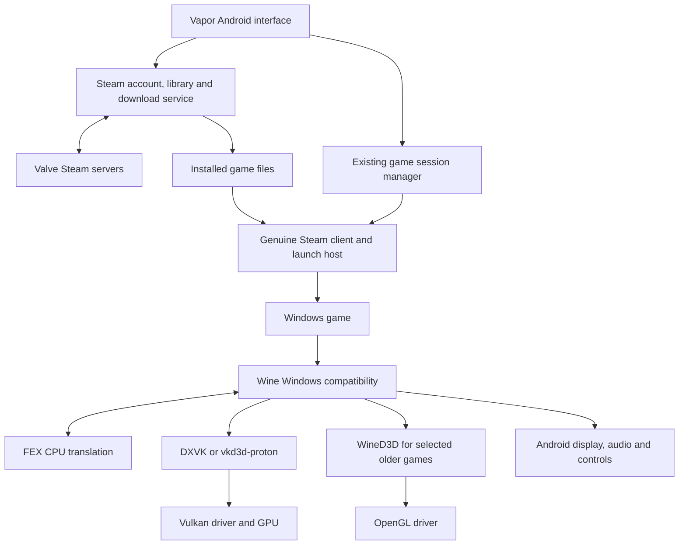
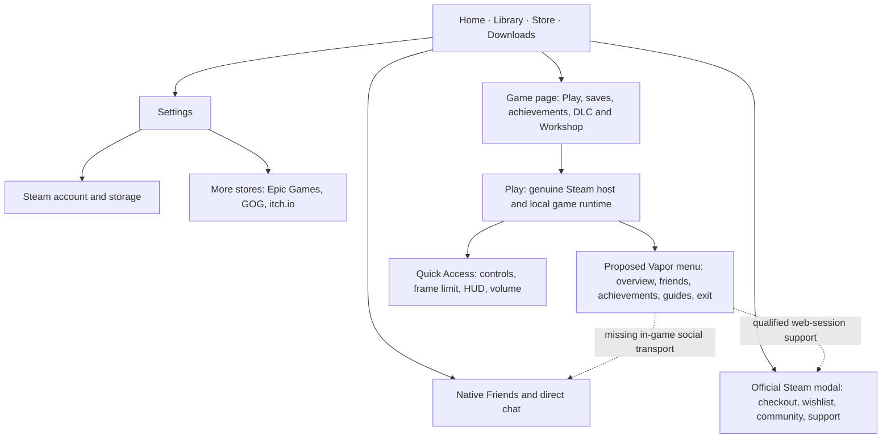
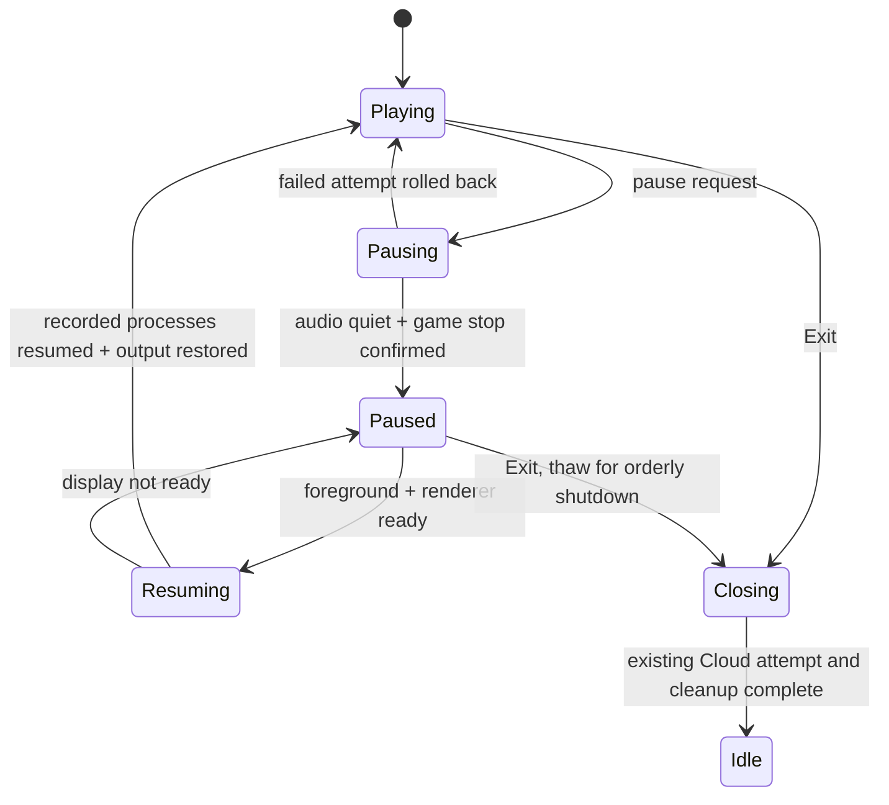
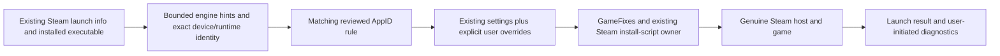
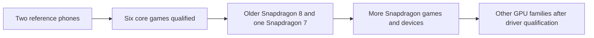

# Vapor implementation roadmap

## Product boundary

Native Android interface, local Windows-game execution, Steam-owned content downloaded through the user's account. No streaming, OS replacement, ownership simulation, custom backend, or new download database. Reuse WinNative's owners: Steam services, session manager, game settings, Room records, and Android UI.



## Graphics component source engineering — 21 October 2026

The accepted scope now explicitly includes source-level performance refactoring
of the drivers, graphics translators, Wine and FEX. Use the existing component
formats and retain credited upstream code. A complete rewrite, new runtime
manager, configuration database or graphics service is not required.

**Completed bounded checkpoint:** Turnip wait-any, wrapper image creation and
wrapper tracing have source changes; both components' baseline/candidate Android
libraries build. The candidates pass 37 Turnip cases, 26 wrapper image cases and
seven generated-call cases with clean sanitizers, plus the separate allocation
and read-only-memory checks. Meson's generator dependency is corrected. Original
controls expose the recorded faults. The wrapper also passes an offscreen native
load and BC probe on the 4 KB API 36 and 16 KB API 37 emulators, a staging
lifetime review records the upstream late-free/growth behavior plus one
conditional open risk, and a packaged-payload identity check bounds the release
reproduction (Leegao recipe located; exact bytes not reproducible from retained
inputs; default/GameNative are a different source line with exact revisions
open), a reference-image probe now verifies exact BC1/BC3 (and BC4/BC5) wrapper
decode plus bit-exact depth transfers on 4 KB and 16 KB emulators (synthetic
data, software Vulkan) with two suspected wrapper-side software-emulation defects
recorded, and the staging-reclamation patch is runtime-validated on 4 KB and
16 KB including stress. No APK/default or physical performance result.
[Qualification](QUALIFICATION.md#graphics-component-source-refactors--21-october-2026).

Continue in this order:

1. Qualify the native Turnip wait-any refactor through actual driver loading and
   rendering. Compare the baseline and candidate built from identical inputs;
   count how often the changed path is reached before inferring a game benefit.
   Preserve the working driver and ordinary Steam/Cloud teardown.
2. Continue wrapper verification. The released-payload identity/reproduction is
   bounded: Leegao recipe located, exact bytes not reproducible from retained
   inputs; the default and GameNative payloads are now source-identified as builds
   of the public Pipetto-crypto/mesa and GameNative/mesa forks respectively (the
   GameNative payload is byte-identical to a published wrapper-gamenative release
   artifact; exact build refs remain partly open). Native loading, synthetic BC decode, depth transfers, sampling/rendering
   and BC7 pass the emulator probes: a reference-image probe matches independent
   S3TC, RGTC and BC7 decoders exactly for the wrapper compute path (BC7 on both
   4 KB and 16 KB), and a graphics-pipeline probe renders wrapper-decoded
   BC1/BC3 UNORM/sRGB textures correctly (32/32 checked readbacks pass, RGBA8
   controls byte-exact). The BC_SRGB storage inconsistency is root-caused and
   fixed experimentally by `tools/vulkan-wrapper/srgb-storage.patch` (host-CPU
   path now linearises; A/B closes the 74-LSB gap to 1 LSB; reference-tool
   expectation update pending). Next: run the probes on an Adreno/KGSL phone
   (runbook ready); the staging-reclamation patch is now runtime-validated on
   4 KB and 16 KB (unfenced/one-time, reset/begin, `vkQueueSubmit2`-with-fence,
   stress peak 2–16 tracked vs 512 for the control), with a documented
   semaphore-only limitation. A no-GPU CI lane qualifies placed-memory loader
   plumbing and capability skip (lavapipe SKIP, patched mock ICD supported,
   Android emulator paths documented as absent), and an independent APK
   reproducibility lane builds the pinned APK on two separate runners and fails
   on any byte difference.
   Remaining: real-driver placement semantics (RADV/ANV/NVK/Turnip), a
   validation-layer run over the wrapper itself, concurrency, physical-phone
   duration, the host-CPU odd-extent overrun, and an upstream decision/packaging
   note for the sRGB host-path fix.
3. Deepen DXVK queue/compiler and VKD3D shader/capability/descriptor review on the
   exact packaged ARM64EC bases. Measure submission cost, shader stalls, waits,
   memory and cold/warm behavior. Reuse upstream priority/cache mechanisms;
   refactor a demonstrated cost with a small source patch and regression checks.
4. Continue Wine display/synchronization/media and FEX instruction/cache work
   from their existing component experiments. Match Bionic interfaces and the
   genuine Steam host. The unresolved ntsync owner-death gate blocks promotion,
   not analysis of other Wine performance paths.
5. Use EmuReady reports to choose reproducible game/device/configuration cases,
   retaining platform, edition and runtime differences. Start with the user's
   Helltaker, TF2 training and Ghostrunner Demo; treat Onimusha's capability error
   as a separate investigation. Reports do not replace source traces or matched
   phone evidence. Other GPU families require their own kernel/driver review.

Each source change needs an input revision, explained cost reduction, source
regression, native build and the relevant device result before promotion. Track
reviewed paths and open boundaries in the existing
[runtime research](RUNTIME-RESEARCH.md#direct-driver-and-translator-engineering--21-october-2026)
and component receipts. No whole-repository or full-catalog audit is complete.

## EmuReady community reports — 21 October 2026

**Read-only slice implemented and locally checked.** The public API reader,
shared native modal, identity guards and explicit settings viewer are in place.
44 focused JVM/Compose tests passed on the first APK; a follow-up review then
fixed eight matching/gating/error-state findings and re-verified with 41 JVM
tests (24/24 + 17/17), 17 report/game-page Android checks and 14 catalog-install
Android checks on the rebuilt Kotlin/resource APK (native libraries reused at that
point; a later full native rebuild with Rust/cargo rebuilt the APK and re-passed
the JVM and both Android suites). Live signed-out catalog browsing retrieves Windows
Half-Life 2 reports and settings. A live public-API re-check confirmed the
reader's request format and response shapes, including the load-bearing Windows
platform guard; the earlier 403s were the desktop web path's origin gate, and
batch AppID coverage gaps make the title fallback load-bearing. A signed-out
emulator journey then rendered live Half-Life 2 reports and settings and opened
both source links in Chrome; a clean-rebuild difference was then root-caused to
build inputs/metadata and two fixed-input clean builds produced byte-identical
APKs. [Qualification and
screenshots](QUALIFICATION.md#emuready-community-reports--21-october-2026).
Selective settings application and automatic route ranking are not implemented;
physical-phone/TalkBack acceptance, live coverage of the Windows-less gating
branch, and cross-machine/release-signing reproducibility remain (same-machine
byte-identical APKs were demonstrated with a pinned `BUILD_ID`,
`SOURCE_DATE_EPOCH` and clean packaging).

Implementation scope and verification plan:

Implement the read-only slice reviewed in [runtime research](RUNTIME-RESEARCH.md#emuready-compatibility-prior-art--20-october-2026):

1. Add an on-demand public API reader beside the library feature. Resolve Steam
   identity and require the Windows platform; title-only matches remain labeled.
   The live lookup can return a Switch game with the same title, so reject that
   result and search for an unambiguous Windows entry before reading reports.
2. Reuse a native Community reports modal from installed Steam game pages and
   catalog details. Fetch settings only when a report is opened; retain report
   source/device/emulator context. No account, settings import or launch dependency.
3. Verify JSON boundaries, platform/demo identity, missing reports versus service
   errors, cancellation, controller actions and narrow/large-text layouts. Run
   focused JVM/Compose checks, compile the APK, then inspect an emulator capture.

Do not add a backend mirror, startup library scan, generated GameNative config
import, or automatic report submission. Settings application remains a later slice.

## Production parent-runner execution — 20 October 2026

`tools/tests/steam-probe-parent-runtime.cpp` includes the existing launcher source
with its entry point renamed, then directly calls its local `run_probe_exe` function.
It does not invoke the genuine Steam startup entry point and does not duplicate or
extract the process runner into another production abstraction. Logs go to files
inside the isolated test directory rather than the prefix's ordinary launcher log.

Seven cases exercise that exact function: normal result import with a seeded stale
log, missing executable, invalid executable, a directory blocking the log path,
command-length overflow, a continuously busy callback source, and a hung child
with the actual 25-second deadline. The hot callback source never returns idle,
so an unbounded drain would prevent the wait loop from completing. Its acquisitions
and releases must match in batches of 64. Process enumeration checks no matching
fixture child remains after each call.

The timeout must log forced diagnostic termination and unconfirmed cleanup, confirm
child exit, omit a shutdown completion audit, and return within the test's broad
25–35 second correctness window. These intervals are timeout checks, not game
loading, CPU, graphics or battery benchmarks. The marker-file selection and the
whole authenticated Steam handoff remain separate from this direct function test.

Build next to the already-built matching `probe.exe` and controlled API DLL:

```sh
x86_64-w64-mingw32-clang++ -std=c++17 -O2 -Wall -Wextra -Wno-unused-parameter -static -mwindows -Iapp/src/main/cpp/wn-steam-launcher tools/tests/steam-probe-parent-runtime.cpp app/src/main/cpp/wn-steam-launcher/clean_shutdown.cpp -ladvapi32 -lkernel32 -luser32 -o parent.exe
```

Repeat with i686, then launch `parent.exe` through the prepared account-free
container as with `integration.exe`. Require all seven case verdicts and final
`result=PASS` in `parent.exe.result`. Actual emulator screenshots and the exact
input/log hashes are recorded in the qualification evidence. CI cross-compiles
this fixture with its existing MinGW installations; no Wine run is added to CI.

## Production probe DLL boundary — 20 October 2026

The next execution gate uses the **actual `iface_probe.cpp` executable**, not a
second receiver implementation. `tools/tests/steam-social-fixture.cpp` builds a
controlled public-API DLL, and `tools/tests/steam-social-probe-runtime.cpp` starts
the production probe as a Windows child and checks its exit code, diagnostic log
and fixture shutdown audit. These files are test-only; they must remain in an
isolated Downloads test directory and must never replace a game's Steam DLL.

The nine cases cover capability-only reads, a received entry, a quiet window,
malformed callback rejection, listener-enable rejection, listener-disable failure,
explicit event cancellation, a missing selected DLL, and forced termination of a
stuck callback frame. Each acquired callback must be released, no sending export
may be called, and the fixture's private message text must stay out of probe logs.
This exercises the `SteamAPI_Init` fallback; the fixture does not export the
internal initialization function and does not open a Valve session.

### Cancellation found during execution

Console-control attempts reported success from `GenerateConsoleCtrlEvent`, but
the probe returned the ordinary quiet-window result. This reproduced with both
targeted/broadcast event delivery and production-matching creation flags. The
underlying Wine/FEX/console mechanism is not diagnosed. Console cancellation stays
unqualified; the earlier failed trace and screenshot are preserved.

The receive-only probe now creates a per-process named Windows event:
`Local\VaporSocialProbeCancel-<Windows PID>`. A diagnostic parent can open it with
`EVENT_MODIFY_STATE` and call `SetEvent`. The receiver's existing wait callback
waits on it for 100 ms between dispatch ticks. Cancellation still flows through
listener disable and Steam API shutdown. The event handle closes after shutdown;
creation/collision/wait errors report failure. Console handling remains best-effort.
This is a kernel object for diagnostic control, not a new Steam connection,
persistent setting, background service, or Android chat bridge.

The fixture driver requests this event after the DLL audit reports listening. Its
hang case separately kills a child that cannot return from `RunFrame`, checks that
the process exits with 124, and requires that no shutdown completion was recorded.
**This does not execute the genuine host's parent wait loop**; that loop and its
25-second deadline remain an independent integration gate.

To reproduce, place these three matching-architecture outputs together in a
new isolated directory (`steam_api.dll` for i686, `steam_api64.dll` for x86_64):

```sh
x86_64-w64-mingw32-clang++ -std=c++17 -O2 -Wall -Wextra -Werror -static -shared tools/tests/steam-social-fixture.cpp -o steam_api64.dll
x86_64-w64-mingw32-clang++ -std=c++17 -O2 -Wall -Wextra -Werror -Wno-unused-parameter -static app/src/main/cpp/wn-steam-launcher/src/iface_probe.cpp -lkernel32 -lcrypt32 -liphlpapi -o probe.exe
x86_64-w64-mingw32-clang++ -std=c++17 -O2 -Wall -Wextra -Werror -static -mwindows tools/tests/steam-social-probe-runtime.cpp -luser32 -o integration.exe
```

Copy the isolated directory to Downloads and launch `integration.exe` through the
prepared container's `boot_exe` entry as in the receiver-contract instructions.
The driver writes `integration.exe.result` and a `.log`/`.trace` per case beside
it. Require all nine case verdicts plus final `result=PASS`; the GUI is only a
summary. Its optional single argument selects one named case for diagnosis.
The runtime files are test artifacts, not APK or game-library payloads.

CI uses the already-installed MinGW toolchains to compile both test sources; it
does not execute Wine or Steam. Results and exact input hashes belong in the
[qualification record](QUALIFICATION.md#production-probe-controlled-dll-execution--20-october-2026).

## Receiver contracts executed under Wine/FEX — 20 October 2026

The receiver's existing 33 injected-export scenarios now execute as both x86 and
x86_64 Windows PE programs through the emulator's normal display/runtime Activity.
Both pass. This moves those contracts beyond host-native tests and cross-compilation;
it does not test the genuine Steam API DLL or incoming network delivery.

The small test-only entry point in `tools/tests/steam-friends-receive-runtime.cpp`
reuses the same receiver test source. It redirects test output to `<exe>.result`
and shows a 12-second Win32 summary window for an actual Android screenshot.
Assertions remain enabled. Missing completion, an assertion abort or summary-window
failure is not a pass. The fake reader was renamed to avoid MinGW's `read` overload;
the receiver implementation did not change. CI now also cross-compiles this entry
point using its existing MinGW toolchains; CI does not run it under Wine.

Reproduce in an account-free prepared test container, using toolchains on PATH:

```sh
x86_64-w64-mingw32-clang++ -std=c++17 -O2 -Wall -Wextra -Werror -static -mwindows tools/tests/steam-friends-receive-runtime.cpp -luser32 -o steam-receiver-contracts-x86_64.exe
i686-w64-mingw32-clang++ -std=c++17 -O2 -Wall -Wextra -Werror -static -mwindows tools/tests/steam-friends-receive-runtime.cpp -luser32 -o steam-receiver-contracts-i686.exe
adb -s emulator-5554 shell mkdir -p /sdcard/Download/VaporSteamSocial20261020
adb -s emulator-5554 push steam-receiver-contracts-x86_64.exe /sdcard/Download/VaporSteamSocial20261020/
adb -s emulator-5554 push steam-receiver-contracts-i686.exe /sdcard/Download/VaporSteamSocial20261020/
adb -s emulator-5554 shell am start -n app.vapor.android/com.winlator.cmod.runtime.display.XServerDisplayActivity --ei container_id 1 --es boot_exe 'D:\VaporSteamSocial20261020\steam-receiver-contracts-x86_64.exe'
```

Wait for the window to close and inspect the matching `.exe.result` for both the
33-scenario line and `result=PASS`. Stop the fixture session, then repeat with the
i686 executable. This requires the prepared container's D: drive to map Downloads
and Steam launch to be disabled; do not run it in an active game session. Timings
include boot and the summary timer and are not game-performance measurements.
No runtime/driver configuration was written; the container bytes and four recorded
FEX DLL/SO hashes were unchanged after both runs. The fixture session was stopped
and Vapor was reopened to Home afterward.
[Results and screenshots](QUALIFICATION.md#receiver-contracts-on-android-winefex--20-october-2026).

The next boundary is loading a fixture DLL through the production probe, then a
genuine Steam session. Windows process-runner timeout and console-control delivery
are still separate checks; synthetic callback cancellation is already covered here.

## Genuine-host diagnostic integration — 20 October 2026

Plan and scope: extend the existing `C:\wn-iface-probe.on` diagnostic switch,
reuse its child-process runner and host log, then test mode parsing and compile
both host architectures. This prepares local instrumentation; it does not enable
live chat or replace the Android conversation owner.

The marker's text now selects the probe:

| Marker content | Behavior |
| --- | --- |
| Empty or whitespace | Existing legacy interface diagnostic, including its original auth-ticket probes |
| `social` | Read-only Friends capability mode |
| `social-listen` | Receive-only observation window |
| Anything else / unreadable / oversized | Report invalid marker and skip gameplay; never substitute legacy mode |

This uses the existing marker, not another settings store. Remove it to restore
normal launches. An opt-in diagnostic run skips gameplay even if its binary is
missing or fails to start. Both existing architecture probes are attempted in
sequence; the game API DLL for a missing architecture may report a load failure.
The per-probe result is copied into the existing host log after normal exit.
Previous per-probe logs are removed before execution, so a failed run cannot be
mistaken for an earlier result.

The host pumps its own callback pipe between 100 ms process waits. Each iteration
is capped at 64 callbacks and the process wait deadline is 25 seconds per probe.
An expired/failed wait requests termination, waits up to two more seconds, and
reports cleanup as unconfirmed; a failed termination/exit confirmation is logged
explicitly. This is not a claim of a graceful Steam shutdown. Child-process and
console behavior still require Windows/Wine/FEX execution testing.

Local gates: 13 mode-parser scenarios, 33 receiver scenarios and 15 capability
scenarios under ASan/UBSan; cross-build x86/x86_64 host components outside APK
assets. No APK packaging or live Steam operation is part of this step.

## Passive Friends receive diagnostic — 20 October 2026

The same interface probe now accepts `--social-listen` in place of `--social`:

```text
wn-iface-probe.exe "C:\path\to\game" <AppID> "C:\social-receive.log" --social-listen
```

This is a diagnostic for a matching game API DLL and an already-running genuine
Steam host, not an Android chat feature. It opens no separate Steam protocol login.
It exclusively uses manual callback dispatch in its own process; it must not be
merged into a process using `SteamAPI_RunCallbacks` without revisiting ownership.
The observation has 100 ticks with 100 ms sleeps (nominally ten seconds, plus API
work), draining at most 64 callbacks per tick. Each acquired callback is released.
The receiver reads only valid Friends-message callbacks for its user, counts
ordinary chat reads, and disables interception before the caller shuts down Steam.
It never resolves reply/send exports and never logs message contents or friend IDs.

The callback envelope and event layout follow the Windows pack(8) ABI in Valve's
[pinned SDK internal declarations](https://github.com/ValveSoftware/Proton/blob/bc896217ffcd67f892f952b010f898fe7bd0f0a1/lsteamclient/steamworks_sdk_164/steam_api_internal.h)
and [Friends declarations](https://github.com/ValveSoftware/Proton/blob/bc896217ffcd67f892f952b010f898fe7bd0f0a1/lsteamclient/steamworks_sdk_164/isteamfriends.h).
A callback message index remains local to this API; it is not a CM timestamp or
ordinal, and successful reading does not establish outgoing acknowledgement.

- Exit 0 / `receive_observed`: at least one ordinary message was read.
- Exit 9 / `receive_window_no_message`: none was read during this window; this is
  inconclusive, not proof that the account cannot receive messages.
- Exit 10 / `receive_callbacks_rejected`: callbacks arrived but no ordinary
  message could be read successfully; inspect the rejected count.
- Exit 11 / `receive_cancelled`: the explicit cancellation event or console
  handler interrupted observation; listener disable still ran. Cleanup failure
  takes precedence. Console delivery is not qualified on this Wine/FEX setup.
- Exit 8: missing receive exports, unavailable session, rejected listener,
  failed listener disable, or unavailable/failed cancellation event. Shared
  file/init/argument failures retain their codes. Social modes require a shutdown
  export before API initialization, so normal cleanup is available.

The next gate remains running this probe under Wine/FEX against a genuine session
and an authorized incoming test message. Only then should the existing Android
conversation owner receive a native event bridge. No second connection, persistent
chat queue or outgoing transport has been added. The opt-in existing-marker
launch integration is described above; normal game launches do not enable it.

## Native Steam social capability step — 20 October 2026

This starts the in-game social lane through the existing genuine-session path.
`wn-libsteamclient`'s Friends chat methods are stubs; their names do not establish
working message transport. The resident genuine host has a callback pump, but no
current native Friends-message command/event bridge to the Android conversation.

### Prior Art and decision

**Extend the existing `wn-iface-probe`, rather than add another Steam connection.**
The selected game already supplies its original Steam API DLL, and the probe
already initializes that API against a running client. Valve documents
[Friends-message callbacks](https://partner.steamgames.com/doc/api/ISteamFriends#SetListenForFriendsMessages),
with message reads in response to those callbacks and a separate reply method.
The [SDK flat API declarations](https://github.com/ValveSoftware/Proton/blob/bc896217ffcd67f892f952b010f898fe7bd0f0a1/lsteamclient/steamworks_sdk_164/steam_api_flat.h)
provide a public binding route without adding client-build-specific vtable offsets.
No new dependency, background service, account, chat database or transport is added.

### Implemented first step

The probe has an explicit `--social` mode after its existing game-directory,
AppID and log arguments. Use the directory containing that game's original
`steam_api64.dll` or `steam_api.dll`, and the matching probe architecture. The
mode refuses to substitute an API DLL from the general DLL search path if the
selected file cannot load. A too-long selected DLL path is reported as a failure.
The usual host launch does not enable this mode automatically.

This mode resolves the public Friends accessor (v018, or v017 when absent), reads
the ordinary-Friends count, and reports the availability of listener, message,
reply and manual-dispatch exports. It neither enables listening nor reads/sends
messages. It omits the legacy probe's certificate import, other DLL probes,
auth-ticket requests and ticket/hardware logging. The original diagnostic mode
retains its existing behavior. No Android Steam reconnect or login is requested.

| Probe result | Meaning |
| --- | --- |
| Exit 0: `exports_present_delivery_unverified` | A Friends count query succeeded and candidate exports exist; no chat delivery is established. |
| Exit 6 | A required accessor/read export is missing, the interface is unavailable, or the Friends query reports no connected session. |
| Exit 7 | Friends are readable, but candidate chat/manual-callback exports are incomplete. |
| Exit 1/2/3/4/64 | Log/file/init/argument failure; inspect the diagnostic instead of treating it as a supported transport. |

Missing flat exports identify a limitation of this probe/API-DLL combination,
not proof that the phone or Steam itself cannot support chat. A zero count is a
valid read result, not a fully populated Friends-list or message-delivery proof.

### Local result and next proof

Fifteen injected-export scenarios pass with AddressSanitizer and UndefinedBehaviorSanitizer.
The x86 and x86_64 Windows probes compile with warnings treated as errors. The
binaries are staged outside APK assets; no APK or bundled runtime was changed.
No ADB device is currently connected, and no live Steam session was used.
See [native evidence](QUALIFICATION.md#native-steam-social-probe--20-october-2026).

The next bounded proof is receiving one genuine Friends callback through a
single selected callback-dispatch mechanism, without reconnecting Android's CM
client or logging message contents. Valve's
[manual-dispatch contract](https://github.com/ValveSoftware/Proton/blob/bc896217ffcd67f892f952b010f898fe7bd0f0a1/lsteamclient/steamworks_sdk_164/steam_api.h)
prohibits mixing it with the regular Steam API callback dispatcher. The existing
host callback loop must not be replaced speculatively.

Before native chat is enabled, handle the identity mismatch explicitly: the
public game callback provides a friend/message index, while Vapor's CM chat
history uses server timestamp/ordinal identities. Do not manufacture server
identities or clear a draft merely because a local reply call returned. Native
UI events, acknowledgement/history reconciliation, exit cleanup and a deliberate
live send/reply remain separate implementation and qualification steps.

## Settings controller continuation — 20 October 2026

The compact editor's section strip now uses Left/Right, with Up to its action row
and Down/A into the form. Wide sidebar directions remain unchanged. Resizing,
selected-page return, first-input focus and loaded-state Save protection are checked
through the existing navigator. The combined local batch passes 40 focused JVM
tests; Android UI test sources compile. Physical gamepads/key-repeat, phone UX and
APK checks remain separate. See [input evidence](UI-UX.md#game-settings-controller-navigation--20-october-2026).

## Game settings UI continuation — 19 October 2026

The existing editor now adapts to its own width and text scale: compact navigation,
a separate game heading, paired-field reflow and readable artwork actions extend
the current state and persistence owners. Wide windows retain the sidebar. Nine new
layout checks and 22 social regressions pass locally; Android UI test sources compile.
APK/device and physical-controller checks remain deferred. See [UI evidence](UI-UX.md#game-settings-layout--19-october-2026).

## Friends and Chat UI continuation — 19 October 2026

The social panels now share the Steam-focused shell palette, readable scrolling
settings, 48 dp account/close targets and responsive conversation widths. Eight
account-free production-layout checks and 14 existing conversation/service checks
pass locally; Android UI test sources compile. No APK/device run or live Steam
message was used. Physical controllers, phone keyboard lifecycle, TalkBack and
live delivery remain qualification work. See [UI evidence](UI-UX.md#friends-and-chat-presentation--19-october-2026).

## Setup and sign-in continuation — 18 October 2026

The native first-run screens now share Vapor's shell branding and measured layout.
QR/account selection, Steam Guard recovery, preparation feedback and controller
focus extend the existing owners. The auth fix cancels abandoned code challenges
instead of leaving a receiver waiting through retries. Local UI and auth checks
are recorded separately from live account, physical controller and Xiaomi
acceptance. The Downloads continuation now separates transfer stages, filenames, recovery actions
and completion. Trusted completed Steam installs open the existing game page.
The automatic graphics requirement below remains a separate runtime lane.

## Component continuation: Wine and FEX — 18 October 2026

The next local work skips additional APK/phone checks at the owner's request.
Use the existing component formats and source experiments:

1. Reconstruct the pinned Wine package's source/patch/dependency inputs from its
   identified base and upstream build/release records. Compare existing Android
   adaptations before importing fixes. A version string alone does not reproduce
   the full package. Verify by a pinned input manifest and replay/build checks;
   keep unavailable inputs explicit rather than inventing a matching recipe.
2. Apply the unmodified upstream FEX cache-blob fix to the already-recorded 2610
   experiment. Rebuild both ARM64EC and WOW64 Windows DLLs with the retained
   toolchain, preserving the original Bionic Unix libraries. Package a distinct
   experimental WCP with all patch/license/input records; no default activation.
3. Run the existing account-free Windows cache probes on the prepared emulator,
   checking cold/warm reuse, mixed guest architectures, invalidation and cache-off
   behavior. Verify applied payload hashes, then restore the prior runtime and
   test-owned settings/files. These are component checks, not APK or Steam tests.
4. Update the existing runtime/provenance/qualification records with actual build
   and probe results. Physical performance, Steam handoff, codecs and modern
   Android execution remain separate gates.

**19 October result:** both FEX DLLs are rebuilt with the unmodified upstream fix;
all 15 cache phases pass, with two restored-baseline runs and exact byte restoration.
The Wine source/dependency path now builds its X11 target and native dependencies.
External-pointer comparisons reproduce lost clipped clicks in the original module
and pass all eight candidate phases across x64/x86. The original runtime/settings
are restored. Guided defaults and the APK are unchanged. This completes the current
bounded component pass; the complete Wine package's patch/Steam ABI mapping,
fullscreen/Vulkan game checks and phone performance remain unqualified.
See [results](QUALIFICATION.md#runtime-components--19-october-2026).

## Automatic graphics attempts — 18 October 2026

The bounded implementation now lives in the existing launch, driver-probe, shortcut
and exit paths. For fresh Steam launches using the guided Proton/graphics baseline,
Vapor checks the selected installed driver and System driver, then constructs eligible
legacy DXVK, modern DXVK, paired DXVK/VKD3D, or selected older-game WineD3D attempts.
It does not download or enable an experimental driver as a retry. Explicit per-game
Wine/graphics choices and other runtime configurations retain their existing path.

A complete static D3D12 import scan selects the prepared modern pair first. A small
set of explicit translator startup diagnostics can trigger another eligible attempt,
with a total limit of four. A loading delay, one frame, generic crash, Steam login or
Cloud error is not a graphics diagnosis. Retries stop on cancellation, backgrounding,
uncertain cleanup, a changed target or changed components. The owning session worker
orders preparation and teardown; another attempt runs after host/process/environment
cleanup and release of the existing per-AppID Cloud reservation.

The loading screen names the attempt and graphics choice and offers Cancel launch,
including controller B. A remembered choice requires the host's explicit game-process
observation, at least 120 frame observations across 20 seconds, and a clean exit.
This is startup evidence, not a Verified badge. The existing shortcut holds the choice
and its device, game/build and actual component-file fingerprint. Failed remembered
choices are cleared. Steam-created files and directory timestamp changes are not
mistaken for a new game build.

Local verification and package identity are recorded in
[qualification](QUALIFICATION.md#automatic-graphics-routing--18-october-2026).
**Physical Onimusha failure/retry/recovery is still pending.** Minimum underlying-driver
feature checks do not establish the whole wrapper/translator/Wine chain or all game
feature levels. Some failures never emit a recognizable startup diagnostic. Native
driver crashes can terminate Android itself; this flow does not claim recovery from
those crashes or unsupported hardware features.

Direct component work remains a separate qualification gate: the FEX cache-source
patch and balanced Turnip/KGSL package under `tools/fex` and `tools/turnip` are
experiments. The [runtime follow-up](RUNTIME-RESEARCH.md#runtime-and-driver-follow-up--18-october-2026)
records current upstream fixes and holds. Do not activate the reviewed unsafe DXVK
binary-semaphore fallback or non-recoverable ntsync fallback as an automatic option.

## Idle-work first pass — 18 October 2026

Keep the existing service, Library and image-loader owners. Shared decoded artwork
now has a device-aware cache budget. Library prefetch is bounded and cancellable
when the screen is hidden, while completed disk files and the Library snapshot stay
available for quick returns. The launcher trims its image cache on game handoff.
The first local pass has **21 passing JVM checks**. This is an implementation and
local-test milestone, not measured idle RAM or phone acceptance. Measure PSS and
warm return time on the reference phone before claiming the proposed budgets have
been met. Existing game/download/Cloud/chat lifecycles remain unchanged.
See [qualification](QUALIFICATION.md#artwork-and-idle-work-checks--18-october-2026).

## Native game page continuation — 17 October 2026

The installed-game page now groups everyday actions beside Play and moves maintenance
under Manage, retaining existing launch, save, store and branch owners. A measured header
and body replace the fixed top reservation. Wide title/history and actions use parallel
columns; narrow or large-text windows reflow and scroll. The short-wide clipping regression,
controller A/B behavior and existing removal reservation are covered in a clean 26-case UI
batch. Native portrait and landscape component renders are reviewed with labeled sample data.
The placeholder logo and all 222 bundled runtime/native entries remain unchanged.

This completes the game-page portion of the current frontend pass. Next extend the same
hierarchy to the **existing Downloads queue and install-to-Play feedback**, then check the
whole native Library → game page → progress → return journey. Do not introduce another
queue or session state owner. Phone/live Steam checks remain deferred at the owner's request;
local UI/packaging checks are not gameplay, Cloud round-trip or public-alpha qualification.
See the [game-page implementation record](QUALIFICATION.md#native-game-page--17-october-2026).

## Native launcher and Store recovery — 17 October 2026

Home and the Library carousel now share one native cover shelf, with portrait
artwork, an enlarged selection, in-place title/status and game settings. First
touch selects; a second touch or Open game enters the existing native game page.
Uninstalled games keep their existing manager. New Library settings default to
the carousel; saved Grid/List choices remain available. This replaces the wide
Home card and separate Library featured banner rather than adding another view.

The current placeholder is a three-pivot mechanical V with two short leftward
vapor trails, a white silhouette and navy-to-blue launcher background. App and
launcher share the same vector; standalone SVG exports use a tight crop.
Translucent navy panels, subtle light edges and static Home/Library artwork blur
apply the requested glass styling to existing native controls. Invisible drawer
swipe areas are restricted to the outer gutters so they no longer intercept
Store action taps, while both drawer swipes remain available.

Store search now shows one spelling correction only for empty matches. Refresh
retains the current query's rendered page with a warning/retry on failure;
reconnection retries a failed active page. Successful unchanged IME submits do
not repeat requests, and counts name the chosen subset. Steam's `no-store` HTTP
policy remains intact; no persistent catalog cache or background retry service
is added. The reported 84 records were the selected Hot games subset, not the
entire Steam catalog.

The normal account-free app confirms retained-card refresh recovery and full
catalog browsing. The subsequent trace reproduces the second, new-query failure:
the reconnect retry fires, but its HTTP call times out after 20 seconds. Recovery
now discards idle connections from the old network through the existing HTTP owner
before retrying. The controlled two-disconnect sequence then recovers both the
retained Factorio page and a new Hollow Knight search without manual Retry.
The browser also retains a reconnect signal behind details/web modals and reads
the existing connection state without a synchronous Android connectivity query
on the UI thread. Phone/network diversity remains a separate acceptance gate.

The earlier native-shelf build passes 42 selected Android UI and 26 catalog/Library
JVM checks locally. The UI follow-up removes duplicate shelf captions so portrait
covers retain their full proportions, reserves the action panel's bottom padding
in short wide windows, and spaces stacked Store filters. Current validation and
artifact identities are recorded in the qualification record. The owner rejected the
five-joint logo study; the later three-pivot revision is now accepted as a placeholder
while app development continues. All 222 bundled
runtime/native entries match the previous Cloud-exit APK. Game runtime, Steam
session/Cloud behavior, physical gameplay and modern-target qualification remain
the existing gates. See the [implementation and evidence
record](QUALIFICATION.md#native-cover-shelf-and-store-recovery--17-october-2026)
and [interaction details](UI-UX.md#console-style-cover-shelf--17-october-2026).

## Xiaomi gameplay milestone — 14 October 2026

The owner reports EU3 running “flawlessly” on the Xiaomi Snapdragon 8 Elite Gen 5, and TF2 training running with Steam connected without observed frame drops. Local gameplay on a reference phone is now demonstrated by owner feedback. Preserve that working configuration; next record its identity/settings and check save/reopen, input and longer sessions. The [phone evidence record](QUALIFICATION.md#owner-reported-xiaomi-gameplay--14-october-2026) separates these two successes from measured performance, online multiplayer and the six-core-game matrix.

The preceding game-menu build added the visible in-game Vapor button, Return to game and consumed dismissal touches through the existing session host. Five menu and six Home checks pass. Runtime assets/native libraries match the preceding stores APK. The separate emulator container attempt exited before its desktop, so menu behavior in a running game still needs the phone check. See [the menu build record](QUALIFICATION.md#native-game-menu--14-october-2026). The latest navigation change keeps Steam at the centre and moves other store accounts and browsing into Settings → More stores; see [the 15 October build record](QUALIFICATION.md#more-stores-navigation-and-suspend-research--15-october-2026).

## Store and session recovery — 15 October 2026

On 16 October, an account-free Windows test reproduced a second-request race in
the genuine host: Android's sentinel could terminate a cleanup thread already
handling normal game exit. The host now leaves that owner running. Original
x86/x64 runs each fail both game-first cases; corrected runs pass 16/16 process
cases, with 53 JVM and four UI checks passing. Both packaged hosts are rebuilt.
This closes a local source failure, not the phone's Cloud acceptance gate.
[Trace and limitations](QUALIFICATION.md#overlapping-steam-host-exit-requests--16-october-2026).

The owner has supplied gameplay screenshots for You Have to Win the Game and Helltaker and
confirmed sound in all reported tests. You Have to Win the Game also has a reported second-launch
Cloud hang requiring an app restart, with no visible error. Save/reopen and remote Cloud correctness
remain open; this report takes priority over expanding the game list.

The current implementation keeps observing the genuine host after launch, connects normal game
exit to existing cleanup, adds an Android-side launch Cloud deadline, prevents pre-game failures
from uploading old local saves, and surfaces unfinished exit uploads. A zero-file synchronized
result is valid; the UI says Cloud is up to date rather than claiming a file was uploaded. Native
Cloud errors cancel launch, and cleanup owns the handoff release. The reported phone failure has
not been reproduced from logs and is not declared resolved until the updated APK is retested.

Native Store filters/categories, search as you type, a top-seller feature and inset Steam web modals
are implemented through the existing owners. No additional store service, account database,
compatibility badge or game preset was added.

Next acceptance sequence: repeat You Have to Win the Game launch → normal Quit → launch, then
repeat using Vapor's Exit game; create real progress and check local reopen, then inspect Steam's
remote file timestamp/content. Preserve the working phone settings and existing saves. Only after
that check should the small-game screen proceed to The Murder of Sonic the Hedgehog and Gravitas.
[Qualification details](QUALIFICATION.md#store-and-session-recovery--15-october-2026).

The [16 October phone follow-up](QUALIFICATION.md#xiaomi-repeat-exit-and-save-restoration-check--16-october-2026)
is the current detailed sequence: preserve saves/settings, upgrade without fresh
preparation, repeat normal Quit and Vapor Exit in You Have to Win the Game first,
then Ghostrunner Demo. Remote restoration uses a separate test environment after
confirmed upload; Helltaker is for achievements and local progression. Active
save reservations are not persistent unsynced-save state. All five phone case
groups remain pending; no device was connected at the protocol check.

The same-day follow-up now cancels the previous exit's reconnect/status cleanup on a new handoff,
orders the status retry after the existing reconnect delay, and prevents a Home resume from
bypassing that delay. Background suspend waits for reserved save cleanup. The loading screen
also places the live phase beside the title/artwork in landscape. These changes reuse the existing
service and loading state; the runtime binaries/settings are unchanged from the Store/session APK.
The next acceptance sequence above is unchanged. [Follow-up evidence](QUALIFICATION.md#session-handoff-and-loading-layout--15-october-2026).

## Current delivery: accounts, direct installs and Steam web features — 14 October 2026

The accepted frontend is a hybrid: Vapor owns Home, Library, native catalog, installation, Downloads,
game settings and the game overlay. Official Steam pages provide checkout, Wishlist, Community,
guides and Workshop browsing inside a separate web panel. A Steam web install link returns to the
native game page; public metadata never creates ownership. There is no claim of full SteamOS parity,
fixed startup time, a percentage of features delivered, or a fixed memory saving.

First-run setup offers Steam connection or Set up later. The main navigation always exposes Home,
Library, Steam Store and Downloads. Other store accounts and Browse actions are on the dedicated
Settings → More stores page. Existing store authentication and download services remain the owners.
Owned paid titles use the same download path as other owned titles. Buying an unowned title is still a
store transaction. Steam demos/free-on-demand titles request the account license via the existing native
CM client, then wait for the ordinary license/PICS library records before installation.

| Feature | Current owner and delivery boundary |
|---|---|
| Steam setup and optional stores | Native Steam startup; other account and Browse actions are in Settings. Existing login services remain the owners; store-visibility preferences are retired. |
| Steam catalog, demos and paid games already owned | Native catalog and existing game manager/download queue. A parent page exposes its separate demo AppID. |
| Epic, GOG and itch.io downloads | Existing authenticated store managers; this change does not certify downloads or purchases on every store. |
| Steam checkout, Wishlist, Community, guides and Workshop pages | Official HTTPS web panel; short-lived access cookie minted by the existing CM authentication path. No refresh token is sent to page JavaScript. |
| Web page controller navigation | Standard WebView keyboard/D-pad focus initially. Complex pages, external payment flows and full spatial navigation require separate testing. |
| Cloud saves, achievements, DLC and branches | Existing native owners. Each account/game behavior still needs qualification; browsing an achievement or Workshop page is not proof of an in-game unlock or installed mod. |
| In-game controls | Native Android touch/joystick/touchpad overlays and editable profiles. Settings → Input Controls offers Virtual Gamepad, RTS and FPS layouts; the session Controls panel selects the layout, visibility, opacity and adaptive sticks. EU3 needs mouse/touchpad input. The Guide button now uses a Vapor V without changing saved bindings. Xiaomi gameplay is owner-reported; the input method and detailed overlay/controller checks are not yet recorded. |
| Hardware tuning | Show only controls backed by Android or the actual game runtime. No invented TDP, clock or fan controls. |
| Runtime compatibility | Genuine Steam host, Wine/FEX and graphics drivers remain the separate compatibility gate. Web features do not improve or prove game execution. |

Product copy, notifications, new recordings/save exports/log exports, updater identity and support links
now use Vapor. Existing working directories remain usable. WinNative remains named as an upstream
component supplier and credited source; internal JNI/package identifiers remain where runtime binaries
and existing saved state require them. Vapor's GPL license and attribution remain intact.

Implementation evidence and remaining authenticated/device checks are recorded in [QUALIFICATION.md](QUALIFICATION.md).

## Accepted reuse sequence — 14 October 2026

Keep the app GPL-3.0 and preserve WinNative's integration. The close-upload uninstall guard and the
source-confirmed shell lifecycle cleanup are implemented, with 15 selected JVM and 10
Android UI checks passing; see [qualification evidence](QUALIFICATION.md#targeted-upstream-reuse--14-october-2026).
The owner has now reported successful Xiaomi gameplay; next capture that working configuration. These are targeted changes to existing owners, not a replacement Steam
service or runtime. [The upstream applicability map](COMPETITOR-COMPARISON.md#verified-upstream-reuse-map--14-october-2026)
records exact references, existing functionality and incorrect claims in the proposals.

EU3 and TF2 training now have successful owner reports on the Xiaomi. The EU3 edition is not
identified, so retain EU3 Demo Test 0 as a reproducible comparison with the earlier emulator build.
The core matrix is six games times two phones (12 pending game/device results); these two
additional titles are recorded separately.
[The Test 0 procedure](QUALIFICATION.md#xiaomi-test-0--same-eu3-demo) preserves the earlier
emulator evidence and records the actual graphics/runtime path. A demo pass does not
establish Steamworks-required game support or a Steam Cloud save round trip.

Only a reproduced per-game failure justifies a compatible fix in the existing GameFixes
and game-settings path. A downloaded protonfixes interpreter, second Steam protocol
client, new synchronization runtime is not part of this baseline. The automatic-settings design below
reuses the current game-fix owner; remote distribution remains gated on a qualified local rule. After phone launch/input/audio/save evidence, compare upstream DLC, branch,
achievement, family-copy, agreement and input fixes against existing owners, one behavior
at a time. No public release is authorized by this research or by a successful local build.

The [Ghostrunner Demo observation](QUALIFICATION.md#ghostrunner-demo-loading-and-gameplay-observation--15-october-2026)
corrects the earlier Blade Runner identification. The owner reports unchanged-settings gameplay
and sound, visible hitching, and a timeout after exiting while Steam/Cloud closes. Prioritize that
exit and save-path trace. A later phone log confirms one two-file Cloud upload and clean logoff;
repeatability and restored progress remain open. Community full-game level 9–12 and late-game runtime-switch reports are
future regression leads, not automatic per-level configuration or evidence against this demo build.

## Steam features and integration plan — 15 October 2026

**Recommendation:** keep Vapor's native Steam-focused interface, finish the inherited social and
library paths, and use official Steam pages for commerce and community. Extend the on-demand
genuine host only for the features that must operate during gameplay. Do not add JavaSteam, a
second general Steam connection, a hosted social service or a new runtime to implement this plan.

This is the feature plan, not a claim of full SteamOS compatibility. The screenshot/audio reports
establish local game execution; the second-launch Cloud failure remains the first phone acceptance
check. The [session trace](QUALIFICATION.md#steam-session-and-close-time-cloud-trace--14-october-2026)
and [recovery work](QUALIFICATION.md#store-and-session-recovery--15-october-2026) remain authoritative.

### What the checkout actually contains

- **Friends and direct messages are already implemented in source.** `FriendsDrawerContent`,
  `SteamChatScreen`, `SteamServiceFriendsChat` and `ChatOverlayService` use `WnSteamSession`.
  JNI already exposes friend/persona retrieval, text sends, message history, incoming-message
  draining and image sends. The [chat recovery build](QUALIFICATION.md#friends-and-chat-recovery--15-october-2026)
  now distinguishes unavailable/cached status, retains unconfirmed text drafts and merges
  acknowledgements, live echoes and history by Steam message identity. Qualify these existing
  owners with real accounts; no second chat stack was added.
- **The Android connection is intentionally suspended during gameplay.**
  `bionicHandoffAcquireImpl` disconnects it and cancels `messagePollerJob`. The genuine host owns
  the game session. A native chat drawer wired only to that disconnected service cannot deliver
  live in-game chat. Cached friend state must not be presented as live.
- **Web authentication has the same dependency today.** `SteamWebSession.connect()` calls
  `withWnSession`, which refuses work while `suspendedForBionic`; JNI's `nativeGetWebAccessToken`
  also requires a connected runtime. Each panel attempts this connection and refreshes its
  cookies. Simply adding a Chat URL does not solve authentication during a game.
- **The web panel refreshes the library when it closes already.** `SteamCatalogScreen` calls
  `refresh`, and `SteamStoreTab` processes licenses and refreshes the existing library. Qualify
  whether that consumes newly delivered ownership reliably. A receipt URL is only a signal to
  refresh; the account's license/depot authorization remains the authority for Install.
- **A native menu is not Valve's injected overlay.** The genuine host sets
  `SteamNoOverlayUIDrawing=1`. The older `WnLibSteamClient` overlay poller and URL dispatcher do
  not establish a working genuine-host bridge; the dispatcher currently logs an invite request
  without presenting an invite flow. Trace the selected runtime before reusing that path.
- **Achievements, DLC, branches and Workshop have existing owners.** These include
  `SteamAchievementsScreen`, user-stat/schema methods, game install dialogs, `SteamBranchSelection`,
  `WorkshopScreen`, subscribed-item RPCs and downloads. No `wn-achievement-events` producer or
  FileObserver is present. The achievement page now reads fresh account progress, distinguishes
  missing data from locked achievements, and offers Refresh with session-ownership guards. See the
  [achievement checks](QUALIFICATION.md#achievement-status-and-refresh--15-october-2026).
  Viewing achievement progress and displaying Workshop subscriptions
  are separate from a server-confirmed unlock or a mod the running game recognizes.

### Experience map



The main Library catalog is Steam plus installed local games. Other stores' uninstalled catalogs
belong in **Settings → More stores**. Existing non-Steam installs remain playable and active
downloads remain visible. Account setup, services, files and saves retain their current owners.

### Complete feature map

“Source exists” below means code was found, not that the feature passed a live account test.
Effort is relative to the existing code; private host interfaces and live authentication remain
uncertain until tested.

| Feature family | Recommended experience and implementation | Current boundary / proof needed | Priority |
| --- | --- | --- | --- |
| Login, Steam Guard and account state | Existing native login; clear connected, reconnecting and offline states | Source exists. Keep authenticator secrets and trade approvals in Valve's official app. Account switching needs per-account saves/cache isolation before support is claimed. | First |
| Library, search, favorites, collections, hidden games | Native Compose using current Room/install records; Steam-focused discovery | Core library/search exist. Add collection/favorite UX through existing owners; local collections must not claim Steam collection sync without implementing it. | First |
| Downloads, updates, verify and storage | Existing queue and native depot pipeline; clear size/progress/retry and installed status | Qualify interruption, disk-full, repair and update exclusion while a game is running. Scheduling, bandwidth controls and LAN transfer are distinct additions. | First |
| Store, demos, free games and discovery | Native catalog, filters, categories and owned/free/demo actions | Source exists. Free/demo installs require actual licenses. Trending/top-seller placement is not a compatibility rating. | First |
| Wishlist, cart, checkout, gifts, wallet, keys and support | Official Steam modal, with supported browser handoff for external payment steps | Existing panel exists; live login, expiry, provider redirects, cancellation and returning to owned/installable state remain unqualified. No automatic purchases. | First |
| Friends, avatars, persona status and friend requests | Native Friends drawer; online/in-game state, unread indicators, profile and privacy actions | Friends/status code exists. Audit request/block/mute actions individually; respect account restrictions and privacy. | First |
| Direct chat and history | Finish existing native chat; visible send failure, retry, read/unread and reconnect history | Text/history/image paths exist. Test account-side delivery and avoid duplicate optimistic messages after reconnect. | First |
| Chat during a game | Keep the same Compose conversation; use a proven active-session transport | The native poller stops at handoff. Prototype web-session continuity first; if unsuitable, narrowly extend the genuine host. Do not reconnect the ordinary Android client to make chat appear live. | Technical proof first |
| Group chats, channels, images and voice | Group/chat-room support through the selected proven transport; voice as a separate milestone | Direct-message bindings do not implement ChatRoom state. WebView has no microphone-permission or file-picker handling today. | Later |
| In-game presence, hours and recent players | Genuine game session supplies state; native UI reads/display it | Verify from a second Steam client and after exit. A local elapsed-time label does not prove Steam counted hours. | First |
| Invites, Join game, lobbies and game voice | Route through actual game/Steam callbacks and supported launch intent | Per-game qualification. Displaying an invite link is not a join; preserve lobby/server information and never execute received text as shell commands. | After session proof |
| Achievements, stats and leaderboards | Native game-page progress, real-earned unlock toast; official/community view where useful | Achievement read/refresh and unavailable states have automated coverage. Prove a normal unlock writes back to Steam, then identify the event for a toast. Do not synthesize unlocks. | After session proof |
| Steam Cloud, conflicts and local backup | Existing launch/exit sync with clear per-game result, backup/export and retry | The phone's second-launch issue and upload→remote file→restore/reopen are still open. Not every Cloud file contains progression. | Blocking baseline |
| Overlay and Quick Access | Extend existing display-host menu with overview, social, achievements and guides; controls/HUD/frame cap in Quick Access | Input isolation has automated UI coverage. Game-requested overlay callbacks, commerce and invitations require a real host route. | After session proof |
| DLC and beta/legacy branches | Existing game Properties/install selection; show licensed DLC and available branches | Source exists. Test actual depot selection, passworded branch access, switching back and save compatibility. | Next |
| Workshop | Official browsing plus existing native subscribed-item/download paths | Reconcile on return or before launch while the service owns the session. Test install metadata, update/removal and the game's UGC discovery; downloading into a folder alone is insufficient. Never alter a running game's mods. | Next |
| Touch, physical controllers and Steam Input | Existing Android controls and per-game mappings first; expose community layouts only after compatible translation | Standard controller input is separate from full Steam Input action sets, glyphs, gyro and radial menus. Test games that require Steam Input explicitly. | Core controls first |
| Profiles, reviews, discussions, guides, activity and game news | Official modal for community pages; native entry points on game pages | Browser/controller/focus and authentication checks; opening a web page is not native feature parity. | Next |
| Inventory, Game Coordinator, trading and Market | Genuine host for game-side state; official community/Market pages for account operations | TF2 training is not a formal inventory/GC/VAC trace. Inventory, trading permissions, item purchases and protected multiplayer are separate checks. | Game by game |
| Steam Families and parental controls | Existing family metadata only where backed by real temporary entitlement; official family-management UI | Family-group lookup does not prove lender selection, copy availability or parental approval. Never infer ownership from catalog membership. | Later |
| Offline play and reconnect | Saved local game state, truthful offline status and supported host credentials | Test each game offline, reconnect conflicts and restricted titles. “Installed” does not guarantee offline launch. | Next |
| Screenshots, recordings and notifications | Reuse Android capture/recording and notification owners; optional in-game toast suppression | Local recording is separate from Steam Game Recording timelines, clips and community upload. Measure overhead and preserve game audio. | Later |
| SteamOS system controls | Android-supported brightness, audio, frame target and lifecycle handling | No universal Android TDP/fan control or Steam Deck suspend guarantee. Do not show controls with no working device implementation. | Supported subset |
| Remote Play, Remote Play Together, broadcast and SteamVR | Keep streaming outside the requested local-play product; VR is a separate runtime/hardware project | Not part of the initial feature commitment. | Outside initial scope |

Valve's [overlay documentation](https://partner.steamgames.com/doc/features/overlay) and
[ISteamFriends interface](https://partner.steamgames.com/doc/api/ISteamFriends) distinguish
rendered overlay UI, game callbacks, invitation handling and rich presence. These are game-facing
contracts, not a general third-party Android-client SDK. [Steam Input](https://partner.steamgames.com/doc/features/steam_controller)
contains substantially more than gamepad buttons. [Cloud](https://partner.steamgames.com/doc/features/cloud)
and [Workshop](https://partner.steamgames.com/doc/features/workshop/implementation) both depend on
the game's integration and client-side state. [Steam Families](https://partner.steamgames.com/doc/features/families)
explicitly distinguishes borrowed access from permanent ownership.

### Chat and web-session decision

**Keep the native Friends/direct-chat interface. Treat web chat as a bounded experiment, not the
new default or an already-working solution.** [Valve's mobile overview](https://store.steampowered.com/mobile/)
shows Friends and group chat as a separate app; it does not establish Android WebView voice,
controller navigation, or session compatibility inside Vapor. A public visit to
[Steam web chat](https://steamcommunity.com/chat/) redirects to sign-in; no authenticated session
was used for this research.

The smallest useful experiment is one user's deliberate text send and one incoming reply during
a running test game, with no new CM login and no game disconnection. Prepare the web session
while the existing Android owner is connected; test opening after handoff, expiration, closing and
reopening, logout and account changes. Do not reconnect the game-owning account merely to refresh
a cookie. If an independent token-refresh path is needed, first prove its existing authentication
contract and keep refresh credentials on the Android side. Destroying the current modal destroys
its WebView, so background chat notifications are a separate problem even if open-panel chat works.

The present WebChromeClient handles loading progress only. Android requires explicit handling for
[web permission requests and file selection](https://developer.android.com/reference/android/webkit/WebChromeClient);
voice and attachment upload are not delivered by setting a chat URL. Do not grant arbitrary web
origins microphone access or inject Steam cookies into payment-provider domains. Current external
navigation requires a user gesture and popups are disabled, so automatic payment redirects are a
concrete qualification gap. Keep official-origin checks and use a supported browser handoff when
necessary; do not solve checkout by allowing every destination inside the authenticated panel.

If web chat meets the text proof but feels poor with controllers, keep it as an explicit modal
fallback and investigate native in-game chat through the genuine host's existing lifetime/control
path. Add only the needed friends/message commands and events, plus delivery/timeout results.
First establish interface availability on the pinned Valve client version. The public
[FriendMessages schema](https://github.com/SteamTracking/Protobufs/blob/master/webui/service_friendmessages.proto)
and [ChatRoom schema](https://github.com/SteamTracking/Protobufs/blob/master/webui/service_chatroom.proto)
help identify protocol shapes; they do not prove that an arbitrary Web API token can call those
services or that group voice works. A second chat-only connection is another research option,
not a reason to undo the deliberately single-owner game handoff without coexistence evidence.

### Delivery order and acceptance

1. **Reliable Steam session and Steam-only main navigation.** Deliver More stores in Settings;
   retain installed games and active downloads. On the phone, complete normal Quit and Vapor Exit
   followed by a fresh launch, with and without changed saves. Failed/offline sync must stop showing
   a spinner and preserve the local save. Existing automated checks do not replace this phone gate.
2. **Native Friends and direct chat outside games.** Connection labels, retained drafts, explicit
   retry and reconnect-history merging are implemented with fixture coverage in the 15 October
   chat build. Qualify with two controlled accounts and explicit,
   user-initiated messages: send/receive/history/unread, disconnect/reconnect, block/restriction
   failure, logout, account separation and touch/controller text entry. No real messages are sent
   as part of read-only research or unattended UI tests.
3. **One proven in-game social route and Guides.** Run the bounded web-session/chat experiment
   above, then choose that fallback or the narrow host extension based on evidence. Check that the
   game continues, sound survives, dismissal does not leak input and the session exits cleanly.
   Do not advertise voice/group/invites from a text-chat pass.
4. **Achievements, Cloud and invitations.** Earn an unlock normally and observe account writeback;
   identify a real event before adding a toast. Prove remote save restore and one supported game's
   real invite/join path. Add overview/social/achievements/guides to the current native game menu.
5. **Library depth and web completion.** Qualify DLC, branches and one Workshop title, then finish
   collections, wishlist/checkout return, community entry points and controller focus. Request
   current entitlements after return; a purchase-page URL never changes ownership by itself.
6. **Advanced features by demonstrated demand.** Group/voice chat, family copy selection, richer
   Steam Input and recording/community sharing each receive their own acceptance cases.

The Settings move is a small UI task. Existing native Friends/chat polish is medium effort;
web checkout testing depends on account/provider availability. In-game chat, game-requested
callbacks and full Steam Input are high-uncertainty runtime work. Do not turn the pasted “few
hours” or “100% features” estimate into a delivery promise. Agree feature completion through the
flows above, not a percentage of SteamOS or a count of screens.

### Performance HUD follow-up

The two phone screenshots contain point-in-time HUD readings, preserved in
[qualification](QUALIFICATION.md#you-have-to-win-the-game-screenshot--15-october-2026). They do not
establish a controlled cap experiment, sustained percentiles, game architecture, absence of all
rendering defects, or the cause of the power difference. Controller prompts are evidence of
controller-style UI, not proof of a particular XInput implementation or every control mapping.

Vapor already has a per-game `fpsLimit`, an FPS Limiter setting and runtime renderer/Wayland hooks.
Expose the existing value clearly in Quick Access rather than add a second limiter setting. First
check whether it limits actual game rendering in the selected path, not only Android presentation.
Test the same You Have to Win the Game scene at its current setting and 60 FPS, with the same
brightness, refresh rate, resolution, driver, cooling and frame-generation state. Record warm-up,
several minutes of frame times and the sensor's power estimate; repeat the comparison. Do not
promise 1.5–2 W or a sevenfold improvement from different games. DXVK's own
[configuration comments](https://raw.githubusercontent.com/doitsujin/dxvk/master/dxvk.conf)
recommend external pacing where available; any DXVK-side change must match the bundled build
and be measured against the current limiter.

## Quick pause and resume design — 15 October 2026

**Decision: improve the existing pause path, starting with short, single-player pauses.** This
is a source-reviewed design, not a suspend feature shipped by the Steam-focused navigation build.
Do not promise Steam Deck sleep, survival after Android kills the app, zero battery use, or a
continuous multiplayer connection. No freeze-on-menu or freeze-on-lock default changed here.

### Existing owners and concrete gaps

| Existing path | What is present | What the coordinated pause needs |
| --- | --- | --- |
| `runtime/system/ProcessHelper.java` | `SIGSTOP`/`SIGCONT`; optional `GAME_ONLY` filtering; a broad Wine-process scan | Confirm actual Linux game identities and session membership; protect the host by identity; remember only the processes stopped by this pause; handle partial failure and PID reuse. Resume currently scans and signals all detected Wine processes. |
| `runtime/display/XServerDisplayActivity.java` | Manual Pause/Resume drawer action; optional background pause, off by default | One ordered operation in the existing session owner. Background stop/continue currently use independent threads; manual pause does not coordinate audio; resume starts audio before the asynchronous process scan completes. |
| `runtime/display/environment/XEnvironment.java` | ALSA output suspension and PulseAudio sink suspend/resume | Completion/failure reporting and audio-focus gating. `AudioFocusHandler` currently dispatches independent tasks. DirectAudio is a separate backend and is not covered merely by muting PulseAudio. |
| `runtime/display/wayland/WaylandSession.java` | Stops vsync and calls `nativeSetSurface(null)` on surface loss; reattaches a new surface | Native output-detach and output-ready acknowledgement. `vk_present_set_window` queues a request; it does not synchronously prove compositor teardown or swapchain readiness. |
| `runtime/display/renderer/VulkanRenderer.java` | X11 renderer surface destruction/recreation | The same readiness rule, qualified separately from Wayland and its SurfaceControl path. |
| `runtime/system/SessionKeepAliveService.java` | Active environment/XServer, foreground notification, screen-lock wake lock | Own the pause result across activity replacement. `isContainerPaused` currently describes activity backgrounding, not confirmed stopped game processes. Do not derive a “Paused” badge from that flag. |
| `SteamCloseSync` and display activity exit | Reserved close-time upload/cleanup and Android Steam reconnection | Pausing keeps the session active. Exiting a paused session must thaw the recorded game processes before orderly shutdown/save work, while retaining the existing close-sync reservation. |
| `XServerDisplayActivity.switchLaunchTargetAfterCleanup` | Receives a different launch target through `onNewIntent` | Wait for actual cleanup completion before recreation. It currently calls `performForcedSessionCleanup`, which starts another thread, then posts recreation; returning from that method is not a completed exit. The paused-session switch prompt must use the real completion signal. |

The main shell (`UnifiedActivity`) and game display (`XServerDisplayActivity`) are separate
activities. Keeping a display view behind Compose inside the game activity does not keep it alive
when the separate library activity covers that window. Moving the entire shell into the game
activity would be a larger navigation change and is not the first fix. Handle surface loss and
reattachment through the existing display owners first.

The launcher reports Windows process IDs through Windows APIs. Those are not established Linux
PIDs; never pass a `CreateProcess`/Steam PID from the host log directly to Android `kill`.
`GuestProgramLauncherComponent.pid` can identify a loader/host rather than the game. A parent
walk alone is insufficient when Wine services create or reparent processes. The first experiment
must correlate the selected executable and game session with real, same-UID `/proc` identities.

### Suspend pipeline and helper contract

Extend the existing `SessionKeepAliveService` session state and `ProcessHelper` primitives. Keep
the selected AppID/shortcut identity there with the active environment so all launch entry points
can distinguish **resume this game** from **exit this game before starting another**. No additional
service, persistent pause database, replacement Steam session, or generic plugin layer is needed.

Route manual pause, background policy, resume, audio-focus changes and exit through one serialized
session operation path. The actual paused process set is the source of truth; UI and notification
state follow completion, not the Activity callback. A resume request must still satisfy the current
foreground, surface and manual-pause conditions when it runs. Exit wins over queued pause/resume.

Proposed native boundary, **a design sketch only** (names are not implemented JNI exports):

```cpp
// Process identities are established for the current launch, not caller-selected arbitrary PIDs.
// The active session owns OS process handles and the exact successfully stopped set.
SuspendResult suspendGameSession(SessionId session);
ResumeResult resumeGameSession(SessionId session, SurfaceGeneration readySurface);
// Results distinguish confirmed pause/resume, no game, unsupported identity, partial failure,
// stale session and process exit. JNI must not collapse these into an unconditional boolean.
```

1. **Identify first.** Capture the Linux identity of the game and its confirmed game helpers,
   plus explicit host/wineserver/service exclusions for this launch. Check UID and process start
   time. Protect the Android process, genuine host, wineserver and runtime services by identity;
   an `.exe` suffix or a list of substrings is not an ownership boundary. In particular,
   `steam.exe` matching does not establish protection for a differently named 32-bit host.
   Use kernel process descriptors where available to bind signalling to the observed process.
   A PID/start-time check alone retains a signal-time race; unsupported kernels require a qualified
   alternative or an explicit unavailable result, not a claim of identical safety. Unknown helpers
   mean the session cannot yet advertise a complete pause.
2. **Quiet audio and input.** Suspend the selected audio backend and receive completion without
   blocking the UI thread. Neutralize pressed virtual/physical inputs. Request guest focus loss
   through the actual X11/Wayland input path, with a bounded wait. Focus loss is advisory: games
   need not open a pause menu, and a fixed 50 ms sleep does not prove they have paused.
3. **Stop only confirmed game processes.** Recheck the launch identity, stop the tracked game
   processes and verify their stopped state. Record only processes this operation stopped; a
   pre-stopped process must not be resumed later by Vapor. Reconcile newly observed game children
   before reporting success. A disappearing process, unknown child or partial failure must roll
   back the processes stopped by this attempt where possible and report the actual remaining
   state. Keep the genuine host, wineserver and Android compositor responsive.
4. **Finish display quiescence.** Stop output scheduling and synchronize teardown on the renderer's
   own thread. Surface destruction must independently prevent further use of the old Android
   window, even if a game-stop request is still pending. Do not walk `/proc`, sleep, wait for Steam
   traffic, or wait indefinitely for a frozen producer inside `surfaceDestroyed()`.
5. **Resume in order.** Reattach the current Android surface and receive acknowledgement that the
   renderer/compositor has accepted that surface generation. Then continue only the recorded live
   identities, restore focus/input and observe presentation. Do not wait for a new game frame
   *before* continuing a frozen game. Unmute only when the session is foregrounded, audio focus
   permits it and resume has succeeded. A failed reattach keeps the game paused with Retry/Exit;
   missing game processes become an ended/failed session, never a successful resume.

Keep the native helper narrow: it signals identified processes and returns real results. Kotlin/Java
owns user intent and session transitions; the existing native display owner owns its output window.
If the existing Java/Android primitives can provide the required identity and completion guarantees,
reuse them instead of adding JNI solely to rename a `kill()` call.



This diagram describes intended observable transitions; it is not a second independent state
machine to add alongside the current owner. Failed rollback and missing-process results remain
explicit errors with recovery/exit actions.

### Steam, power and presentation boundaries

- A paused game still owns the single active session. Leave the Android Steam connection suspended
  and the genuine host alive; pause/resume must not reconnect a competing CM session or upload
  saves as if the game exited. The service being alive does not prove Valve connectivity. No
  specific 30–60 second heartbeat timeout was established in this audit.
- Host heartbeats cannot preserve a frozen game's own multiplayer sockets, matchmaking or server
  timers. Start with offline/single-player play. TF2 training can be a later diagnostic; live
  multiplayer must not receive automatic freeze merely because the menu opened.
- A stopped game may hold a shared Wine/Steam IPC resource. Leaving host and wineserver processes
  runnable is necessary but does not prove their requests cannot block behind that game. Check
  actual host responsiveness during the pause; arbitrary process freezing is not a cooperative
  game-engine pause or a guarantee against timer jumps on resume.
- Freeze is an in-memory pause, not a save or hibernation image. Android may reclaim processes;
  the current best-effort negative `oom_score_adj` writes do not guarantee retention on unrooted
  devices. App process death invalidates the in-memory pause record; never signal stale saved PIDs.
- The existing keep-alive service acquires a partial wake lock while a session is screen-locked.
  This must be included in power measurements. Keeping a network host responsive and allowing deep
  device sleep are different requirements. Do not remove the lock without a connection/resume test,
  or retain it while advertising zero-power sleep.
- `SIGSTOP` stops CPU execution of the selected processes; previously submitted GPU work and the
  host, audio/compositor, Android system and display can still consume power. Use **Paused** with
  **Resume** and **Exit game**, never **Suspended (0% CPU)** as an unmeasured product claim.
- Keep the existing manual Pause control first. Reuse the existing background-pause setting after
  qualification; add pause-on-menu only after rapid open/close, nested Controls, audio focus and
  exit races pass. Surface loss handling is required regardless of an optional auto-pause policy.

### Qualification order

1. Record a real session's Linux process identities, host identity, display backend and audio
   backend on the Xiaomi. Do not log raw command lines that can contain account/session material.
2. Test selection and signal failure with harmless local child processes: protected helpers,
   PID reuse/process exit, partial stop/rollback, new children, repeated pause/resume and exit
   interrupting resume. Host/JVM fixtures prove ordering only; no game compatibility claim.
3. In **You Have to Win the Game**, run ten menu pause/resume cycles, two library round trips,
   then screen lock for 30 seconds and two minutes. Check sound/input, live process state,
   surface recreation, a real save checkpoint, ordinary Quit and a fresh launch.
4. Repeat in **Helltaker** on the actual audio/display path. Include Android app switching,
   controller reconnect and an interruption while paused. After this, test host connectivity
   recovery and TF2 training without treating it as a multiplayer guarantee.
5. Force a missing game process and a failed output reattach; verify a clear ended/retry/exit
   result. Exit while paused and prove the existing close-time Cloud attempt terminates, local
   saves remain and the next game can launch. Remote Cloud restoration remains a separate test.
6. Measure running, paused with screen on, and locked-screen consumption over repeatable windows.
   Keep brightness, refresh rate, frame cap and cooling fixed. Publish observed power/retention
   limits, then consider changing defaults. No such measurements were performed for this design.

Primary references: Android's [surface lifecycle contract](https://developer.android.com/reference/android/view/SurfaceHolder.Callback),
Linux [signal semantics](https://man7.org/linux/man-pages/man7/signal.7.html) and
[process descriptors](https://man7.org/linux/man-pages/man2/pidfd_open.2.html), Microsoft's
[activation message contract](https://learn.microsoft.com/en-us/windows/win32/winmsg/wm-activateapp),
and Vulkan's [surface-loss rules](https://docs.vulkan.org/spec/latest/chapters/VK_KHR_surface/wsi.html).
Vulkan requires replacing a lost surface/swapchain; a new `ANativeWindow` pointer alone does not
restore an already-lost Vulkan surface. In Vapor's Wayland path the compositor owns the Android
output window, so Android surface replacement is not automatically the guest DXVK swapchain dying.

## Read-only engine hints — 15 October 2026

The first diagnostic step is implemented in the existing Steam launch path. After the existing
resolver selects the launch executable, `GameEngineHints` reads its PE CPU architecture and checks
named Unity, Unreal or Source layouts inside the installation. Multiple matches, invalid headers,
missing files and unsupported layouts stay Unknown. It neither selects another executable nor
changes arguments, DLL overrides, FEX presets or graphics settings.

Inspection runs only when existing diagnostic logging is enabled. It visits at most 2,048 directory
entries across named paths, limits a path to 16 segments and rejects paths/symlinks outside the
installation. It does not recursively scan assets or promise a fixed duration. Its log records
the public AppID, engine hint/evidence, CPU architecture, elapsed time and
`settings_changed=false`, without adding paths or account data.

The reused PE inspector now handles invalid offsets without throwing and distinguishes ARM/ARMNT
CPU identities from x86 while retaining its legacy 32/64-bit API. The engine names are narrow
file-layout hints, not diagnoses or compatibility ratings. Architecture describes the selected
entry executable; a launcher can later start a different game binary.

The implementation passes 33 selected JVM checks and six Android filesystem/logging checks.
Fixtures establish read-only behavior, path handling, ambiguity and failure tolerance; they do not
establish real-game detection accuracy or faster loading. See the
[engine-hints build record](QUALIFICATION.md#read-only-engine-hints--15-october-2026).
The working Xiaomi configuration still needs to be captured. No new game fix, compatibility badge,
JSON rule loader or remote update path has been added.

The existing application-log capture includes the engine-hint tag at INFO level while retaining
WARN as the general threshold. An Android regression checks that the production hint reaches the
existing log-export path. The logger still uses its existing buffering and rotation.

The file conventions draw on [Unity's Windows build documentation](https://docs.unity.com/en-us/engine/6000.7/manual/platform-specific/windows/standalone-binaries),
[Valve's Source filesystem code](https://github.com/ValveSoftware/source-sdk-2013/blob/master/src/public/filesystem_init.cpp),
and [Microsoft's PE format](https://learn.microsoft.com/en-us/windows/win32/debug/pe-format).
The narrower supported patterns are exercised by the fixtures, not a claim to identify every build.

## Automatic game settings: remaining design — 14 October 2026, updated 15 October

The aim is to make a tested fix automatic for the game and device configuration it actually fixes.
The proposed universal five-cause diagnosis, 90% success rate, three-minute repair time and sub-5-ms
engine scan are unsupported. A black screen, Unity page fault or Vulkan device loss is a symptom,
not a diagnosis. Preserve the owner's working EU3/TF2 configuration while collecting comparable logs.

### Preparation audit and the proposed plug-and-play defaults — 15 October

The supplied five-step proposal was checked against the actual preparation path and pinned
archives. `VaporPreparation` selects Proton 11.0-2 ARM64EC steam-unixlib (package revision 3),
FEXCore 2607-84e127a63-unix (revision 0) and DXVK 1.10.3 ARM64EC async (revision 0).
The inspected Proton package matches its pinned SHA-256. This is an audit of development inputs,
not an inspection of the Xiaomi's installed prefix or a dependency execution test.

`ContainerManager` extracts the selected prefix pack, then copies missing runtime DLLs from
`aarch64-windows` into `system32` and `i386-windows` into `syswow64`. Existing files are preserved
by this copying step. First-launch `WinComponentSetup` applies the selected native/builtin
components. Prepare Vapor reuses existing matching environments instead of resetting them.

| Dependency | What is present in the inspected inputs | What that establishes |
| --- | --- | --- |
| Visual C++ runtimes | The pinned runtime has Wine builtin implementations of `msvcr80/90/100/110/120`, corresponding C++ DLLs, `msvcp140`, `vcruntime140` and `ucrtbase` for ARM64/ARM64EC and x86 paths. The native `vcrun2010` component is enabled by default. | A starting implementation is supplied; this is not every Microsoft VC++ installer having run successfully. |
| VC++ installation markers | `seedVcRedistRegistryIfDllsPresent` checks for two system32 DLLs, then writes 14.50 runtime markers. | Registry markers are not a binary version/architecture check or proof of a complete Microsoft installation. |
| DirectX helper DLLs | The enabled native `direct3d` archive includes x64/x86 `d3dcompiler_43`, `d3dcompiler_47`, `d3dx9_43` and other helpers. | These common imports are already supplied. DXVK/VKD3D feature support and game behavior are separate. |
| Media Foundation / video | Wine builtin `mf`, `mfplat`, `mfreadwrite`, `winegstreamer`, `quartz` and `wmvdecod` are present; the runtime also contains `winegstreamer.so`. An additional x86 `wmdecoder` archive is bundled but absent from the default component selection. | File presence does not qualify codec discovery, backend dependencies or an actual movie. No global media override is justified by Ghostrunner's successful loading transition. |
| XAudio | Wine builtin XAudio DLLs are present. The bundled native XAudio archive is optional; `xaudio=0` retains the Wine path by default. | The owner's audio reports support the tested sessions, not all XAudio versions or games. |
| .NET | `mscoree.dll` is present as a Wine builtin. | This is not proof of an installed .NET Framework or a working WPF launcher. |

The local inventory, selected PE machine fields, Wine builtin markers and input hashes are in
`work/prefix-audit-20261015/inventory.json`. No DLLs, registries, game files or runtime archives
were changed by this audit. Missing imports should lead to a game-specific dependency check in
the existing owner, rather than adding every redistributable to every prefix.

Decisions on the five proposals:

| Proposal | Existing behavior and next implementation boundary |
| --- | --- |
| Default 60 FPS and a 35%-of-RAM `dxvk.conf` | The existing limiter paces guest buffer reuse in X11/Wayland. Newly created Steam/Epic/GOG store shortcuts now explicitly start at 60 FPS; Vapor → Performance exposes the control first. Existing shortcuts retain their limit or legacy Off value. No additional DXVK limiter was added. Same-game phone power/frame-time qualification remains pending; see the [implementation record](QUALIFICATION.md#steam-web-session-and-fps-defaults--15-october-2026). Do not set reported VRAM/shared memory as a universal RAM guard: those DXVK values are not an allocation limit. |
| Rewrite UE4 graphics settings on first launch | New environments already default to 1280×720. In-game render scale, FSR support and config location are title/build-specific. Keep engine hints read-only; add a targeted, reversible rule only after establishing the actual Ghostrunner Demo config path and comparing the same scene. Preserve Cloud-managed and user-edited settings. |
| Global `mfplat` / GStreamer overrides | Do not apply. Relevant Wine modules are already present, and the supplied demo gets through loading. Reproduce a specific video failure, confirm which codec/backend is used, then test a narrow component fix. A DLL override alone cannot guarantee video decoding. |
| Automatic touch layout and physical-controller hiding | Per-game profiles and the optional `auto_hide_touch_on_controller` preference already exist. Steam PICS stores `controllerSupport`; the catalog model currently does not carry this field or reliable keyboard-only genre semantics. Use metadata as an initial suggestion only when no user profile exists; missing controller support is not proof of an RTS layout. Preserve manual choices and qualify connect/disconnect behavior before changing defaults. |
| Pre-download anti-cheat / memory notices | Keep notices non-blocking and source-specific. The current native catalog model has no anti-cheat or minimum-memory fields. Add supported publisher metadata to that owner before displaying claims; unknown stays unknown. A Windows RAM requirement is not an Android memory budget, and the middleware name alone does not establish incompatibility. |

The Cloud-status APK did not implement these five proposals. The later web/FPS update implements
the new-shortcut FPS default; the remaining proposals and measured power results stay pending.
The immediate measured issue is repeatable exit/Cloud behavior; the supplied phone log establishes
one working upload and clean logoff while the timeout reports remain open. The performance
recorder's frame/CPU measurement issues must also be corrected before it supports tuning claims.

Upstream [DXVK 1.10.3 settings](https://github.com/doitsujin/dxvk/blob/v1.10.3/dxvk.conf)
define frame limits and reported-memory overrides; the [current DXVK description](https://github.com/doitsujin/dxvk/blob/master/dxvk.conf)
explicitly distinguishes the memory override from a hard cap. Valve's
[Proton guidance](https://partner.steamgames.com/doc/steamhardware/proton) describes per-title
EAC/BattlEye enablement and unsupported kernel-space anti-cheat. Proton support on Linux is not
automatic qualification of Vapor's Android path.

No catalog-wide success percentage, 95%-software diagnosis, guaranteed 60 FPS/power target or
fixed 1.5–2 GB memory saving is established by this project. The experimental full Steam option
also uses a **different runtime path**: `LinuxRuntime` runs an ARM64 glibc rootfs through proot,
with its own ARM64 Proton choices and driver mapping. It does not run the identical Bionic prefix
with only an extra browser attached. Its compatibility and overhead need separate measurement.

### Extend the current launch path

`XServerDisplayActivity` already calls `GameFixes.applyForLaunch` before the guest starts.
`GameFixes` owns Steam AppID rules and the EU3 demo display repair; `GameSettings` owns user overrides;
`FEXCorePresetManager` owns the actual supported presets. The genuine Steam launcher already runs
install scripts with completion markers and installer exit codes. These remain the implementation
owners. A new compatibility database, if introduced, must replace the hardcoded Steam rule index,
not run alongside a second rule engine.



1. **Detect, without guessing a fix.** Resolve the selected executable through existing launch
   metadata. Read its PE architecture using the existing executable inspector, and check a small set
   of paths beside it and under the known install root: Unity player/data files, Unreal's shipping
   executable/Engine layout, or Source binaries. Treat ambiguous layouts as Unknown. Do not recursively
   scan a full game installation, follow paths outside its root, or promise a fixed scan duration.
   Engine names are diagnostic hints; finding `UnityPlayer.dll` does not diagnose a memory race.
2. **Match narrowly.** A settings rule matches AppID plus the game build/architecture and tested
   runtime/driver/GPU conditions it depends on. No match means normal existing settings. Device model
   alone is insufficient. Never infer compatibility from owning, installing or merely launching a game.
3. **Apply through existing owners.** Keep explicit user settings authoritative. Calculate defaults
   for the launch instead of persistently rewriting every shortcut or the shared prefix. Registry or
   game-file repairs use named existing handlers with the existing backup/error behavior. No arbitrary
   shell command, executable download, deletion path or replacement Steam API library belongs in JSON.
4. **Make the result inspectable.** The game page can show a matched rule and its reason, tested
   configuration and evidence. Launch diagnostics record effective component IDs and the applied rule.
   Distinguish "Reported working on Xiaomi 17 Pro", "Tested on this configuration" and "Untested".
   EU3's demo/full edition and exact working settings are unrecorded; Hollow Knight has no owner test.
   Do not publish the pasted three `VERIFIED` entries.

### Data and update boundary

Start with one reproduced failure and a regression in the current `GameFixes` path. Once additional
qualified rules justify data-driven distribution, move the Steam rule index into a bundled
`vapor_compat_db.json` consumed by that same owner. Keep evidence separate from executable settings:

```json
{
  "format": 1,
  "apps": {
    "440": {
      "reports": [{
        "source": "owner",
        "device": "Xiaomi 17 Pro",
        "scope": "training with Steam connected",
        "result": "reported_working",
        "settings_recorded": false
      }],
      "profiles": []
    }
  }
}
```

This is a proposed format, not a file currently loaded by Vapor. The empty profiles list deliberately
preserves TF2's working settings. A future profile contains matching game/device/runtime conditions,
references to qualified test evidence, and only supported settings or named fix handlers. It cannot
label a game tested merely by changing its status field.

For updates without an APK, use one fixed project-controlled HTTPS source and the existing HTTP
client. Bound the response size; validate the format, known component IDs, allowed setting names and
relative executable paths; install a completely valid update atomically and retain the last accepted
copy. On offline/error/unsupported-format, use the accepted copy or bundled rules. Fetch outside the
launch path; freeze the chosen rule for the entire session and never mutate a running game's files.
A new rule *type*, installer or runtime still requires an app/component update. This has not been
implemented or published in this build; no new service, background worker or account is needed.

### Correct the proposed fixes before applying any

- **Redistributables:** honor Steam's install scripts and architecture/installation state. Valve
  maintains those scripts and may require both 32-bit and 64-bit components. Copying DLLs into one
  `system32` folder does not reproduce installation, registration or dependencies. Diagnose a missing
  module with the exact game build before adding components. [Valve common redistributables](https://partner.steamgames.com/doc/features/common_redist)
- **FEX:** upstream TSO is enabled by default, whereas this checkout's Performance preset explicitly
  disables it. Its Stability and Compatibility presets already enable stronger ordering. Test those
  existing presets when evidence suggests it; a Unity/Unreal exception alone is insufficient. Record
  the actual installed FEX version. [FEX configuration](https://github.com/FEX-Emu/FEX/blob/main/FEXCore/Source/Interface/Config/Config.json.in)
- **Video and audio:** a native-then-builtin DLL preference is not a generic "skip video" operation.
  Disabling media can break required cutscenes. Only use a game's supported skip option or a measured
  DLL change for that title. Do not globally add `mfplat`, `quartz` or `xaudio2_7` overrides.
- **Graphics:** check required Vulkan features and actual DXVK/driver versions. `DXVK_ASYNC` is not
  a universal upstream switch; fork-specific options and Turnip debug flags need the matching build
  and a reproduced failure. A device-lost error does not identify one cause. DXVK documents its
  logging and HUD controls separately. [DXVK documentation](https://github.com/doitsujin/dxvk#debugging)
- **Launchers and input:** only bypass an optional launcher through a validated launch target or
  supported argument that retains the game's required authentication. Do not skip anti-cheat as a
  compatibility fix. Do not add `-nojoy` / `-nosteamcontroller` to every Source title: those can defeat
  Vapor's controller experience. No TF2 launch argument is changed by this proposal.

### Delivery and acceptance sequence

1. Capture the working Xiaomi APK, game build, graphics/runtime versions and settings without
   replacing them. The next free-game screen is **You Have to Win the Game → Helltaker → The
   Murder of Sonic the Hedgehog**, followed by **Gravitas**. Use the
   [selected test procedure](QUALIFICATION.md#next-free-game-tests-on-xiaomi--selected-15-october-2026).
   The owner's [15 October screenshot](QUALIFICATION.md#you-have-to-win-the-game-screenshot--15-october-2026)
   shows the first game's scene rendered with Vapor controls; input, sound and save/reopen remain
   pending. It is not a completed gameplay qualification.
   Start with the first reproducible failure if one occurs; none is assumed in advance. This
   additional screen does not replace the formal six-game/two-phone matrix.
2. **Implemented 15 October:** bounded engine hints in the existing diagnostic path. Checks cover
   ambiguous layouts, nested executable directories, architecture, absent files and paths outside
   the install root. Hints do not change launch arguments or presets. Real-game hint accuracy still
   needs a diagnostic launch on the phone.
3. Reproduce one failure; change one setting or dependency; repeat launch, play, audio, save and
   reopen with before/after logs. Add the smallest rule in `GameFixes` and a behavioral regression.
4. Extract the rule index to bundled JSON only when needed. Check invalid data, precedence, exact
   matching, unsupported components, offline fallback, unchanged custom settings and identical behavior
   for the already-working EU3/TF2 paths. A bundled migration must remove the superseded index.
5. Add remote refresh with the same parser and rule owner, then qualify an interrupted update and a
   rejected update while a session is running. Add compatibility UI labels from actual recorded results.

Only the read-only diagnostic step is implemented. Automatic settings, compatibility labels and
remote rule delivery remain design work; this change adds no game-playability result.

## Current focus: an integrated Steam frontend

Steam is infrastructure for the ordinary Library → game → Play journey. The optional full Linux client is no longer a game card or a first-run client choice; its existing Advanced panel now has an Open action. Old cached client cards are filtered by real shortcut identity, while actual games remain visible. The Add game client entry and automatic optional-client updater popup are removed. The agent's latest UI and preparation checks use a separate clean Android 16 emulator; the owner's Xiaomi gameplay results are recorded separately above.

The user explicitly reaffirmed a SteamOS-fork-like experience for the whole app. The ordinary first-run path is now one guided **Prepare Vapor** step using the existing system-file installer, component installer and container creator. It verifies pinned downloads, reuses complete components, preserves an existing matching environment and exposes Continue only after preparation succeeds. Technical choices remain under Advanced setup. The Library now has All games and Installed views using the existing ownership/install records and managers. Store links back to Library instead of owning a duplicate account-game grid. The shared visual direction follows Steam / Big Picture, with portrait covers, compact navigation and white focus. Accounts & storage, App preferences, the Settings sidebar, shared dialogs and Quick Access now follow that same visual treatment. Store cards use less height so prices fit on a short landscape screen. Home now opens first and shows a recent-games shelf through the existing Library owner, with wide selection, adjacent covers and an Open game action. X opens Library, and Library B returns Home. The next frontend work is collections, remaining inherited forms and more complete controller navigation, with the remaining save/reopen and input checks on the working Xiaomi configuration; see [the current Home scope](UI-UX.md#home-and-recent-games--14-october-2026). Download failures and unsupported devices must remain visible; preparation does not establish game compatibility. See [the guided setup and evidence boundaries](UI-UX.md#guided-preparation--14-october-2026). A SteamOS-style interface and a SteamOS operating-system port remain different scopes.

## Previous milestone: reliable launch preparation

The user resumed Android testing on 14 October and explicitly authorized ADB control. The launch-settings APK is installed in the existing Android 16 emulator; neither reference phone is connected. The preceding journey APK exercised native catalog browsing, a fresh Steam demo download, automatic appearance in the Library, and both Library/Store Play entry points through the ordinary UI. Game settings now prioritize General, Graphics and Input Controls, use shared colors and expose larger controls. The installed-file query also recovers a stale not-downloaded row using existing completion/ownership checks.

The launch-settings build passes 67 focused JVM tests and 18 selected Android Compose tests. The first automatic display rule extends the existing game-fix hook for Steam demo 22150. Android checks verify matching the game configuration to the virtual screen, retaining the original file, and returning a preparation error to the Library with a route to that game’s settings. After manual repair of damaged test-environment runtime files, the demo reached its main menu and exited cleanly. The repair, rendering boundary and earlier save/input results are recorded in [qualification evidence](QUALIFICATION.md). [UI research and screen map](UI-UX.md) remains the authority for the UI lane. Phone qualification, native Steam cloud-conflict recovery, accessibility and physical-controller acceptance remain open.

## Checkpoints

| Phase | Required result | Current evidence / remaining work |
| --- | --- | --- |
| 0. Foundation | Documented build and inputs; install on both phones; origins and distribution conditions known | Pinned upstream imported with history/LFS/submodules; local baseline builds; Vapor opens on Android 16 and Android 17 (the latter in page-size compatibility mode). Xiaomi installation/use is owner-reported. S24 installation, exact phone/configuration inventory and binary provenance review remain open. |
| 1. Steam journey | Install, login, Guard, owned library, direct download, genuine launch, play, save, exit, reopen repeatedly on both phones | The owner reports EU3 playing flawlessly and TF2 training running with Steam connected on Xiaomi. Earlier emulator builds completed a fresh Steam demo download, Library insertion and launch to menus/country selection; input was inconsistent and the demo's Save Game was disabled. Capture the working phone configuration and verify acquisition, save/reopen, sustained measurements and the second phone. |
| 2. Modern Android | Target SDK 36; Android 17; 4 KB and 16 KB execution; no root or security bypass | Target SDK 28 retained. All 39 APK libraries now pass ELF alignment and ZIP alignment passes; nine JNI checks pass on both 4 KB and 16 KB emulators. Target-36 execution/loading, downloaded runtimes, game children, permissions, foreground services and full game page-size qualification remain. |
| 3. User experience | Library, game page, downloads, settings; touch/controller journey; clear failures and safe saves | Vapor styling, Steam-first startup and native Steam catalog/search/details use existing owners. Free/demo licenses are requested natively; purchases and community pages use the official Steam web panel. The native game menu now has a visible Vapor entry, Return to game and touch isolation, with 11 selected UI checks passing. Live acquisition/web authentication and the remaining download/save/input cases require qualification. |
| 4. Qualification | Six core games on two phones: 12 recorded results | Core matrix pending. Two additional owner-reported successes: EU3 and TF2 training on Xiaomi. Detailed settings, session duration and frame-time records remain to be captured. |
| 5. Public alpha | Signed upgrade path, redistribution/source review, external tests, privacy-safe diagnostics and owner acceptance | Not started; no public release authorized or published. |

### Phase 0 next gates

- Inventory source revisions and every runtime binary used. Hashes establish identity, not license rights or reproducibility.
- Determine how Valve files are acquired for a public build; do not assume bundled copies can be redistributed.
- Capture the working Xiaomi installation's exact APK, settings, model, Android build, RAM, Vulkan features and memory page size. Install on the S24 Ultra and record the same details.
- Confirm legitimate access to the test games. Do not ask for account passwords in issues or chat.
- Stop public distribution if a required component's source/reuse conditions remain unresolved.

### Phase 1 behavior to preserve

- Account login and downloads are separate from the Wine-side Steam session; success in one does not establish the other.
- One account and one running game initially.
- Original game libraries stay intact. Reject known modified installations and direct the user to Steam verification.
- Every launch preparation error must stop before a game starts; native sign-in or launch rejection must reach the user.
- Tokens stay in protected Android storage at rest. Audit handoff environment, Valve cache files and diagnostic exports before account testing is broadened.
- Check download origins, manifests and entitlement with an actual owned game. No substitute download source or simulated ownership.
- Verify exit cleanup and reopening a real save.

### Phase 2 experiment order

Package launch helpers with the APK; treat downloaded game files as data. Reproduce the first target-36 execution failure, inspect the existing open Bionic loading path, and fix the concrete restriction. Then validate graphics/audio/input/storage/children, Home/lock/return, and 4 KB/16 KB environments. A target number or aligned ELF alone is not a pass. Keep X11 first; Wayland requires its own measured experiment.

### Cross-chipset and service readiness — 15 October 2026

The [source and Mantis comparison audit](COMPETITOR-COMPARISON.md#cross-chipset-and-mantis-audit--15-october-2026) found existing GPU probes, system/Leegao wrappers, BCn options and task-removal cleanup. The next work extends those owners. No automatic non-Adreno driver changes, new service or competitor code was introduced by this audit.

1. **Make existing driver selection consistent.** The [16 October implementation](QUALIFICATION.md#driver-validation-development-check--16-october-2026) filters imported drivers, preserves saved selections, separates wrapper type from driver identity and validates before Cloud/prefix preparation. Native probes no longer borrow the system renderer when a custom driver fails; a reproduced JNI context crash is also fixed. Local coverage: 28 selected JVM tests and eight Android native/UI checks. Remaining: feature/format checks for the exact graphics component and physical-driver qualification. Test non-Adreno with X11 and the system wrapper first; keep Wayland's current Adreno boundary. A successful probe is not full game compatibility.
2. **Resolve the demonstrated modern-Android blockers.** The [16 October source rebuild](QUALIFICATION.md#native-library-alignment-and-tls--16-october-2026) fixes `libcrypto.so`, `libssl.so` and `libcurl.so`: 39/39 APK libraries and ZIP alignment now pass. Nine JNI checks also pass on both 4 KB and 16 KB emulators. Next inspect downloaded runtime ELF files and page-size assumptions, and reproduce the first target-36 execution failure. Verify packaged launch helpers, the existing loader and child processes independently of alignment. Pass: the chosen target launches and exits a game on the intended environments without root or disabled platform controls. This APK/native-I/O checkpoint is not that full-game pass.
3. **Adapt download scheduling without duplicating ownership.** Evaluate API 34+ user-initiated transfer jobs around the existing Steam download queue, native connection and persisted progress. Preserve older-Android behavior. Test network loss, app restart, user stop, job constraints and system termination; resume only according to platform rules and user intent. Pass: completed chunks and install records remain consistent, progress resumes correctly, and no second queue or Steam connection competes for the transfer.
4. **Qualify existing shutdown paths.** Exercise `SessionKeepAliveService` and `SteamService` task-removal/termination behavior and their interaction with the existing per-AppID close-sync reservation. Do not rely on a callback always running. Pass: graceful exit, interrupted upload and forced termination have distinct outcomes; an unconfirmed upload is never marked successful and local saves remain available. Add no separate watchdog unless a reproduced gap cannot be handled by these owners.

Once the above paths have a stable build, compare Mantis on the same Xiaomi with EU3 and Helltaker before the heavier Ghostrunner Demo. Record both APKs and complete runtime inputs, identical game builds/scene/resolution/FPS cap, equivalent settings, frame generation off, thermal/cooling conditions and cold/warm launch times. Measure sustained frame times and whole-process memory rather than library file sizes. Keep download throughput, graphics performance and save restoration as separate results. No Mantis gameplay or comparative performance has been measured in this audit, and physical tests remain deferred at the user's request.

The old OpenSSL/curl Prefab inputs were replaced by checksum-pinned source builds of the
same versions in the existing CMake path. Source headers are generated for ARM64; SONAMEs,
dynamic dependencies and exported symbol sets match the preceding APK. TLS success and
rejection paths are covered by local device tests.
`libwinlator.so` still owns this native content I/O; Rust `wn-steam-client` remains a separate
build. The [reuse audit](COMPETITOR-COMPARISON.md#upstream-reuse-audit--16-october-2026)
records what can actually be borrowed and confirms the bundled Leegao v0.0.5r5 identity.
Use per-version upstream graphics requirements; do not assume a generic
extension list makes every DXVK 2.x build work on Vulkan 1.1, or enable BCn emulation solely
from one underlying-driver feature bit without qualifying the wrapper's effective behavior.

### Ten-part blueprint: existing owners and delivery boundaries — 16 October 2026

The five readiness steps above remain the delivery order. APK alignment is already
39/39; it is not a remaining task. The first implementation extends the existing
read-only launch inspector and timing recorder. No second Rust scanner, diagnostic
service, settings database or runtime configuration layer is required for those checks.

| Proposal | Existing owner and decision | Delivery boundary |
| --- | --- | --- |
| 1. PE binary scanner | `PEHelper` now reads ordinary and delayed import tables; `GameEngineHints` combines the results with its existing CPU/layout hints after Steam selects the executable. Keep this with the shared runtime inspector rather than the Steam transport. | Implemented as diagnostic evidence. Bounded reads, no executable changes. A DLL import is a positive clue; dynamic loading, plug-ins and child processes remain invisible. Do not auto-select a renderer or controller profile from absence of an import. |
| 2. Launch recorder | Extend `GameLaunchTiming` and the existing host-log tailer. Driver validation now has start/return markers; failure, destruction and first-content records include the furthest observed driver/runtime/Steam/display milestones. Application log export now includes the timing tag. | Implemented observations, not a new watchdog or a claim to isolate every hang. Runtime start returning is not FEX readiness, and guest content is not a playable menu. No Steam host binary changes are needed. |
| 3. Qualification mode | Use `PerformanceRecorder`, the current HUD, diagnostic export and this launch trace. | A future guided test can collect these existing outputs. A three-minute sample is a smoke test, not a Verified badge or the sustained gameplay qualification. EU3 needs at least 768 pixels of height. |
| 4. Pocket Sleep | Continue the [coordinated pause design](#quick-pause-and-resume-design--15-october-2026) in the game-session, audio and display owners. | Separate experiment. `onPause` is not a save checkpoint; copying files while the game writes can yield an inconsistent backup. Process freeze needs reliable game identity, host exclusion, surface readiness and orderly resume/exit. No automatic freeze or snapshot is enabled by this checkpoint. |
| 5. Immutable prefix and deltas | Existing component installation and prefix/container setup remain authoritative. | Defer a new storage model until a reproduced reset/isolation failure justifies its migration and save-handling cost. It does not remove Android's executable-file restrictions or prove a one-second reset. |
| 6. Shader-cache management | Extend the current driver validation and `DXVKConfigUtils` cache ownership when a stale-cache failure is reproduced. | Imported-driver checks exist; exact translator/feature checks remain open. No generic Mali second-run diagnosis, cache deletion, generation directory or global driver flag is added. A cache experiment must retain the previous data and compare identical runs. |
| 7. Thermal pacing | Start with the existing frame cap and `PerformanceRecorder` thermal status. | ADPF supplies thermal/performance hints, not a general CPU-pinning or forced-frequency API. Live FPS changes need the running renderer's supported control path; changing the launch environment cannot update an existing process. Device measurements must establish useful thresholds and recovery behavior. |
| 8. Compact installs | Existing Steam manifest/depot selection and download queue own language, architecture and licensed optional content. | Offer only choices supported by the game's depot metadata. Do not delete installers, redistributables or arbitrary files assumed unnecessary. Keep UIDT scheduling separate from content selection and preserve checkpoint ownership. |
| 9. Input personas and gyro | Existing input profiles, overlay and controller/gyro paths. | Keep per-game selection and explicit user overrides. XInput import evidence does not establish menu navigation, aim behavior or a game's preferred input method; do not overwrite a working profile automatically. |
| 10. Local save history | Existing save-path resolution, session exit and per-AppID Cloud reservation own the operation. | Candidate for bounded, quiescent backups with explicit restore/conflict handling. Retention by session count alone does not bound storage; define byte limits and low-space behavior before adding a vault. A backup is not proof that Cloud completed or that the game flushed its latest save. |

Platform references: [PE import/delay-import format](https://learn.microsoft.com/en-us/windows/win32/debug/pe-format),
[Android Dynamic Performance Framework](https://developer.android.com/games/optimize/adpf),
and [user-initiated transfers](https://developer.android.com/develop/background-work/background-tasks/uidt).
UIDT jobs can still stop; preserve user cancellation and the platform's rescheduling
rules rather than promising uninterrupted downloads. Local checks remain authorized;
physical-phone performance, live accounts and cross-device Cloud restoration remain
separate owner-run qualification.

### Performance and expansion

Game-loading diagnostics now instrument the existing launch path using the existing logger: library request, parallel environment preparation, Steam-host observations and guest content/frame callbacks. First interactive menu and playable save remain externally measured endpoints. The owner reports smooth Xiaomi gameplay, but no loading-time improvement or comparative speed result has been measured. See the [loading protocol and event limits](QUALIFICATION.md#game-loading-measurements). Capture measurements on the working phone configuration before changing caches or launch sequencing.

Begin 3D tests at 1280×720 and 30 FPS, respecting each game's minimum resolution (the Europa Universalis III demo needs at least 768 pixels vertically); use 60 FPS for suitable lighter titles. Investigate driver/features, CPU translation, shader/frame pacing, memory pressure, display/audio, then sustained thermals. Add a second runtime/driver only for a demonstrated failure. Ordinary cooling is the default; external cooling must be labeled.



The app should probe capabilities instead of blocking every unfamiliar model. Distinguish app installation, game launch and playable performance. Planning allowance remains four to eight months for a focused alpha, subject to demonstrated runtime and Steam integration blockers.

## Steam integration comparison (2026-10-13)

The native Android interface remains the accepted product. Store browsing is an Android Compose view reading Steam catalog data, while existing Room ownership records control install access. The public catalog is not a license or compatibility record. Steam StoreQuery/StoreBrowse endpoints are an undocumented storefront contract and may change. The current native free-license path and official checkout panel supersede the earlier website-only acquisition flow; returning refreshes the existing license/PICS pipeline and library.

The pinned upstream also contains `LinuxClientInstaller`, a full ARM64 Linux Steam/Proton/GameScope path. It is an existing experiment to assess before adding another runtime architecture. Its installer currently requires Adreno and its compositor requires Turnip, so it is not an emulator fallback. It has not been qualified in Vapor.

[DroidDeck](https://github.com/Droid-Deck/DroidDeck) is the comparison for real Steam Big Picture inside Android. [Armada](https://armadaos.dev/) is a separately booted Linux system for specifically supported handhelds. Neither removes the need for PC-to-ARM translation. [Valve's Steam Frame documentation](https://partner.steamgames.com/doc/steamhardware/steamframe/compatibility) describes the same Proton plus FEX combination on ARM SteamOS. Compare the existing native path and the existing full-client path with DroidDeck on the same device and game before changing the foundation. Interface appearance is not a runtime benchmark.

## Reusing upstream work — 14 October 2026

### Prior Art update — 16 October 2026

The [runtime source investigation](RUNTIME-RESEARCH.md) records 35 public repository
snapshots and distinguishes implementation review from documentation-only comparisons.
Its first candidates are a matched FEX 2610 package, supported modern ARM64EC DXVK,
Turnip rendering-mode and queue-wait comparisons, then Android userspace ntsync and the
existing Wayland/AHardwareBuffer path. The investigation began with guided FEX 2607
and DXVK 1.10.3. The implementation below advances fresh guided containers to a FEX
2610 development candidate and locally checks its persistent cache with a narrow
runtime eviction fix; no game-performance improvement is claimed. Existing device selections may differ. Extend the existing component, launch,
display and session owners. The five readiness steps and physical qualification gates
above remain authoritative.

### Runtime improvement implementation plan — 16 October 2026

The accepted next work is to implement the [runtime investigation](RUNTIME-RESEARCH.md)
through the existing component and launch owners. Start with one translator change;
keep Wine, graphics, Steam handoff, saves and the current FEX preset fixed. Local
checks are authorized now; phone and live-account comparisons remain owner-run.

| Step | Implementation surface | Local acceptance | Device acceptance / promotion |
| --- | --- | --- | --- |
| 1. Release-pinned FEX candidate | `VaporPreparation`, existing component installation and `ContainerCreation` | Verify the 2610 release commit's Unix package, both DLL/Unix-library pairs, archive digest, setup selection and preservation of existing containers. Build the development APK and exercise both guest architectures on the isolated 4 KB emulator where available. | Repeat the same Helltaker, TF2 training and Ghostrunner segment; retain genuine Steam/exit/save behavior. A new development default is not a qualified public default. |
| 2. FEX code cache | Existing FEX environment/configuration path | Confirm the candidate actually creates and reuses entries; retain default-off until measured. Check update invalidation and observed storage bounds. | Compare cold and warm runs with the same translator and preset. Keep only a demonstrated benefit without correctness or storage regressions. |
| 3. Modern ARM64EC DXVK | Existing component selection, `DXVKConfigUtils`, effective driver probe | Pin one supported build and audit required features and its cache interface. Retain the old component for explicit comparison. | Correct images and improved or equivalent frame times on the same driver and scene. |
| 4. Turnip rendering and queue waits | Existing driver/environment selection; Mesa KGSL fix before changing DXVK's queues | Respect GPU-specific GMEM workarounds; prove zero-timeout poll behavior and build a traceable candidate. Do not change power policy at the same time. | Compare the prior/fixed driver, then forced sysmem/normal selection where supported. Keep each comparison separate and record energy and sustained frame delivery. |
| 5. Android userspace ntsync | Matched Wine ntdll/wineserver build and existing session cleanup | Reuse the public implementation; prove shared-region identity, wait semantics, thread/process death and clean handoff. | Repeat game launch/exit and Cloud recovery while comparing wait cost against esync. |
| 6. Wayland/hardware-buffer presentation | Existing display host/compositor and matching Wine/driver package | Preserve acquire/release fences, overlays, input and surface lifecycle; identify copy/wait fallbacks. | Lower measured presentation overhead with correct frames and background/return behavior. |
| 7. Audio/media follow-up | Existing DirectAudio/PulseAudio and Wine media paths | Match private Wine audio interfaces; use a reproduced decoder/underrun problem to select any patch. | Sound, route changes, cutscenes and latency remain correct during sustained play. |

**Step 1 local status:** implemented and checked. The pinned download installs through
normal Prepare Vapor, existing container selection remains unchanged, and 22 focused
JVM tests pass. The same Windows console probe passes x86/x64 on 2607 and 2610, plus
an x64 rollback run. The [qualification record](QUALIFICATION.md#fex-2610-development-candidate--16-october-2026)
records the development APK, payload hashes, scope and warnings. Phone/Steam/game
promotion remains pending.

**Step 2 local status:** cache reuse is demonstrated in both Windows guest paths.
The experiment reproduced stock 2610 deleting one architecture's cache when the
other started. A nine-line FEX patch partitions Windows frontend directories before
existing stale-cache cleanup. Both patched DLLs were built and checked in the
separate `2610-14c92681f-vapor-cache-unix-0` component; the original Unix support
libraries remain unchanged. Alternating x64/x86 console runs preserve both caches
and reuse compiled code. See the [cache checkpoint](QUALIFICATION.md#fex-disk-cache-experiment--16-october-2026)
for update/limit checks and exact build identity. This component does not replace
the guided pin or enable caching in ordinary containers. Real-game benefit,
concurrent mixed children, and safe shared-root component switching remain open.
**Step 3 local status:** an unmodified, release-pinned DXVK 3.1.1 component was
built for ARM64EC and x86, with ten DLL mappings and recorded source/build inputs.
The existing cache configuration now supplies its Windows shader-cache path;
guided preparation explicitly preserves its older DXVK pin even when a newer
component is installed. Twenty-five focused JVM checks pass, including incomplete
DLL pairs and preservation of existing custom settings/save fixtures.

Graphics promotion is held: both guest paths load the new DLLs and write/read the
cache directory, but the emulator paths lack required features (`dualSrcBlend` on
SwiftShader; `robustBufferAccess2` on Lavapipe, including the Leegao wrapper trial).
The older DXVK renders the original shader probe on Lavapipe. This is no modern-DXVK
rendering or performance pass. See the [component/cache checkpoint](QUALIFICATION.md#dxvk-311-candidate-and-cache-path--16-october-2026).
Actual new shader-cache creation/reuse, eligible phone rendering and game comparisons
remain open.

**Step 4 local status:** source audit, regression checks and an isolated driver
build are complete; device promotion remains open. Mesa merged the concrete KGSL
polling fix on 8 October. The older source fails 8/14 mocked wait cases; the fix
and the candidate pass all 14. A pinned Android Turnip build retains GPU-specific
workarounds and the balanced patch set without maximum-clock requests. All four
driver LOAD segments have 16 KB alignment. Source patch replay matches all 13
modified/new files. No driver or rendering-mode default is changed.

The graphics probe now checks changing uploads, repeated presentation and buffer
resizes: two x64 software-rendered runs each pass 240 frames/18 readbacks/two
resizes; a stale-upload negative control fails as expected. The old x86 device
creation timeout persists. These emulator checks do not qualify the new Turnip
binary or DXVK 3.1.1. The donor binary-semaphore patch applies but fails the source
audit for fence reuse and incomplete lifecycle/dependency handling; it is not
adopted. Driver import/loading, phone correctness and performance/power comparisons
remain open in the [step-4 record](QUALIFICATION.md#turnip-queue-audit-and-driver-candidate--16-october-2026).
**Step 5 local status:** the library build, source audit and initial tests are
recorded, but the recovery/activation gate is **held**. The original Android library
passes its 15 functional cases and an independent-process shared-region handoff.
A new bounded death test fails: after a child exits holding the actual shared lock,
the parent times out instead of receiving owner-death recovery. Both required robust
mutex APIs are absent on the API-36 Bionic test environment. The local library patch
therefore reports unsupported initialization before publishing a region. Its two
focused checks pass through rejection, not successful recovery.

The current Wine/FEX baseline separately passes eight Windows synchronization and
child/thread lifecycle scenarios in both x86 and x64, alongside the existing three
CPU checks per run. This is not an ntsync performance comparison. Public Wine
headers/patches were traced, including its fsync/server fallback when initialization
fails; no matched Wine build was promoted or installed. App configuration and the
existing runtime remain unchanged. See the [recovery gate](QUALIFICATION.md#android-ntsync-recovery-gate--16-october-2026).
**Step 6 local status:** the existing Wayland compositor now rejects unsuccessful
fence waits and preserves display-release fence ownership after failed copies.
The same upstream source fails 28 of 48 boundary checks; the fixed source passes
55 checks on both the host and native Android. Seven additional checks exercise
the new copy-fence ownership path. These are four real pipe/poll checks plus
controlled API tests, not a Wayland rendering qualification. The Android library
and development APK build; seven in-game menu tests and the retained X11 graphics
probe pass. Only `libwnwayland.so` changes among 222 compared asset/native entries;
guided runtime payloads and display defaults stay fixed. See the
[fence checkpoint](QUALIFICATION.md#wayland-fence-correction--16-october-2026).

The coherent Wayland Wine/driver package, actual acquire/release traces, surface
and overlay transitions, and phone performance remain open.

**Step 7 local status:** source and functional audio checks now cover the retained
Wine/FEX runtime. DirectAudio selection distinguishes classic and system-thread
Wine 11 interfaces even though both have 37 calls; an unsupported interface uses
the existing default-audio fallback. Same-size stale prefix drivers are replaced.
The three reproduced install failures now pass within 11 focused JVM cases.

The existing native audio test also reproduced a preloaded-input shutdown crash.
Retaining the NDK/Clang shared state through finalization corrects that case;
logging-on/off bridge runs and 17 native controller cases pass. A Windows probe
separately passes all 53 checks for each architecture/backend combination:
x86/x64 × PulseAudio/DirectAudio. It exercises output progress, pause/restart,
reset and close at two formats. The invalid-device negative control fails as
expected. No runtime audio archive, backend default or buffer preset changes.
See the [audio checkpoint](QUALIFICATION.md#audio-interface-and-exit-corrections--16-october-2026).

Physical sound, route changes, microphone/voice, media decoding, measured latency,
underruns and CPU/power comparisons remain open. Step 5 still requires a
recoverable implementation and matching Wine/session qualification. These are
local engineering checkpoints, not seven completed device-qualification steps.

Step 1 source candidate is FEX tag `FEX-2610`, commit
`14c92681f4d62cf84d901460e0358de09c8847a7`, packaged upstream as
`FEXCore-2610-14c92681f-unix-0`. Its download is 1,555,528 bytes with SHA-256
`bc5c601b995acf19a958237d8aff5cb24de7aa8b96241a35b3c0ad9e03ca2178`.
Both native Unix libraries in this upstream package have 4 KB ELF LOAD alignment;
the experiment targets the existing 4 KB runtime baseline and does not close the
separate 16 KB downloaded-runtime gate.

Rollback uses the existing component selector and the retained 2607 package. Repeating
guided preparation must preserve an existing container's translator choice and saves;
fresh guided setup must use its explicit pin even if an unrelated newer component is
installed. No second profile store, experimental account, automatic cache enablement,
or replacement session manager is required. Record build/test results in QUALIFICATION.md
and component identity in PROVENANCE.md before marking this step locally complete.

**Reuse is the implementation strategy.** Vapor already starts from WinNative, including its Wine/FEX runtime, graphics integration, input and Steam services. The next step is to compare specific upstream fixes against these existing paths, not add another launcher or rewrite a driver. The DroidDeck source reviewed for this comparison is pinned at `4b17bc9a23b985fcab24b21aa2ffe6222ead4b65`. This section records candidates and boundaries; it does not claim that additional GPU optimizations have been imported or measured in Vapor.

| Source / work | Concrete reuse in Vapor | Existing owner and test needed |
| --- | --- | --- |
| [DroidDeck driver pairing](https://github.com/Droid-Deck/DroidDeck/blob/4b17bc9a23b985fcab24b21aa2ffe6222ead4b65/app/src/main/java/com/droiddeck/launcher/gpu/DriverPairs.kt) | Study its GPU-family defaults and checks that the Android display and Linux driver halves belong to the same release. Keep exact component versions together. | Extend existing driver selection only where a mismatch is demonstrated. `runtime/content/DriverPackages.java` already owns package installation/selection; `GPUInformation.java` already probes the active driver. DroidDeck's paired Linux/display model applies to the Linux path, not automatically to Bionic Wine. |
| [DroidDeck game environment notes](https://github.com/Droid-Deck/DroidDeck/blob/4b17bc9a23b985fcab24b21aa2ffe6222ead4b65/docs/development/game-environment.md) | Match graphics translation to actual GPU features. Its documented Adreno 6xx fallback from DXVK 3 to 2.7.1 is a concrete example: a newer build can require an unsupported feature. Keep tested settings per game and component version. | Use existing `GameSettings` and launch configuration. Probe required Vulkan features; GPU name or Vulkan version alone is insufficient. Validate each chosen combination on the reference phone before making it a default. |
| [Mesa Turnip/Freedreno](https://docs.mesa3d.org/drivers/freedreno.html) | Use upstream driver and shader-compiler fixes; keep shader caches and measure rendering behavior. Turnip already chooses between GMEM and system-memory rendering. | Existing driver loader and display renderer. Do not globally force a debug rendering mode or claim a faster driver from a release label. Compare the same scene, resolution, runtime and cooling. |
| [DXVK](https://github.com/doitsujin/dxvk) and [vkd3d-proton](https://github.com/HansKristian-Work/vkd3d-proton) | Reuse DirectX compatibility and shader work. Select a supported build for the game's graphics API and device, with WineD3D retained for a demonstrated older-game case. | Existing graphics-wrapper selection. Check launch, visual correctness and frame times; forced feature-level settings do not implement missing hardware features. |
| [DroidDeck PRoot investigation](https://github.com/Droid-Deck/DroidDeck/blob/4b17bc9a23b985fcab24b21aa2ffe6222ead4b65/docs/development/proot-performance.md) | Reuse its measurements of file/path overhead when evaluating Vapor's inherited Linux lane. | `runtime/linux/ProotFastPath.java` already exists in the pinned foundation. Compare the implementation before porting anything. Its syscall microbenchmarks are not whole-game loading or FPS results, and PRoot changes do not directly accelerate the current Bionic launch path. |
| [Winlator](https://github.com/brunodev85/winlator) | Reuse relevant Android display/input fixes and tested game workarounds that fit the inherited code. | Existing runtime/display/input owners. Box64 tuning variables must not be copied into FEX as if they were interchangeable. |
| [Armada](https://armadaos.dev/) | Use its game compatibility findings and supported component combinations as test leads. | Armada boots its own Linux system and exposes CPU/GPU clocks and fan controls. Those OS-level controls are not ordinary Android-app capabilities. Port only the applicable game/runtime changes. |

The practical order is: **identify the real GPU and driver → select compatible runtime/graphics versions → reproduce a game failure → port the smallest relevant upstream fix → compare the same game segment before and after → save the verified settings in the existing game record.** Collect loading, rendering, input and thermal results separately. Avoid a second profile database, a generic optimization service, or unexplained collections of environment flags.

Open-source code can be adapted subject to its component license and attribution requirements; keep the source revision and corresponding changes traceable. A public repository or downloadable binary does not make every component reusable. In particular, [GameNative's notices](https://github.com/utkarshdalal/GameNative/blob/master/THIRD_PARTY_NOTICES) identify proprietary execution, Steam-bootstrap and KGSL-shim components. They are not an open-source GPU implementation to copy into Vapor. Existing source/distribution gates still apply to anything bundled in a public APK.

The current Android emulator uses software graphics, so it can test app flows and some game behavior but cannot qualify Snapdragon Turnip performance. A real Snapdragon device is required for the GPU comparison; emulator success and other projects' performance reports remain separate evidence.
