# Vapor: UI and app work first

Updated 20 October 2026. Home and the Library carousel now share a native cover shelf,
with selection and game actions in place. Store search suppresses repeated spelling prompts
and preserves the current results during connection recovery. Branding uses the same artwork in the standard
APK and native shell. The preceding passes improve page navigation, Home,
Downloads and Quick Access with consistent spacing and reachable large-text actions. Steam remains
the main experience; optional storefronts remain in Settings → More stores. Gameplay reports and
account qualification remain separately recorded in [QUALIFICATION.md](QUALIFICATION.md).

## Parent-runner fixture capture — 20 October 2026

The [parent-runner qualification](QUALIFICATION.md#production-parent-runner-execution--20-october-2026)
adds actual emulator captures of the launcher runner's seven-case x64 verdict
and passing i686 retry.
It is a diagnostic summary, not a user-facing chat or gameplay screen. The initial i686
startup timeout is recorded separately from both passing executions.

## Production DLL probe screenshots — 20 October 2026

The production interface probe now passes nine controlled-DLL process cases in
both Windows architectures under the Android runtime. Its actual emulator summary
screens, original console-cancellation failure and exact evidence are linked from
[qualification](QUALIFICATION.md#production-probe-controlled-dll-execution--20-october-2026).
These are diagnostic fixture windows, not a Steam conversation or shipped UI.

## Windows receiver fixture screenshots — 20 October 2026

Both Windows receiver-contract executables ran inside the actual Android Wine/FEX
display host and displayed their results. These are synthetic callback fixtures,
not Steam conversations or a new product screen. See the
[execution results and both screenshots](QUALIFICATION.md#receiver-contracts-on-android-winefex--20-october-2026).
The earlier UI captures below remain a separate Android presentation check.

## Actual emulator review — 20 October 2026

The existing **Vapor_UI_API36 ARM64 Android 16 emulator** was booted after the
earlier availability check. The current local UI APK and test APK were built and
installed without wiping app data. The installed APK SHA-256 matches the assembled
APK. This supersedes the earlier “no device connected” limitation for Android UI
checks; it does not establish a genuine Steam session.

**Eight Android instrumentation tests passed** in `SteamChatUiTest` (46.128 s):
signed-out drawer, cached in-game status, ready-Friends conversation callback,
offline draft editing/send blocking, failed-send draft retention and explicit retry,
no automatic send across handoff/reconnect, keyboard action, and narrow/large-text
composer. Message handlers are fixtures: no real Steam message was sent.

Manual navigation covered Home → Friends → Chat Settings → close → Store → search.
The Store populated and `Portal` returned 130 results including Portal and Portal 2;
the query survived keyboard dismissal. This is an observed search result, not a
network latency, cache recovery or full-catalog qualification test.

These five images are **actual ADB screenshots of the installed application**, at
1080 × 2400. The account is signed out. They are separate from the sample renders
in the following section.

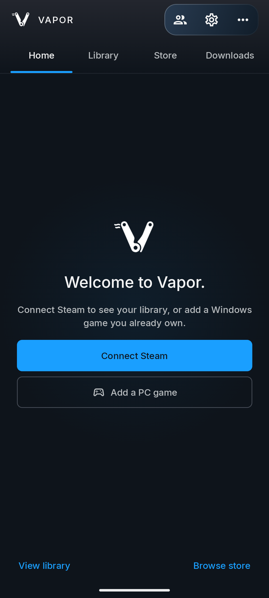

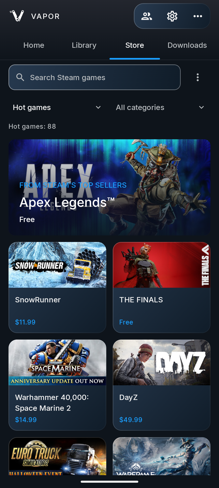

The build still targets SDK 28 and this emulator uses 4 KB pages. The new social
host/probe source has not replaced the APK's bundled runtime assets. These tests
therefore qualify the current UI, not the new native diagnostic under Wine/FEX.
Live Friends receipt, genuine-session handoff, Cloud transfers, physical controls
and Snapdragon performance remain separate. The emulator is left running.
[Build, installation, test and screenshot receipt](evidence/2026-10-20-emulator-social.json).

## Screenshot review — 20 October 2026

These eight images show **production Android Compose views rendered locally with
Robolectric native Canvas/Bitmap**, using sample or signed-out state. They are not
phone/emulator screenshots, live Steam sessions, or evidence of message delivery.
Empty driver/profile selectors belong to the fixtures; they do not describe an
installed device. Earlier phone gameplay evidence remains in
[QUALIFICATION.md](QUALIFICATION.md), separate from this layout review.

| View | What this documents | Remaining device check |
| --- | --- | --- |
| Friends drawer | Shared Vapor mark, account card, close action, sample friend row | Live personas, avatar loading and message arrival |
| Conversation | Long-name truncation, empty state and disconnected composer | Keyboard/insets, real conversation and delivery |
| Chat settings | Scrollable settings in short landscape; explanation that chat pauses during genuine-host gameplay | Phone scrolling, TalkBack and actual session transitions |
| Compact game settings | Full-width heading/actions and horizontal section rail | Phone sizing and touch acceptance |
| Wide game settings | Sidebar with form/artwork actions | Tablet/handheld sizing |
| Large-text game settings | 150% text, wrapping actions and scrolling content | Device font scale and TalkBack |
| Controller section focus | Highlight on compact Graphics section | Physical D-pad/key-repeat delivery |
| Controller Save focus | Highlight on Save above selected Input Controls section | Physical gamepad activation and persistence |

### Friends and conversation

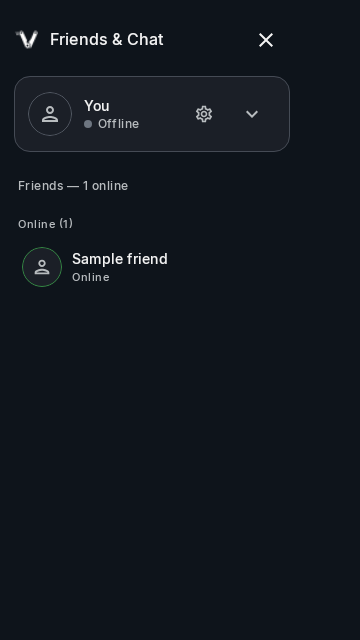
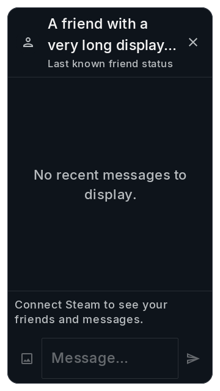

### Chat settings in short landscape

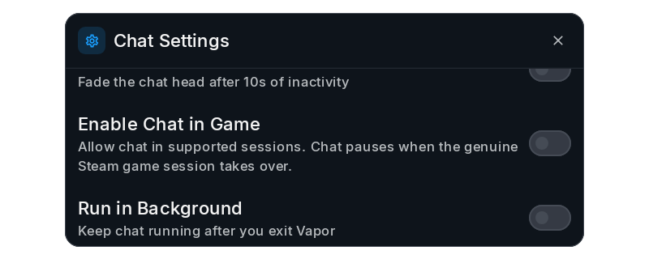

### Compact and wide game settings

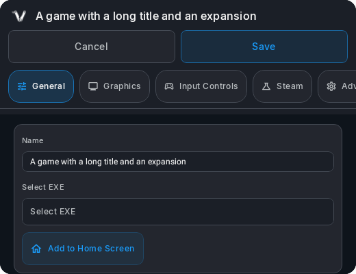

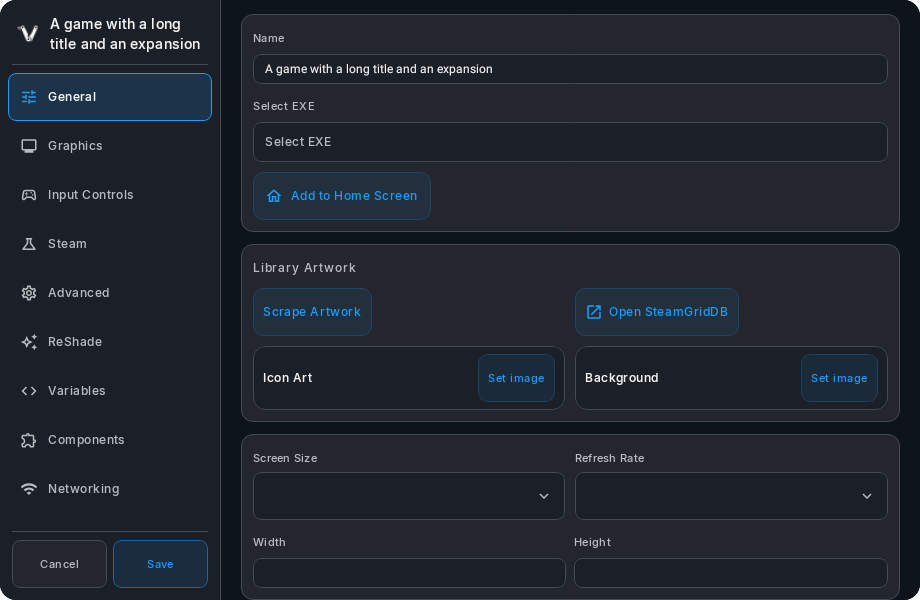

### Large text and controller focus

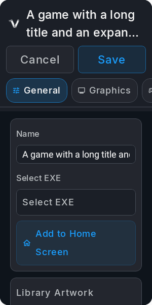

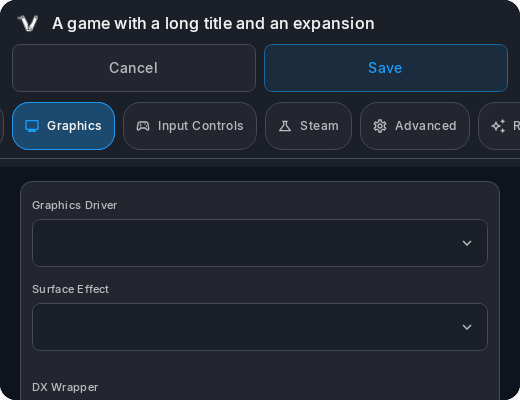

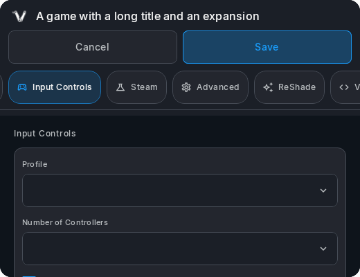

A fresh 20 October run executed all **40 selected JVM/Compose tests**, with zero
failures, errors or skips, and compiled Android instrumentation sources. All eight
regenerated PNG hashes match the earlier retained renders. Device instrumentation
was not executed.

The corresponding layout/interaction records are
[Friends and Chat](evidence/2026-10-19-social-polish.json),
[game settings](evidence/2026-10-19-game-settings-polish.json), and
[controller navigation](evidence/2026-10-20-settings-controller.json).
The [documentation receipt](evidence/2026-10-20-screenshot-review.json) records
this review's images and source hashes. Screenshots demonstrate the rendered
state; assertions and test receipts carry the interaction checks.

### Steam social implementation behind these screens

The Android conversation still uses its existing native Steam service. While the
genuine game host owns Steam, that service's chat connection remains suspended.
The new receive-only probe is diagnostic instrumentation, **not a live overlay
chat bridge**. The implementation is documented in the
[host integration](ROADMAP.md#genuine-host-diagnostic-integration--20-october-2026),
[capability receipt](evidence/2026-10-20-steam-social-probe.json),
[receive receipt](evidence/2026-10-20-steam-social-receive.json),
[cleanup receipt](evidence/2026-10-20-steam-social-receive-cleanup.json), and
[host receipt](evidence/2026-10-20-steam-social-host.json).

At the earlier 20 October availability snapshot, ADB reported no connected device and neither `wine` nor `wine64`
was available on this Mac's command path. No device session, Steam login, outgoing
message, APK assembly/install or runtime replacement was performed for this
review. The later emulator review above adds Android UI captures; no genuine-session
screenshot is available yet.

## Game settings controller navigation — 20 October 2026

Directional input now follows the existing editor's measured layout. The compact
horizontal section strip previously used the vertical sidebar's rules: Right
entered the form instead of selecting the next section, and Up could not reach
the action row above it. Both failures were reproduced with production Compose
views before changing the existing `GameSettingsNav` owner.

| Focus | Compact editor controls |
| --- | --- |
| Section strip | Left/Right changes section and stops at either end; Down or A enters the form; Up reaches Save/Cancel. |
| Save/Cancel | Left/Right changes action; A activates it; Down returns to the selected section. |
| Form | Existing field navigation remains active; Up at its first navigation row returns to the section strip. |

Wide editors retain Down/Up through the sidebar and Right into the form. The
renderer supplies layout and selected-page bindings to the same navigator; no new
controller service, preference or persistence owner was added. First controller
input still reveals focus without activating an action. The existing loaded-state
guard blocks Save through both touch and controller input. The separate retro
editor retains the navigator's default vertical behavior.

Local verification covers six new Compose cases and three navigation cases,
alongside the previous 31 checks: **40 focused JVM tests passed**, with no
failures/errors/skips. It includes returning from the first form control, retaining
the selected section after action-row navigation, refusing Save before loading,
and changing directional behavior after resizing. Android UI test sources compile.
The CI selection includes the new navigation suite locally.

These checks inject directional events into the same navigator used by the dialog's
window input handlers. They do not establish physical gamepad delivery, Android
key-repeat behavior, TalkBack or phone acceptance. No APK was assembled or installed.
The renders use production Compose views with account-free sample/preloaded state.
[Verification receipt](evidence/2026-10-20-settings-controller.json).

[Controller focus on the Graphics section](images/controller-game-settings-compact.png).

## Game settings layout — 19 October 2026

The existing per-game editor now chooses its compact navigation from the editor's
available width and text scale, rather than the Activity's orientation. A narrow
landscape dialog no longer spends 220 dp on a sidebar. Wide editors retain their
sidebar, while compact editors have a full-width game heading, the shared Vapor
mark, equal-width Save/Cancel actions and the existing scrolling section rail.
Save waits for the existing loaded state and keeps its existing callback.

Paired fields also use the width available inside their own group, so controls
stack when sidebar, padding or larger text leave insufficient room. The artwork
heading stays above its actions. General-page home/artwork actions have centered
content and at least 48 dp targets. The Save button can grow with its label instead
of enforcing an exact height. This pass does not change graphics defaults,
automatic routing, runtime components, stored profiles or persistence ownership.

**Local verification:** nine new production Compose layout checks passed, alongside
the previous 22 Friends/Chat checks (**31 total**, no failures/errors/skips). They
cover narrow panels inside wide windows, the wide sidebar, 150% text, Save/Cancel
callbacks and loaded-state gating, Graphics/Input navigation, paired-field reflow,
resizing with an unsaved draft, and General artwork action sizes. Android UI test
sources compile; device instrumentation was not run. The original narrow-panel
check failed against the orientation-based layout before the fix.

These are account-free Robolectric/Canvas renders of production views using sample
state, including empty device/profile lists. The Graphics navigation fixture uses
a preloaded missing-shader state; native shader discovery is not exercised by the
JVM test. Phone keyboard behavior, physical gamepads, TalkBack and owner acceptance
remain separate checks. No APK was assembled or installed.
[Verification receipt](evidence/2026-10-19-game-settings-polish.json).

[Wide editor](images/game-settings-wide.png) ·
[300 dp editor with 150% text](images/game-settings-large-text.png)

## Friends and Chat presentation — 19 October 2026

The native Friends drawer and conversation now use Vapor's shared shell colors.
Friends keeps a branded header and explicit 48 dp close action above one scrolling
account/contact area. Account settings and presence controls use 48 dp buttons;
missing avatars have a person placeholder and a presence ring. Existing cached-status,
sign-in and game-session availability rules remain in force.

Chat Settings uses one readable column, capped at 640 dp, with a fixed header and
scrolling options. The full setting row toggles its existing preference. Settings
remain reachable with 150% text and in a short landscape window. Controller row
coordinates follow the new single-column order through the existing pane navigator.

The conversation panel respects safe drawing and keyboard insets, caps its width
at 800 dp and keeps a 48 dp close action. Long names truncate after two lines;
message bubbles adapt to 85% of available width, capped at 480 dp. The empty-state
message has centered text and internal padding. Sending, history, authentication,
Steam session ownership and Cloud synchronization retain their existing owners.

**Local verification:** 22 focused JVM checks passed: eight production Compose layout
checks under Robolectric, eight conversation tests and six service tests. The Android
UI test sources compile; they were not run on a device. Two baseline layout checks
failed before the fix (undersized account settings target and no settings scroll parent).
The existing CI test selection now includes these three suites and retains renders
inside its existing test-report artifact. No new app-runtime dependency was added;
the JVM checks reuse the Compose UI test library already used by Android tests.

The images below are native Canvas renders of production Compose views under
Robolectric using sample/offline data. They are not Xiaomi or emulator captures.
The conversation stress case deliberately uses a long name and 150% text.
Live messaging, physical-controller and TalkBack behavior, keyboard lifecycle on a
phone, and owner acceptance remain pending. No APK was assembled or installed for
this pass. [Source and test receipt](evidence/2026-10-19-social-polish.json).

[Large-text conversation](images/social-conversation-portrait.png) ·
[Short landscape settings after scrolling](images/social-settings-landscape.png)

## Downloads and completed installs — 18 October 2026

The queue keeps its existing DownloadService, DownloadCoordinator and per-store
records. Cards now separate the current phase, an optional single-line file name,
transfer totals and the complete error text. Unknown transfer totals use an
indeterminate indicator instead of an invented zero percent. Processing phases
at full transfer progress continue to show work in progress rather than suggesting
installation is ready. A time estimate appears only when the existing download
model has recent speed samples.

Completed, trusted Steam installations offer Open game, using the existing native
game page. The game page remains responsible for Play, session requirements and
save reservations. Completion without a trusted installation does not offer that
action. Pause, resume/retry and confirmed cancellation use the existing callbacks.
Progress listeners and speed polling follow the screen's STARTED lifecycle.
The presentation reuses the native theme, queue buttons and cancellation dialog;
there is no new download queue, record schema or launcher. The 27-case UI batch
and two landscape repeats pass locally; physical gamepad/phone acceptance and live
transfers remain pending. [Portrait preview](images/downloads-portrait.png) ·
[Landscape preview](images/downloads-landscape.png) · [Evidence](evidence/2026-10-18-downloads-d3d12.json).

## Setup and Steam sign-in — 18 October 2026

Prepare Vapor, first-run account setup, Steam sign-in and Steam Guard now share
the native shell's logo, colors and spacing. The frame uses an opaque dark
background, measured header and scrollable body with safe-area and keyboard
insets. Wide sign-in shows account fields beside a QR code; narrower screens
offer QR code and Account name tabs without discarding typed credentials.
Short landscape windows use a compact header and less decoration so the
actions retain space. Card content explicitly uses the theme's foreground color.

Steam remains the primary connection, with Connect Steam and Set up later
separate. A connected account offers Continue to Vapor. Preparation keeps its
existing package installer, permission requests, progress, retry and Advanced
owners. There is no additional account, setup-completion preference or service.
The same vector logo is reused in the shell and these screens.

The account form labels the Steam account name, supports IME Next/Done,
password visibility and one clickable Keep me signed in row. Blank or busy
submissions are disabled. Login failure, QR retry, email/authenticator code
rejection and failed device approval each expose an appropriate recovery action.
Steam Guard challenges are cancelled when abandoned or superseded, so an old
request cannot consume a later retry's code. Native Steam authentication and
token storage remain with the existing service and ViewModel.

Controller entry selects the account action when input changes to keyboard or
gamepad navigation; touch does not force that focus. Actions retain at least
48 dp targets. The stage change uses a short Crossfade and the background is
static. Component checks inject large text as a layout stress case; this does
not change the Activities' existing fixed-font-scale policy.

The local pass records 31 passing Android UI cases, three portrait rerenders
and 25 passing JVM checks. The portrait/landscape captures use labeled sample
authentication state, including a QR payload that cannot sign in to Steam.
Live account completion, physical controllers and phone UX acceptance remain
separate. See the [verification record](evidence/2026-10-18-onboarding.json).

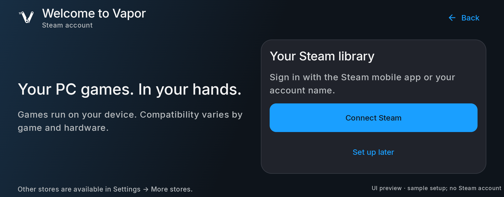

The [portrait sign-in preview](images/onboarding-login-portrait.png) uses a sample
QR payload rather than an account's sign-in challenge.

## Artwork and idle work — 18 October 2026

The existing shared Coil loader is created on the first image request. Decoded artwork
has a budget of one eighth of the Android app heap class, capped at **48 MiB**, or
**16 MiB** on Android low-RAM devices. Disk caches and Coil's memory-pressure handling
remain active. The limit covers the image cache, not bitmaps still displayed by a screen,
all app memory, or a running game's graphics resources.

Library artwork prefetch runs only while that screen's lifecycle is at least STARTED.
Leaving the screen or hiding the launcher cancels its requests, including a response
blocked on headers or body data. Four workers replace one coroutine per image. Completed
files remain on disk; incomplete files are removed and retried when the screen returns.
Only complete files are published as reusable artwork. The Library snapshot remains in
its existing owner so a return does not begin from an empty grid. When the game Activity
keeps the application visible, the stopped launcher explicitly trims its image cache.

These changes do not suspend games or modify the Steam account, download queue or Cloud
sync lifecycle. Steam's existing idle disconnect still waits for active work and respects
background chat. The first performance budgets are **150–250 MB PSS** at settled
Home/Library and a **100–150 MB** background goal with no active work. A cached warm return
should aim for one second on the reference Xiaomi. These are proposed budgets, not
measurements or achieved savings. Profile foreground idle, background idle, game handoff
and a dismissed web panel separately before publishing performance claims.

## Native game page — 17 October 2026

The installed game's existing native page keeps Play as the primary action. Settings,
Cloud Saves and supported Achievements are labeled shortcuts immediately below it.
Maintenance is grouped under **Manage**: updates, file verification, Workshop, Home
screen shortcut, desktop launch, supported save transfer/cheats, storage move, store
selection and removal. Each entry retains its existing callback and visibility rules;
this is not a second installer, game launcher or save manager. The source badge is a
label rather than a hidden maintenance menu. Optional store selection remains available
inside Manage for games that use the existing multi-store Library record.

Back, branch selection and the source label occupy a measured header. Its labels can
wrap on narrow or large-text screens; the scrollable game content receives the height
remaining below that header. This replaces the fixed top offset rather than adding a
second header-height state.

In wide windows, the title/history and the action group occupy parallel columns. The
actions no longer have to fit below a full-width title; this keeps the bottom shortcut
inside a short viewport without shrinking buttons. Portrait retains the stacked layout.
The action group measures the space left after page padding and navigation insets.
The shortcuts share the available row width and reflow into fewer columns with larger
text; Play and Manage stack when the row would become cramped. The old fixed-width
children could wrap individually while leaving half of each row unused. The page now
also paints its own dark background while artwork is loading or unavailable. Menus
use the existing Material dropdown component for screen-bound placement, scrolling and
system-controlled transitions. Interactive entries keep a minimum 48 dp touch target.

Controller entry focuses Play, or Settings when Play is disabled. The page reuses the
existing native controller-input path. A activates the focused action once; B closes
Manage before leaving the page, and closing Manage returns focus to its anchor. Physical
gamepads and the full phone journey remain separate acceptance checks.

The current close-time save reservation remains the authority for removal. While it
is active, the page explains that sync is still finishing and local saves are kept;
Manage cannot remove the game, and a confirmation already open is dismissed. This
message does not claim a successful Cloud upload. Native Steam session ownership,
upload deadlines and remote save restoration remain with the existing service and
separate account-side qualification.

## Console-style cover shelf — 17 October 2026

The supplied landscape reference places a horizontal row of portrait covers above the selected
game's title and actions, with an enlarged selection and subdued game artwork behind it. Vapor
adapts that structure to its native Compose Home and existing Library carousel. It keeps one game
selection and the existing Library records, artwork cache, install managers and settings owners.
There is no additional web page, library database or navigation destination.

Portrait covers retain their proportions. The selected cover is larger and brighter, with the
existing white focus border; adjacent covers remain visible. Selection animates with a short
scale transition instead of repeatedly changing the row's measured widths. A first tap on another
cover selects it and updates the title, install state and actions in place. A second tap or
**Open game** opens that game's existing native play/options screen. Uninstalled titles offer
**Install**, using their existing manager. Installed games also expose their settings directly.
Game launch, update/verification blocking, save operations and Cloud reservations stay with the
existing game page. Selecting a cover does not launch or install anything.

Left/right and A retain the current controller selection/open behavior; Y retains game settings.
Touch, controller selection and the shared artwork background use the same focused game. New
Library preferences default to the carousel; existing Grid/List choices are preserved in Library
options. Grid/List remain available, with no extra layout mode or preference. Narrow or large-text
windows stack actions and allow vertical scrolling. Short landscape windows reduce cover height
so the actions remain reachable. Compose's normal animation duration scale governs the short
selection and title transitions; no continuous animation or video background is added.

The follow-up removes caption strips from this cover shelf. The selected game's title remains
in the action panel, and each image keeps its accessible name. Grid and List captions retain
their existing presentation. This gives the full 2:3 card to portrait artwork rather than
cropping it to make room for a second title. Short wide windows reserve additional height for
the game action panel and its bottom padding.

This replaces the earlier wide selected Home card and separate Library featured banner. Store
discovery remains a compact native catalog, while checkout and Community retain their official
Steam web modal. The supplied reference is a layout direction, not a claim of SteamOS parity.

The drawer swipe targets now occupy only the outer 8 dp gutters. The previous invisible
right-hand target was inset over the Store options button and prevented its centre from receiving
touches. Pointer checks cover both edge-adjacent buttons and the retained left/right drawer swipes.

## Three-pivot mechanical V — 17 October 2026

The current placeholder is implemented in `app/src/main/res/drawable/vapor_logo.xml`:
two circular upper pivots, a slightly larger lower hinge and two separate, short vapor
trails on the left. The owner chose to retain it as placeholder artwork while app work
continues. The arms form a clear V with a flowing inner opening. The lower seam
uses circular arcs and a rounded end instead of a pointed overlap. This replaces the
rejected five-joint logo and the intervening stream studies.

The header, welcome screen, Quick Access and standard APK launcher continue to consume
this one white vector. The existing navy-to-blue launcher background, 16 dp foreground
inset and in-app 1.2 scale remain in place. Other build flavors retain their launcher
resources. The refinement adds no raster dependency, animation, setting or UI behavior.

Exports in the workspace's `outputs/Vapor-mechanical-V-20261017` folder derive directly
from the production drawable. The standalone SVG has tight artwork bounds plus 2 units
of breathing room. The review board includes circle and rounded-square mask studies,
a header sample and 24/32/48/64 px in-app samples. Pixel enlargements use the actual
small PNGs. The V and three openings remain identifiable at small sizes; the vapor
strokes and hinge gap are clearer at 32 px and above.

Geometry checks find no clipping at the existing in-app scale. With the launcher inset,
the artwork stays within a 32.72 dp radius, inside the 33 dp guaranteed safe circle in
the 108 dp layer. The standard Android resource compilation/link step and development
APK build pass. The exported `Vapor-0.1.0-mechanical-v-dev.apk` contains the new vector;
its signature and 16 KB ZIP alignment pass. All 222 packaged assets and native-library
entries match the previous native-shelf APK. The artifact's hash and build logs are
recorded beside the exports. These are build, packaging and rendered-artwork checks;
the later app-UI continuation reviews it in emulator captures as placeholder artwork.
Final branding and phone appearance remain separate from that acceptance. No new
gameplay or account qualification is claimed.

## Store connection feedback — 17 October 2026

The public catalog uses the existing reactive network monitor for its offline check.
When its validation signal is missing, the existing platform fallback runs on IO
instead of querying ConnectivityManager on the UI thread. A definite offline result
stops the request; an unknown result still allows the transport attempt. Reconnection
retries a failed or waiting request, and retains that signal
while a game detail or Steam web modal is open. A successfully loaded page is retained
without an extra request on return. The existing HTTP owner discards idle connections from
the old network on a background dispatcher before recovery, so the next request can connect
afresh. Active calls are not evicted. This uses OkHttp's existing pool operation, with no
additional HTTP client, polling loop or retry service.

An offline refresh explains that the last loaded results remain visible. A different
offline search has no old cards and explains that games will reload on reconnect.
An online service failure retains its own error text and Retry action. Existing
query-scoped page memory, native install actions and Steam's HTTP cache policy remain
the owners of those behaviors. Application logging identifies connection/request transitions and
exception types without recording search text, account details or credentials.

Stacked game/category selectors now retain an 8 dp gap at large font scales; both
keep their existing 48 dp minimum touch target. Ordinary portrait and landscape
toolbars retain their compact layout. Build, emulator interaction and phone acceptance
are recorded separately in the qualification record.

## Glass panels — 17 October 2026

The header utility group, selected-game action panel, Store cards, Library/Store search and
Quick Access now share a translucent navy gradient with a thin, fading light edge. A small
modifier in the existing shell presentation file owns that repeated treatment. The header
uses a restrained dark gradient; content density, 48 dp targets, labels, focus states and
navigation owners are retained. The game settings action also gets a visible light outline.

Home/Library apply a static 24 dp blur only to the subdued hero artwork behind the covers and
actions. Compose supports that effect on Android 12 and later; earlier versions retain the
tinted artwork without blur. Text, covers and controls remain sharp. Quick Access uses tinted
transparency, not a live backdrop-capture pipeline. No blur is attached to the game display,
no continuous decorative animation is added, and no game-speed or battery improvement is
claimed. Actual emulator renders and the existing interaction/layout checks remain the
verification boundary; physical-phone appearance and browsing performance need owner review.

## Library density and shared logo — 15 October 2026

The Library previously used separate rows for Search/options and All games/Installed. The
standard-width layout now places both view tabs, search and options on one toolbar. Tab widths
follow their labels instead of fixed 144 dp boxes. At narrow effective widths the controls stack,
and the selected view scrolls into view when necessary. Expanded search uses a 48 dp minimum
field with the same type scale, outline, clear action and spacing as the Store.

The hub still owns the query, selected view, controller shortcuts and game selection. Changing
All games/Installed resets the existing focus index; clearing search retains the selected view.
The redundant content wrapper is removed. Counts and grid cards align to 16 dp outer gutters,
with 12 dp horizontal card gaps and 16 dp between rows. Carousel/list settings and owned versus
installed filtering keep their existing paths. No new preference or service is introduced.

Branding is shared by the standard APK launcher, header, welcome state and Quick Access. The
standalone generic V tile is removed. The replacement keeps the original launcher's turquoise
and blue palette, with one V formed by three straight bands. The innermost band stops at 75% of its full
height, leaving its lower ends open; the other two bands retain short flat connected bases. All upper
ends are flat. After image exploration, the user chose an exact Android vector: six solid-color
polygons share one drawable, with no raster texture or duplicated density assets. Android applies
the existing dark adaptive background and a safe foreground inset. Other specialized build variants retain their launcher resources.

In wide, short windows the empty Library puts its explanation beside its actions, keeping Connect
Steam and Add a PC game visible without scrolling. Narrow and large-text windows retain the
scrollable vertical layout. Signed-in refresh and Browse Store use the same action callbacks.

The final APK passes 45 selected UI checks. Actual portrait/landscape screens, Quick Access and
the Android icon were inspected; all 220 runtime entries match the preceding build. See the
[Library and logo record](QUALIFICATION.md#library-layout-and-vector-logo--15-october-2026).
Physical gamepad/TalkBack and Xiaomi acceptance remain separate from emulator checks.

## Compact Store controls — 15 October 2026

Scope: the native Store's search, filtering and result hierarchy, using the existing catalog owner.
The reported problem was excess control size: repeated titles, a large search outline, two rows of
full-size chips and another results heading displaced the games. The global Home / Library /
Store / Downloads navigation stays in place.

- Search uses the existing Compose `BasicTextField` primitive with a 48 dp minimum surface,
  body-medium text, a smaller search icon, a clear action and a visible focus border. It remains
  mounted while browsing so controller Y can focus it even after a long result scroll.
- Hot games / All games / Free to play / Demos / On sale and the genre list now use two text
  selectors. The current choice remains visible; each menu marks its selection with a check.
  There is no horizontally clipped row of competing boxes.
- At effective widths of at least 680 dp, search and selectors share one toolbar. Narrower
  windows put the selectors in the scrollable results header; very large text stacks them.
  Layout responds to available width and font scale rather than a device-model list.
- Wishlist, Community and Refresh live in **Steam Store options** beside search. Reset remains
  visible with active filters. A single result count replaces the repeated results title/subtitle.
- The page uses aligned 16 dp outer gutters, 8 dp between controls and the existing 12 dp card
  gutters. Popup selection uses Material's existing open/close transitions and controller focus.
  No new animation loop, setting, theme, service or stored preference is added.

The 48 dp targets follow [Android's Compose accessibility guidance](https://developer.android.com/develop/ui/compose/accessibility/api-defaults).
Compact visuals do not require shrinking hit areas. Available-width adaptation follows
[Android's layout guidance](https://developer.android.com/develop/ui/compose/layouts/adaptive/support-different-display-sizes).

| Audit dimension | Finding and acceptance | Priority / owner |
| --- | --- | --- |
| Usability | Games should appear within 160 dp of the Store content start in the normal portrait fixture; filters remain visible and searchable. | High / existing shell |
| Accessibility | Keep 48 dp targets, non-overlapping bounds, named controls, selected states and usable 200% text. Physical TalkBack remains a separate check. | High / existing shell |
| Information architecture | Keep the main destinations; group secondary Store actions under one named menu. | Medium / existing shell |
| Visual design | Remove repeated headings and oversized chip rows; align search, selectors and cards to one gutter. | High / existing shell |
| Interaction | Preserve clear/reset, IME submit, page history and details return. A selects one popup action; B dismisses without leaving Store. | High / existing shell |
| Content | Current selection, count, loading, retry and empty state stay truthful. No ownership or compatibility claim changes. | Medium / existing shell |
| Performance | Preserve lazy cards and cancelled-request handling. No game-speed or memory improvement is claimed from layout changes. | Preserved / existing shell |
| User goal | Put game artwork and prices above unnecessary chrome while keeping discovery and recovery actions reachable. | High / existing shell |

The final scoped run passes 35 Android UI checks. In the normal portrait app, the same filtered
search moves its first card from 312 dp to 172 dp below the Store content start (45% less control
height). The landscape capture shows the first four names and prices without scrolling. This
validates the tested layouts and interactions, not every device or a full accessibility certification.
Validation is recorded separately in [qualification](QUALIFICATION.md#compact-store-layout--15-october-2026).

## Branding, layout and everyday navigation — 15 October 2026

The first branding pass used a vector V tile in the header, welcome state and Quick Access.
The later shared-logo pass above replaces that tile and updates the standard APK launcher too. The existing theme,
account services, game list and runtime remain the owners. `VaporHeader` extracts presentation from
the existing hub so constrained layouts can be checked directly; it adds no navigation state or theme.

The header keeps Friends, Settings and Quick Access reachable on narrow screens. Library search
and options now share the view toolbar when space allows; large text stacks the controls. Large
text can scroll the destination strip, and changing destinations brings the selected tab into view.
All utility buttons have controller focus feedback. Search has clear and close actions, IME Search
hides the keyboard, and Back closes an open Library search before leaving the Library. A no-results
state offers Clear search instead of leaving users at a dead end.

Welcome content has a bounded, centered layout and scrolls in short windows. Home places the
selected title above its action on narrow screens, while keeping them beside each other when there
is room. Downloads has a centered empty state with Browse store; it uses the hub's navigation-bar
inset once so its action stays fully visible in the tested landscape window. The Store spotlight
grows to accommodate larger text instead of clipping its price in a fixed-height box.

The earlier spacing pass separated the two Store chip rows. The compact Store pass below
supersedes those rows with two selectors and removes the repeated heading/subtitle. Touch
targets retain a 48 dp minimum; their labels and visual treatment are lighter.

Motion is limited to short Compose transitions: tab underline/color, welcome entry, selected Home
title and the existing search/Quick Access transitions. No decorative animation loop or motion
preference is introduced. Quick Access uses the existing dialog controller-input helper so A and B
follow the same path as the Steam web modal.

The scoped audit prioritizes the following findings. The implementation owner is the existing shell;
this is a polish pass, not a whole-app accessibility or SteamOS feature certification.

| Dimension | Finding / acceptance |
| --- | --- |
| Usability | High: narrow Library toolbar could crowd its actions. Keep every utility visible and separate search when needed. |
| Accessibility | High: fixed Store hero height could clip large text. Keep title, price and action reachable at 200% text; physical TalkBack remains pending. |
| Information architecture | Preserve Home, Library, Store and Downloads. Optional stores stay in Settings. |
| Visual design | Medium: text-only header, touching Store filter rows and inconsistent empty-state spacing. Reuse the V mark, bounded widths, aligned gutters and explicit chip gaps. |
| Interaction | Medium: clearing/closing search and controller confirmation need explicit behavior. Exercise callbacks and real dialog key dispatch. |
| Content | Keep ownership, download, launch and qualification wording unchanged. Empty states offer a specific next action. |
| Performance | Short, event-driven transitions only; no runtime or download changes. Animation-off and settled-layout checks remain distinct from phone frame pacing. |
| User goal | Faster access to the existing games and actions. No sign-in, game launch or purchase is triggered by opening these screens. |

See [the build and validation record](QUALIFICATION.md#native-ui-polish--15-october-2026).

## Store and Steam web modal — 15 October 2026

The native Store keeps the existing catalog, license acquisition and download owners. Browse
**Hot games, All games, Free to play, Demos or On sale**, then narrow by Action, Adventure, RPG,
Strategy, Puzzle or Platformer. Hot games is a selection from Steam's released top-seller set, not
a numbered sales ranking or a Vapor compatibility recommendation. A featured game uses the
same native details and install path as any other card.

Search refreshes after a short typing pause and retains the selected genre and price/type filters.
IME Search still submits immediately; submitting an already successful unchanged search does
not send it again. Steam spelling help appears only when no games match and offers one useful
alternative rather than repeating all returned suggestions;
empty results offer Clear search and filters. A labeled Reset action also appears beside results
whenever a search, genre or free/demo/sale filter is active; it returns to All games / All categories.
Refresh in the Steam Store options menu reloads the current request while retaining its current
results in memory. A failed refresh labels those results and exposes Retry; a new query cannot
reuse the old query's page. The selected subset is named in the count (for example, Hot games).
The existing network monitor retries a failed active page when connectivity returns. Loading and
searching have distinct labels; an error keeps the chosen request and filters.
The existing 50-result search limit remains explicit.
Wide layouts put search, game type, category and Store options in one row. Portrait keeps search
visible while the compact selectors scroll with the results. Prices continue to use the existing
public catalog region; checkout confirms the actual account price.

The results use Compose's existing lazy grid primitive, with stable game keys and fewer columns
when text is larger. Off-screen cards are created as needed; this is not a measured download or
gameplay speed improvement. Opening and closing details keeps the result position and search.
Previous/Next show the current page and keep the actual visited offsets, including when Steam
returns fewer than 24 entries. Changed filters or a new search start at page one. A cancelled,
late response cannot replace the new request's results or clear its loading state.

`SteamCatalogBrowser` contains the existing public browsing state in the same source file so
these interactions can be tested with controlled responses. The activity still owns authentication,
license acquisition, game details and official web panels. The default loader remains `SteamCatalog`;
there is no second catalog service, persisted response cache, database or account connection.
Steam's `no-store` response policy is preserved; only the current query's rendered page is retained
through refresh/retry. Leaving the screen or process does not provide an offline Steam catalog.
Controller focus is no
longer forcibly moved to the first card when results arrive. The browse handler yields while a
detail/web modal is open, and unregistering it cannot remove a newer screen's handler.

Wishlist, Community, checkout, guides and Workshop browsing open in a centered, inset Steam
modal with a page title, visible host, Back, Close, loading progress and retry state. Closing it
preserves native Store search/filter state. Existing exact-origin checks, native account connection,
short-lived cookie handling and native install-link routing remain in place. Authenticated web
content and external payment flows still require account testing.

This is a Store/modal polish pass, not completion of every inherited screen or SteamOS parity.
See the [Store browsing validation record](QUALIFICATION.md#store-browsing-and-recovery--15-october-2026).
See [the build and verification record](QUALIFICATION.md#store-and-session-recovery--15-october-2026).

## Loading layout follow-up — 15 October 2026

The existing native loading dialog now uses two columns on landscape screens at least 600 dp
wide: game information on the left and the actual current phase on the right. Portrait keeps the
vertical arrangement. Smaller artwork and spacing keep the phase visible on a landscape phone;
short windows and larger text can scroll. The phase remains an accessibility live region.

The same loading state and runtime callbacks supply the text and measured progress. Moving from
a measured Cloud transfer to an unmeasured launch phase resets the percentage as before; the
layout does not invent a progress value or mark a transfer successful. Four new Android tests
cover landscape/portrait visibility, large text, and that phase transition. Captures are explicitly
labelled interface fixtures with no game or Cloud transfer running. Physical TalkBack, controller
and real-game acceptance remain separate checks. [Build evidence](QUALIFICATION.md#session-handoff-and-loading-layout--15-october-2026).

## Native game menu — 14 October 2026

Tap **Vapor** in the upper-right corner of the game surface to open the existing session menu. Its **Controls** tab selects a layout and adjusts touchscreen visibility, opacity and adaptive sticks. **Return to game** stays visible above every settings pane. Android Back, the existing edge/four-finger gestures and the controller Guide hold remain available.

The menu dims the background and consumes the outside dismissal tap through its closing animation. Opening it releases held touch controls through the existing input owners. Closing a pane also clears its popup callback, so reopening cannot retain a hidden profile picker. Return to game dismisses the panel; a game's pause behavior remains its own.

The sheet fits narrow screens instead of assuming a minimum 300 dp viewport. Five new Android tests exercise the production host over an Android View fixture, including a 280×320 dp viewport at 150% font size. Together with six existing Home checks, **11 tests pass**. The captured Controls view is explicitly labeled as a test surface. Normal Home/Settings navigation passes, but the emulator's separate container launch exited before its desktop; see [the exact build and check boundaries](QUALIFICATION.md#native-game-menu--14-october-2026). This update does not add a runtime, preferences layer or new control-profile format.

## Recommendation

Keep Vapor in Kotlin and Jetpack Compose. Use the Big Picture interaction model: visible main destinations, game artwork, a clear main action, controller focus and quick access. Build ordinary app tasks around the existing Steam and download services.

Use Home, Library, Store and Downloads as the main navigation. Keep Settings visible in the header. Keep Epic Games, GOG and itch.io under Settings → More stores. A phone should remain comfortable in portrait; a wider screen should use the extra space without requiring a different app mode.

Valve describes the Steam Deck experience as designed for gamepad controls, with a unified library, store and system controls. This is the useful product reference, not a promise that Vapor has all SteamOS features. [Valve: Steam Deck software](https://www.steamdeck.com/en/software)

## Accounts, Steam features and native controls — 14 October 2026

After runtime preparation, **Welcome to Vapor** offers **Connect Steam** or **Set up later**. A connected account gets **Continue to Vapor**. The signed-out Home action opens this same Steam setup, and opening it never automatically launches login.

The main header and controller shoulder navigation visit Home, Library, Steam Store and Downloads only. Steam cannot be hidden by the old store-visibility preference. **Settings → More stores** opens a dedicated page with Epic Games, GOG and itch.io account actions, Browse buttons and separate folders when shared storage is disabled. Accounts & storage now contains Steam and shared storage only. Browse uses the existing native store destination through Android Navigation saved state, with a More stores breadcrumb and Back action. Android Back and controller B return there. Main shoulder navigation skips these pages. Other stores’ uninstalled catalogs no longer feed Home or Library; installed games and active downloads remain available. Closing Settings or browsing does not sign an account out. No replacement account storage or visibility feature flag is added.

Steam catalog pages distinguish owned games, free/demo acquisition and purchases. An owned paid game opens its existing native manager. A demo requests its license through Steam, then uses the existing license/PICS and download path. A paid parent exposes the separate demo when Steam lists one. Failures stay in Vapor with retry; they do not silently open a browser. Purchases, Wishlist, Community, guides and Workshop pages use official Steam web content in a distinct panel. The panel offers native Steam connection when signed out and uses short-lived cookies when connected. Its account authentication and external payment flows still need live qualification.

Touch controls are Android views drawn over the local game surface. Their bindings feed the existing gamepad, keyboard and mouse paths; they do not need a Linux desktop UI. The current routes are:

- **Settings → Input Controls → Select Profile → Virtual Gamepad** for dual sticks, D-pad, face buttons and triggers. The Controls Editor changes button positions, size and bindings.
- Choose **RTS** for mouse/keyboard-oriented games such as EU3, or **FPS** for its corresponding layout. Layout suitability depends on the game; a joystick cannot add gamepad support to a mouse-only title.
- During a game, tap **Vapor**, use Android Back or use the existing four-finger touchpad gesture to open the session menu. **Controls** selects a profile, toggles the touchscreen overlay, adjusts opacity and changes adaptive-stick behavior. **Return to game** closes the panel.
- **Auto-hide on Controller** can hide touchscreen controls when a physical controller connects. Existing physical-controller mapping remains separate from the virtual gamepad profile.

The Guide icon is now a Vapor V in the renderer and editor. Its stored icon ID, position and game binding remain intact, so existing layouts need no migration. This is a branding change, not a change to Guide-button semantics. The editor preview shows layout availability. The owner's Xiaomi gameplay report does not specify its input method; multitouch, vibration, controller reconnect and individual control profiles still need explicit checks.

## Home and recent games — 14 October 2026

The visual reference is Valve’s [Steam Deck Home image](https://cdn.akamai.steamstatic.com/steamdeck/images/software/software_hero_device_english.png), linked from its [software page](https://www.steamdeck.com/en/software). The selected title is wide, neighboring covers remain portrait, and subdued artwork sits behind the row. Vapor now uses this structure in a native Home destination with short card-width transitions and an Open game action. The artwork comes from the existing loader and custom-game overrides.

Home is the initial destination. Its bounded shelf shows up to twelve available recent entries in the existing local order. If no available game has a local launch record, the heading is **Your games** and the shelf uses the existing Library order. An empty account/device gets sign-in, refresh or local-game actions; no sample games or invented history are inserted into product data. The inherited name-keyed history is not a verified play-session record: opening the runtime can write it before gameplay succeeds. Renaming a custom game can also leave history under its older name. Home therefore does not label its action Resume or claim a working save.

`LibraryCarousel` continues to own scans, shared-install aliases, disconnected-drive filtering, artwork and install-versus-detail routing. Home changes its projection and presentation; it adds no database, cache, account service or launch path. The same existing `playtime_stats` reads now recognize both Windows-sanitized names and original retro names. Game details still own Play, controls and saves; uninstalled owned games still open their existing download managers.

Left/right select Home games, A opens on release, and X opens the full Library. Library B returns to Home; Home keeps the existing exit confirmation. Shoulder-button navigation and Quick Access remain available. Store’s return link resolves Library by route identity, not its old zero index. Home/Library content switches without overlapping their shared game-selection collectors; other main destinations retain the existing fade. Full SteamOS controller and animation parity remains unfinished.

Main tabs size to their labels, with horizontal scrolling when they exceed the available width; changing the selected tab brings it into view. This fixes the clipped Downloads label observed in portrait after adding Home. The narrow layout retains a separate header row for account/settings controls.

Verification separates data/selection tests, isolated production-component UI tests, and normal application navigation. Populated screenshots use explicitly labeled sample data in the test renderer only. The account-free emulator cannot establish an authenticated Home-to-game journey. See the [dated qualification record](QUALIFICATION.md#home-and-recent-games--14-october-2026).

The accompanying [competitor comparison](COMPETITOR-COMPARISON.md) evaluates DroidDeck, WinNative, Winlator, GameNative, GameHub and Armada. It distinguishes primary-source features from reproduced Vapor results and recommends targeted reuse without introducing a second runtime.

## SteamOS visual comparison and everyday screens — 14 October 2026

The user asked how closely Vapor resembles SteamOS and requested continued implementation. Comparing the preceding native captures with Valve's [Library](https://cdn.fastly.steamstatic.com/steamdeck/images/ver2/software_library_english.jpg) and [Quick Settings](https://cdn.fastly.steamstatic.com/steamdeck/images/ver2/software_quickaccess.jpg) references shows a recognizable Steam direction, but not a faithful screen-for-screen match. This is a visual judgment, not a measured percentage or a feature-compatibility score.

| Area | Comparison and current change | Remaining difference |
| --- | --- | --- |
| Library | Portrait artwork, neutral dark surfaces, white focus and owned/installed views are the closest match. The layout option now says Grid, since its column count adapts to width. | Vapor still uses its own main navigation and game-card labels; Home now has its own shelf, described above; favorites/collections and the complete controller menu remain unfinished. |
| Store | The previous search/category block consumed too much height and pushed prices below a short viewport. The search field and game-card typography/padding are now more compact. | Native catalog browsing does not reproduce Steam's full editorial storefront or checkout interface. |
| Settings | The sidebar now uses a flat white active selection. Accounts use compact state/action rows; Accounts & storage and App preferences use the shared palette without nested rounded cards. | Advanced tools and other inherited sections still have their own layouts. |
| Quick Access | Dark side panel, separated volume/brightness rows, thin blue slider tracks, round white thumbs and flat shortcut actions follow Valve's panel structure more closely. | Only the existing Android volume, app-window brightness and navigation actions are exposed. No unsupported Steam Deck controls are drawn. |
| Dialogs | The shared dialog frame and buttons now use restrained corners, clearer titles and 48 dp button targets. Sign-out uses that shared shell and retains explicit confirmation. | Dialog content and some store-specific/game-specific overlays still need individual visual review. |

This pass extends the existing Compose screens and callbacks. It adds no account system, stored preferences, backend, UI framework or runtime path. The account action moves beside its state where there is room and below it on narrow layouts. Shared-folder, storage, download-server, language and app preferences retain their current owners. The settings sidebar's active rail versus content focus remains distinct. Quick Access continues to report real battery/Android values and adjust the same audio stream and app window.

Five new Android UI checks cover account sign-in callback routing, cancellation versus explicit sign-out, narrow/large-text account controls and Quick Access navigation. The complete selected suite passes 40/40; the selected JVM suite passes 121/121. Native settings navigation and visible Store prices are checked separately. The isolated account tests use artificial signed-in state and callbacks; they never sign in or sign out a real Steam account. See the corresponding [qualification record](QUALIFICATION.md#steamos-everyday-screens--14-october-2026).

## Big Picture Library — 14 October 2026

The user explicitly requested that the look and feel be borrowed from Steam and Big Picture. The visual reference is Valve's [Steam Deck Library image](https://cdn.fastly.steamstatic.com/steamdeck/images/ver2/software_library_english.jpg), linked from its [software page](https://www.steamdeck.com/en/software): portrait covers, compact navigation, restrained dark surfaces, clearly selected tabs, white focus outlines and short focus motion. This is now the visual direction for the whole app. Vapor keeps its own identity and implementation; this change does not embed Valve's proprietary frontend or claim complete feature parity.

**Library → All games / Installed → game → Download or Play** now uses the existing records and managers. All games merges available Steam, Epic and GOG ownership rows with installed/custom games. Installed remains the existing disk/metadata-based install result. Shared-install aliases stay hidden, installed records retain their current recent-play order, and uninstalled titles follow alphabetically. Search applies to either view. The owned view is not written to the installed-game cache, and no storefront result becomes a license. The former owned-game grid under Store is removed; Store links back to Library and continues public catalog discovery and checkout.

Cards identify **Installed** versus **Not installed**. Tapping a card or selecting it with A opens the same install-or-play decision. The inherited store-specific game managers still own downloads; installed pages retain controls, saves and launch. A is delivered on release so the new page cannot receive the same button release as a second action. X switches All games / Installed; LB/RB remain main navigation. Empty results clear the old selected game, and an empty signed-in account gets refresh/browse actions rather than an indefinite loading indicator.

The shared palette now uses neutral dark surfaces and white focus outlines. Library cards replace the rotating border with a short scale transition and a white border. The default Library layout is a portrait grid, with five columns on wide default-profile screens; existing saved layout choices and the explicit device profile are preserved. The main header becomes one compact row where there is room. Both game-page Play actions are green; the old Store action-button rainbow/glass layers are removed in favor of standard buttons. Shared Material container colors and shapes now follow the same neutral palette and straight edges, including selected Store filters; they no longer inherit the default purple. Missing Steam portrait artwork retries the existing header image through the same loader. Other inherited screens still need visual review against this direction.

Native UI checks use the separate account-free emulator. The populated component capture is explicitly labeled **sample library**: it renders the production tabs and cards, but its ownership/install states are test fixtures and never enter the app database. Public artwork is optional and uses the same image loader; it is not a game-compatibility claim. Normal startup, tabs, public Store and Settings are checked separately. See [qualification evidence](QUALIFICATION.md#big-picture-library--14-october-2026).

The next UI work is the remaining inherited settings/forms and the full signed-in Library → download → game page journey on a reference phone. Hardware-controller navigation, owner visual acceptance, actual account refresh, game launch and save qualification remain distinct from component tests.

## Steam belongs behind the frontend — 14 October 2026

The agreed flow is **open Vapor → sign into Steam → browse Library/Store → install → Play**. The user clarified that the whole experience should feel like a SteamOS fork: one fullscreen gaming home, consistent touch/controller navigation, integrated account and download flows, game launch/return, and quick controls. Runtime selection, containers and a separate Steam desktop must not define the normal experience. This is the acceptance direction for the whole app, not a claim that this build completes it. Vapor is an Android app derived from WinNative, not an installed fork of the SteamOS operating system. A console-style frontend is the product goal; kernel, desktop and Steam Deck system features are not supplied by that interface.

The inherited optional Linux Steam client was explicitly labeled as a game in the Library. Its real shortcut now remains on disk for runtime use but is excluded from game cards, including the old cached card on upgrade. Identification uses the existing client marker and stable shortcut ID, not its display name: a real game named Steam remains visible. Other custom, Linux and Steam games keep their existing paths.

The optional client is now opened from **Settings → Accounts & storage → Advanced → Full Steam client (experimental)**. The existing panel still owns its download, update and confirmed removal; installed and update-available states expose an Open action. Opening the panel does not start a download. Missing shortcut detection refreshes the existing installer state and offers reinstallation. The normal Library no longer offers Add Linux Steam or opens the optional-client update prompt automatically.

The initial setup no longer asks users to choose Linux Steam versus Windows Steam. The subsequent guided preparation below moves the inherited component and default-container pages under Advanced setup. Steam account, download, genuine-client launch, compatibility, saves and runtime owners remain unchanged. This does not prove complete SteamOS feature parity or new game compatibility.

## Guided preparation — 14 October 2026

The normal first-run path is **Allow file access → Prepare Vapor → Continue to library**. A single screen prepares bundled system files, downloads and verifies the fixed initial Proton/FEX/DXVK set, installs it with the existing component owner and creates the default play environment. It does not require picking runtime versions or creating a container manually. No Steam account is needed for preparation.

Progress describes the actual current step. A known download size shows that step’s percentage; extraction and environment creation use indeterminate progress. Continue is absent while work is running or failed. Retry checks the installed component files and reuses completed components; an interrupted download itself restarts. Verified downloaded archives left after an interrupted install can also be reused. The screen explains storage/network failures and keeps component versions behind optional details.

The initial downloads total 120,338,747 bytes (about 115 MiB); a fresh setup requires 3 GiB free (2 GiB if system files are already installed and components are still needed). The first real installation used about 2.67 GiB for system files, downloaded components and the Wine prefix, so the original 2 GiB fresh-install allowance was raised after measurement. The existing system-file installer and session keep-alive service remain the owners. A real low-storage run exposed a startup race: lifecycle observation could stop the newly created service before it registered as foreground. Registration now precedes publishing the instance and attaching the observer; a fast failure can then stop safely. Home does not cancel the operation, but Android may terminate the process. Reopening then retrying checks the existing files; no background-completion or full suspend/resume guarantee is made. The Back action cannot exit an active installation.

An existing environment using the selected runtime is reused without resetting its settings or saves. A fresh environment uses the existing platform defaults and becomes the ARM64 default. A prior usable default is retained. The normal game-launch selector now respects that ARM64 default when there is no explicit X86 default. Preparation checks required runtime files and the created Wine prefix; it does not run a game or establish GPU support.

**Advanced setup** opens the inherited component/container controls. It is unavailable while preparation is active to avoid competing installations. The guided screen uses the shared Vapor theme, safe drawing insets, a scrolling layout, large touch targets, standard Compose focus, and controller A/B navigation. Advanced B changes screens on release so the same key press cannot also close guided setup. Physical-controller and TalkBack acceptance remain separate from injected-key/UI checks. No new dependency, database, download queue, service or launcher was added.

The final guided-setup APK passes 80 focused JVM tests and 28 selected Android UI tests. Normal application testing additionally completed permission handoff, offline failure/retry, automatic preparation, a repeat without a duplicate environment or changed container settings, portrait/landscape inspection and Continue into the Library. See [the dated evidence](QUALIFICATION.md#guided-first-run-preparation--14-october-2026). Phone/game qualification remains separate.

## Research applied to the design

| Finding | Decision for Vapor |
| --- | --- |
| Controller users need an obvious starting point, a predictable order and visible focus. | Use Compose focus for the inline Store screen, focus its first result when a controller is connected, and retain global shoulder-button navigation. Keep the existing dialog navigation for game details. [Android focus guidance](https://developer.android.com/develop/ui/compose/touch-input/focus) |
| Navigation should adapt to available space. | Four primary destinations remain visible, including the new Home screen. Other stores move into a menu; catalog columns and game detail layouts respond to width. This pass uses existing Compose primitives, with no new navigation dependency. [Android adaptive navigation](https://developer.android.com/develop/ui/compose/layouts/adaptive/build-adaptive-navigation) |
| Small, unlabeled controls are hard to use on a phone. | Main controls use at least 48 dp. Installed-game actions become labeled buttons in two columns; content scrolls when the available height is small. [Android accessibility defaults](https://developer.android.com/develop/ui/compose/accessibility/api-defaults) |
| Work should be tied to the visible UI and measured before making speed claims. | Dispose inactive tab content after its brief transition, preserve saved scroll state, retain the existing library cache, and load detail screenshots in a lazy row. Keep bounded catalog pages and submit-based search. [Compose performance guidance](https://developer.android.com/develop/ui/compose/performance/bestpractices) |

The previous Store screenshot showed a full-screen catalog dialog with a second Back header and a large information block above the results. The installed-game page used a single row of small icon-only actions. The source also kept the Library composed, transparent and potentially focusable beneath every other tab. These were the concrete starting problems for this pass.

## Loading screen continuation — 14 October 2026

The existing `PreloaderDialog` remains the owner. A measured cloud/download step could leave its percentage and determinate mode visible during the next unknown-duration launch phase: `setStepOnUiThread` changed only the text. A phase change now resets the display to indeterminate and clears the old percentage. A later measured transfer can enable progress again; supplied percentages are clamped to 0–100. Game title, source and profile remain intact through a phase change.

The full-screen Compose view now uses the shared Vapor theme, readable game information and one current-step panel. It scrolls on short screens and avoids fixed-height title/status slots. It preserves artwork supplied by the retro import screen. The old particle, glow and orbit loops and their two layout switches were removed. A standard Material progress indicator supplies the only ongoing loading animation. These source changes reduce decorative work; no startup, battery or FPS improvement has been measured.

The percentage describes the current measured step, not the whole game launch. Unknown-duration work has no percentage or invented ETA. This follows [Android's progress guidance](https://developer.android.com/develop/ui/compose/components/progress). The heading, polite status announcements and standard progress semantics use [Compose accessibility semantics](https://developer.android.com/develop/ui/compose/accessibility/semantics); TalkBack behavior still needs native testing.

English status labels now use phrases such as “Preparing Steam,” “Starting the game runtime” and “Installing required game components.” New and revised translations remain pending. That loading-screen pass retained the existing failure UI; the session-error continuation below replaces two reported-failure paths. General launch cancellation and automatic retry remain outside that loading-screen change. The later save-conflict work below adds cancellation at that specific prompt.

The browser preview's Play action now opens three manually selected sample loading states: preparing, a 65% cloud transfer, and starting the game without a percentage. Preview controls are explicitly labeled and do not appear in the native screen. The samples neither connect to Steam nor run a game. Keyboard focus stays within the loading preview and returns to Play, then the originating Library card. A reverse-Tab escape from the initial heading was found and corrected during browser review.

## Session-error continuation — 14 October 2026

The runtime activity previously showed reported Steam-host failures as a brief toast before exit. Preparation exceptions used an alert in that activity, with cleanup waiting for dismissal. Both paths now retain the first reported error, call the existing exit path once, and carry the message on the existing return Intent after cleanup finishes. Cloud handling and process cleanup still belong to the existing session owner. A queued failure during cleanup can attach its message without starting another cleanup.

The app presents a persistent **Game session problem** dialog with the game name, selectable error text, **Close**, and **Open Settings**. It reuses the shared dialog shell, theme, scrolling and controller input helper. Close is the initial focus target; Settings opens the existing Accounts & storage section. Android saved-instance state retains an open message during Activity recreation. The consumed return Intent and saved dismissal keep the old message from replaying. There is no separate error store or automatic retry.

A failed pinned-shortcut session returns to the app so the message can be read; an ordinary pinned-shortcut exit keeps its previous behavior. Delivery still depends on the existing cleanup completing and returning to the app. Errors that never reach these callbacks, process crashes, earlier library-side rejection and setup-wizard redirection are not covered by this dialog. Native cleanup and return behavior have not been exercised in this pass.

The preview adds a **Sample failure** control under the sample loading screen. It shows an example Steam sign-in failure and supports Close, Escape and Open Settings. The sample explicitly says that no game ran. It proves navigation and presentation intent; it neither invokes cleanup nor tests a real Steam session.

## Steam save-conflict continuation — 14 October 2026

The inherited prompt had 34 dp buttons, a cloud-first controller entry and no Cancel action. It now uses Vapor's shared theme, equally styled device/cloud panels, timestamps, explicit replacement effects and controls at least 48 dp high. **Cancel launch** is the first controller entry near the top. Content scrolls on short screens. The checkbox retains the existing backup preference, with wording that explains the backup is best effort rather than guaranteed.

The existing dialog now reports cancellation exactly once for Cancel/Back, unanswered dismissal and Activity destruction. The Android launch-sync owner uses one completed future to arbitrate choice, timeout and destruction. A cancelled wait selects neither version, skips backup/resolution, returns false to the existing session owner and stops before environment launch. The session owner suppresses exit upload after that cancellation. There is no separate save store or new service.

The native Steam host previously treated every answer other than `local` as `cloud`. It now accepts only exact `local` and `cloud` answers; cancel, empty, partial and unknown answers cannot select a version. An unresolved prelaunch conflict stops before `LaunchApp` and the post-download launch record. An atomic flag suppresses exit synchronization while that conflict is unresolved, including teardown while the prompt is open. Both host executables were rebuilt and their packaged bytes verified. A timeout/unresolved host failure uses the existing persistent session-error path.

This is a correction to conflict cancellation, not a rewrite of cloud synchronization. Existing explicit-choice transfer failure behavior and best-effort backup handling are unchanged. Host tests do not prove Steam's file effects, successful transfers, cleanup timing or that an actual backup can be restored.

The browser **Sample save conflict** control demonstrates the screen with example dates. Cancel/Escape return to the original Library card. Explicit device/cloud actions go to a labeled sample loading step and say no files were changed. No account, game, save or runtime is connected to this preview.

## Native changes implemented

- **Main navigation:** Library → Store → Downloads, with a visible Settings button and an Other stores menu. The Store header stays visible while browsing. Files and Add game appear in the Library footer.
- **Store:** opens the native public catalog immediately. Popular, All games, Demos and Free to play remain; Open in your library returns to the owning Library view. Ownership badges read existing Room records. No public catalog item becomes an owned game.
- **Search and recovery:** explicit search submission, paged results, clear loading, sign-in, empty and retry states. An owned result opens the existing game manager. An unowned title uses Steam for checkout or license acquisition and refreshes ownership on return.
- **Game pages:** the installed-game page keeps the existing Play and save/settings owners. Its secondary buttons have text labels and larger touch targets. Its main action uses a simpler solid button; content can scroll on short screens. Store details put the main action before the description and use side-by-side artwork/information at wider sizes.
- **Downloads:** real service progress, bytes and transfer speed appear on game cards. Each unfinished game has its own Pause, Resume or Retry action and confirmed Cancel. Queue actions always affect the whole queue; the previous selected-download state was removed. Failed rows show the full error. Controls wrap and have at least 48 dp height, and the queue header scrolls with the list on short screens. The empty screen opens the existing Store path. A hidden Store opens the existing Library options with an explanation instead of silently returning to Library.
- **Settings:** the existing navigation is grouped as Everyday, Advanced, and Help and about. Accounts & storage opens the existing Stores screen, with Steam first, storage next and other accounts lower down. Input controls, App preferences and Device profile stay available through their existing routes. Runtime tools remain available under Advanced. Navigation rows use selected semantics, visible focus and at least 52 dp height; the sidebar switches to the existing section drawer below 700 dp. The Accounts & storage screen uses the shared Vapor palette and 48 dp account/folder actions. No new preferences store or settings dashboard was introduced.
- **Steam runtime panel:** opening the existing panel now only shows its status; the panel's existing Download/Update action starts the operation. Sign-out confirmations and account callbacks remain unchanged.
- **Library:** All games and Installed share existing ownership/install records, cards and action owners. The selected record supplies the optional carousel feature panel's title/artwork and Open game action. The existing grid, carousel, list, focus index and game-detail owners remain. The featured panel appears only when enough vertical space is available, allowing for font scale. Searching and shorter layouts keep more room for the game list. An empty signed-in Library offers refresh and Store browsing; an empty Installed view offers All games.
- **Focus:** Store content uses Compose's standard focus path for arrows, Tab, Enter and activation. B returns and Y opens search; the app retains its global tab and quick-access controls. Detail dialogs retain their existing owner. Hardware behavior remains untested in this pass.
- **Work while hidden:** a platform SaveableStateHolder preserves tab scroll state while inactive content leaves composition. The existing library cache remains the data owner. No new database, cache, service, account or dependency was added.
- **Theme:** Settings navigation and account cards now reuse the shared colors. Looping sidebar borders, account pulses and download-gradient sweeps were removed from these surfaces. Progress remains connected to the real download data; transfer speed is sampled once a second while a downloading card is in composition. Primary button text now uses the dark background color against the blue accent, a calculated contrast ratio of 6.56:1 for those two solid colors. This is a color-pair calculation, not an accessibility certification of the app.

The former standalone Steam-owned grid was replaced by the catalog, then removed from the catalog when ownership browsing moved into the main Library. Existing account, install, download, save and launch services remain the action owners.

## App map

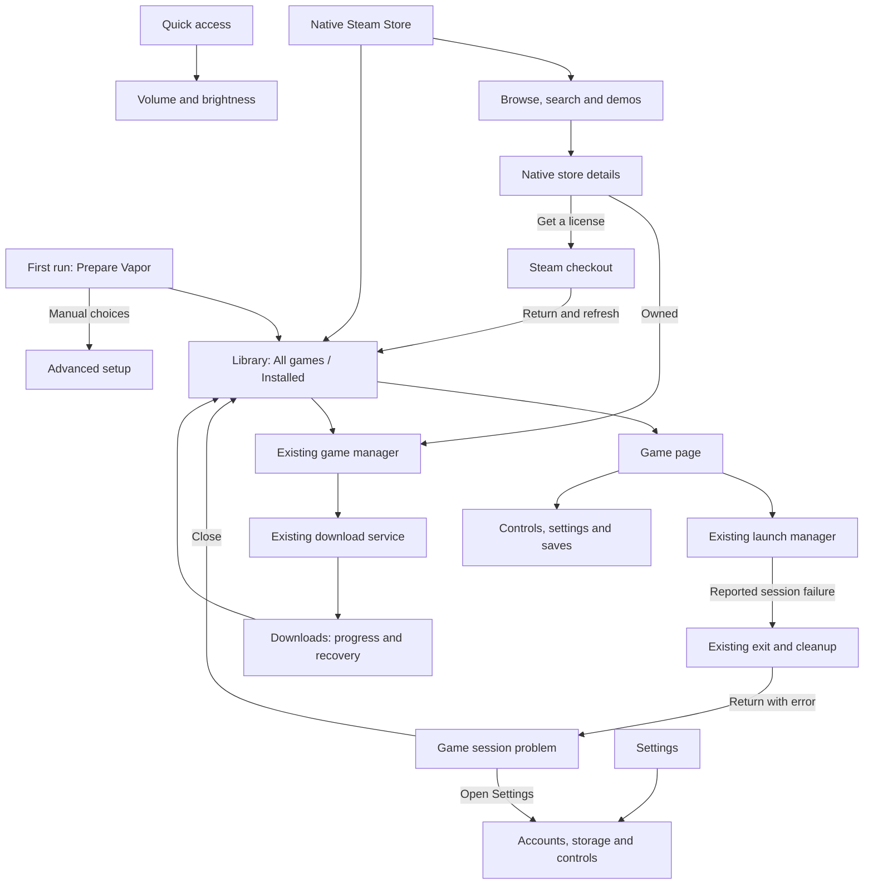

## Preview and implementation boundaries

`Vapor-UI-preview.html` is a standalone, clickable design reference. It uses sample game names, ownership and download progress. It does not log into Steam, download games, change the device or run a game. Game artwork loads from Steam's image CDN; the preview can open as a local file, with a connection needed for those images.

The preview covers Library, Store, game details, sample loading and failure states, Downloads, Settings and Quick access, with Handheld and Phone layout controls. It demonstrates screen transitions and focus; it is not an Android render or a second implementation of Vapor's services. It is a design reference, not pixel-for-pixel parity: narrow Settings uses scrolling section shortcuts in the preview and the existing section drawer in Android. Advanced sections in the preview are descriptive placeholders; the native routes open the actual inherited screens.

| Area | Actual native app | Preview |
| --- | --- | --- |
| Navigation and native catalog | Updated in this pass | Design representation with fixed examples |
| Owned games, installs and accounts | Existing real service owners; new catalog entry path | Sample data only |
| Installed-game action layout | Updated in this pass | Matching direction, with example text |
| Library artwork layout | Featured selected game added above the existing carousel/grid/list when space permits | Fixed installed examples; no compatibility claim |
| Downloads | Native cards and queue actions updated using existing services | Sample paused, failed and completed entries; local-only controls |
| Settings | Native navigation and Accounts & storage updated; existing tools/preferences screens retained | Grouped navigation and example account/storage content |
| Loading screen | Existing full-screen dialog simplified; phase-progress handoff corrected; existing runtime callbacks retained | Three explicitly labeled sample states; preview-only controls |
| Session error | Reported preparation/Steam-host error carried after existing cleanup; persistent dialog with saved UI state | One labeled sample error; Close/Escape and Settings navigation |
| Runtime and game compatibility | No new qualification | No game execution |

## Audit and follow-through

| Dimension | Evidence and status |
| --- | --- |
| Usability | Store discoverability, game action labels, download recovery controls and Settings organization improved in source. Native touch verification pending. |
| Accessibility | Larger controls, tab semantics, labeled actions and visible focus added. Native font scaling, TalkBack and controller reconnect pending. |
| Information architecture | Primary destinations separated from optional stores. Settings visible. Source complete for this pass, including grouped Settings navigation. |
| Visual design | Shared dark palette and blue accent; adaptive details. Browser wide/phone review completed, native rendering pending. |
| Interaction | Browser search, owned filter, details and quick access checked in the first pass. This continuation checked retry, pause/resume, cancellation/keep downloading, focus return, history clearing, empty queue and Settings navigation in the sample preview. Native checks remain separate. |
| Content | Compatibility remains unverified; ownership uses Steam records; prices and account region remain distinct. New labels use Android resources. Translations of new strings pending. |
| Performance | Inactive compositions removed, screenshot loading made lazy, and continuous decorative animations removed from the updated download/settings surfaces. No measured battery, FPS or startup improvement claimed. |
| Product goal | Local Steam gaming remains the purpose. No new streaming, backend or replacement OS work. |

The three source tasks from the previous pass are now implemented: Downloads presentation, Settings organization, and Library/detail continuity. This is **3 of 3 scoped UI implementation tasks**, not completion of Vapor or its alpha qualification.

Remaining checks, now that the user has resumed Android testing:

1. **Downloads:** verify real pause/resume/retry/cancel, process restart, completed/error states, controller selection and long errors. Confirm that Clear history preserves the existing service behavior for completed, cancelled and failed entries.
2. **Settings:** check touch, keyboard and controller navigation in the wide sidebar and narrow drawer; verify sign-in/out, folder pickers and runtime panel actions reach their existing owners. Review text at large font scales. The deeper inherited runtime and preferences screens have not all been visually redesigned.
3. **Library and Store:** check portrait/landscape, focus and scroll restoration, empty signed-in Library, a hidden Steam tab, cached offline ownership, download completion and return from checkout. The resumed pass verifies fresh download-to-Library behavior and both Play entry points. Keep manually restored-file recovery and sustained gameplay separate; an Installed label alone does not prove either.
4. **Loading:** check real cloud progress followed by an unmeasured phase, long names/status text, large fonts, TalkBack, artwork, generic installer loading and first-content dismissal.
5. **Session errors:** exercise real preparation and reported Steam-host failures, return after cleanup, repeated/late callbacks, normal and failed pinned launches, background return, Activity recreation and dismissal, Close and Settings, long errors and controller input. Verify process cleanup separately. Source/state tests do not prove this native journey.
6. **Save conflicts:** exercise device/cloud choices, cancellation, Back, unanswered dismissal, destruction, timeout and late callbacks in both Android-side and genuine-host paths. Verify no game starts or exit upload occurs after cancellation; verify actual transfer results, best-effort backup failures/restoration, long dates/text and controller scrolling. These are still native acceptance checks.
7. **Owner review:** review actual Android screens and the full browsing-to-install journey. Browser examples do not substitute for this. Translations of the new labels remain pending.

The resumed pass includes the existing emulator and normal app journey. It does not expand the runtime architecture or establish phone performance.

## Resumed app journey — 14 October 2026

The installed Steam details screen now offers Play through the same genuine-client launch path as the Library. It disables Play while the game has an unfinished download/update and explains the action needed. The ordinary installed-file query now uses existing marker and store-ownership recovery when its database row is stale and says not downloaded. See [the focused diagnosis](../specs/bugs/BUG-installed-steam-play.md); this does not retrospectively prove why an earlier manually restored demo disappeared.

Game settings put General, Graphics and Input Controls first, keep their existing state and callbacks, use the shared Vapor palette, and provide 48 dp navigation/Save/Cancel/dropdown controls. Selected sections use a static highlight and expose their selected state; the old continuously animated selection border was removed.

The APK and test APK build. The 49 focused JVM tests pass. In the emulator, 16 selected Compose tests pass; the eight new Play/settings checks also pass after reboot with landscape rotation requested. These isolated screen tests do not start the normal Application, Steam or a game. Normal app testing completed native Store search, a fresh Steam download, automatic Library insertion and both Play entry points. The demo reached its menu and country selection after matching its game resolution to the virtual screen; input remained inconsistent. Site Burial loaded the old save, advanced the story, created a new slot and reopened it after a full exit/relaunch. The demo files were verified into a private archive and uninstalled to restore Site Burial within the emulator's limited storage. Full settings/input/save acceptance remains broader than this pass. See [qualification evidence](QUALIFICATION.md) for screenshots, setup and limits.

Current artifact: `Vapor-0.1.0-journey-dev.apk`, 687,101,825 bytes, SHA-256 `c478e7bee2ea73ff9c94644de1e31521d8822bb4fb50ab7342c91cdc4ef0753c`. Receipt: `Vapor-journey-build-checks.json`. Debug signed, minimum SDK 29, target SDK 28; no public release was made.

## Earlier save-conflict UI verification — 14 October 2026

- `assembleStandardDebug`: passed. APK metadata, ARM64 ABI, conflict-dialog/sync DEX symbols and v2 signature were checked. Both rebuilt Steam hosts and probes match the APK assets byte for byte.
- **44 focused JVM tests passed**, zero failures/errors/skips: SteamCatalog 9, SteamLaunchRequirements 3, SteamLaunchExeFamily 8, WnLauncherStatusTailer 6, GameLaunchTiming 5, PreloaderDialogState 3, GameSessionFailure 7 and SteamCloudConflictDialog 3. The three new Robolectric checks exercise cancellation once, unanswered dismissal and Activity destruction without selecting a save. They do not execute Steam transfers or render an Android screen. The tailer test also covers the unresolved-conflict error.
- The portable C++ parser check passed for explicit local/cloud and rejected cancelled, partial, empty, unknown and null answers. Both 32-bit/64-bit Windows hosts and probes cross-built successfully. CI now includes the parser and dialog checks; no remote CI run was made.
- `git diff --check` and English resource XML validation passed. The existing binary inventory's 77 entries match the recorded inputs, including the rebuilt hosts and refreshed source hashes.
- Browser sample: Library → game → Play → Sample save conflict; initial Cancel focus; Tab/Shift+Tab containment including the checkbox; backup toggle; Cancel/Escape return to the original card; both explicit sample choices reach the sample starting step. Wide review used a 1143 × 727 CSS viewport and approximately 1086 px app frame. Phone review used a 540 × 1000 viewport with approximately 388 × 780 px app frame. A narrower default 285 px frame also wrapped without horizontal overflow. Short dialogs scroll; lower actions and backup text were reached. No console errors were observed. Captures use bounds adjusted for the browser's zoom; viewport overrides were reset.
- At this earlier checkpoint Android work was paused: no installation, real Steam/save operation, gameplay, loading benchmark or energy measurement. Native rendering, actual cancellation/cleanup, synchronization, backup restoration, font scaling, TalkBack, physical controllers and owner acceptance remain pending. Core game/device qualification stays **0/12**.

Earlier artifact: `Vapor-0.1.0-cloud-ui-dev.apk` (687,101,497 bytes), debug signed, ARM64, minimum SDK 29, target SDK 28, version 0.1.0-dev.
SHA-256: `e4f3e274274389d999897fc7c4ee8e126d2c3ec901174cf6ee8f5c197c747828`.
Receipt: `Vapor-cloud-UI-build-checks.json`. Prior APKs remain separate. No staging, commit, push, publication or release was made.

## Earlier session-error UI verification — 14 October 2026

- `assembleStandardDebug`: passed. APK package metadata, ARM64 ABI, the new dialog's DEX symbols and v2 signature were checked.
- **41 focused JVM tests passed**, zero failures/errors/skips: SteamCatalog 9, SteamLaunchRequirements 3, SteamLaunchExeFamily 8, WnLauncherStatusTailer 6, GameLaunchTiming 5, PreloaderDialogState 3 and GameSessionFailure 7. The seven new tests cover one-time delivery, ordinary return, recreation of a visible message, dismissed-message replay, later failure, missing game name and empty/malformed delivery. They test the handoff value and saved-state helpers, not real Activity transitions or Compose rendering.
- `git diff --check`: passed. English resource XML parsed without duplicate keys.
- Browser sample: Library → game → Play → Sample failure; initial Close focus; Tab/Shift+Tab containment; Close/Escape return to the original game card; a later game supplies its own name; Open Settings reaches Accounts & storage. No console errors were observed. Wide layout was reviewed at a 1143 × 727 CSS viewport (approximately 1086 px app frame), and the Phone setting at a 540 × 303 viewport (approximately 388 px app frame, 780 px tall and document-scrollable). The error content had no horizontal overflow. Captures account for the browser's existing zoom; temporary viewport overrides were reset.
- The APK was not installed or run. Actual cleanup/return, Android layout, long text and font scaling, TalkBack, controller input and owner acceptance remain pending. Android work stays paused. Core game/device qualification remains **0/12**; no speed or battery improvement is established.

Session-error artifact: `Vapor-0.1.0-recovery-ui-dev.apk` (687,099,113 bytes), debug signed, ARM64, minimum SDK 29, target SDK 28, version 0.1.0-dev.
SHA-256: `a7879f9fe03f9f4c7224a0581f216bb0dd2a2ecee6f0164d52b15eb44ff8791f`.
Receipt: `Vapor-recovery-UI-build-checks.json`. Prior APKs are preserved. No staging, commit, push, publication or release was made.

## Earlier loading UI verification — 14 October 2026

- `assembleStandardDebug`: passed. The APK's v2 signature and package metadata were verified.
- **34 focused JVM tests passed**, with zero failures/errors/skips: SteamCatalog 9, SteamLaunchRequirements 3, SteamLaunchExeFamily 8, WnLauncherStatusTailer 6, GameLaunchTiming 5 and PreloaderDialogState 3. The three new tests cover transfer-to-launch percentage reset while retaining game metadata, later measured progress, and progress bounds. JVM tests do not render Android UI.
- `git diff --check`: passed.
- Browser design review: 1144 × 727 browser viewport with a 1088 px wide app frame, plus the 390 px Phone frame. The loading views had no horizontal overflow. Sample progress changed from no value to 65% and back to no value. Reverse Tab and Tab stayed inside the dialog; Back and Escape returned focus to Play and then the original Library card. No browser console errors were recorded in this review. Screenshots show sample data, not the APK running.
- Native installation/rendering, font-scale and TalkBack checks, physical controls, game loading measurements and owner acceptance remain pending. Android work stays paused. Core game/device qualification remains **0/12**.

Loading UI artifact: `Vapor-0.1.0-launch-ui-dev.apk` (682,351,401 bytes), debug signed, ARM64, minimum SDK 29, target SDK 28.
SHA-256: `3394def90da2ec8480d4f34e39f81fd23f153fb19e70826e9a7ac6da7fe193ae`.
Receipt: `Vapor-launch-UI-build-checks.json`. Earlier UI and loading-diagnostics APKs are preserved separately. No commit, push or release was made.

## Earlier UI build verification — 13 October 2026

- `assembleStandardDebug`: passed.
- Focused JVM tests: **23 passed**, zero failures/errors across Steam catalog parsing, genuine launch requirements, status reporting and executable-family selection. These tests do not exercise the new Android layouts.
- `git diff --check`: passed.
- Browser preview: inspected 1144 px browser width and 390 px phone frames. Downloads and Settings had 388 px content and 388 px scroll width in the phone check; the Settings section strip scrolls within its own boundary. Retry, cancellation and Keep downloading, focus return, cancellation of all sample entries, Clear history, empty state, and Advanced navigation were exercised. No console errors were recorded in the inspected browser session. These are sample UI checks only.
- APK packaging checked for the updated download, settings and library UI symbols and manifest; APK v2 signature verified. The build remains ARM64, minimum SDK 29, target SDK 28, development debug signed.
- **No Android install, native screenshot, physical-controller test, game-performance result or owner acceptance is claimed for this build.**

Artifact: `Vapor-0.1.0-ui-dev.apk`.
SHA-256: `8d24b88d8a86c6f724b12345d218577473535ae7c89e4efa09736ccca664e0fb`.
The build receipt records changed UI source hashes and test counts in `Vapor-UI-build-checks.json`. The checkout remains local and dirty; no commit, push or release was made.

## Launch-settings continuation — 14 October 2026

Preparation errors now carry the existing shortcut identity through the existing return Intent and saved state. **Game settings** resolves that shortcut from the current Library and opens its normal editor. Native Steam-host failures retain **Open Settings** for account recovery. There is no error database or automatic retry.

A malformed Europa Universalis III demo configuration was tested through Library → Play: preparation stopped, cleanup returned to the Library, the error rendered, and the game-specific settings action opened the correct editor. The landscape dialog scrolls to its second action. Two new Compose cases verify the actions; the selected UI suite passes 18 tests. Host tests verify the destination survives delivery/recreation. Physical-controller and TalkBack validation remain pending.

Automatic display preparation uses the existing game-fix owner and the actual post-scale virtual screen. Its first rule is limited to Steam app 22150; driver selection, graphics quality and emulator-only flags were not generalized. See QUALIFICATION.md for the exact artifact, native file checks and test-environment limitations.
